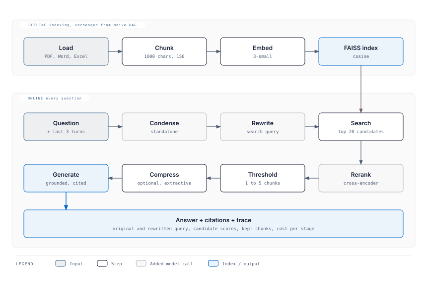
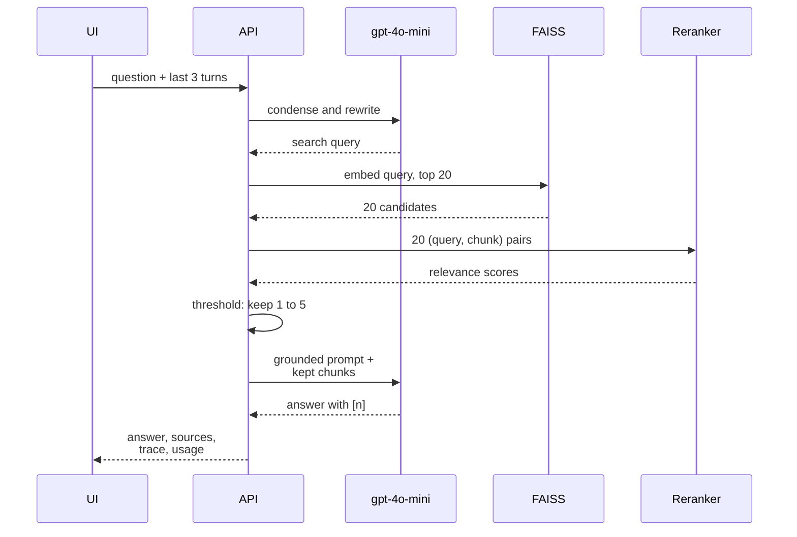

# 11. Advanced RAG Architecture End to End

In this note:

- The whole pipeline on one page
- Every stage: input, output, model, time and cost
- A worked example traced through every stage
- The latency and cost budget, and the design choice it forces
- Fallbacks when a stage fails
- The trace returned with every answer
- Settings
- Naive RAG and Advanced RAG side by side

## The whole pipeline



Indexing does not change: the same loaders, chunker (1000 characters, 150 overlap), text-embedding-3-small embeddings and FAISS index as Naive RAG. Everything new happens at question time, around retrieval.



## Every stage

<table width="100%">
<thead><tr><th>#</th><th>Stage</th><th>Input</th><th>Output</th><th>Model</th><th>Note</th></tr></thead>
<tbody>
<tr><td>1</td><td>Condense and rewrite</td><td>Question, last 3 turns</td><td>One standalone search query</td><td>gpt-4o-mini, temperature 0</td><td>03, 05</td></tr>
<tr><td>2</td><td>Embed query</td><td>Search query</td><td>1536-number vector</td><td>text-embedding-3-small</td><td>Naive RAG 05</td></tr>
<tr><td>3</td><td>Candidate search</td><td>Query vector</td><td>Top 20 chunks with cosine scores</td><td>FAISS IndexFlatIP</td><td>06</td></tr>
<tr><td>4</td><td>Rerank</td><td>Original question (standalone form) and 20 chunks</td><td>20 relevance scores, new order</td><td>Cross-encoder</td><td>07, 08</td></tr>
<tr><td>5</td><td>Threshold and dynamic k</td><td>Scored chunks</td><td>1 to 5 kept chunks, or none</td><td>None (rule)</td><td>09</td></tr>
<tr><td>6</td><td>Compress (optional)</td><td>Kept chunks</td><td>Verbatim key sentences</td><td>Reranker or embeddings</td><td>10</td></tr>
<tr><td>7</td><td>Generate</td><td>Standalone question, user's wording, kept chunks</td><td>Answer with [n] citations</td><td>gpt-4o-mini, same prompt as Naive RAG</td><td>Naive RAG 09</td></tr>
</tbody>
</table>

Two details matter: the reranker scores chunks against the **standalone question** (what the user means), not against the keyword-heavy search query; and the generator answers the user's question, not the rewrite (note 03).

## Worked example

A two-turn conversation over the indexed papers. The values for Advanced RAG are the expected behaviour that the implementation will have to confirm.

```text
Turn 1  User: What is the original RAG paper about?
        Assistant: It combines a pre-trained seq2seq generator with a dense retriever over Wikipedia ... [1]
Turn 2  User: Which retriever and generator does it combine?
```

<table width="100%">
<thead><tr><th>Stage</th><th>Value</th></tr></thead>
<tbody>
<tr><td>1 Condense and rewrite</td><td>Standalone: "Which retriever and generator does the original RAG model (Lewis et al.) combine?" Search query: "RAG Lewis et al. retriever and generator components: dense passage retriever DPR, BART seq2seq generator"</td></tr>
<tr><td>2-3 Search</td><td>20 candidates; Naive RAG's top 4 for this question had only one useful chunk, and the passage naming DPR and BART was missing; with 20 candidates and a query that contains the terms, that passage should be inside</td></tr>
<tr><td>4 Rerank</td><td>The chunk saying "The retriever (Dense Passage Retriever, henceforth DPR) provides latent documents conditioned on the input, and the seq2seq model (BART) then conditions on these latent documents" (RAG paper, page 2) should rise to the top; the Corrective RAG chunks that ranked high in Naive RAG should fall</td></tr>
<tr><td>5 Threshold</td><td>Keeps the 1 or 2 chunks above the threshold</td></tr>
<tr><td>7 Generate</td><td>"The original RAG model combines a Dense Passage Retriever (DPR) ... with a BART-large generator ... [1]"</td></tr>
<tr><td>Expected change</td><td>Naive RAG correctness on this question was 0.25 to 0.50; the target is 1.0, with context precision rising from 0.25 to 0.5 or more</td></tr>
</tbody>
</table>

## Latency and cost budget

Estimates with gpt-4o-mini prices ($0.15 per million input tokens, $0.60 per million output) and Naive RAG's measured timings:

<table width="100%">
<thead><tr><th>Stage</th><th>Tokens</th><th>Cost (USD)</th><th>Time</th></tr></thead>
<tbody>
<tr><td>Condense and rewrite (one call)</td><td>about 500 in, 40 out</td><td>0.000099</td><td>0.5 to 1 s</td></tr>
<tr><td>Embed query</td><td>about 20</td><td>0.0000004</td><td>part of the about 1 s embedding call measured in Naive RAG</td></tr>
<tr><td>FAISS top 20</td><td>-</td><td>0</td><td>about 1 ms</td></tr>
<tr><td>Rerank 20 (local cross-encoder)</td><td>-</td><td>0</td><td>0.1 to 0.3 s</td></tr>
<tr><td>Threshold</td><td>-</td><td>0</td><td>under 1 ms</td></tr>
<tr><td>Generate with 2 to 3 chunks</td><td>about 900 in, 120 out</td><td>0.000207</td><td>1 to 1.5 s</td></tr>
<tr><td><b>Total</b></td><td></td><td><b>about 0.00031 (Rs 0.026)</b></td><td><b>about 2.6 to 3.8 s</b></td></tr>
</tbody>
</table>

Against the targets (under Rs 0.04, under 3 s), cost is fine; **latency is the tight part**. That forces two design choices:

- **Condense and rewrite in one LLM call**, not two (two calls would add another 0.5 to 1 s).
- **Skip the call when it is not needed:** first question of a chat that is already specific and long. Then the pipeline is close to Naive RAG's 1.7 s plus reranking.

Streaming the answer (showing tokens as they are generated) would also hide much of the generation time in the UI; it is a separate feature that can be added later.

## Fallbacks

Every added stage must fail safely back to Naive RAG behaviour, never to an error:

<table width="100%">
<thead><tr><th>Failure</th><th>Fallback</th></tr></thead>
<tbody>
<tr><td>Condense or rewrite call fails or times out</td><td>Search with the original question</td></tr>
<tr><td>Reranker unavailable</td><td>Use the cosine order and keep the top 4 (exactly Naive RAG)</td></tr>
<tr><td>Threshold keeps nothing</td><td>Fixed not-found answer without calling the generator (or keep the best chunk if the floor is disabled)</td></tr>
<tr><td>Compression fails</td><td>Send the kept chunks unchanged</td></tr>
</tbody>
</table>

Each fallback is logged, so the evaluation and the logs show how often a stage did not run.

## The trace

Every answer returns a **trace** of the pipeline, used by the logs, the UI and the evaluation:

<table width="100%">
<thead><tr><th>Field</th><th>Content</th></tr></thead>
<tbody>
<tr><td>original_question</td><td>As typed</td></tr>
<tr><td>standalone_question, search_query</td><td>After condense and rewrite (equal to the original if skipped)</td></tr>
<tr><td>candidates</td><td>Each of the 20: file, page, cosine score, cosine rank, reranker score, reranker rank, kept or dropped</td></tr>
<tr><td>kept</td><td>The chunks sent to the generator</td></tr>
<tr><td>stages</td><td>Time and tokens for each stage, fallbacks used</td></tr>
<tr><td>usage</td><td>Total tokens and cost in USD and INR, as in Naive RAG</td></tr>
</tbody>
</table>

## Settings

<table width="100%">
<thead><tr><th>Setting</th><th>Default</th><th>Controls</th></tr></thead>
<tbody>
<tr><td>REWRITE_ENABLED</td><td>true</td><td>Condense and rewrite stage</td></tr>
<tr><td>HISTORY_TURNS</td><td>3</td><td>Turns sent for condensing</td></tr>
<tr><td>CANDIDATE_K</td><td>20</td><td>First-stage candidates</td></tr>
<tr><td>RERANKER</td><td>cross-encoder</td><td>Reranker implementation (cross-encoder, llm, none)</td></tr>
<tr><td>RERANK_THRESHOLD</td><td>tuned on the test set</td><td>Minimum reranker score to keep a chunk</td></tr>
<tr><td>MIN_CHUNKS, MAX_CHUNKS</td><td>1, 5</td><td>Bounds on kept chunks</td></tr>
<tr><td>COMPRESSION</td><td>none</td><td>none or extractive</td></tr>
</tbody>
</table>

Each stage can be switched off, which is what the evaluation needs to measure the effect of one stage at a time (note 12).

## Naive RAG and Advanced RAG side by side

<table width="100%">
<thead><tr><th>Aspect</th><th>Naive RAG</th><th>Advanced RAG</th></tr></thead>
<tbody>
<tr><td>Query used for search</td><td>As typed</td><td>Standalone, rewritten</td></tr>
<tr><td>Follow-up questions</td><td>Not supported</td><td>Supported (last 3 turns)</td></tr>
<tr><td>Chunks searched for</td><td>4</td><td>20</td></tr>
<tr><td>Ranking</td><td>Cosine only</td><td>Cosine, then cross-encoder</td></tr>
<tr><td>Chunks sent</td><td>Always 4</td><td>1 to 5, by score</td></tr>
<tr><td>LLM calls</td><td>1</td><td>2 (1 when the rewrite is skipped)</td></tr>
<tr><td>Expected cost per question</td><td>Rs 0.02 (measured)</td><td>about Rs 0.026</td></tr>
<tr><td>Expected time</td><td>1.7 s (measured)</td><td>about 2.6 to 3.8 s</td></tr>
<tr><td>Visibility</td><td>Sources and usage</td><td>Plus the full trace</td></tr>
</tbody>
</table>

## Key points

- Indexing is unchanged; condense and rewrite, wide search, rerank, threshold and optional compression are added at question time.
- The reranker scores against the standalone question; the generator answers the user's question.
- Expected cost about Rs 0.026 per question, within budget; latency is tight, so condense and rewrite are one call and skipped when not needed.
- Every stage falls back to Naive RAG behaviour on failure, and every answer carries a trace.
- Every stage can be switched off, so its effect can be measured alone.

## Navigation

Previous: [10. Context Compression and Filtering](10.%20Context%20Compression%20and%20Filtering.md) | [Index](README.md) | Next: 12. Evaluating Advanced RAG (next)
