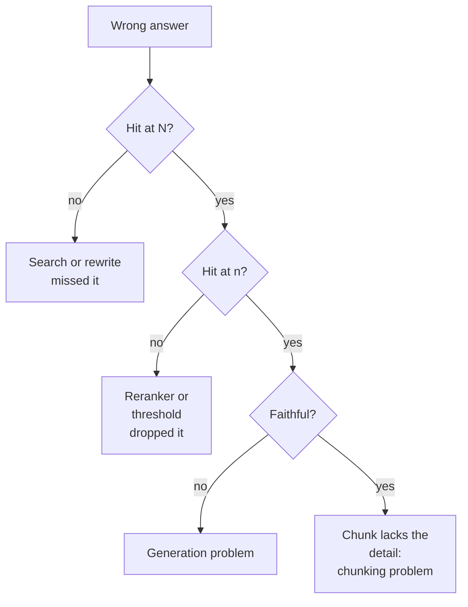
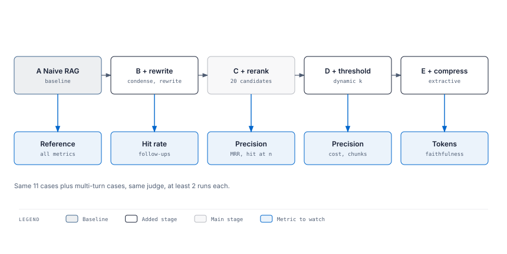

# 12. Evaluating Advanced RAG

In this note:

- What the evaluation must prove
- Rules for a fair comparison with Naive RAG
- Extending the test set without losing comparability
- The metrics: existing judge metrics plus stage-level retrieval metrics
- Ablation: measuring one stage at a time
- Decision rules: when a stage is kept
- Pitfalls, including ways a metric can be gamed
- The report

## What the evaluation must prove

Two things:

1. **Advanced RAG is better than Naive RAG** on the measures that matter (correctness, context precision, hit rate) without getting worse on faithfulness, cost or latency beyond the budget.
2. **Which stage caused the gain.** If the whole pipeline is better, we still need to know whether rewriting, reranking or the threshold did the work, so that useless stages (which cost time and money) can be removed.

## Fair comparison rules

<table width="100%">
<thead><tr><th>Keep fixed</th><th>Why</th></tr></thead>
<tbody>
<tr><td>Documents and index (same 6 files, same chunking)</td><td>A different index changes what can be found</td></tr>
<tr><td>Test cases and reference answers</td><td>Different questions give different scores</td></tr>
<tr><td>Judge model, prompt, temperature 0</td><td>The ruler must not change between runs</td></tr>
<tr><td>Generator model, prompt, temperature</td><td>Advanced RAG changes the context, not the writer</td></tr>
<tr><td>At least 2 runs per configuration</td><td>Identical Naive RAG runs scored 0.79 and 0.81: differences under about 0.03 are noise</td></tr>
</tbody>
</table>

The Naive RAG baseline (top 4, mean of three runs) is the reference: overall 0.80, faithfulness 0.95, relevance 0.98, context precision 0.41, correctness 0.85, hit rate 90 percent, Rs 0.02 and 1.7 s per question.

## Extending the test set

The 11 Naive RAG cases contain no follow-ups and only a few hard retrieval cases. New cases are needed for the new abilities, but the original 11 must stay unchanged so the comparison with the baseline remains valid.

<table width="100%">
<thead><tr><th>Group</th><th>Cases</th><th>Purpose</th></tr></thead>
<tbody>
<tr><td>Core (unchanged)</td><td>The 11 Naive RAG cases</td><td>Direct comparison with the baseline</td></tr>
<tr><td>Multi-turn</td><td>Pronoun, ellipsis and topic-change follow-ups (note 05)</td><td>Conversational rewriting</td></tr>
<tr><td>Hard retrieval</td><td>Questions that use different words from the documents, and questions where similar papers compete</td><td>Rewriting and reranking</td></tr>
</tbody>
</table>

Scores are reported separately for the core group and for the extended set. The Naive RAG pipeline is also run on the new cases, so they have their own baseline.

## Metrics

### Existing end-to-end metrics (LLM judge, Naive RAG docs 24 to 26)

Faithfulness, answer relevance, context precision, correctness, overall, and the file-level retrieval hit rate. They stay exactly as defined, so the numbers are comparable.

### New stage-level metrics

Advanced RAG has more stages, so it needs metrics that look **inside** the pipeline, computed from the trace (note 11):

<table width="100%">
<thead><tr><th>Metric</th><th>Definition</th><th>Tells you</th></tr></thead>
<tbody>
<tr><td>Hit rate at N (candidates)</td><td>Expected file among the 20 candidates</td><td>Did the search (and the rewrite) find it at all?</td></tr>
<tr><td>Hit rate at n (kept)</td><td>Expected file among the chunks sent to the generator</td><td>Did reranking and the threshold keep it?</td></tr>
<tr><td>Rank of first relevant chunk, before and after reranking</td><td>Position by cosine and by reranker score</td><td>How much the reranker moved the right chunk</td></tr>
<tr><td>MRR@N before and after reranking</td><td>Mean of 1 / rank of the first relevant chunk (note 08)</td><td>Ranking quality of each stage</td></tr>
<tr><td>Average kept chunks</td><td>Mean number of chunks sent</td><td>Prompt size; whether the threshold is too strict or too loose</td></tr>
<tr><td>Rewrite faithfulness</td><td>Judge check: does the rewritten query keep the meaning of the question without adding facts?</td><td>Whether rewriting drifts</td></tr>
<tr><td>Fallback rate</td><td>Share of questions where a stage fell back</td><td>Reliability of each stage</td></tr>
<tr><td>Latency and cost per stage</td><td>From the trace</td><td>Whether the budget holds</td></tr>
</tbody>
</table>

Reading them together locates problems:

## Ablation: one stage at a time

<table width="100%">
<thead><tr><th>Run</th><th>Configuration</th><th>Expected to move</th><th>Must not get worse</th></tr></thead>
<tbody>
<tr><td>A</td><td>Naive RAG (baseline, top 4)</td><td>-</td><td>-</td></tr>
<tr><td>B</td><td>A + condense and rewrite</td><td>Hit rate, multi-turn correctness</td><td>Faithfulness, core correctness</td></tr>
<tr><td>C</td><td>B + 20 candidates + reranking, keep top 4</td><td>MRR, context precision, correctness</td><td>Hit rate at n, latency budget</td></tr>
<tr><td>D</td><td>C + threshold and dynamic k (1 to 5)</td><td>Context precision, prompt tokens, cost</td><td>Hit rate at n, correctness</td></tr>
<tr><td>E</td><td>D + extractive compression (optional)</td><td>Prompt tokens</td><td>Faithfulness, correctness</td></tr>
</tbody>
</table>

Run C keeps 4 chunks on purpose: it isolates the effect of better **ordering** from the effect of sending **fewer** chunks (run D). A second useful check is reranking without rewriting (A + rerank), to see whether the reranker alone explains most of the gain.

## Decision rules

A stage stays in the default pipeline only if all of these hold, averaged over at least two runs:

1. Its target metric improves by more than the noise level (about 0.03 for judge scores).
2. Faithfulness and core correctness do not drop by more than the noise level.
3. The whole pipeline stays within the budget: under Rs 0.04 and under 3 s per question.

If a stage helps only one group (for example rewriting helps multi-turn cases but not the core cases), it can stay with a condition (for example only when history is present).

## Pitfalls

<table width="100%">
<thead><tr><th>Pitfall</th><th>What happens</th><th>Guard</th></tr></thead>
<tbody>
<tr><td>Gaming context precision</td><td>Sending only 1 chunk raises precision trivially, even if it is the wrong chunk</td><td>Always read precision together with hit rate at n and correctness</td></tr>
<tr><td>Overfitting the threshold</td><td>A threshold tuned on 11 questions may not generalise</td><td>Tune on the extended set; prefer a round value in the stable range; report the curve, not just the best point</td></tr>
<tr><td>Small test set</td><td>One question changes overall by about 0.02 to 0.05</td><td>Report per-case changes, not only averages; grow the test set over time</td></tr>
<tr><td>Judge sensitivity to context length</td><td>A judge may grade answers with shorter contexts differently</td><td>Correctness uses the reference answer, which does not depend on the context</td></tr>
<tr><td>Changing two things at once</td><td>Gains cannot be attributed</td><td>The ablation ladder</td></tr>
<tr><td>Ignoring cost and latency</td><td>A "better" pipeline that is too slow or expensive to use</td><td>Budget is a decision rule, not a footnote</td></tr>
</tbody>
</table>

## The report

The Advanced RAG API docs will end with a comparison report in this shape:

<table width="100%">
<thead><tr><th>Metric</th><th>Naive RAG (A)</th><th>B</th><th>C</th><th>D</th><th>Change A to D</th></tr></thead>
<tbody>
<tr><td>Overall</td><td>0.80</td><td>to measure</td><td>to measure</td><td>to measure</td><td>target +0.05</td></tr>
<tr><td>Context precision</td><td>0.41</td><td>to measure</td><td>to measure</td><td>to measure</td><td>target +0.24</td></tr>
<tr><td>Correctness</td><td>0.85</td><td>to measure</td><td>to measure</td><td>to measure</td><td>target +0.05</td></tr>
<tr><td>Hit rate at n</td><td>90%</td><td>to measure</td><td>to measure</td><td>to measure</td><td>target 95%+</td></tr>
<tr><td>Faithfulness</td><td>0.95</td><td>to measure</td><td>to measure</td><td>to measure</td><td>no drop</td></tr>
<tr><td>Cost per question</td><td>Rs 0.02</td><td>to measure</td><td>to measure</td><td>to measure</td><td>under Rs 0.04</td></tr>
<tr><td>Time per question</td><td>1.7 s</td><td>to measure</td><td>to measure</td><td>to measure</td><td>under 3 s</td></tr>
</tbody>
</table>

The Evals page in the UI will show the same comparison per run and per case, so a regression on a single question is visible, not hidden in an average.

## Key points

- Prove two things: Advanced RAG beats the baseline, and which stage caused it.
- Keep everything fixed except the pipeline; run each configuration at least twice; ignore changes under about 0.03.
- Keep the 11 core cases unchanged and add multi-turn and hard-retrieval cases as a separate group.
- Add stage metrics from the trace: hit rate at N and at n, rank and MRR before and after reranking, kept chunks, rewrite faithfulness, fallbacks, cost and latency per stage.
- Add one stage per run; keep a stage only if it beats noise without hurting faithfulness, correctness or the budget.

## Navigation

Previous: [11. Advanced RAG Architecture End to End](11.%20Advanced%20RAG%20Architecture%20End%20to%20End.md) | [Index](README.md) | Next: [13. Cost and Latency Trade-offs](13.%20Cost%20and%20Latency%20Trade-offs.md)
