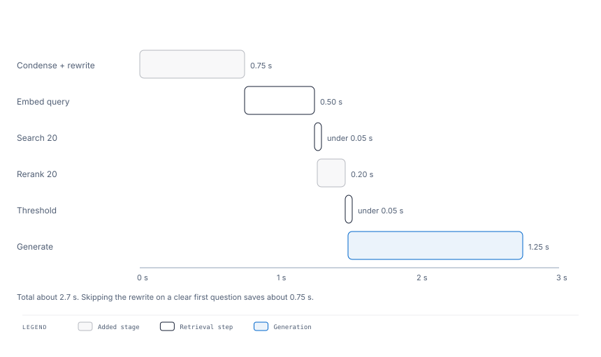
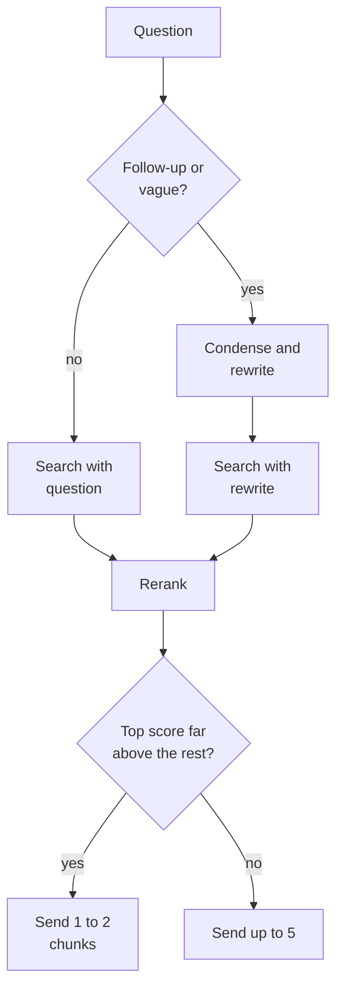

# 13. Cost and Latency Trade-offs

In this note:

- How to calculate the cost and the time of one answer
- Where the time goes, stage by stage
- Typical and worst-case latency (p50 and p95)
- Every lever that reduces cost or latency, and what it costs in quality
- Caching, including semantic caching and its risks
- What it costs at different traffic levels
- How to measure it in this project

## Cost of one answer

Every stage that calls a paid model adds its tokens times the price per token:

$$C = \sum_{s \in \text{stages}} \frac{T^{in}_s \cdot P^{in}_s + T^{out}_s \cdot P^{out}_s}{10^6}$$

<table width="100%">
<thead><tr><th>Symbol</th><th>Meaning</th><th>Values here</th></tr></thead>
<tbody>
<tr><td>T_in_s, T_out_s</td><td>Input and output tokens of stage s</td><td>From the API's usage field</td></tr>
<tr><td>P_in_s, P_out_s</td><td>Price per million tokens for the model of stage s</td><td>gpt-4o-mini $0.15 in, $0.60 out; text-embedding-3-small $0.02</td></tr>
</tbody>
</table>

A local cross-encoder has no per-token price; its cost is the CPU it runs on. With the estimates of note 11, one Advanced RAG answer costs about $0.00031 (Rs 0.026), against Naive RAG's measured Rs 0.02. Two details from those numbers:

- The **generation call is still the biggest cost**, and it gets cheaper when the threshold sends fewer chunks.
- The **rewrite call is the main new cost**, about a third of the total.

## Where the time goes

The stages run one after another, so the total time is their sum:

$$T = T_{rewrite} + T_{embed} + T_{search} + T_{rerank} + T_{threshold} + T_{generate}$$

With the estimates in the figure, T is about 2.7 s against Naive RAG's 1.7 s. The two LLM calls (rewrite and generate) are about three quarters of it. Search and the threshold are under 50 ms together. Optimising them is pointless; optimising the LLM calls and the reranker is where time is won.

## Typical and worst case

Averages hide slow answers. Latency is reported as percentiles:

<table width="100%">
<thead><tr><th>Measure</th><th>Meaning</th><th>Why it matters</th></tr></thead>
<tbody>
<tr><td>p50 (median)</td><td>Half of the answers are faster than this</td><td>The typical experience</td></tr>
<tr><td>p95</td><td>95 percent of the answers are faster than this</td><td>The slow answers users remember; LLM APIs have long tails</td></tr>
</tbody>
</table>

An Azure OpenAI call that usually takes 0.7 s can sometimes take 3 s. With two LLM calls in a row, the chance that at least one is slow roughly doubles, so the p95 of Advanced RAG grows more than its p50. This is one more reason to skip the rewrite call when it is not needed.

## Levers

<table width="100%">
<thead><tr><th>Lever</th><th>Saves</th><th>Quality cost</th><th>Note</th></tr></thead>
<tbody>
<tr><td>Condense and rewrite in one call</td><td>About 0.5 to 1 s and one call of tokens</td><td>None if the prompt does both well</td><td>05, 11</td></tr>
<tr><td>Skip the rewrite for clear first questions</td><td>About 0.75 s and Rs 0.004 on those questions</td><td>Small: those questions need it least</td><td>03</td></tr>
<tr><td>Threshold (fewer chunks)</td><td>Generation input tokens and some generation time</td><td>None if tuned; risk of dropping evidence if too strict</td><td>09</td></tr>
<tr><td>Smaller candidate set N</td><td>Reranker time (it grows with N)</td><td>Lower recall if N is too small</td><td>06</td></tr>
<tr><td>Smaller or optimised reranker (MiniLM, ONNX, quantised)</td><td>Reranker time</td><td>Some ranking quality</td><td>08</td></tr>
<tr><td>Batch all reranker pairs in one call</td><td>Overhead of 20 separate calls</td><td>None</td><td>08</td></tr>
<tr><td>Cap answer length (max tokens)</td><td>Output tokens and generation time</td><td>Truncated answers if too low</td><td>Naive RAG settings</td></tr>
<tr><td>Streaming the answer</td><td>Perceived time: the first words appear after a fraction of a second</td><td>None; total time unchanged</td><td>UI feature</td></tr>
<tr><td>Run things in parallel</td><td>For example embed and search the original question while the rewrite runs, then use whichever is better</td><td>More complexity, extra search cost</td><td>Optional</td></tr>
<tr><td>Caching</td><td>Repeated work on repeated questions</td><td>Stale or wrong answers if done carelessly</td><td>Below</td></tr>
</tbody>
</table>

## Caching

<table width="100%">
<thead><tr><th>Cache</th><th>Key</th><th>Saves</th><th>Risk</th></tr></thead>
<tbody>
<tr><td>Embedding cache</td><td>Exact query text</td><td>The embedding call (about 1 s here) for repeated queries</td><td>None: embeddings do not change</td></tr>
<tr><td>Rewrite cache</td><td>Question + recent history</td><td>The rewrite call</td><td>Low; history must be part of the key</td></tr>
<tr><td>Exact answer cache</td><td>Exact question (standalone form)</td><td>The whole pipeline</td><td>Stale answers after documents change: clear on upload and delete</td></tr>
<tr><td>Semantic cache</td><td>Embedding of the question; reuse an answer if a past question is very similar</td><td>The whole pipeline for paraphrased questions</td><td>Wrong answers when two similar-looking questions need different answers ("sick days" versus "leave days")</td></tr>
</tbody>
</table>

Rule: cache what is **deterministic** (embeddings, rewrites at temperature 0) freely; cache **answers** only with invalidation on document changes, and use semantic caching only with a strict similarity threshold and evaluation.

## Cost at different traffic levels

At about Rs 0.026 per question (Advanced RAG, estimated) and Rs 0.02 (Naive RAG, measured), over 30 days:

<table width="100%">
<thead><tr><th>Questions per day</th><th>Naive RAG per month</th><th>Advanced RAG per month</th><th>Difference</th></tr></thead>
<tbody>
<tr><td>100</td><td>Rs 60</td><td>Rs 78</td><td>Rs 18</td></tr>
<tr><td>1,000</td><td>Rs 600</td><td>Rs 780</td><td>Rs 180</td></tr>
<tr><td>10,000</td><td>Rs 6,000</td><td>Rs 7,800</td><td>Rs 1,800</td></tr>
</tbody>
</table>

Plus the machine that runs the reranker (a small CPU server handles many questions per second with a MiniLM-size model). For most uses the extra spend is small compared with the value of fewer wrong answers; the question to ask is the cost of one wrong answer for the use case.

## Not every question needs every stage

The biggest saving comes from **not running stages that do not help a given question**:

- a clear, specific question does not need a rewrite;
- a question whose top candidate scores far above the rest does not need 5 chunks;
- a greeting or a question outside the documents does not need retrieval at all.

Deciding per question is the idea behind [10. Adaptive RAG](../../../10.%20Adaptive%20RAG/) (a classifier routes each query to no retrieval, single-step or multi-step retrieval). Advanced RAG uses the simple rules above; Adaptive RAG learns them.

## Measuring it in this project

The Advanced RAG trace records time and tokens per stage (note 11), and the usage file records each run as in Naive RAG. The analytics page will show cost per question and per stage. The evaluation reports p50 and p95 latency and cost per question for each ablation run (note 12), so every stage's price is known next to its quality gain.

## Key points

- Cost = sum over stages of tokens times price; the generation call is still the biggest, the rewrite is the main new cost.
- Time = sum of sequential stages; the two LLM calls dominate, search and thresholds are almost free.
- Watch p95, not just the average: two LLM calls in a row make slow answers more likely.
- Main levers: one combined rewrite call, skipping it when not needed, fewer chunks, a small batched reranker, streaming, safe caching.
- Expected extra cost is about Rs 0.006 per question (Rs 180 per month at 1,000 questions a day); the biggest saving is not running stages a question does not need.

## Navigation

Previous: [12. Evaluating Advanced RAG](12.%20Evaluating%20Advanced%20RAG.md) | [Index](README.md) | Next: [14. Limitations of Advanced RAG](14.%20Limitations%20of%20Advanced%20RAG.md)
