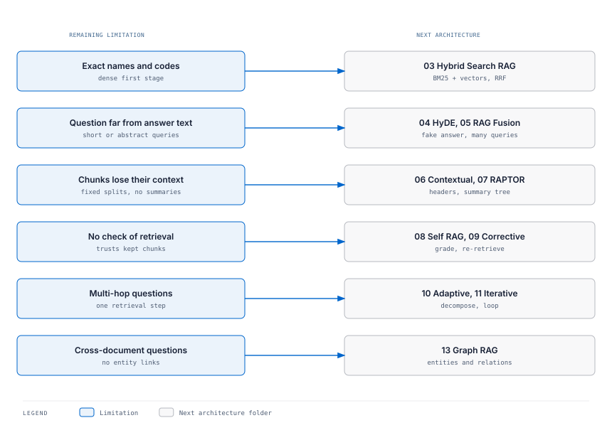
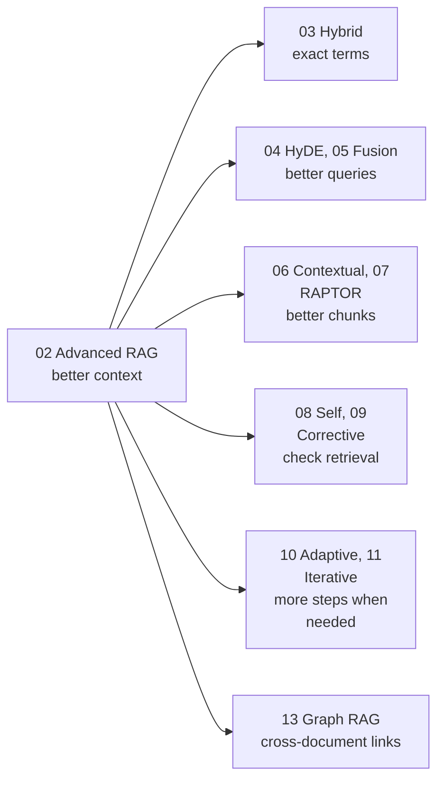

# 14. Limitations of Advanced RAG

In this note:

- What Advanced RAG fixes and what it cannot
- Limitations inherited from Naive RAG
- New limitations that Advanced RAG introduces
- Each limitation mapped to the architecture that addresses it
- Why Advanced RAG is still a strong default

## What it fixes and what it cannot

Advanced RAG improves **which chunks reach the prompt**: better queries, more candidates, a precise reranker and a threshold. It does not change the shape of the pipeline: one query, one retrieval, one generation, with no checking and no loops. Everything that needs a different shape remains a limitation.

## Limitations inherited from Naive RAG

<table width="100%">
<thead><tr><th>Limitation</th><th>Why Advanced RAG does not remove it</th><th>Example</th><th>Next architecture</th></tr></thead>
<tbody>
<tr><td>Exact names, codes and acronyms</td><td>The first stage is still dense search; a chunk that is not among the 20 candidates can never be reranked to the top</td><td>"DPR", a product code, an employee ID</td><td><a href="../../../03.%20Hybrid%20Search%20RAG/">03. Hybrid Search RAG</a></td></tr>
<tr><td>Single retrieval step</td><td>One query, one search; information spread over several chunks or documents may not all be found</td><td>"Compare Self-RAG's retrieval decision with Adaptive-RAG's routing"</td><td><a href="../../../10.%20Adaptive%20RAG/">10. Adaptive RAG</a>, <a href="../../../11.%20Active%20Iterative%20RAG/">11. Active Iterative RAG</a></td></tr>
<tr><td>No check of retrieved chunks</td><td>A threshold drops weak chunks but never decides "retrieval failed, search again or search elsewhere"</td><td>The rag-corpus case if no RAG-paper chunk reaches the top 20</td><td><a href="../../../09.%20Corrective%20RAG/">09. Corrective RAG</a>, <a href="../../../08.%20Self%20RAG/">08. Self RAG</a></td></tr>
<tr><td>Fixed chunking without context</td><td>Chunks are still cut by length and do not know which paper or section they come from</td><td>Similar paragraphs from four RAG papers</td><td><a href="../../../06.%20Contextual%20Chunking%20RAG/">06. Contextual Chunking RAG</a></td></tr>
<tr><td>No document-level or corpus-level view</td><td>Retrieval returns passages, not summaries; questions about a whole document or the whole collection have no single chunk</td><td>"What are the main themes across all the papers?"</td><td><a href="../../../07.%20RAPTOR%20RAG/">07. RAPTOR RAG</a>, <a href="../../../13.%20Graph%20RAG/">13. Graph RAG</a></td></tr>
<tr><td>Parsing noise</td><td>Better ranking of noisy text is still noisy text</td><td>Flattened tables, split small caps</td><td>Better loaders; <a href="../../../18.%20Multimodal%20RAG/">18. Multimodal RAG</a> for tables and figures</td></tr>
</tbody>
</table>

## New limitations introduced by Advanced RAG

<table width="100%">
<thead><tr><th>Limitation</th><th>Cause</th><th>Mitigation</th></tr></thead>
<tbody>
<tr><td>Higher latency</td><td>An extra LLM call and a reranker (about 1 s more, note 13)</td><td>One combined rewrite call, skipping it when not needed, streaming</td></tr>
<tr><td>Higher cost</td><td>Rewrite tokens (about Rs 0.004 to 0.007 per question)</td><td>Skip rules, caching, fewer chunks in the prompt</td></tr>
<tr><td>Rewrite drift</td><td>The rewriter may change the meaning or add facts</td><td>Strict prompt, answer the original question, rewrite-faithfulness metric</td></tr>
<tr><td>Reranker domain shift</td><td>Rerankers trained on web search questions may misjudge papers, tables or code</td><td>Evaluate on our test set, try a larger or domain-tuned reranker</td></tr>
<tr><td>Threshold fragility</td><td>Tuned on a small test set; changes when the reranker, chunking or documents change</td><td>Tune on the extended set, re-tune after changes, keep n_min</td></tr>
<tr><td>More moving parts</td><td>Four stages that can fail or be misconfigured</td><td>Fallbacks to Naive RAG behaviour, the trace, per-stage metrics</td></tr>
<tr><td>Short memory only</td><td>Follow-ups use the last 3 turns sent by the client; nothing is remembered across sessions</td><td><a href="../../../20.%20Memory%20RAG/">20. Memory RAG</a></td></tr>
<tr><td>Same steps for every question</td><td>The pipeline is fixed; it cannot choose more or less work per question except through simple rules</td><td><a href="../../../10.%20Adaptive%20RAG/">10. Adaptive RAG</a>, <a href="../../../22.%20Modular%20RAG/">22. Modular RAG</a></td></tr>
</tbody>
</table>

## The roadmap from here

Each later folder keeps the Advanced RAG evaluation setup, so every new architecture is measured against both the Naive RAG baseline and the Advanced RAG result.

## Why Advanced RAG is still a strong default

- It fixes the most common failure in practice: relevant information exists but is not ranked high enough.
- It stays a simple, predictable straight-line pipeline that is easy to debug with the trace.
- Its added cost is small (about Rs 0.006 per question here) and bounded.
- Many production RAG systems are essentially Advanced RAG: query rewriting, hybrid or dense retrieval, a reranker and a context budget.
- The later architectures build on it rather than replace it: hybrid search changes stage 1, Corrective RAG adds a check after stage 2, Adaptive RAG decides which stages to run.

## Key points

- Advanced RAG improves which chunks reach the prompt; it does not add checking, loops or memory.
- Inherited limits: exact names, single retrieval, no retrieval check, context-free chunks, no corpus-level view, parsing noise.
- New limits: latency, cost, rewrite drift, reranker domain shift, threshold fragility, more moving parts, short memory, fixed steps.
- Each limit maps to a later architecture, and each later architecture is compared with this one on the same evaluation.

## Navigation

Previous: [13. Cost and Latency Trade-offs](13.%20Cost%20and%20Latency%20Trade-offs.md) | [Index](README.md) | Next: 15. Glossary (next)
