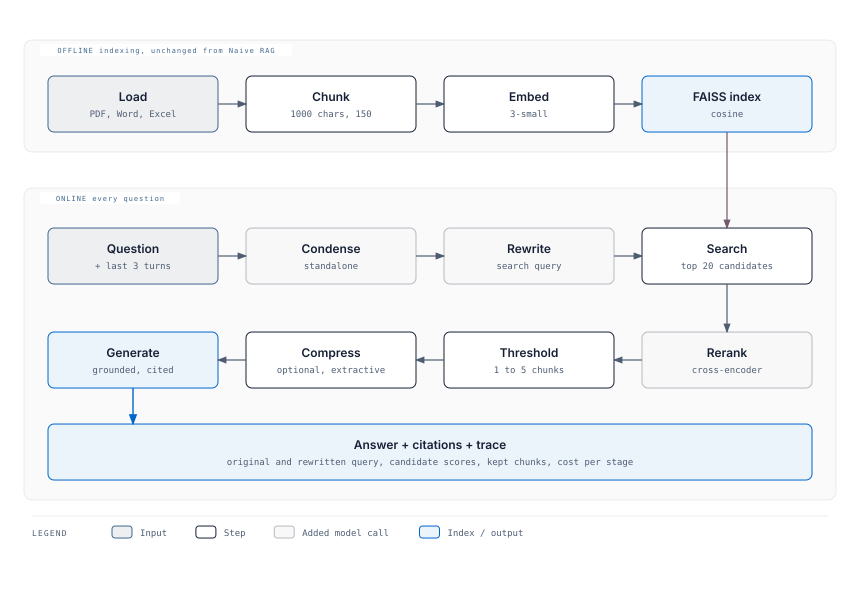
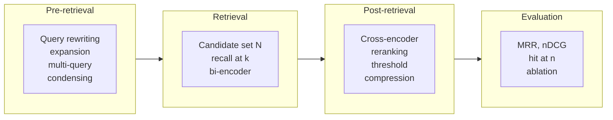

# 15. Glossary

Short, simple definitions of every term introduced in the Advanced RAG notes, in alphabetical order. Terms already defined for Naive RAG (chunk, embedding, cosine similarity, top-k, faithfulness and so on) are in the [Naive RAG glossary](../../../01.%20Naive%20RAG/01.%20Notes/01.%20Basic%20Concepts/13.%20Glossary.md).

## Where the terms fit

## Terms

<table width="100%">
<thead><tr><th>Term</th><th>Simple definition</th><th>Note</th></tr></thead>
<tbody>
<tr><td>Ablation</td><td>Evaluating a system with one component added or removed at a time, to see what each component contributes</td><td>12</td></tr>
<tr><td>Abstractive compression</td><td>Rewriting retrieved chunks into a short new summary focused on the question</td><td>10</td></tr>
<tr><td>Advanced RAG</td><td>Naive RAG plus optimisation before retrieval (query rewriting) and after retrieval (reranking, filtering, compression)</td><td>01</td></tr>
<tr><td>Candidate set (N)</td><td>The larger list of chunks returned by the first-stage search, to be reranked (for example 20)</td><td>06</td></tr>
<tr><td>Coreference</td><td>A word that refers to something mentioned earlier ("it", "he", "that model")</td><td>05</td></tr>
<tr><td>ColBERT (late interaction)</td><td>A retriever that keeps one vector per token and matches question tokens to document tokens; between a bi-encoder and a cross-encoder</td><td>07</td></tr>
<tr><td>Condensing (question contextualisation)</td><td>Turning a follow-up question into a standalone question using the chat history</td><td>05</td></tr>
<tr><td>Context compression</td><td>Shortening the selected chunks to the parts that matter for the question</td><td>10</td></tr>
<tr><td>Cross-encoder</td><td>A transformer that reads the question and a chunk together and outputs one relevance score</td><td>07</td></tr>
<tr><td>DCG / nDCG</td><td>Discounted cumulative gain: a ranking score that rewards relevant results near the top; nDCG divides it by the best possible value, giving 0 to 1</td><td>08</td></tr>
<tr><td>Dynamic k</td><td>Choosing how many chunks to send per question from their scores, instead of a fixed number</td><td>09</td></tr>
<tr><td>Ellipsis</td><td>Leaving words out because they are clear from context ("And for CRAG?")</td><td>05</td></tr>
<tr><td>Extractive compression</td><td>Keeping only the useful sentences of retrieved chunks, word for word</td><td>10</td></tr>
<tr><td>Fallback</td><td>What the pipeline does when a stage fails, for example searching with the original question</td><td>11</td></tr>
<tr><td>First-stage retrieval</td><td>The cheap search over the whole index that produces candidates (here, embeddings and FAISS)</td><td>06</td></tr>
<tr><td>Hard negative</td><td>A passage that looks relevant to the query but does not answer it; used to train rerankers</td><td>08</td></tr>
<tr><td>Hit rate at N, at n</td><td>Share of questions whose expected file is among the N candidates, or among the n chunks finally sent</td><td>06, 12</td></tr>
<tr><td>HyDE</td><td>Hypothetical Document Embeddings: search with the embedding of an LLM-written fake answer</td><td>04</td></tr>
<tr><td>Listwise reranking</td><td>An LLM receives all candidates and returns them in order of relevance</td><td>08</td></tr>
<tr><td>LLMLingua</td><td>A token-pruning method that removes low-information tokens from long prompts</td><td>10</td></tr>
<tr><td>Lost in the middle</td><td>LLMs use information at the start and end of a long context better than in the middle</td><td>06, 10</td></tr>
<tr><td>MAP</td><td>Mean average precision: averages precision at every rank where a relevant result appears</td><td>08</td></tr>
<tr><td>MMR</td><td>Maximal Marginal Relevance: picks results that are relevant to the query but not too similar to each other</td><td>06</td></tr>
<tr><td>Modular RAG</td><td>RAG built from interchangeable modules with routing, loops and memory; the paradigm after Advanced RAG</td><td>01</td></tr>
<tr><td>MRR</td><td>Mean reciprocal rank: the average of 1 / rank of the first relevant result</td><td>08</td></tr>
<tr><td>Multi-query</td><td>Generating several phrasings of a question, searching each, and merging the results</td><td>04</td></tr>
<tr><td>p50, p95</td><td>The latency that 50 or 95 percent of answers are faster than</td><td>13</td></tr>
<tr><td>Pointwise reranking</td><td>Scoring each candidate on its own, for example with a 0 to 10 rating</td><td>08</td></tr>
<tr><td>Post-retrieval</td><td>Steps between search and generation: reranking, thresholds, compression, ordering</td><td>01</td></tr>
<tr><td>Pre-retrieval</td><td>Steps before search that improve the query: rewriting, expansion, condensing</td><td>01</td></tr>
<tr><td>Precision at k</td><td>Relevant chunks among the top k, divided by k</td><td>06</td></tr>
<tr><td>Pseudo-relevance feedback</td><td>Searching once, taking terms from the top results, adding them to the query and searching again</td><td>04</td></tr>
<tr><td>Query drift</td><td>A rewritten or expanded query that moves away from what the user asked</td><td>03, 04</td></tr>
<tr><td>Query expansion</td><td>Adding related terms, synonyms or a short description to the query</td><td>04</td></tr>
<tr><td>Query rewriting</td><td>Turning the user's question into a clearer, more specific search query before retrieval</td><td>03</td></tr>
<tr><td>Recall at k</td><td>Relevant chunks among the top k, divided by all relevant chunks</td><td>06</td></tr>
<tr><td>RECOMP</td><td>A method (ICLR 2024) that compresses retrieved documents with trained extractive and abstractive compressors and can return nothing</td><td>10</td></tr>
<tr><td>Reciprocal rank fusion (RRF)</td><td>Merging ranked lists by summing 1 / (60 + rank) for each item</td><td>04</td></tr>
<tr><td>Reranking</td><td>Re-scoring first-stage candidates with a more accurate model and sorting them again</td><td>08</td></tr>
<tr><td>Retrieve-then-rerank</td><td>The two-stage design: cheap search over everything, accurate scoring of a short list</td><td>06</td></tr>
<tr><td>Rewrite faithfulness</td><td>Whether a rewritten query keeps the question's meaning without adding facts</td><td>12</td></tr>
<tr><td>Rewrite-Retrieve-Read</td><td>The pipeline of the query rewriting paper: rewrite the query, retrieve, then read and answer</td><td>03</td></tr>
<tr><td>Score threshold</td><td>A minimum relevance score a chunk must reach to be sent to the generator</td><td>09</td></tr>
<tr><td>Selective augmentation</td><td>Adding no context when the retrieved documents do not help (RECOMP's empty summary)</td><td>10</td></tr>
<tr><td>Semantic cache</td><td>Reusing an earlier answer when a new question is very similar to an old one</td><td>13</td></tr>
<tr><td>Standalone question</td><td>A question that can be understood without the chat history</td><td>05</td></tr>
<tr><td>Step-back prompting</td><td>Asking a more general question first to retrieve background knowledge</td><td>04</td></tr>
<tr><td>Token pruning</td><td>Removing individual low-information tokens from the context to shorten it</td><td>10</td></tr>
<tr><td>Trace</td><td>The record returned with each answer of what every stage did: queries, candidate scores, kept chunks, time and cost</td><td>11</td></tr>
<tr><td>Two-stage retrieval</td><td>See retrieve-then-rerank</td><td>06</td></tr>
<tr><td>Vocabulary mismatch</td><td>The user and the documents using different words for the same thing</td><td>03</td></tr>
</tbody>
</table>

## Navigation

Previous: [14. Limitations of Advanced RAG](14.%20Limitations%20of%20Advanced%20RAG.md) | [Index](README.md) | Next: [02. Research Paper Explained](../02.%20Research%20Paper%20Explained/)
