# Advanced RAG: Basic Concepts

These notes explain every building block that Advanced RAG adds to Naive RAG, in simple terms, with diagrams, formulas and worked examples. Each note ends with links to the previous and next note. They assume the [Naive RAG basic concepts](../../../01.%20Naive%20RAG/01.%20Notes/01.%20Basic%20Concepts/).

## How the notes connect

```mermaid
flowchart LR
    N1[01 What is<br/>Advanced RAG] --> N2[02 From Naive<br/>to Advanced]
    N2 --> N3[03 Query<br/>rewriting]
    N3 --> N4[04 Expansion and<br/>multi-query]
    N4 --> N5[05 Conversational<br/>rewriting]
    N5 --> N6[06 Candidate<br/>retrieval]
    N6 --> N7[07 Bi-encoder vs<br/>cross-encoder]
    N7 --> N8[08 Reranking]
    N8 --> N9[09 Thresholds and<br/>dynamic k]
    N9 --> N10[10 Context<br/>compression]
    N10 --> N11[11 End to end]
    N11 --> N12[12 Evaluation]
    N12 --> N13[13 Cost and<br/>latency]
    N13 --> N14[14 Limitations]
```

## Reading order

<table width="100%">
<thead><tr><th>#</th><th>Note</th><th>What you will learn</th><th>Pipeline stage</th><th>Status</th></tr></thead>
<tbody>
<tr><td>01</td><td><a href="01.%20What%20is%20Advanced%20RAG.md">What is Advanced RAG</a></td><td>Definition, the three paradigms (Naive, Advanced, Modular), what is added and what stays the same</td><td>Overview</td><td>Done</td></tr>
<tr><td>02</td><td><a href="02.%20From%20Naive%20to%20Advanced%20RAG.md">From Naive to Advanced RAG</a></td><td>The measured Naive RAG gaps and which Advanced RAG technique fixes each</td><td>Overview</td><td>Done</td></tr>
<tr><td>03</td><td><a href="03.%20Query%20Rewriting.md">Query Rewriting</a></td><td>Why user questions and documents use different words; LLM rewriting; prompts; risks</td><td>Pre-retrieval</td><td>Done</td></tr>
<tr><td>04</td><td><a href="04.%20Query%20Expansion%20and%20Multi-Query.md">Query Expansion and Multi-Query</a></td><td>Adding terms, generating several query variants, merging their results</td><td>Pre-retrieval</td><td>Done</td></tr>
<tr><td>05</td><td>Conversational Query Rewriting</td><td>Turning follow-up questions into standalone questions with the chat history</td><td>Pre-retrieval</td><td>Planned</td></tr>
<tr><td>06</td><td>Candidate Retrieval and Recall</td><td>Retrieve many, keep few; recall at k; why a bigger candidate set helps reranking</td><td>Retrieval</td><td>Planned</td></tr>
<tr><td>07</td><td>Bi-Encoders vs Cross-Encoders</td><td>How each scores relevance, speed versus accuracy, why both are used together</td><td>Retrieval</td><td>Planned</td></tr>
<tr><td>08</td><td>Reranking</td><td>Cross-encoder rerankers, LLM rerankers, hosted rerankers; ranking metrics (MRR, nDCG)</td><td>Post-retrieval</td><td>Planned</td></tr>
<tr><td>09</td><td>Score Thresholds and Dynamic k</td><td>Dropping weak chunks, choosing how many chunks to keep per question</td><td>Post-retrieval</td><td>Planned</td></tr>
<tr><td>10</td><td>Context Compression and Filtering</td><td>Keeping only the relevant sentences (extractive and abstractive compression, as in RECOMP); "lost in the middle"; ordering chunks</td><td>Post-retrieval</td><td>Planned</td></tr>
<tr><td>11</td><td>Advanced RAG Architecture End to End</td><td>The full pipeline, step by step, with a worked example</td><td>All</td><td>Planned</td></tr>
<tr><td>12</td><td>Evaluating Advanced RAG</td><td>Comparing against the Naive RAG baseline fairly; which metrics should move</td><td>Evaluation</td><td>Planned</td></tr>
<tr><td>13</td><td>Cost and Latency Trade-offs</td><td>What each extra stage costs, and how to keep it affordable</td><td>Operations</td><td>Planned</td></tr>
<tr><td>14</td><td>Limitations of Advanced RAG</td><td>What it still cannot do and which architectures come next</td><td>Overview</td><td>Planned</td></tr>
<tr><td>15</td><td>Glossary</td><td>Every term used in these notes</td><td>Reference</td><td>Planned</td></tr>
</tbody>
</table>

## Navigation

[Notes](../README.md) | Next: [02. Research Paper Explained](../02.%20Research%20Paper%20Explained/)
