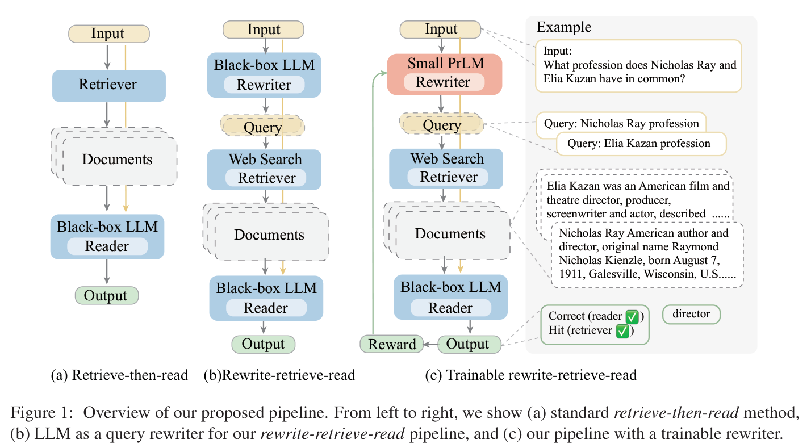
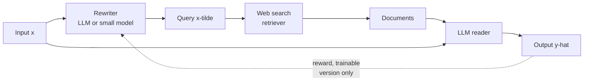

# 01. Abstract (Paper Section: Abstract)

In this note:

- The abstract split into its sentences
- Each sentence explained in simple words
- Words you need to know before reading further
- Figure 1 of the paper: the whole idea in one picture

## The Abstract, Sentence by Sentence

The abstract has nine sentences. Each one is quoted and then explained.

### Sentence 1

> "Large Language Models (LLMs) play powerful, black-box readers in the retrieve-then-read pipeline, making remarkable progress in knowledge-intensive tasks."

**Simple meaning:** In a normal RAG system, first a retriever finds documents, then an LLM reads them and answers (retrieve-then-read). The LLM is the **reader**. It is a **black box**: we can send it text and get text back, but we cannot see or change its weights (for example ChatGPT through an API).

### Sentence 2

> "This work introduces a new framework, Rewrite-Retrieve-Read instead of the previous retrieve-then-read for the retrieval-augmented LLMs from the perspective of the query rewriting."

**Simple meaning:** The paper adds one step at the front: before retrieving, **rewrite the query**. The pipeline becomes rewrite, then retrieve, then read.

### Sentence 3

> "Unlike prior studies focusing on adapting either the retriever or the reader, our approach pays attention to the adaptation of the search query itself, for there is inevitably a gap between the input text and the needed knowledge in retrieval."

**Simple meaning:** Earlier work improved RAG by changing the retriever (for example training it) or the reader (prompting or fine-tuning it). This paper changes the **query** instead, because what the user typed is often not the best text to search with. That difference is the "gap" between the input and the knowledge that is actually needed.

### Sentence 4

> "We first prompt an LLM to generate the query, then use a web search engine to retrieve contexts."

**Simple meaning:** The simple version: ask an LLM to write the search query, then send that query to a web search engine (Bing) to get documents.

### Sentence 5

> "Furthermore, to better align the query to the frozen modules, we propose a trainable scheme for our pipeline."

**Simple meaning:** The retriever (web search) and the reader (the LLM) cannot be changed; they are **frozen**. To get queries that suit these frozen parts even better, the paper also proposes a version where the rewriter is **trained**.

### Sentence 6

> "A small language model is adopted as a trainable rewriter to cater to the black-box LLM reader."

**Simple meaning:** The trainable rewriter is a small model (T5-large, about 770 million parameters), small enough to train, unlike the big reader.

### Sentence 7

> "The rewriter is trained using the feedback of the LLM reader by reinforcement learning."

**Simple meaning:** The rewriter learns by trial and error: it writes a query, the system retrieves and the reader answers, and the quality of the answer becomes a **reward**. Queries that lead to good answers are made more likely. This is **reinforcement learning (RL)**.

### Sentence 8

> "Evaluation is conducted on downstream tasks, open-domain QA and multiple-choice QA."

**Simple meaning:** They test on question answering where the model must find facts (open-domain QA: HotpotQA, AmbigNQ, PopQA) and on exam-style multiple-choice questions (MMLU).

### Sentence 9

> "Experiments results show consistent performance improvement, indicating that our framework is proven effective and scalable, and brings a new framework for retrieval-augmented LLM."

**Simple meaning:** Rewriting the query improves the results across tasks, both with the LLM rewriter and with the small trained rewriter.

## Words You Need to Know

<table width="100%">
<thead><tr><th>Word</th><th>Meaning</th></tr></thead>
<tbody>
<tr><td>Retrieve-then-read</td><td>The standard RAG pipeline: retrieve documents for the input, then an LLM reads them and answers</td></tr>
<tr><td>Rewrite-Retrieve-Read</td><td>The paper's pipeline: rewrite the input into a search query, retrieve with it, then read</td></tr>
<tr><td>Black-box LLM</td><td>An LLM used only through inputs and outputs, with no access to its weights</td></tr>
<tr><td>Frozen module</td><td>A component that is not trained or changed (here the web search retriever and the LLM reader)</td></tr>
<tr><td>Rewriter</td><td>The component that turns the input into a search query: either a prompted LLM or a small trained model</td></tr>
<tr><td>Reinforcement learning (RL)</td><td>Training by reward: actions that lead to good outcomes become more likely</td></tr>
<tr><td>Open-domain QA</td><td>Answering questions on any topic by finding facts in a large knowledge source</td></tr>
<tr><td>Multiple-choice QA</td><td>Choosing the right option among several (here MMLU exam questions)</td></tr>
</tbody>
</table>

## Figure 1 of the Paper: The Whole Idea in One Picture

**How to read it, from left to right:**

<table width="100%">
<thead><tr><th>Panel</th><th>Pipeline</th><th>What happens</th></tr></thead>
<tbody>
<tr><td>(a) Retrieve-then-read</td><td>Input, Retriever, Documents, Black-box LLM Reader, Output</td><td>The input is used directly as the search query (Naive RAG)</td></tr>
<tr><td>(b) Rewrite-retrieve-read</td><td>Input, Black-box LLM Rewriter, Query, Web Search Retriever, Documents, Reader, Output</td><td>An LLM first writes the query; web search uses it</td></tr>
<tr><td>(c) Trainable rewrite-retrieve-read</td><td>Same as (b), but the rewriter is a small trainable model (Small PrLM), and a Reward from the output goes back to the rewriter</td><td>The green arrow is the reinforcement learning loop</td></tr>
</tbody>
</table>

**The example on the right:** the input "What profession does Nicholas Ray and Elia Kazan have in common?" is hard to search as one question. The rewriter splits it into two queries, "Nicholas Ray profession" and "Elia Kazan profession". Each query finds a document that states the profession; the reader combines them and answers "director". The retriever **hit** the needed facts and the reader is **correct**.

The thin yellow line in each panel shows the original input also going to the reader: the reader always sees the original question, even though retrieval used the rewritten query.

## Key Points

- The paper adapts the **query**, not the retriever or the reader, because the input text and the needed knowledge differ.
- Two rewriters: a prompted LLM, and a small T5 model trained with reinforcement learning using the reader's answers as the reward.
- The retriever is a web search engine and the reader a black-box LLM; both are frozen.
- Rewriting improves results on open-domain QA and multiple-choice QA.
- In our Advanced RAG, this is the pre-retrieval stage (basic concepts notes 03 and 05).

## Navigation

[Paper index](README.md) | Next: [02. Introduction](02.%20Introduction.md)
