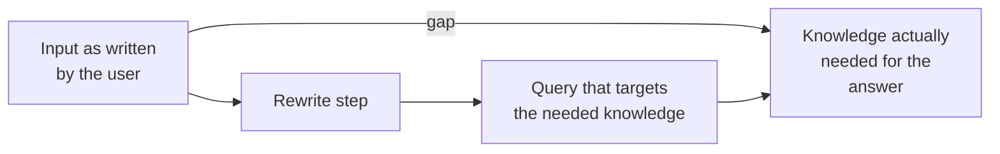
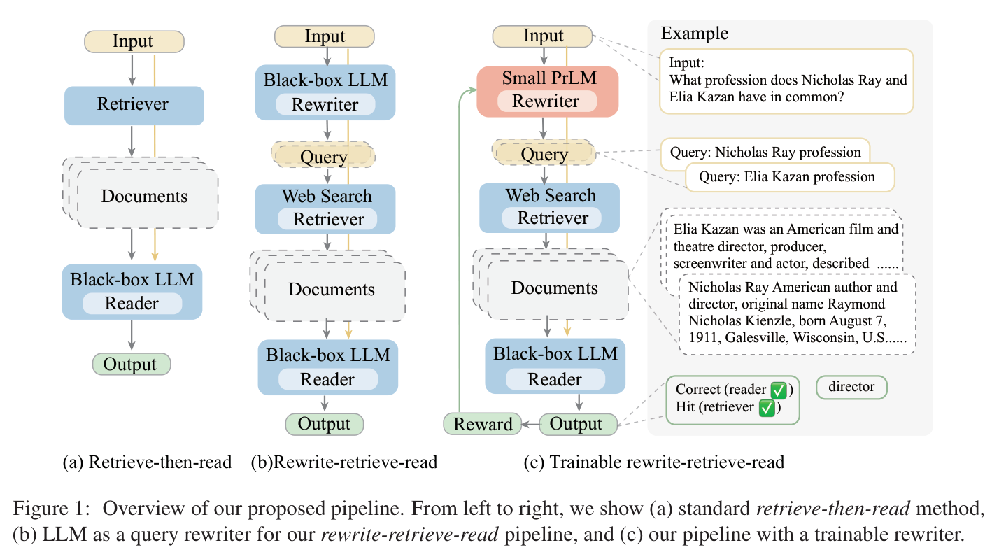

# 02. Introduction (Paper Section 1)

In this note:

- The problem: LLMs hallucinate and go out of date
- Why retrieval is the standard fix, and why black-box LLMs complicate it
- The two existing research lines, and what they miss
- The paper's idea: adapt the query
- The proposed framework and its trainable version
- The experiments in one table
- The contributions

## The Problem: Hallucination and Out-of-Date Knowledge

The paper starts from two weaknesses of LLMs:

<table width="100%">
<thead><tr><th>Weakness</th><th>Paper's words</th><th>Simple meaning</th></tr></thead>
<tbody>
<tr><td>Hallucination</td><td>"LLMs still have to face the issue of hallucination"</td><td>The model states things that are false, confidently</td></tr>
<tr><td>Temporal misalignment</td><td>"and temporal misalignment"</td><td>The model's knowledge stops at its training date; the world keeps changing</td></tr>
</tbody>
</table>

Both happen because training depends on a large text corpus "without the perception of the real world": the model never checks its knowledge against current facts.

## Retrieval Is the Standard Fix

> "Existing work has proved that incorporating external knowledge (i.e., non-parametric knowledge) with internal knowledge (i.e., parametric knowledge) can effectively alleviate hallucination, especially for knowledge-intensive tasks."

This is the RAG idea from Lewis et al. 2020 (see the [Naive RAG paper notes](../../../../01.%20Naive%20RAG/01.%20Notes/02.%20Research%20Paper%20Explained/)): give the model retrieved documents (non-parametric knowledge) next to what it already knows (parametric knowledge). The paper calls this the **retrieve-then-read** framework: a retriever searches for documents related to the question, then the LLM reads the question and the documents and predicts the answer.

## Why Black-Box LLMs Complicate It

> "As most LLMs are only accessible through inference APIs, they play the part of black-box frozen readers in the pipeline. This makes previous retrieval augmentation methods that require complete access ... no longer feasible."

The original RAG paper, REALM and Atlas train the retriever and the reader together, which needs full access to the reader's weights and gradients. With ChatGPT behind an API, that is impossible. So recent work adapts **around** the frozen LLM.

## Two Existing Research Lines

<table width="100%">
<thead><tr><th>Line</th><th>Idea</th><th>Examples named in the paper</th><th>What stays fixed</th></tr></thead>
<tbody>
<tr><td>Adapt the retriever to the LLM</td><td>Train a dense retriever using the LLM's feedback, so it fetches documents the LLM finds useful</td><td>REPLUG (Shi et al. 2023)</td><td>The LLM and the query</td></tr>
<tr><td>Design the retriever-reader interaction</td><td>Carefully crafted prompts or multi-step pipelines where the LLM searches several times and reasons step by step</td><td>ReAct (Yao et al. 2023), DSP (Khattab et al. 2022)</td><td>The retriever, the LLM and the query</td></tr>
</tbody>
</table>

## What They Miss: The Query

> "Existing approaches overlook the adaptation of the query, i.e., the input of the retrieve-then-read pipeline. The retrieval query is either original from datasets or directly determined by the black-box generation, thus is always fixed. However, there is inevitably a gap between the input text and the knowledge that is really needed to query."

This is the central argument. Whatever the retriever and the reader do, they work with a query that nobody optimised. A question like "What profession does Nicholas Ray and Elia Kazan have in common?" is a good question for a person but a poor search query: the knowledge needed is two separate facts, one per person.

## The Proposal: Rewrite-Retrieve-Read

> "In front of the retriever, a step of rewriting the input is added, filling the gap between the given input and retrieval need, as is shown in Figure 1."

Two design choices are made in the introduction:

<table width="100%">
<thead><tr><th>Choice</th><th>Reason given</th></tr></thead>
<tbody>
<tr><td>Retriever = an internet search engine (Bing)</td><td>"avoids the maintenance of the search index and can access up-to-date knowledge"</td></tr>
<tr><td>One rewriting step, not many rounds</td><td>Unlike ReAct and DSP, which need several retriever-LLM interactions per sample, the rewrite only "clarif[ies] the retrieval need from the input text"</td></tr>
</tbody>
</table>

## The Trainable Version

> "The black-box retriever and the reader form a frozen system. To further smooth the steps of our pipeline, we apply a small, trainable language model to perform the rewriting step, denoted as the rewriter. The rewriter is trained by reinforcement learning using the LLM performance as a reward."

The key insight: in a system where the expensive parts are frozen, the cheapest place to learn is a **small model in front of them**. The rewriter is the only trainable part, and it is trained on what matters: whether the frozen reader ends up answering correctly.

## The Experiments in One Table

<table width="100%">
<thead><tr><th>Part</th><th>Choice</th></tr></thead>
<tbody>
<tr><td>Open-domain QA</td><td>HotpotQA (multi-hop questions), AmbigNQ (ambiguous questions made specific), PopQA (long-tail, less popular facts)</td></tr>
<tr><td>Multiple-choice QA</td><td>MMLU (exam questions in four categories)</td></tr>
<tr><td>Trainable rewriter</td><td>T5-large</td></tr>
<tr><td>Reader (frozen LLM)</td><td>ChatGPT (gpt-3.5-turbo) and Vicuna-13B</td></tr>
<tr><td>Headline result</td><td>"query rewriting consistently improves the retrieve-augmented LLM performance", and "the smaller language model can be competent for query rewriting"</td></tr>
</tbody>
</table>

## Contributions

The paper summarises its contributions as:

1. **Rewrite-retrieve-read** is "the first framework where the input text is adapted for the frozen retriever and LLM reader".
2. A **tuneable scheme** with a small trainable model that achieves "performance gains with less resource consumption".

## What This Means for Our Project

- Our generator (gpt-4o-mini through Azure) is exactly the kind of black-box frozen reader the paper describes.
- Our retriever is not web search but our own FAISS index; the gap between the input and the needed knowledge is the same problem (Naive RAG limitation L3, missed retrievals).
- We will use the **frozen LLM rewriter** (panel b of Figure 1); the trainable RL rewriter needs training data and GPUs and is explained here for understanding.

## Key Points

- LLMs hallucinate and go stale; retrieval helps, but most LLMs are black boxes that cannot be trained with the retriever.
- Existing work adapts the retriever (REPLUG) or the interaction (ReAct, DSP) but leaves the query fixed.
- The paper adds a rewrite step in front of the retriever to close the gap between the input and the needed knowledge.
- A small trainable rewriter, trained by RL on the frozen reader's success, is the cheap way to learn in a frozen system.

## Navigation

Previous: [01. Abstract](01.%20Abstract.md) | [Paper index](README.md) | Next: [03. Related Work](03.%20Related%20Work.md)
