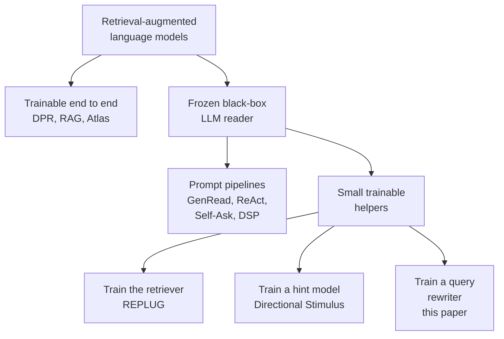

# 03. Related Work (Paper Section 2)

In this note:

- 2.1 Retrieval augmentation: from trainable end-to-end systems to retrieval for giant models
- The Internet as a knowledge base
- 2.2 Cooperation with black-box LLMs: prompting pipelines and small trainable helpers
- A map of every method the section names
- Where Rewrite-Retrieve-Read fits

## 2.1 Retrieval Augmentation

> "Language models require external knowledge to alleviate the factuality drawbacks. Retrieval augmentation has been regarded as the standard effective solution."

The section traces how retrieval augmentation developed:

<table width="100%">
<thead><tr><th>Stage</th><th>What the paper says</th><th>Examples</th></tr></thead>
<tbody>
<tr><td>Early pipelines</td><td>A sparse retriever (keyword based) or a dense retriever in front of a pre-trained language model</td><td>DrQA (Chen et al. 2017, sparse), DPR (Karpukhin et al. 2020, dense)</td></tr>
<tr><td>End-to-end trainable systems</td><td>Retriever and reader are both trainable-size models like BERT or BART, so "the whole retrieve-then-reader framework is a tuneable end-to-end system"</td><td>DPR, RAG (Lewis et al. 2020)</td></tr>
<tr><td>Smoothing the two steps</td><td>Methods that optimise retrieval and reading comprehension together</td><td>Sachan et al. 2021, Lee et al. 2022, Jiang et al. 2022</td></tr>
<tr><td>Retrieval for large models</td><td>Retrieval stays useful as models grow, and can compensate for fewer parameters</td><td>Atlas (Izacard et al. 2022): few-shot results on par with 540B PaLM while being about 50 times smaller</td></tr>
</tbody>
</table>

The Atlas point is worth remembering: a much smaller model **with retrieval** can match a giant model **without** it. That is the economic argument for RAG.

### The Internet as a knowledge base

> "More related to our work, the search engine can assume the role of the retriever and use the Internet as the source of external knowledge."

<table width="100%">
<thead><tr><th>Work</th><th>How it uses web search</th></tr></thead>
<tbody>
<tr><td>Komeili et al. 2022</td><td>Internet search based on the dialogue history, for generating dialogue responses</td></tr>
<tr><td>SeeKeR (Shuster et al. 2022)</td><td>One Transformer that iteratively writes a search query, extracts knowledge, then generates a response</td></tr>
<tr><td>Lazaridou et al. 2022</td><td>Web search as knowledge augmentation for large models</td></tr>
<tr><td>Menick et al. 2022</td><td>Web search for fact-checking and supporting answers with quotes</td></tr>
<tr><td>ReAct (Yao et al. 2023)</td><td>Web search inside an LLM agent loop</td></tr>
</tbody>
</table>

Note that several of these already **generate a search query** (Komeili, SeeKeR). The new element in this paper is a dedicated rewriting step for a frozen LLM reader, and training that step with the reader's feedback.

## 2.2 Cooperation with Black-box LLMs

> "LLMs are only accessible as a black box in most cases, which is because (i) Some like ChatGPT are not open-source and kept private; (ii) The large parameter scale requires computational resources that are not always affordable to users. This constraint means nothing is available except input and output texts."

Given only text in and text out, two strategies exist:

### Strategy 1: better interaction through prompts

<table width="100%">
<thead><tr><th>Method</th><th>Idea</th></tr></thead>
<tbody>
<tr><td>GenRead (Yu et al. 2023)</td><td>Ask the LLM to <b>generate</b> a context document instead of retrieving one: the LLM retrieves from its own memory</td></tr>
<tr><td>ReAct (Yao et al. 2023)</td><td>Interleave reasoning (chain of thought) with actions such as web searches</td></tr>
<tr><td>Self-Ask (Press et al. 2022)</td><td>The LLM asks itself follow-up sub-questions and answers them, optionally with search</td></tr>
<tr><td>DSP, Demonstrate-Search-Predict (Khattab et al. 2022)</td><td>A programmed pipeline between the LLM and the retriever, with bootstrapped demonstrations and multi-hop breakdown</td></tr>
</tbody>
</table>

These work in zero- or few-shot settings, but "the behavior of LLMs sometimes needs adjustments", and prompts alone cannot be optimised with a training signal.

### Strategy 2: small trainable models around the LLM

> "A feasible approach is to append trainable small models in front of or after the LLM. The small models, as a part of the parameters of the system, can be fine-tuned for optimization."

<table width="100%">
<thead><tr><th>Method</th><th>What is trained</th><th>Signal</th></tr></thead>
<tbody>
<tr><td>REPLUG (Shi et al. 2023)</td><td>A dense retriever placed before the frozen LLM</td><td>The LLM's supervision: retrieve documents that help the LLM</td></tr>
<tr><td>Directional Stimulus Prompting (Li et al. 2023)</td><td>A small model that gives the LLM hints (keywords for summarisation, dialogue acts)</td><td>A reward from the LLM's output</td></tr>
<tr><td>This paper</td><td>A small query rewriter placed before the retriever</td><td>A reward from the frozen reader's answer quality</td></tr>
</tbody>
</table>

## A Map of the Section

## Where Rewrite-Retrieve-Read Fits

> "Different from the inspiring work mentioned above, our proposed pipeline contains a query rewriting step in front of the retrieve-then-read module. We further propose a trainable scheme with a small rewriting model, which is a novel enhancement for retrieval-augmented LLM by reconstructing the search query."

<table width="100%">
<thead><tr><th>Compared with</th><th>Difference</th></tr></thead>
<tbody>
<tr><td>End-to-end systems (RAG, Atlas)</td><td>Does not need access to the reader's weights</td></tr>
<tr><td>Prompt pipelines (ReAct, DSP)</td><td>One rewrite step instead of many LLM rounds, and it can be trained</td></tr>
<tr><td>REPLUG</td><td>Trains the query side instead of the retriever, so it also works with a search engine whose ranking cannot be changed</td></tr>
</tbody>
</table>

## What This Means for Our Project

- We are in the "frozen black-box LLM" branch: gpt-4o-mini cannot be trained with our retriever.
- Our Advanced RAG uses ideas from both strategies: a prompted rewriter (strategy 1) and a separate small model for reranking (strategy 2, but placed after retrieval).
- ReAct, Self-Ask and DSP, with their multiple retrieval rounds, belong to later folders (11. Active Iterative RAG, 16. Agentic RAG).

## Key Points

- Retrieval augmentation moved from trainable end-to-end systems to retrieval for frozen giant models; Atlas shows retrieval can replace many parameters.
- Web search as a retriever is established (SeeKeR, ReAct, fact-checking work).
- With black-box LLMs, systems either craft better prompts and pipelines or train small helper models around the LLM.
- This paper is the first to train a small **query rewriter** for a frozen retriever and reader.

## Navigation

Previous: [02. Introduction](02.%20Introduction.md) | [Paper index](README.md) | Next: [04. Methodology](04.%20Methodology.md)
