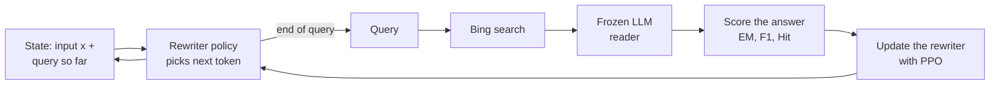
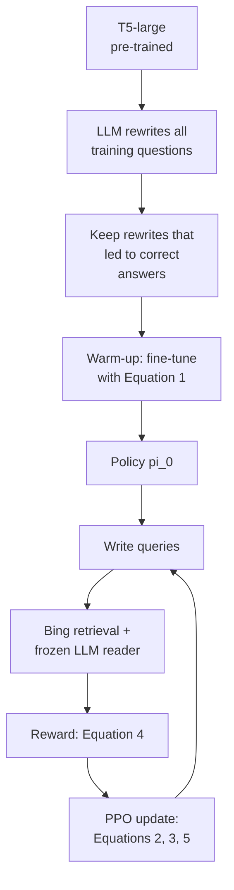

# 04. Methodology (Paper Section 3)

In this note:

- 3.1 Rewrite-Retrieve-Read written formally
- 3.2 Why train a rewriter at all
- 3.2.1 Warm-up: learning to rewrite from the LLM's good rewrites (Equation 1)
- 3.2.2 Reinforcement learning: the rewriter as a policy (the MDP)
- PPO, the clipped objective (Equation 2), with a worked example
- Advantage estimation with GAE (Equation 3)
- The reward and the KL penalty (Equation 4)
- The final loss (Equation 5)
- The whole training process in one diagram

## 3.1 Rewrite-Retrieve-Read, Formally

The paper defines a task dataset and the three steps:

$$D = \{(x, y)_i\}, \quad i = 0, 1, 2, \dots, N$$

<table width="100%">
<thead><tr><th>Symbol (plain text)</th><th>Name</th><th>Meaning</th></tr></thead>
<tbody>
<tr><td>D</td><td>Dataset</td><td>All examples of a knowledge-intensive task, for example open-domain QA</td></tr>
<tr><td>x</td><td>Input</td><td>The original input to the pipeline, for example a question</td></tr>
<tr><td>y</td><td>Expected output</td><td>The correct answer</td></tr>
<tr><td>x-tilde (x with a tilde)</td><td>Query</td><td>The search query written by the rewriter for the knowledge x needs</td></tr>
<tr><td>doc</td><td>Context</td><td>The documents retrieved with the query</td></tr>
<tr><td>y-hat (y with a hat)</td><td>Prediction</td><td>The reader's answer after reading [doc, x]</td></tr>
</tbody>
</table>

1. **Query rewrite:** generate a query x-tilde for the required knowledge, based on x.
2. **Retrieve:** search for related context doc.
3. **Read:** comprehend the input together with the contexts, [doc, x], and predict y-hat.

The simple version asks a frozen LLM to rewrite with a few-shot prompt "to encourage the LLM to think", and its output "can be none, one or more queries to search". None means no retrieval is needed; several queries cover several needs (like the two professions in Figure 1).

## 3.2 Why Train a Rewriter

> "Total reliance on a frozen LLM has shown some drawbacks. Reasoning errors or invalid search hinders the performance ... retrieved knowledge may sometimes mislead and compromise the language model."

A prompted LLM rewriter is not optimised for **this** retriever and **this** reader. A trainable rewriter can learn which queries actually lead the frozen pipeline to correct answers. The trainable rewriter, written G_theta, is initialised from **T5-large (770M parameters)** and trained in two stages: warm-up, then reinforcement learning.

## 3.2.1 Rewriter Warm-up

T5 was pre-trained to fill in missing text, not to write search queries, so it first needs examples of the task. The paper builds a **pseudo dataset** by distillation:

1. Ask the LLM to rewrite every training question x; collect its queries x-tilde as pseudo labels.
2. Run the pipeline with each query. **Keep only the rewrites that led the reader to the correct answer**:

$$D_{Train} = \{(x, \tilde{x}) \mid \hat{y} = y\}$$

3. Fine-tune the rewriter on D_Train with the standard language-modelling loss:

$$L_{warm} = -\sum_{t} \log p_\theta\big(\hat{\tilde{x}}_t \mid \tilde{x}_{<t}, x\big) \qquad (1)$$

<table width="100%">
<thead><tr><th>Symbol (plain text)</th><th>Meaning</th></tr></thead>
<tbody>
<tr><td>L_warm</td><td>The warm-up loss to minimise</td></tr>
<tr><td>t</td><td>Position of a token in the query</td></tr>
<tr><td>x-tilde-hat_t</td><td>The query token the rewriter should produce at position t</td></tr>
<tr><td>x-tilde_(&lt;t)</td><td>The query tokens before position t</td></tr>
<tr><td>p_theta(... | ...)</td><td>The rewriter's probability of that token, given the input x and the earlier tokens; theta are its weights</td></tr>
</tbody>
</table>

**In words:** make the rewriter assign high probability to each next token of the good LLM rewrites. After warm-up the rewriter imitates the LLM. The paper notes its performance is only "modest", because the pseudo labels depend on a hand-written prompt and the model is small. Reinforcement learning is used to go further.

## 3.2.2 Reinforcement Learning

### The rewriter as a policy

Writing a query token by token is framed as a **Markov Decision Process**, the tuple S, A, P, R, gamma:

<table width="100%">
<thead><tr><th>MDP part</th><th>Paper's definition</th><th>In plain words</th></tr></thead>
<tbody>
<tr><td>State space S</td><td>Finite set limited by the vocabulary and the sequence length</td><td>A state s_t = [x, tokens written so far]</td></tr>
<tr><td>Action space A</td><td>Equal to the vocabulary</td><td>An action a_t = choosing the next token</td></tr>
<tr><td>Transition P</td><td>Determined by the policy network, the rewriter G_theta</td><td>The next state is the current state plus the chosen token</td></tr>
<tr><td>Reward R</td><td>A value that depends on the current state</td><td>A score of the final answer after retrieval and reading</td></tr>
<tr><td>gamma</td><td>Discount factor</td><td>How much later rewards count compared with immediate ones</td></tr>
</tbody>
</table>

The rewriter after warm-up is the starting policy pi_0. One **episode** is writing one query until the end-of-sentence token. Then the query is sent to the retriever, the reader answers, and the answer is scored to produce the reward.

### PPO: the clipped objective

The goal is to maximise the expected reward of the queries the rewriter writes:

$$\max_\theta \; \mathbb{E}_{\hat{\tilde{x}} \sim p_\theta(\cdot \mid x)} \big[ R(x, \hat{\tilde{x}}) \big]$$

The paper uses **Proximal Policy Optimization (PPO)** (Schulman et al. 2017), which maximises a clipped version:

$$\max_\theta \; \mathbb{E}_{(s_t, a_t) \sim \pi_{\theta'}} \Big[ \min\big\{ k_{t,\theta} \, A^{\theta'}(s_t, a_t), \; \text{clip}(k_{t,\theta}, 1 - \epsilon, 1 + \epsilon) \, A^{\theta'}(s_t, a_t) \big\} \Big], \quad k_{t,\theta} = \frac{p_\theta(a_t \mid s_t)}{p_{\theta'}(a_t \mid s_t)} \qquad (2)$$

<table width="100%">
<thead><tr><th>Symbol (plain text)</th><th>Meaning</th></tr></thead>
<tbody>
<tr><td>theta</td><td>The rewriter weights being updated</td></tr>
<tr><td>theta-prime</td><td>A temporarily fixed copy of the rewriter used to sample queries</td></tr>
<tr><td>k_(t,theta)</td><td>Probability ratio: how much more (or less) likely the updated rewriter is to choose token a_t than the sampling copy</td></tr>
<tr><td>A(s_t, a_t)</td><td>Advantage: how much better choosing a_t was than expected in state s_t</td></tr>
<tr><td>epsilon</td><td>Clip range, for example 0.2: the ratio is limited to between 0.8 and 1.2</td></tr>
<tr><td>clip(k, 1 - epsilon, 1 + epsilon)</td><td>k cut to the allowed range</td></tr>
</tbody>
</table>

**In words:** increase the probability of tokens that turned out better than expected (positive advantage) and decrease the others, **but never move too far in one update**. The clip and the min keep each step small, which keeps training stable.

**Worked example** with epsilon = 0.2:

<table width="100%">
<thead><tr><th>Case</th><th>k</th><th>A</th><th>k times A</th><th>clip(k) times A</th><th>min (what is used)</th><th>Effect</th></tr></thead>
<tbody>
<tr><td>Good token, already pushed up a lot</td><td>1.3</td><td>+2</td><td>2.6</td><td>1.2 x 2 = 2.4</td><td>2.4</td><td>The gain is capped: no reward for pushing beyond 1.2</td></tr>
<tr><td>Good token, small change</td><td>1.1</td><td>+2</td><td>2.2</td><td>1.1 x 2 = 2.2</td><td>2.2</td><td>Normal update</td></tr>
<tr><td>Bad token, already pushed down a lot</td><td>0.7</td><td>-1</td><td>-0.7</td><td>0.8 x -1 = -0.8</td><td>-0.8</td><td>The objective stops improving below 0.8, so there is no incentive to push further</td></tr>
</tbody>
</table>

### Advantage estimation with GAE

The advantage is estimated with a **value network** V_phi (initialised from pi_0) that predicts how good a state is, using **Generalized Advantage Estimation** (Schulman et al. 2015):

$$\delta_t = R(s_t, a_t) + V_\phi(s_{t+1}) - V_\phi(s_t), \qquad \hat{A}^{\theta}_t(s_t, a_t) = \sum_{t'=0}^{\infty} \lambda^{t'} \, \delta_{t+t'} \qquad (3)$$

<table width="100%">
<thead><tr><th>Symbol (plain text)</th><th>Meaning</th></tr></thead>
<tbody>
<tr><td>V_phi(s)</td><td>Value network: the expected future reward from state s</td></tr>
<tr><td>delta_t</td><td>Temporal-difference error: reward now plus the value of the next state, minus the value expected for this state; positive means "better than expected"</td></tr>
<tr><td>A-hat_t</td><td>The advantage: a weighted sum of future delta values</td></tr>
<tr><td>lambda</td><td>Bias-variance trade-off between 0 and 1: near 0 trusts the value network (low variance, more bias), near 1 trusts the actual rewards (less bias, more variance)</td></tr>
</tbody>
</table>

(The standard GAE weight is (gamma times lambda) to the power t'; the paper writes only lambda, which is the same with gamma = 1, a common choice for short text generation.)

### The reward and the KL penalty

> "The reward function R reflects the quality of the generated queries, which needs to be consistent with the final evaluation of the task."

$$R(s_t, a_t) = R_{lm}(\hat{\tilde{x}}, y) - \beta \, \text{KL}(\pi_\theta \,\|\, \pi_0) \qquad (4)$$

<table width="100%">
<thead><tr><th>Symbol (plain text)</th><th>Meaning</th></tr></thead>
<tbody>
<tr><td>R_lm</td><td>Task score of the reader's final answer compared with the gold answer y (exact match, F1, and for QA a retrieval "Hit" bonus, defined in the experiments, note 06)</td></tr>
<tr><td>KL(pi_theta || pi_0)</td><td>Kullback-Leibler divergence: how far the current rewriter's token distribution has moved from the warmed-up rewriter</td></tr>
<tr><td>beta</td><td>Weight of the penalty</td></tr>
</tbody>
</table>

**Why the KL penalty:** without it, RL can find strange queries that happen to score well (reward hacking) or that are no longer fluent text. Penalising distance from pi_0 keeps the rewriter close to sensible, LLM-like queries while it improves.

### The final loss

$$L_\theta = -\frac{1}{|S| T} \sum_{\tau \in S} \sum_{t=0}^{T} \min\big(k_{t,\theta} A^{\theta'}, \; \text{clip} \, A^{\theta'}\big), \qquad L_\phi = \frac{1}{|S| T} \sum_{\tau \in S} \sum_{t=0}^{T} \big(V_\phi(s_t) - R_t\big)^2, \qquad L_{ppo} = L_\theta + \lambda_v L_\phi \qquad (5)$$

<table width="100%">
<thead><tr><th>Symbol (plain text)</th><th>Meaning</th></tr></thead>
<tbody>
<tr><td>S</td><td>The sampled set of episodes (queries written in this round)</td></tr>
<tr><td>tau</td><td>One episode</td></tr>
<tr><td>T</td><td>Number of steps (tokens) per episode</td></tr>
<tr><td>L_theta</td><td>Policy loss: the negative of the clipped objective, averaged over all steps</td></tr>
<tr><td>L_phi</td><td>Value loss: squared error between the value network's prediction and the actual return R_t</td></tr>
<tr><td>lambda_v</td><td>Weight of the value loss</td></tr>
</tbody>
</table>

**In words:** update the rewriter (policy) to make good tokens more likely within the clip range, and update the value network to predict returns better; train both together.

## The Whole Training Process

## What This Means for Our Project

- Our Advanced RAG uses **only Section 3.1**: a frozen LLM (gpt-4o-mini) prompted to rewrite. We have no training set of (question, answer) pairs large enough, and no GPUs, for Section 3.2.
- The warm-up idea is still useful later: our evaluation logs which rewrites led to correct answers; that is exactly the filtered pseudo dataset of Equation 1, if a small local rewriter is ever trained.
- The reward design teaches a general lesson: the rewriter should be judged by **whether the final answer is correct**, which is how note 12 of the basic concepts evaluates our rewrite step.

## Key Points

- Rewrite-Retrieve-Read: generate query x-tilde from x, retrieve doc, read [doc, x] to predict y-hat; the LLM may output zero, one or several queries.
- Trainable rewriter: T5-large, warmed up on LLM rewrites that produced correct answers (Equation 1).
- Then reinforcement learning with PPO: tokens are actions, the frozen reader's answer quality is the reward (Equations 2 to 5).
- PPO clipping keeps each update small; GAE estimates how much better each token was than expected; a KL penalty keeps queries close to the warmed-up model.

## Navigation

Previous: [03. Related Work](03.%20Related%20Work.md) | [Paper index](README.md) | Next: [05. Implementation](05.%20Implementation.md)
