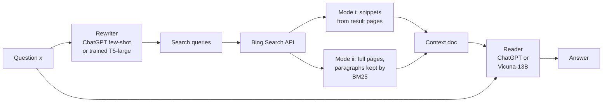
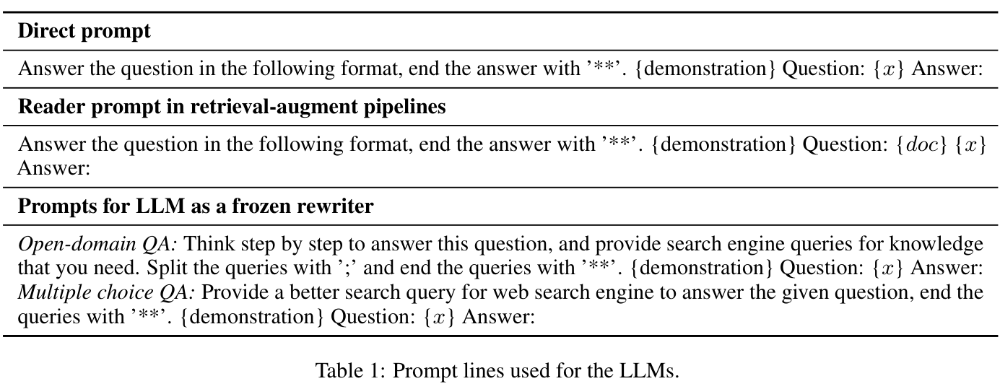

# 05. Implementation (Paper Section 4, with Appendix B)

In this note:

- The three components as built: rewriter, retriever, reader
- Table 1 of the paper: the exact prompts
- How Bing search is used in two ways (snippets, and pages filtered with BM25)
- The training settings from Appendix B, including the adaptive KL weight
- How each choice maps to our project

## The Three Components

<table width="100%">
<thead><tr><th>Component</th><th>Frozen pipeline (Section 3.1)</th><th>Trainable pipeline (Section 3.2)</th></tr></thead>
<tbody>
<tr><td>Rewriter</td><td>An LLM (ChatGPT) with few-shot in-context learning</td><td>A fine-tuned T5-large</td></tr>
<tr><td>Retriever</td><td>Bing search engine</td><td>Bing search engine</td></tr>
<tr><td>Reader</td><td>ChatGPT (gpt-3.5-turbo) or Vicuna-13B, few-shot</td><td>Same</td></tr>
</tbody>
</table>

## The Rewriter

> "Our prompt follows the formulation of [instruction, demonstrations, input], where the input is x. The instruction is straightforward and demonstrations are 1-3 random examples from training sets and are kept constant across all runs."

The demonstrations mainly show the **output format**, for example a short phrase as the answer for HotpotQA, an option letter for MMLU. Keeping them constant across runs removes one source of variation, the same reason our evaluation keeps the judge prompt fixed.

## Table 1 of the Paper: The Prompts

<table width="100%">
<thead><tr><th>Prompt</th><th>Used for</th><th>What to notice</th></tr></thead>
<tbody>
<tr><td>Direct prompt</td><td>The "Direct" baseline: the LLM answers from its own knowledge</td><td>No documents at all</td></tr>
<tr><td>Reader prompt in retrieval-augmented pipelines</td><td>Both retrieve-then-read and rewrite-retrieve-read</td><td>Question: {doc} {x}: the reader always receives the retrieved documents and the <b>original</b> question</td></tr>
<tr><td>Frozen rewriter, open-domain QA</td><td>Writing queries for HotpotQA, AmbigNQ, PopQA</td><td>"Think step by step ... provide search engine queries for knowledge that you need. Split the queries with ';'": several queries allowed, reasoning encouraged</td></tr>
<tr><td>Frozen rewriter, multiple-choice QA</td><td>Writing queries for MMLU</td><td>"Provide a better search query for web search engine": one improved query</td></tr>
</tbody>
</table>

Every prompt ends answers with "**" so the output can be cut at a fixed marker.

One detail: Section 4 says the reader input is "x or [doc, x-tilde-hat]", while Table 1 shows {doc} {x}. Table 1 and Figure 1 (the yellow line from the input to the reader) both indicate that the reader sees the original question; that is also the rule in our basic concepts note 03 ("rewrite for retrieval, answer the original").

## The Retriever: Bing in Two Modes

> "We use the Bing search engine as the retriever. It requires no candidate index construction like a dense retriever, nor candidates like a textbook. But it allows for a wide knowledge scope and up-to-time factuality."

<table width="100%">
<thead><tr><th>Mode</th><th>How</th><th>Like a person who</th></tr></thead>
<tbody>
<tr><td>(i) Snippets</td><td>Concatenate the short related sentences Bing shows for each result</td><td>Reads only the search results page</td></tr>
<tr><td>(ii) Pages with BM25</td><td>Request each result URL, parse the page text, score each paragraph against the query with BM25, keep the highest-scoring paragraphs until a maximum context length</td><td>Clicks the results and reads the relevant parts</td></tr>
</tbody>
</table>

Mode (ii) is itself a small **two-stage retrieval**: web search finds pages (recall), BM25 picks the best paragraphs (precision). That is the same retrieve-then-filter pattern as our candidate retrieval and reranking (basic concepts notes 06 to 08), with BM25 in place of a cross-encoder.

## The Reader

> "The reader is a frozen LLM, where we adopt ChatGPT (gpt-3.5-turbo) and Vicuna-13B. It performs reading comprehension and prediction with few-shot in-context learning."

The authors deliberately do not tune the reader prompt: "As it is not the focus of this work, we pay no more attention to prompt editing." The prediction prompts are the same for every method, so differences come only from the retrieved context.

## Training Settings (Appendix B)

<table width="100%">
<thead><tr><th>Setting</th><th>Warm-up</th><th>Reinforcement learning</th></tr></thead>
<tbody>
<tr><td>Model</td><td>T5-large</td><td>T5-large (policy) and a value network initialised from it</td></tr>
<tr><td>Learning rate</td><td>3e-5</td><td>2e-6</td></tr>
<tr><td>Batch size</td><td>16 or 20</td><td>8 or 16</td></tr>
<tr><td>Epochs</td><td>6, 8 or 12</td><td>2, 3 or 4 per sampling round</td></tr>
<tr><td>Sampling</td><td>-</td><td>5120 sampling steps, 10 threads, 512 steps each</td></tr>
<tr><td>Reward weights</td><td>-</td><td>lambda_f = lambda_h = 1.0 (Equation 6, note 06)</td></tr>
<tr><td>Decoding</td><td colspan="2">4-beam search, returning one sequence</td></tr>
<tr><td>Retrieval in RL</td><td colspan="2">BM25 pages for AmbigNQ, snippets for the other datasets</td></tr>
</tbody>
</table>

### The adaptive KL weight

The beta in Equation 4 (note 04) is not fixed; it is adjusted during training to keep the KL divergence near a target:

$$e_t = \text{clip}\left(\frac{\text{KL}(\pi \,\|\, \pi_0) - \text{KL}_{target}}{\text{KL}_{target}}, -0.2, 0.2\right), \qquad \beta_{t+1} = \beta_t \, (1 + K_\beta \, e_t)$$

<table width="100%">
<thead><tr><th>Symbol (plain text)</th><th>Value</th><th>Meaning</th></tr></thead>
<tbody>
<tr><td>KL_target</td><td>0.2</td><td>The divergence from the warmed-up rewriter that training aims for</td></tr>
<tr><td>e_t</td><td>between -0.2 and 0.2</td><td>Relative error: positive if the rewriter has moved too far, negative if not far enough</td></tr>
<tr><td>K_beta</td><td>0.1</td><td>How fast beta reacts</td></tr>
<tr><td>beta_0</td><td>0.001</td><td>Starting penalty weight</td></tr>
</tbody>
</table>

**In words:** if the rewriter drifts too far from pi_0, increase the penalty; if it stays too close, relax it. Example: KL = 0.3 gives e = clip(0.5) = 0.2, so beta grows by 2 percent (1 + 0.1 x 0.2 = 1.02).

## Mapping to Our Project

<table width="100%">
<thead><tr><th>Paper</th><th>Our Advanced RAG</th><th>Why</th></tr></thead>
<tbody>
<tr><td>ChatGPT few-shot rewriter</td><td>gpt-4o-mini rewriter with rules (basic concepts note 03)</td><td>Same idea, newer model; our prompt also adds standalone rewriting for follow-ups</td></tr>
<tr><td>Bing web search</td><td>FAISS over our own documents</td><td>Our knowledge is private files, not the web</td></tr>
<tr><td>BM25 paragraph filtering of pages</td><td>Cross-encoder reranking of 20 candidates</td><td>Same two-stage pattern, more accurate scorer</td></tr>
<tr><td>Reader sees doc + original question</td><td>Generator sees kept chunks + the user's question</td><td>Answer the user's intent, not the rewrite</td></tr>
<tr><td>Multiple queries split by ";"</td><td>One query by default; multi-query as an option (basic concepts note 04)</td><td>Simpler first; added only if evaluation shows misses</td></tr>
<tr><td>T5 + PPO training</td><td>Not implemented</td><td>Needs a large labelled training set and GPUs</td></tr>
</tbody>
</table>

## Key Points

- Rewriter prompts follow [instruction, demonstrations, input] with 1 to 3 fixed demonstrations; the open-domain prompt asks the LLM to think and output several queries.
- The retriever is Bing, used either as snippets or as full pages filtered by BM25 (a small two-stage retrieval).
- The reader (ChatGPT or Vicuna-13B) always gets the documents and the original question, with the same prompt for every method.
- RL settings: learning rate 2e-6, 4-beam decoding, and a KL weight that adapts towards a target of 0.2.

## Navigation

Previous: [04. Methodology](04.%20Methodology.md) | [Paper index](README.md) | Next: [06. Experiments](06.%20Experiments.md)
