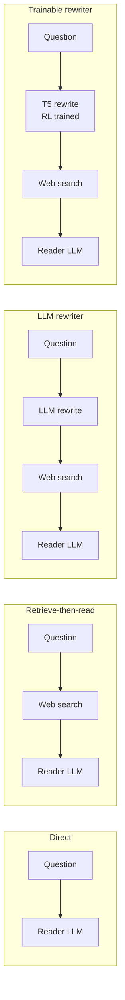
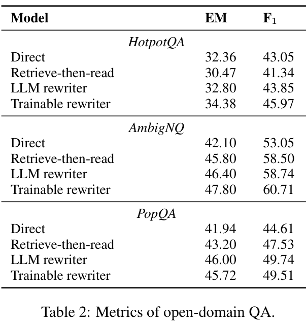
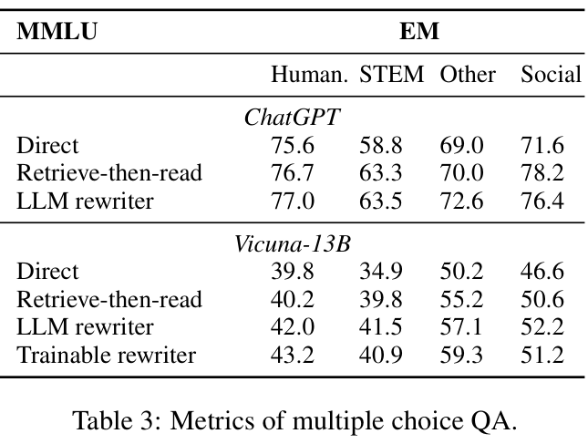

# 06. Experiments (Paper Section 5)

In this note:

- 5.1 The tasks: three open-domain QA datasets and MMLU
- The metrics: Exact Match and F1, with a worked example
- The rewards used for reinforcement learning (Equations 6 and 7)
- 5.2 The four settings compared
- 5.3 Results: Table 2 (open-domain QA) and Table 3 (multiple-choice QA), explained number by number

## 5.1 Task Settings

### Open-domain QA

<table width="100%">
<thead><tr><th>Dataset</th><th>What it tests</th><th>Test set used</th></tr></thead>
<tbody>
<tr><td>HotpotQA (Yang et al. 2018)</td><td>Complex questions that need multi-hop reasoning (facts from two or more documents)</td><td>The full test set</td></tr>
<tr><td>AmbigNQ (Min et al. 2020)</td><td>Ambiguous Natural Questions, each rewritten with minimal constraints into several specific questions</td><td>The first 1000 samples</td></tr>
<tr><td>PopQA (Mallen et al. 2022)</td><td>Long-tail facts about less popular entities, where models have weak parametric knowledge</td><td>Split into 13k training and 714 test</td></tr>
</tbody>
</table>

ChatGPT is used as both the reader and the frozen rewriter.

### Multiple-choice QA

MMLU (Hendrycks et al. 2021): exam questions in four categories (Humanities, STEM, Social Sciences, Other), each split 80 percent training and 20 percent test. A question with its options, q' = [q, c0, c1, c2, c3], is rewritten into a search query; the answer is one option. Retrieved documents that appear in the official contamination lists (pages known to contain the test questions) are ignored, so the retriever cannot simply find the answer key. ChatGPT is the rewriter and reader; Vicuna-13B is also used as a reader "due to the rate limit issue of ChatGPT".

## The Metrics: Exact Match and F1

<table width="100%">
<thead><tr><th>Metric</th><th>Definition</th></tr></thead>
<tbody>
<tr><td>Exact Match (EM)</td><td>1 if the normalised predicted answer equals the normalised gold answer, else 0; averaged over questions and shown as a percentage</td></tr>
<tr><td>F1</td><td>Token overlap between prediction and gold answer: the harmonic mean of precision (share of predicted tokens that are in the gold answer) and recall (share of gold tokens that are predicted)</td></tr>
</tbody>
</table>

$$\text{F1} = \frac{2 \cdot P \cdot R}{P + R}$$

**Worked example:** gold answer "director", prediction "film director".

- EM = 0 (the strings differ).
- Precision P = 1/2 (one of the two predicted tokens is in the gold answer), recall R = 1/1.
- F1 = 2 x 0.5 x 1 / (0.5 + 1) = 0.667.

F1 gives partial credit; EM does not. That is why both are reported.

## The Rewards (Equations 6 and 7)

For open-domain QA, the RL reward adds a **retrieval** term to the answer metrics:

$$\text{Hit} = \begin{cases} 1 & a \in doc \\ -1 & \text{else} \end{cases}, \qquad R_{lm} = \text{EM} + \lambda_f \, \text{F1} + \lambda_h \, \text{Hit} \qquad (6)$$

<table width="100%">
<thead><tr><th>Symbol (plain text)</th><th>Meaning</th></tr></thead>
<tbody>
<tr><td>a in doc</td><td>The gold answer string appears in the retrieved documents</td></tr>
<tr><td>Hit</td><td>+1 if retrieval found the answer, -1 if it did not</td></tr>
<tr><td>lambda_f, lambda_h</td><td>Weights for F1 and Hit; both 1.0 in the paper (Appendix B)</td></tr>
</tbody>
</table>

**Why Hit matters:** the reader may answer correctly from its own memory even with a bad query, or wrongly even with a good one. Rewarding the retriever's hit directly gives the rewriter a cleaner signal about what it controls: whether its query finds the answer.

For multiple-choice QA the reward is only the answer accuracy:

$$R_{lm} = \text{EM} \qquad (7)$$

(An option label cannot be "found" in retrieved documents, so a Hit term would not make sense.)

## 5.2 The Four Settings

<table width="100%">
<thead><tr><th>Setting</th><th>Retrieval</th><th>Query</th></tr></thead>
<tbody>
<tr><td>Direct</td><td>None</td><td>-</td></tr>
<tr><td>Retrieve-then-read</td><td>Yes</td><td>The original question (Naive RAG)</td></tr>
<tr><td>LLM as a frozen rewriter</td><td>Yes</td><td>Queries written by the prompted LLM</td></tr>
<tr><td>Trainable rewriter</td><td>Yes</td><td>Queries written by the T5 rewriter after warm-up and RL</td></tr>
</tbody>
</table>

The reader prompts are the same in every setting, so differences come only from retrieval and the query.

## 5.3 Results: Open-Domain QA

<table width="100%">
<thead><tr><th>Dataset</th><th>Direct EM</th><th>Retrieve-then-read EM</th><th>LLM rewriter EM</th><th>Trainable rewriter EM</th><th>Best gain over retrieve-then-read</th></tr></thead>
<tbody>
<tr><td>HotpotQA</td><td>32.36</td><td>30.47</td><td>32.80</td><td>34.38</td><td>+3.91 EM (trainable)</td></tr>
<tr><td>AmbigNQ</td><td>42.10</td><td>45.80</td><td>46.40</td><td>47.80</td><td>+2.00 EM (trainable)</td></tr>
<tr><td>PopQA</td><td>41.94</td><td>43.20</td><td>46.00</td><td>45.72</td><td>+2.80 EM (LLM)</td></tr>
</tbody>
</table>

What the numbers say:

1. **Rewriting helps on every dataset**, with both rewriters (EM and F1 both rise).
2. **On HotpotQA, plain retrieval hurts** (30.47 below the 32.36 of Direct). Searching with a complex multi-hop question brings noise, as the paper says: "multi-hop questions are not suitable queries for the web search engine". Rewriting turns this into a gain (34.38).
3. **On AmbigNQ and PopQA, plain retrieval already helps**, and rewriting adds more.
4. **On PopQA the trainable rewriter is slightly below the LLM rewriter** (45.72 against 46.00); the paper concludes "the distillation of query rewriting is sub-optimal" there (note 07 explains why).

The HotpotQA result is the same lesson as our Naive RAG evaluation: searching with the question as typed can retrieve the wrong things; a better query fixes retrieval before anything else changes.

## 5.3 Results: Multiple-Choice QA

<table width="100%">
<thead><tr><th>Reader</th><th>Setting</th><th>Humanities</th><th>STEM</th><th>Other</th><th>Social</th></tr></thead>
<tbody>
<tr><td>ChatGPT</td><td>Direct</td><td>75.6</td><td>58.8</td><td>69.0</td><td>71.6</td></tr>
<tr><td>ChatGPT</td><td>Retrieve-then-read</td><td>76.7</td><td>63.3</td><td>70.0</td><td>78.2</td></tr>
<tr><td>ChatGPT</td><td>LLM rewriter</td><td>77.0</td><td>63.5</td><td>72.6</td><td>76.4</td></tr>
<tr><td>Vicuna-13B</td><td>Direct</td><td>39.8</td><td>34.9</td><td>50.2</td><td>46.6</td></tr>
<tr><td>Vicuna-13B</td><td>Retrieve-then-read</td><td>40.2</td><td>39.8</td><td>55.2</td><td>50.6</td></tr>
<tr><td>Vicuna-13B</td><td>LLM rewriter</td><td>42.0</td><td>41.5</td><td>57.1</td><td>52.2</td></tr>
<tr><td>Vicuna-13B</td><td>Trainable rewriter</td><td>43.2</td><td>40.9</td><td>59.3</td><td>51.2</td></tr>
</tbody>
</table>

What the numbers say:

1. **With ChatGPT, rewriting helps in three of four categories**; in Social Sciences it is below plain retrieval (76.4 against 78.2).
2. **With Vicuna-13B, rewriting helps in all four**, and gains are larger: from retrieve-then-read to the best rewriter, +3.0 Humanities, +1.7 STEM, +4.1 Other, +1.6 Social.
3. The paper's explanation: "a more powerful reader has more parametric memories, thus more difficult to compensate with external knowledge". A strong reader already knows much of the answer; a weaker reader benefits more from good retrieval.
4. The trainable rewriter is the best in two Vicuna categories (Humanities 43.2, Other 59.3), and the LLM rewriter in the other two.

## What This Means for Our Project

- Expect rewriting to help most where the question is a poor search query (multi-part, ambiguous, informal) and least where it is already specific; our ablation (basic concepts note 12) measures it separately.
- The Hit reward is the same idea as our retrieval hit rate: measure whether the retriever found the answer, not only whether the final answer was right.
- Gains of 2 to 4 EM points are typical for this technique; it is a solid improvement, not a revolution, which is why Advanced RAG combines it with reranking.

## Key Points

- Tasks: HotpotQA, AmbigNQ, PopQA (EM, F1) and MMLU (EM), with ChatGPT and Vicuna-13B as readers.
- RL reward for QA = EM + F1 + Hit, where Hit is +1 if the retrieved documents contain the answer and -1 otherwise.
- Rewriting improves every open-domain QA dataset; on HotpotQA it turns retrieval from harmful into helpful (30.47 to 34.38 EM).
- On MMLU rewriting helps mostly, more for the weaker reader (Vicuna-13B) than for ChatGPT.

## Navigation

Previous: [05. Implementation](05.%20Implementation.md) | [Paper index](README.md) | Next: [07. Analysis](07.%20Analysis.md)
