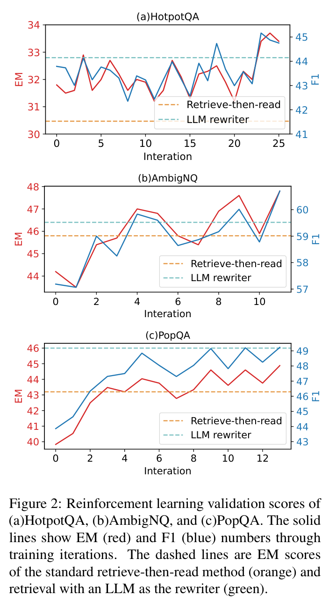
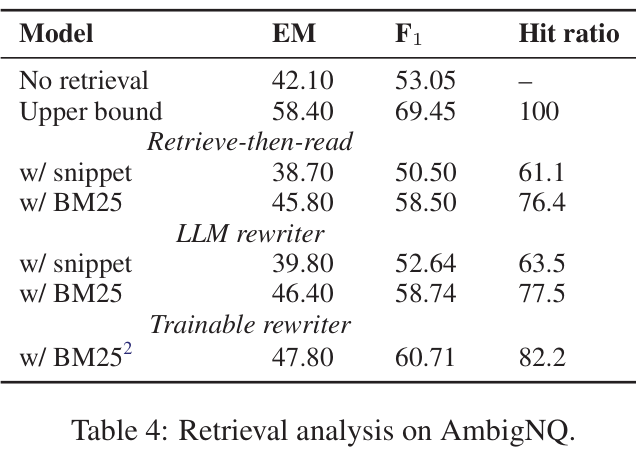
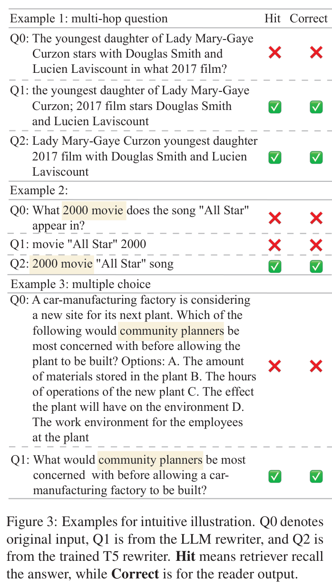
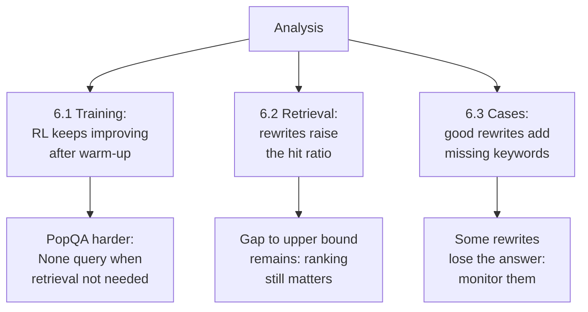

# 07. Analysis (Paper Section 6)

In this note:

- 6.1 The training process: Figure 2, curve by curve
- Why the trainable rewriter stays behind on PopQA, and the "None" query
- 6.2 Retrieval results: Table 4 and the hit ratio
- 6.3 Case study: Figure 3, three examples
- What the analysis teaches for our project

## 6.1 Training Process

Training has two stages: warm-up, then reinforcement learning. Figure 2 shows validation scores during RL. "0 iteration" is the rewriter right after warm-up.

**How to read it:** solid red line = EM, solid blue line = F1 of the trainable rewriter (left and right axes). Dashed orange = EM of retrieve-then-read; dashed green = EM with the LLM rewriter. The x axis is the RL iteration.

<table width="100%">
<thead><tr><th>Panel</th><th>Start (after warm-up)</th><th>What happens during RL</th><th>Reading</th></tr></thead>
<tbody>
<tr><td>(a) HotpotQA</td><td>About 31.8 EM, already above retrieve-then-read (30.47)</td><td>Fluctuates, then rises to about 33.7 EM, above the LLM rewriter (32.80)</td><td>Multi-hop questions are poor queries, so any rewrite helps a lot; RL improves further</td></tr>
<tr><td>(b) AmbigNQ</td><td>About 44 EM, below both baselines</td><td>Overtakes both baselines after about 3 to 4 iterations, ending near 47.8</td><td>RL "can compensate for the insufficiency of the distillation on the pseudo data"</td></tr>
<tr><td>(c) PopQA</td><td>About 40 EM, below both baselines</td><td>Rises above retrieve-then-read (43.20) but stays below the LLM rewriter (46.00)</td><td>A harder case, explained below</td></tr>
</tbody>
</table>

The curves "show upward trends with some fluctuations on all the datasets": RL works, but noisily, typical of policy-gradient training.

### Why PopQA is harder, and the "None" query

PopQA was built to study **adaptive retrieval**: retrieving only when it helps, because unnecessary retrieval can hurt. So the right "query" is sometimes **None** (do not retrieve). Deciding that is hard for a small model:

> "LLM rewriter knows better when the retrieval is needed for itself as a reader."

The paper measures how well each rewriter outputs "None" for questions that need no retrieval:

<table width="100%">
<thead><tr><th>Retrieval-free set defined as</th><th>LLM rewriter F1</th><th>T5 rewriter F1</th></tr></thead>
<tbody>
<tr><td>Questions answered correctly without retrieval (Direct)</td><td>71.9%</td><td>67.1%</td></tr>
<tr><td>Questions correct without retrieval but wrong with retrieval</td><td>78.7%</td><td>77.4%</td></tr>
</tbody>
</table>

Here F1 measures how well "None" outputs match the retrieval-free set. The LLM rewriter is better at knowing what it already knows, because it **is** the reader (the same ChatGPT), while the T5 rewriter must guess what the reader knows.

This is the idea behind later architectures: [10. Adaptive RAG](../../../../10.%20Adaptive%20RAG/) decides per question whether to retrieve, and [08. Self RAG](../../../../08.%20Self%20RAG/) lets the model itself decide when retrieval is needed.

## 6.2 Retrieval Result

QA metrics are indirect: the rewrite changes the documents, and the documents change the answer. To look at retrieval directly, the paper uses the **hit ratio**: the share of questions whose retrieved context contains the correct answer (after text normalisation).

<table width="100%">
<thead><tr><th>Row</th><th>EM</th><th>F1</th><th>Hit ratio</th><th>Meaning</th></tr></thead>
<tbody>
<tr><td>No retrieval</td><td>42.10</td><td>53.05</td><td>-</td><td>The reader alone</td></tr>
<tr><td>Upper bound</td><td>58.40</td><td>69.45</td><td>100</td><td>Only questions whose retrieved context contains the answer: roughly the best the reader can do with perfect retrieval</td></tr>
<tr><td>Retrieve-then-read, snippets</td><td>38.70</td><td>50.50</td><td>61.1</td><td>Snippets often miss the answer and even hurt (below no retrieval)</td></tr>
<tr><td>Retrieve-then-read, BM25</td><td>45.80</td><td>58.50</td><td>76.4</td><td>Full pages filtered by BM25 recall much better</td></tr>
<tr><td>LLM rewriter, snippets</td><td>39.80</td><td>52.64</td><td>63.5</td><td>Rewriting helps with snippets</td></tr>
<tr><td>LLM rewriter, BM25</td><td>46.40</td><td>58.74</td><td>77.5</td><td>... and with BM25</td></tr>
<tr><td>Trainable rewriter, BM25</td><td>47.80</td><td>60.71</td><td>82.2</td><td>Best: +5.8 hit ratio over retrieve-then-read with BM25</td></tr>
</tbody>
</table>

Footnote 2: the trainable rewriter was adapted to the BM25 retriever during RL; its queries reach a 73.4% hit ratio with snippets too.

Two observations from the paper:

1. "Content selection with BM25 recalls better documents than snippets, while query rewriting makes progress on both settings."
2. "The improvement in the hit rate of the retriever is more significant than the improvement in the reader." From retrieve-then-read to the trainable rewriter (BM25), the hit ratio rises by 5.8 points while EM rises by 2.0. Better retrieval does not turn fully into better answers, because the reader does not always use what it is given.

The gap between the upper bound (58.40 EM) and the best result (47.80 EM) shows how much room retrieval still leaves.

## 6.3 Case Study

Q0 is the original question, Q1 the LLM rewriter's query, Q2 the trained T5 rewriter's query. **Hit** = the retriever found the answer; **Correct** = the reader answered correctly.

<table width="100%">
<thead><tr><th>Example</th><th>What went wrong with Q0</th><th>What the rewrite changed</th><th>Result</th></tr></thead>
<tbody>
<tr><td>1. Multi-hop: "The youngest daughter of Lady Mary-Gaye Curzon stars with Douglas Smith and Lucien Laviscount in what 2017 film?"</td><td>A long question about a person who is never named</td><td>Both rewrites put "2017 film" next to "youngest daughter of Lady Mary-Gaye Curzon"; Q1 even splits it into two queries</td><td>Q0 fails; Q1 and Q2 hit and are correct (the actress Charlotte Calthorpe and her film are retrieved)</td></tr>
<tr><td>2. "What 2000 movie does the song 'All Star' appear in?"</td><td>-</td><td>The LLM's Q1 "movie 'All Star' 2000" separates "2000" from "movie" and is misunderstood; the T5's Q2 "2000 movie 'All Star' song" keeps "2000 movie" together</td><td>Q0 and Q1 fail; Q2 hits and is correct</td></tr>
<tr><td>3. Multiple choice about community planners and a new car factory</td><td>A long question with four options is a noisy query</td><td>Q1 removes the options and keeps the key concept "community planners"</td><td>Q0 fails; Q1 retrieves texts about community planning where "environment" (the right option) appears often</td></tr>
</tbody>
</table>

Example 2 is a useful warning: the LLM rewriter is not always better than a trained small model. Small word-order changes in a query can change what a search engine returns.

## The Analysis in One Picture

## What This Teaches for Our Project

<table width="100%">
<thead><tr><th>Paper finding</th><th>Our action</th></tr></thead>
<tbody>
<tr><td>Hit ratio improves more than answer accuracy</td><td>Measure retrieval separately (hit rate at N and at n) as well as correctness (basic concepts note 12)</td></tr>
<tr><td>Snippets versus BM25 pages: the second stage matters</td><td>Candidate retrieval followed by reranking, not just a better query (notes 06 to 08)</td></tr>
<tr><td>Sometimes the best query is no query</td><td>The threshold can send no context, and later folders (Adaptive RAG, Self RAG) decide when to retrieve</td></tr>
<tr><td>Rewrites can hurt (example 2)</td><td>Log every rewrite, measure rewrite faithfulness, fall back to the original question</td></tr>
<tr><td>Long multi-part questions benefit most</td><td>Expect the largest gains on our multi-part and follow-up test cases</td></tr>
</tbody>
</table>

## Key Points

- RL training improves the rewriter on all three datasets, with fluctuations; on AmbigNQ it overtakes both baselines after 3 to 4 iterations.
- On PopQA the trainable rewriter stays behind the LLM rewriter because deciding "no retrieval" requires knowing what the reader knows.
- Rewriting raises the hit ratio more than the answer accuracy (+5.8 versus +2.0 EM on AmbigNQ with BM25).
- The case study shows rewrites fixing multi-hop and noisy questions, and one where word order in the LLM's rewrite caused a miss.

## Navigation

Previous: [06. Experiments](06.%20Experiments.md) | [Paper index](README.md) | Next: [08. Conclusion and Limitations](08.%20Conclusion%20and%20Limitations.md)
