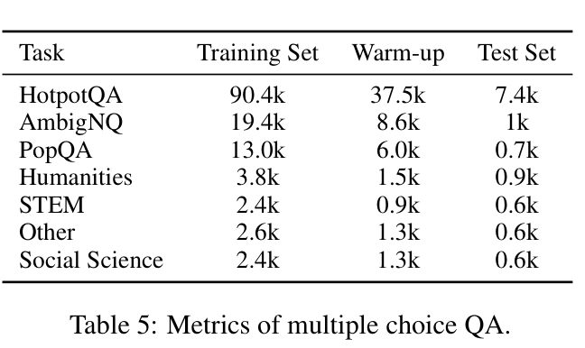
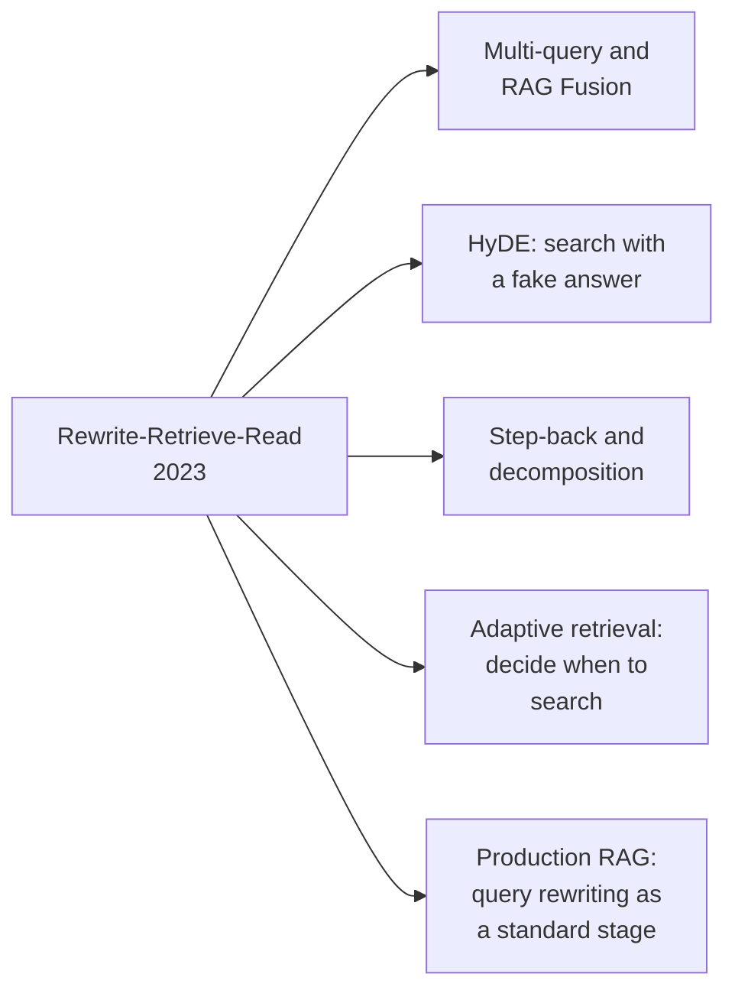

# 08. Conclusion and Limitations (Paper Section 7, Limitations, Appendix)

In this note:

- Section 7: what the authors say they showed
- The three limitations the authors state
- Appendix A: the warm-up dataset (Table 5)
- Appendix C: web search as a tool, pros and cons
- Limitations we add from reading the paper
- How later work followed, and what we take into our implementation

## Section 7: Conclusion

> "This paper introduces the Rewrite-Retrieve-Read pipeline, where a query rewriting step is added for the retrieval-augmented LLM. This approach is applicable for adopting a frozen large language model as the reader and a real-time web search engine as the retriever."

The authors claim three things:

<table width="100%">
<thead><tr><th>Claim</th><th>Evidence in the paper</th></tr></thead>
<tbody>
<tr><td>Retrieval augmentation can be improved from the query side</td><td>Rewriting improves every open-domain QA dataset and most MMLU categories (note 06)</td></tr>
<tr><td>A small trainable model can adapt a frozen pipeline</td><td>The T5-large rewriter trained with warm-up and RL matches or beats the LLM rewriter on HotpotQA and AmbigNQ (note 07)</td></tr>
<tr><td>A new way to put trainable modules into black-box LLM systems</td><td>The rewriter is trained only from the reader's outputs, never its weights</td></tr>
</tbody>
</table>

## Limitations Stated by the Authors

<table width="100%">
<thead><tr><th>#</th><th>Limitation (paper)</th><th>Simple meaning</th></tr></thead>
<tbody>
<tr><td>(i)</td><td>"There is still a trade-off between generalization and specialization among downstream tasks. Adding a training process, the scalability to direct transfer is compromised, compared to few-shot in-context learning."</td><td>A trained rewriter is tuned to one task, retriever and reader; a prompted LLM works on new tasks immediately</td></tr>
<tr><td>(ii)</td><td>LLM agents (ReAct, DSP) call the retriever several times, read earlier results and ask follow-up questions; this work "enhance[s] the one-turn retriever-then-read framework"</td><td>One rewrite, one retrieval: no iterative searching for multi-step needs</td></tr>
<tr><td>(iii)</td><td>"Using a web search engine as the retriever also leads to some limitations. Neural dense retrievers that are based on professional, filtered knowledge bases may potentially achieve better and controllable retrieval."</td><td>Web search is broad but uncontrolled; a curated index with a dense retriever can be more reliable</td></tr>
</tbody>
</table>

## Appendix A: The Warm-up Dataset

(The caption in the paper reads "Metrics of multiple choice QA", but the table actually lists dataset sizes.)

For datasets with official splits (HotpotQA, AmbigNQ) the whole training set is used; PopQA is split 13k / 714 by stratified sampling over its 16 question types; MMLU is split 80 / 20 per category. The warm-up column is the number of LLM rewrites kept because the reader answered correctly with them:

<table width="100%">
<thead><tr><th>Task</th><th>Training set</th><th>Warm-up (kept)</th><th>Share kept</th></tr></thead>
<tbody>
<tr><td>HotpotQA</td><td>90.4k</td><td>37.5k</td><td>41%</td></tr>
<tr><td>AmbigNQ</td><td>19.4k</td><td>8.6k</td><td>44%</td></tr>
<tr><td>PopQA</td><td>13.0k</td><td>6.0k</td><td>46%</td></tr>
<tr><td>Humanities</td><td>3.8k</td><td>1.5k</td><td>39%</td></tr>
<tr><td>STEM</td><td>2.4k</td><td>0.9k</td><td>38%</td></tr>
<tr><td>Other</td><td>2.6k</td><td>1.3k</td><td>50%</td></tr>
<tr><td>Social Science</td><td>2.4k</td><td>1.3k</td><td>54%</td></tr>
</tbody>
</table>

Fewer than half of the LLM's rewrites on HotpotQA led to a correct answer: even a strong LLM rewriter produces many queries that do not help, which is why filtering (and then RL) is needed.

## Appendix C: Web Search as a Tool

<table width="100%">
<thead><tr><th>Advantages</th><th>Disadvantages</th></tr></thead>
<tbody>
<tr><td>Well-developed retriever: no index to build or maintain</td><td>Commercial APIs that need subscriptions</td></tr>
<tr><td>The whole Internet: wide and up to date, reducing temporal misalignment</td><td>Vast knowledge is hard to control</td></tr>
<tr><td>Plug-and-play, like other tools LLMs call</td><td>Results can be inconsistent, redundant or toxic, which hinders the reader</td></tr>
</tbody>
</table>

The appendix ends with a general idea: search engines, code interpreters and other tools have no trainable parameters, so there can be a gap between the LLM and the tool; **a small trainable model in between can align them**. Query rewriting is one example.

## Limitations We Add

From reading the paper with our project in mind:

<table width="100%">
<thead><tr><th>Observation</th><th>Why it matters</th></tr></thead>
<tbody>
<tr><td>Modest absolute gains (about 2 to 4 EM points)</td><td>Rewriting alone does not close the gap to the upper bound (Table 4: 47.80 against 58.40 EM); it needs to be combined with better ranking</td></tr>
<tr><td>No reranking stage</td><td>BM25 paragraph selection is the only post-retrieval step; a cross-encoder could add more</td></tr>
<tr><td>Extra latency and cost are not reported</td><td>Each question needs an extra LLM call (frozen rewriter) or a T5 pass; production systems must budget for it (our basic concepts note 13)</td></tr>
<tr><td>Rewrites can be wrong</td><td>Figure 3, example 2: a reordered query missed the answer; rewrites must be monitored</td></tr>
<tr><td>Conversational follow-ups are not addressed</td><td>The inputs are single questions; resolving references to earlier turns is a separate need (our basic concepts note 05)</td></tr>
<tr><td>Web-specific evaluation</td><td>Results on Bing do not directly predict gains on a private document index</td></tr>
</tbody>
</table>

## How Later Work Followed

Query rewriting became a standard first stage in production RAG frameworks; the ideas it raised (several queries, no query when retrieval is not needed) are developed in 04. HyDE RAG, 05. RAG Fusion and 10. Adaptive RAG.

## What We Take Into Our Implementation

<table width="100%">
<thead><tr><th>From the paper</th><th>In our Advanced RAG</th></tr></thead>
<tbody>
<tr><td>Rewrite before retrieval with a frozen LLM</td><td>gpt-4o-mini condense-and-rewrite step (basic concepts notes 03, 05, 11)</td></tr>
<tr><td>Reader sees the original question</td><td>Generator answers the user's question, not the rewrite</td></tr>
<tr><td>Hit ratio as a direct retrieval measure</td><td>Hit rate at N and at n in the evaluation (note 12)</td></tr>
<tr><td>Second-stage filtering of retrieved text (BM25 over pages)</td><td>Cross-encoder reranking and a threshold (notes 08, 09)</td></tr>
<tr><td>Rewrites that helped are a training set</td><td>Logged rewrites with correctness can become a dataset for a small local rewriter later</td></tr>
</tbody>
</table>

## Key Points

- The paper shows retrieval-augmented LLMs can be improved by adapting the query, with a prompted LLM or a small RL-trained rewriter.
- Stated limitations: task specialisation of the trained rewriter, one-turn retrieval only, and the uncontrolled nature of web search.
- Only about 40 to 55 percent of LLM rewrites led to correct answers, which motivates filtering and RL.
- For our project: a frozen LLM rewriter, answering the original question, measuring retrieval hits, and combining rewriting with reranking.

## Navigation

Previous: [07. Analysis](07.%20Analysis.md) | [Paper index](README.md) | Next paper: [Passage Re-ranking with BERT](../02.%20Passage%20Re-ranking%20with%20BERT/)
