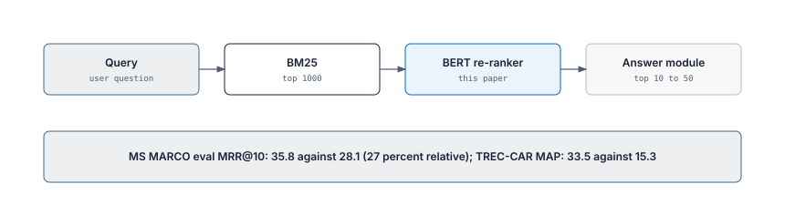
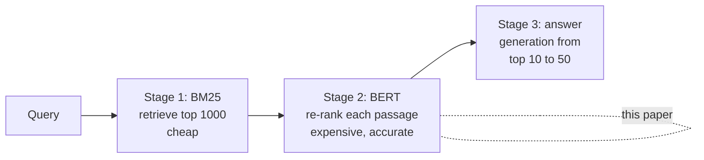

# 01. Abstract (Paper Section: Abstract)

In this note:

- The abstract split into its sentences
- Each sentence explained in simple words
- Words you need to know before reading further
- The paper in one picture

## The Abstract, Sentence by Sentence

This is a short paper (four pages of text), and the abstract has four sentences.

### Sentence 1

> "Recently, neural models pretrained on a language modeling task, such as ELMo (Peters et al., 2017), OpenAI GPT (Radford et al., 2018), and BERT (Devlin et al., 2018), have achieved impressive results on various natural language processing tasks such as question-answering and natural language inference."

**Simple meaning:** Around 2018, models that were first trained on huge amounts of text to predict words (pre-training) and then adjusted to a specific task (fine-tuning) beat earlier methods on many language tasks. BERT was the strongest of them.

### Sentence 2

> "In this paper, we describe a simple re-implementation of BERT for query-based passage re-ranking."

**Simple meaning:** The paper uses BERT for one specific job: given a search query and a list of passages that a first search returned, put the passages in a better order (re-ranking). The method is deliberately simple.

### Sentence 3

> "Our system is the state of the art on the TREC-CAR dataset and the top entry in the leaderboard of the MS MARCO passage retrieval task, outperforming the previous state of the art by 27% (relative) in MRR@10."

**Simple meaning:** It became the best system on two standard passage-ranking benchmarks. On MS MARCO, its MRR@10 score (how high the first relevant passage is ranked) was 27 percent higher than the previous best (35.8 against 28.1 on the evaluation set).

### Sentence 4

> "The code to reproduce our results is available at https://github.com/nyu-dl/dl4marco-bert"

**Simple meaning:** The code is public, so others can reproduce and build on it, which is one reason this paper became so widely used.

## Words You Need to Know

<table width="100%">
<thead><tr><th>Word</th><th>Meaning</th></tr></thead>
<tbody>
<tr><td>Pre-training</td><td>Training a model on large unlabelled text (for example predicting masked words) before using it for a task</td></tr>
<tr><td>Fine-tuning</td><td>Continuing to train a pre-trained model on a smaller, task-specific labelled dataset</td></tr>
<tr><td>BERT</td><td>Bidirectional Encoder Representations from Transformers: a transformer encoder that reads text in both directions; BERT-Base has about 110M parameters, BERT-Large about 340M</td></tr>
<tr><td>Passage re-ranking</td><td>Re-ordering a list of candidate passages, already retrieved for a query, by estimated relevance</td></tr>
<tr><td>MS MARCO</td><td>A large passage-ranking dataset built from real Bing search queries with human-marked relevant passages</td></tr>
<tr><td>TREC-CAR</td><td>TREC Complex Answer Retrieval: queries made of a Wikipedia article title and section title, with the section's paragraphs as relevant passages</td></tr>
<tr><td>MRR@10</td><td>Mean reciprocal rank at 10: average of 1 / rank of the first relevant passage in the top 10 (0 if none); higher is better</td></tr>
<tr><td>State of the art (SOTA)</td><td>The best published result on a benchmark at the time</td></tr>
</tbody>
</table>

## The Paper in One Picture

The paper places BERT in the middle stage of a three-stage question-answering pipeline:

<table width="100%">
<thead><tr><th>Stage</th><th>Paper</th><th>Our Advanced RAG</th></tr></thead>
<tbody>
<tr><td>1. Retrieve many candidates</td><td>BM25, top 1000</td><td>Embeddings and FAISS, top 20</td></tr>
<tr><td>2. Re-rank</td><td>BERT-Large cross-encoder</td><td>A cross-encoder reranker (basic concepts note 08)</td></tr>
<tr><td>3. Generate the answer</td><td>An answer module on the top 10 or 50</td><td>gpt-4o-mini on the kept 1 to 5 chunks</td></tr>
</tbody>
</table>

## Key Points

- The paper re-purposes BERT as a passage re-ranker: the middle stage between a cheap retriever and an answer generator.
- It became state of the art on MS MARCO (27 percent relative MRR@10 gain) and TREC-CAR.
- The method is simple and the code is public, which made it the template for cross-encoder rerankers.
- In our Advanced RAG, this is the reranking stage (basic concepts notes 07 and 08).

## Navigation

[Paper index](README.md) | Next: [02. Introduction](02.%20Introduction.md)
