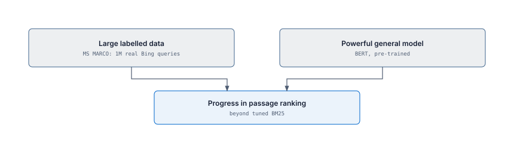
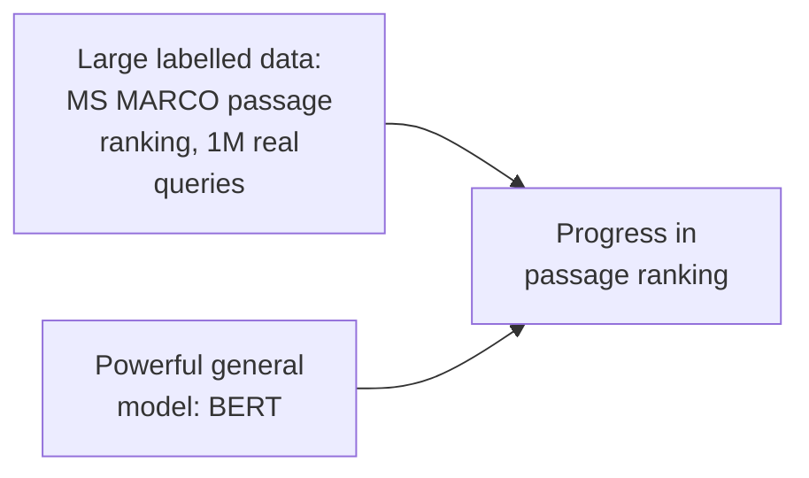

# 02. Introduction (Paper Section 1)

In this note:

- Why reading comprehension progressed fast: datasets plus neural models
- Why neural ranking had not yet beaten classic search
- The paper's argument: the two ingredients now exist for ranking too
- What the paper sets out to do

## The Reading Comprehension Story

> "We have seen rapid progress in machine reading compression [comprehension] in recent years with the introduction of large-scale datasets ... and the broad adoption of neural models."

<table width="100%">
<thead><tr><th>Ingredient</th><th>Examples named in the paper</th></tr></thead>
<tbody>
<tr><td>Large-scale datasets</td><td>SQuAD, MS MARCO, SearchQA, TriviaQA, QUASAR-T</td></tr>
<tr><td>Neural reading models</td><td>BiDAF, DrQA, DocumentQA, QANet</td></tr>
</tbody>
</table>

Reading comprehension means: given a question and a passage, find the answer in the passage. It improved quickly because there was a lot of labelled data **and** strong neural models to learn from it.

## Neural Ranking Had Not Yet Won

> "The information retrieval (IR) community has also experienced a flourishing development of neural ranking models, such as DRMM, KNRM, Co-PACRR, and DUET. However, until recently, there were only a few large datasets for passage ranking, with the notable exception of the TREC-CAR."

Neural ranking models existed, but without large training sets they could not show a clear advantage. The paper cites Lin (2019), who argued that neural ranking models were often not better than well-tuned classic methods such as BM25. Ranking had the models but lacked the data.

## The Argument: Both Ingredients Now Exist

> "We argue that the same two ingredients that made possible much progress on the reading comprehension task are now available for passage ranking task."

<table width="100%">
<thead><tr><th>Ingredient</th><th>For passage ranking</th></tr></thead>
<tbody>
<tr><td>Data</td><td>The MS MARCO passage ranking dataset: "one million queries from real users and their respective relevant passages annotated by humans"</td></tr>
<tr><td>Model</td><td>BERT, "a powerful general purpose natural language processing model"</td></tr>
</tbody>
</table>

## What the Paper Does

> "In this paper, we describe in detail how we have re-purposed BERT as a passage re-ranker and achieved state-of-the-art results on the MS MARCO passage re-ranking task."

The contribution is not a new architecture. It is showing that a general pre-trained model, fine-tuned simply, beats specialised ranking models by a wide margin. That shift (general pre-trained transformers replacing task-specific designs) is the same one that later brought LLMs into retrieval.

## Why It Matters for RAG

<table width="100%">
<thead><tr><th>Then (2019)</th><th>Now (in our project)</th></tr></thead>
<tbody>
<tr><td>BM25 retrieves, BERT re-ranks, a reader extracts answers</td><td>Embeddings retrieve, a cross-encoder re-ranks, an LLM writes the answer</td></tr>
<tr><td>Neural rankers needed large labelled data</td><td>Rerankers trained on MS MARCO (like ms-marco-MiniLM) are downloaded ready to use</td></tr>
<tr><td>The question: can neural ranking beat BM25?</td><td>The question: is reranking worth its latency in a RAG pipeline? (answered by our evaluation)</td></tr>
</tbody>
</table>

## Key Points

- Reading comprehension advanced because large datasets and neural models arrived together.
- Neural ranking lacked large datasets, so it had not clearly beaten BM25.
- MS MARCO (1M real queries with human labels) and BERT provide both ingredients for ranking.
- The paper shows a simply fine-tuned BERT is a state-of-the-art passage re-ranker.

## Navigation

Previous: [01. Abstract](01.%20Abstract.md) | [Paper index](README.md) | Next: [03. Passage Re-ranking with BERT](03.%20Passage%20Re-ranking%20with%20BERT.md)
