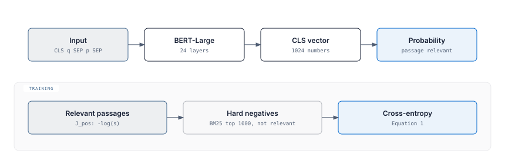
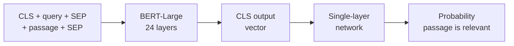
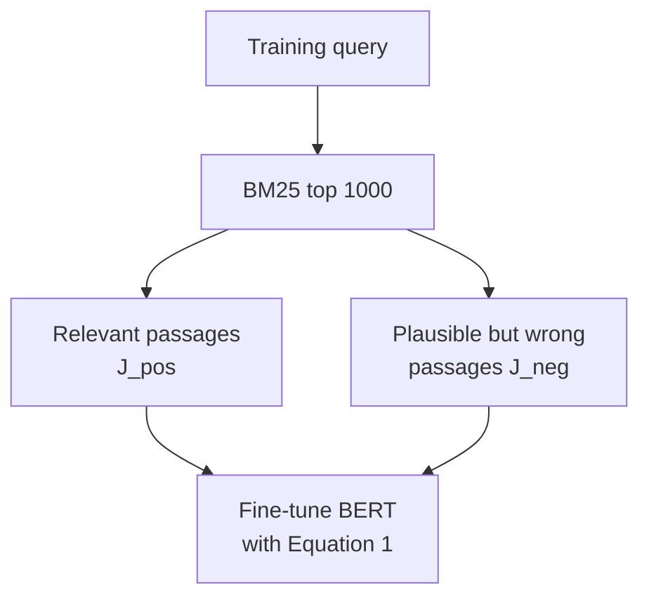

# 03. Passage Re-ranking with BERT (Paper Section 2)

In this note:

- The task: the three-stage question-answering pipeline
- The method: how query and passage are fed to BERT
- Truncation: the 64 and 512 token limits
- From the [CLS] vector to a relevance probability
- The training loss (Equation 1), symbol by symbol, with a worked example
- Why the negatives come from BM25 (hard negatives)



## The Task

> "A simple question-answering pipeline consists of three main stages. First, a large number (for example, a thousand) of possibly relevant documents to a given question are retrieved from a corpus by a standard mechanism, such as BM25. In the second stage, passage re-ranking, each of these documents is scored and re-ranked by a more computationally-intensive method. Finally, the top ten or fifty of these documents will be the source for the candidate answers by an answer generation module."

<table width="100%">
<thead><tr><th>Stage</th><th>Method</th><th>Passages per query</th><th>Cost per passage</th></tr></thead>
<tbody>
<tr><td>1. Retrieval</td><td>BM25 (keyword scoring)</td><td>About 1000 from the whole corpus</td><td>Very low</td></tr>
<tr><td>2. Re-ranking (this paper)</td><td>BERT</td><td>The 1000 candidates</td><td>High: one full BERT pass each</td></tr>
<tr><td>3. Answer generation</td><td>A reading model</td><td>The top 10 to 50</td><td>High</td></tr>
</tbody>
</table>

The paper implements only stage 2.

## The Method

> "The job of the re-ranker is to estimate a score s_i of how relevant a candidate passage d_i is to a query q. We use BERT as our re-ranker."

BERT accepts two text segments, sentence A and sentence B, separated by special tokens. The query is sentence A and the passage is sentence B:

```text
[CLS] query tokens (at most 64) [SEP] passage tokens [SEP]      (total at most 512 tokens)
```



Because both texts are in **one** input, every query token can attend to every passage token in every layer. This is what makes BERT a **cross-encoder** (basic concepts note 07).

### Truncation

> "We truncate the query to have at most 64 tokens. We also truncate the passage text such that the concatenation of query, passage, and separator tokens have the maximum length of 512 tokens."

<table width="100%">
<thead><tr><th>Part</th><th>Limit</th><th>Reason</th></tr></thead>
<tbody>
<tr><td>Query</td><td>64 tokens</td><td>Search queries are short; a cap protects the passage's share of the budget</td></tr>
<tr><td>Query + passage + 3 special tokens</td><td>512 tokens</td><td>BERT's maximum input length (its position embeddings stop at 512)</td></tr>
</tbody>
</table>

Example: a 20-token query leaves 512 - 20 - 3 = 489 tokens for the passage. Our chunks are 1000 characters (about 250 tokens), so they fit without truncation.

### From [CLS] to a probability

> "We use a BERT-LARGE model as a binary classification model, that is, we use the [CLS] vector as input to a single layer neural network to obtain the probability of the passage being relevant. We compute this probability for each passage independently and obtain the final list of passages by ranking them with respect to these probabilities."

Two points:

- **Binary classification:** the model only answers "relevant or not", but the **probability** it outputs gives a fine-grained score to sort by.
- **Independently:** each passage is scored on its own (pointwise), without seeing the other candidates. Sorting the 1000 probabilities gives the new ranking.

## The Training Loss (Equation 1)

> "We start training from a pre-trained BERT model and fine-tune it to our re-ranking task using the cross-entropy loss:"

$$L = -\sum_{j \in J_{pos}} \log(s_j) - \sum_{j \in J_{neg}} \log(1 - s_j) \qquad (1)$$

<table width="100%">
<thead><tr><th>Symbol (plain text)</th><th>Meaning</th></tr></thead>
<tbody>
<tr><td>L</td><td>The loss to minimise</td></tr>
<tr><td>s_j</td><td>The predicted probability that passage j is relevant</td></tr>
<tr><td>J_pos</td><td>Indexes of the relevant passages</td></tr>
<tr><td>J_neg</td><td>Indexes of the non-relevant passages among the top 1,000 retrieved by BM25</td></tr>
<tr><td>log(s_j)</td><td>Large negative number when a relevant passage gets a low probability, so its penalty -log(s_j) is large</td></tr>
<tr><td>log(1 - s_j)</td><td>Large negative number when a non-relevant passage gets a high probability</td></tr>
</tbody>
</table>

**In words:** reward high probabilities for relevant passages and low probabilities for non-relevant ones. This is the standard binary cross-entropy loss.

### Worked example

<table width="100%">
<thead><tr><th>Passage</th><th>Label</th><th>s_j</th><th>Loss term</th><th>Value</th></tr></thead>
<tbody>
<tr><td>A</td><td>Relevant</td><td>0.9</td><td>-log(0.9)</td><td>0.105 (small: good prediction)</td></tr>
<tr><td>B</td><td>Non-relevant</td><td>0.2</td><td>-log(1 - 0.2)</td><td>0.223 (small: good prediction)</td></tr>
<tr><td>C</td><td>Non-relevant</td><td>0.9</td><td>-log(1 - 0.9)</td><td>2.303 (large: confident and wrong)</td></tr>
</tbody>
</table>

A confident mistake costs about 20 times more than a correct prediction, so training focuses on fixing such mistakes.

## Why the Negatives Come From BM25

The non-relevant passages in J_neg are not random passages; they are passages that **BM25 ranked in its top 1000** but that are not relevant. These are **hard negatives**: they share words with the query and look plausible, so they are exactly what the re-ranker will face at test time and must learn to push down.



Training on easy, random negatives would teach the model to separate topics, which the first stage already does; hard negatives teach it the fine distinctions the second stage exists for. This is the same reason our Naive RAG failure (a results table outranking the answer chunk, both about Self-RAG) needs a cross-encoder.

## Key Points

- The re-ranker is stage 2 of retrieve (BM25, top 1000), re-rank (BERT), read (top 10 to 50).
- Input: [CLS] query [SEP] passage [SEP], query at most 64 tokens, total at most 512.
- BERT-Large is a binary relevance classifier: the [CLS] vector goes through one layer to a probability; passages are scored independently and sorted.
- Trained with binary cross-entropy, using BM25's non-relevant top results as hard negatives.

## Navigation

Previous: [02. Introduction](02.%20Introduction.md) | [Paper index](README.md) | Next: [04. Experiments](04.%20Experiments.md)
