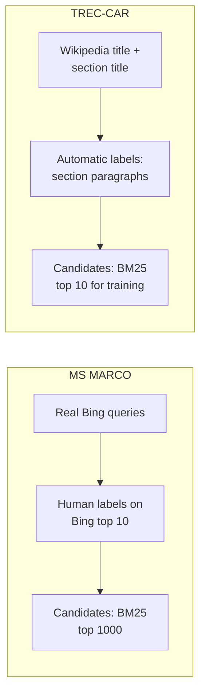

# 04. Experiments (Paper Sections 3.1 and 3.2)

In this note:

- 3.1 MS MARCO: the data, the evaluation sets and their quirks
- How the model was trained on MS MARCO, and how little data it needed
- 3.2 TREC-CAR: the data and the automatic annotations
- The Wikipedia leakage problem and how the authors avoided it
- Training on TREC-CAR
- The two datasets side by side

## 3.1 MS MARCO

<table width="100%">
<thead><tr><th>Split</th><th>Size</th><th>Content</th></tr></thead>
<tbody>
<tr><td>Training</td><td>About 400M tuples</td><td>Each tuple: a query, a relevant passage and a non-relevant passage</td></tr>
<tr><td>Development</td><td>About 6,900 queries</td><td>Each with the top 1,000 passages retrieved by BM25 from the MS MARCO corpus, and relevance labels</td></tr>
<tr><td>Evaluation</td><td>About 6,800 queries</td><td>Each with its top 1,000 BM25 passages, without public labels (scored by the leaderboard)</td></tr>
</tbody>
</table>

Two quirks the paper points out:

- **On average one relevant passage per query.** Ranking quality is therefore measured by where that single passage lands, which is what MRR@10 captures (note 05).
- **Some queries have no relevant passage in their candidate list.** The corpus was built by taking the top 10 passages from **Bing** and having people label them, while the candidate lists come from **BM25**; when BM25 misses the Bing passage, no re-ranker can find it. This is the recall ceiling from our basic concepts note 06: the re-ranker can only reorder what stage 1 returned.

### Training on MS MARCO

<table width="100%">
<thead><tr><th>Setting</th><th>Value</th></tr></thead>
<tbody>
<tr><td>Hardware</td><td>One Google TPU v3-8</td></tr>
<tr><td>Batch</td><td>128 sequences x 512 tokens = 65,536 tokens per batch</td></tr>
<tr><td>Iterations</td><td>100k, about 30 hours</td></tr>
<tr><td>Pairs seen</td><td>100k x 128 = 12.8M query-passage pairs, less than 2 percent of the training set</td></tr>
<tr><td>Longer training</td><td>3 more days (about 50M pairs in total) gave no improvement on the development set</td></tr>
<tr><td>Optimiser</td><td>Adam, learning rate 3 x 10^-6, beta1 = 0.9, beta2 = 0.999, L2 weight decay 0.01</td></tr>
<tr><td>Schedule</td><td>Learning-rate warm-up over the first 10,000 steps, then linear decay</td></tr>
<tr><td>Dropout</td><td>0.1 on all layers</td></tr>
</tbody>
</table>

The striking number is **less than 2 percent** of the available training data: pre-training already gave BERT most of the language understanding it needs, so fine-tuning only has to teach it what "relevant to this query" means. Note 05 shows that even 100k pairs are enough to beat the previous best system.

## 3.2 TREC-CAR

TREC Complex Answer Retrieval (Dietz et al. 2017):

<table width="100%">
<thead><tr><th>Part</th><th>Definition</th></tr></thead>
<tbody>
<tr><td>Query</td><td>A Wikipedia article title concatenated with the title of one of its sections, for example "Coffee / Health effects"</td></tr>
<tr><td>Relevant passages</td><td>The paragraphs inside that section</td></tr>
<tr><td>Corpus</td><td>All English Wikipedia paragraphs, except the abstracts</td></tr>
<tr><td>Splits</td><td>Five predefined folds: the first four for training (about 2.3M queries), the fifth for validation (about 580k queries)</td></tr>
<tr><td>Test set</td><td>The TREC-CAR 2017 test queries (about 2,254)</td></tr>
</tbody>
</table>

### Automatic annotations

The TREC-CAR 2017 organisers labelled by hand only the top five passages of each system submitted to the competition. A new system that finds a relevant passage no submitted system found would get no credit for it. The authors therefore evaluate with the **automatic annotations**, which give relevance for every query-passage pair (a paragraph is relevant if it belongs to the section).

### The leakage problem

> "The official pre-trained BERT models were pre-trained on the full Wikipedia, and therefore they have seen, although in an unsupervised way, Wikipedia documents that are used in the test set of TREC-CAR."

If BERT had already read the test paragraphs during pre-training, the results could be inflated. To avoid this **data leakage**, the authors **pre-trained BERT again, only on the half of Wikipedia used by TREC-CAR's training set**. That is a costly but honest choice, and a good example of checking whether a model has already "seen the exam".

### Training on TREC-CAR

<table width="100%">
<thead><tr><th>Setting</th><th>Value</th></tr></thead>
<tbody>
<tr><td>Training pairs</td><td>For each query, the top 10 passages retrieved by BM25 over the whole corpus (using the Anserini toolkit): 3M queries x 10 = 30M pairs</td></tr>
<tr><td>Iterations</td><td>400k with 32 pairs per batch = 12.8M examples, about 40 percent of the training set</td></tr>
<tr><td>Longer training</td><td>No gain on the development set</td></tr>
<tr><td>Other settings</td><td>Same procedure as MS MARCO</td></tr>
</tbody>
</table>

(The paper gives about 2.3M training queries in the dataset description and 3M queries when counting training pairs; the second is a rounded figure.)

## The Two Datasets Side by Side

<table width="100%">
<thead><tr><th></th><th>MS MARCO</th><th>TREC-CAR</th></tr></thead>
<tbody>
<tr><td>Queries</td><td>Real user questions</td><td>Synthetic: article and section titles</td></tr>
<tr><td>Labels</td><td>Human, about one relevant per query</td><td>Automatic, all paragraphs of the section</td></tr>
<tr><td>Metric</td><td>MRR@10</td><td>MAP</td></tr>
<tr><td>Training used</td><td>Under 2 percent of 400M tuples</td><td>About 40 percent of 30M pairs</td></tr>
<tr><td>Special care</td><td>Some queries unanswerable from BM25 candidates</td><td>BERT re-pre-trained to avoid Wikipedia test leakage</td></tr>
</tbody>
</table>

## What This Means for Our Project

- Rerankers like ms-marco-MiniLM are trained on exactly this MS MARCO data, so they are tuned to **web search questions over short passages**; our papers and HR documents are a different domain, which is why our basic concepts note 08 lists domain shift as a risk to measure.
- The recall ceiling (relevant passage not in the candidates) is real even on a benchmark; our evaluation reports hit rate at N to see it.
- The leakage check is a reminder for our test set: questions whose answers the LLM already knows (like the RAG paper's basics) can look good even with weak retrieval, so correctness should be read together with faithfulness and context precision.

## Key Points

- MS MARCO: about 400M training tuples, dev and eval sets of about 7k queries each with BM25 top 1000 candidates, about one relevant passage per query.
- BERT-Large trained for 30 hours on one TPU, seeing under 2 percent of the training data; longer training did not help.
- TREC-CAR: Wikipedia section retrieval, automatic labels, evaluated with MAP; BERT was re-pre-trained on half of Wikipedia to avoid test leakage.
- Both setups show pre-trained models need relatively little task data to rank well.

## Navigation

Previous: [03. Passage Re-ranking with BERT](03.%20Passage%20Re-ranking%20with%20BERT.md) | [Paper index](README.md) | Next: [05. Results](05.%20Results.md)
