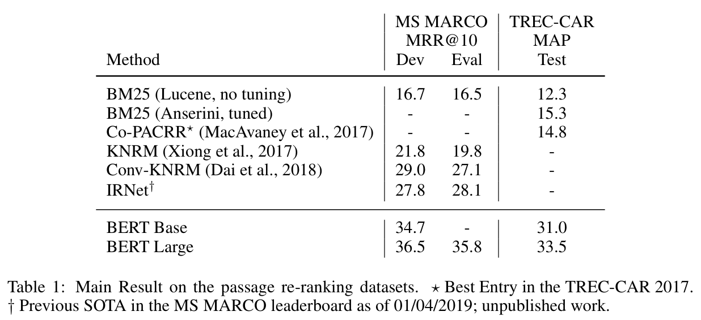
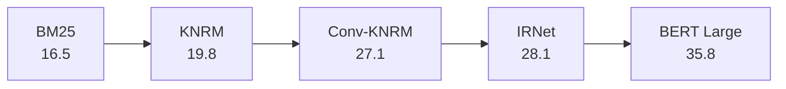
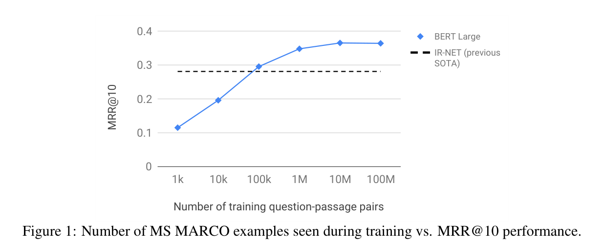
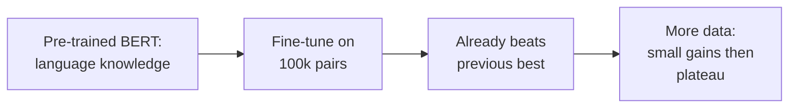

# 05. Results (Paper Section 3.3, Table 1 and Figure 1)

In this note:

- The two metrics: MRR@10 and MAP, with worked examples
- Table 1, row by row
- Where the 27 percent relative gain comes from
- BERT-Base against BERT-Large
- Figure 1: how much training data is needed
- What the results do and do not show

## The Metrics

### MRR@10 (MS MARCO)

For each query, find the rank of the **first** relevant passage in the top 10. Its reciprocal rank is 1 / rank, or 0 if no relevant passage is in the top 10. MRR@10 is the average over all queries, reported times 100 in Table 1.

<table width="100%">
<thead><tr><th>Query</th><th>Rank of first relevant passage</th><th>Reciprocal rank</th></tr></thead>
<tbody>
<tr><td>q1</td><td>1</td><td>1.000</td></tr>
<tr><td>q2</td><td>3</td><td>0.333</td></tr>
<tr><td>q3</td><td>Not in top 10</td><td>0.000</td></tr>
<tr><td>Mean</td><td></td><td>0.444, reported as 44.4</td></tr>
</tbody>
</table>

An MRR@10 of 36 roughly means "on average, the relevant passage sits between rank 2 and 3", but it is an average of very different cases: many queries at rank 1, many with no hit at all.

### MAP (TREC-CAR)

Mean average precision rewards ranking **all** relevant passages high, not only the first. For one query, average the precision at each rank where a relevant passage appears; then average over queries.

Example: relevant passages at ranks 1 and 4 out of 2 relevant in total. Precision at rank 1 = 1/1 = 1.0, precision at rank 4 = 2/4 = 0.5, average precision = (1.0 + 0.5) / 2 = 0.75.

MAP fits TREC-CAR because a section has several relevant paragraphs, while MS MARCO has about one per query.

## Table 1

> "Despite training on a fraction of the data available, the proposed BERT-based models surpass the previous state-of-the-art models by a large margin on both of the tasks."

<table width="100%">
<thead><tr><th>Method</th><th>MS MARCO Dev MRR@10</th><th>MS MARCO Eval MRR@10</th><th>TREC-CAR Test MAP</th><th>What it is</th></tr></thead>
<tbody>
<tr><td>BM25 (Lucene, no tuning)</td><td>16.7</td><td>16.5</td><td>12.3</td><td>Classic keyword baseline</td></tr>
<tr><td>BM25 (Anserini, tuned)</td><td>-</td><td>-</td><td>15.3</td><td>Keyword baseline with tuned parameters</td></tr>
<tr><td>Co-PACRR*</td><td>-</td><td>-</td><td>14.8</td><td>Neural ranker, best TREC-CAR 2017 entry</td></tr>
<tr><td>KNRM</td><td>21.8</td><td>19.8</td><td>-</td><td>Kernel-pooling neural ranker</td></tr>
<tr><td>Conv-KNRM</td><td>29.0</td><td>27.1</td><td>-</td><td>KNRM with n-gram convolutions</td></tr>
<tr><td>IRNet (previous best, unpublished)</td><td>27.8</td><td>28.1</td><td>-</td><td>Previous top of the MS MARCO leaderboard</td></tr>
<tr><td>BERT Base</td><td>34.7</td><td>-</td><td>31.0</td><td>This paper, 110M parameters</td></tr>
<tr><td>BERT Large</td><td>36.5</td><td>35.8</td><td>33.5</td><td>This paper, 340M parameters</td></tr>
</tbody>
</table>

(The paper marks Co-PACRR as the best entry in TREC-CAR 2017 and IRNet as the previous top of the MS MARCO leaderboard as of January 2019, unpublished work; "-" means the paper reports no number.)

### Reading the table

- **MS MARCO, eval set:** BERT-Large 35.8 against IRNet 28.1. Relative gain = (35.8 - 28.1) / 28.1 = 0.274, the **27 percent** in the abstract. Against untuned BM25 (16.5) it is more than double.
- **TREC-CAR:** BERT-Large 33.5 MAP against 15.3 for tuned BM25 and 14.8 for the best 2017 system: also more than double.
- **Neural rankers before BERT** (KNRM, Conv-KNRM, IRNet) already beat BM25 on MS MARCO, but by smaller steps; BERT's jump is larger than all previous steps together.

### BERT-Base against BERT-Large

<table width="100%">
<thead><tr><th>Model</th><th>Parameters</th><th>MS MARCO Dev</th><th>TREC-CAR MAP</th></tr></thead>
<tbody>
<tr><td>BERT-Base</td><td>About 110M</td><td>34.7</td><td>31.0</td></tr>
<tr><td>BERT-Large</td><td>About 340M</td><td>36.5</td><td>33.5</td></tr>
</tbody>
</table>

Three times the parameters gives about 2 MRR points. Most of the gain comes from **the cross-encoder approach itself**, not from size. This is why small cross-encoders (MiniLM with 6 to 12 layers) are used in production: they keep most of the quality at a fraction of the latency.

## Figure 1: How Much Training Data Is Needed

The x-axis is the number of query-passage pairs used for fine-tuning (log scale); the y-axis is MRR@10 on the development set. The dashed line is IRNet, the previous best.

<table width="100%">
<thead><tr><th>Training pairs</th><th>MRR@10 (approximate, read from the plot)</th><th>Against IRNet (about 0.28)</th></tr></thead>
<tbody>
<tr><td>1k</td><td>0.115</td><td>Far below</td></tr>
<tr><td>10k</td><td>0.195</td><td>Below, already above BM25</td></tr>
<tr><td>100k</td><td>0.295</td><td>Above</td></tr>
<tr><td>1M</td><td>0.35</td><td>Well above</td></tr>
<tr><td>10M and 100M</td><td>About 0.365</td><td>Flat: more data stops helping</td></tr>
</tbody>
</table>

> "For example, a BERT-LARGE trained on 100k question-passage pairs (less than 0.3% of the MS MARCO training data) is already 1.4 MRR@10 points better than the previous state-of-the-art, IR-NET."

The curve shows two things:

- **Fast start:** 100k pairs, a tiny fraction of MS MARCO, already beat a model trained on the full dataset. Pre-training does most of the work.
- **Early plateau:** after about 1M to 10M pairs, extra data adds almost nothing, matching the "no gain from 3 more days of training" observation in note 04.

## What the Results Show and Do Not Show

<table width="100%">
<thead><tr><th>Shows</th><th>Does not show</th></tr></thead>
<tbody>
<tr><td>A cross-encoder re-ranker roughly doubles BM25 quality on two benchmarks</td><td>Latency or cost: scoring 1000 passages with BERT-Large per query is slow, and the paper reports no timing</td></tr>
<tr><td>Little fine-tuning data is needed</td><td>How the model does on a domain unlike its training data</td></tr>
<tr><td>Bigger model helps modestly</td><td>The effect of the first-stage recall: all systems re-rank the same BM25 candidates</td></tr>
<tr><td>Gains hold on two very different datasets</td><td>Effect on final answers: there is no answer generation stage in the experiments</td></tr>
</tbody>
</table>

## What This Means for Our Project

- Our Naive RAG ranking problem (the right chunk at rank 3 or 4 behind a table) is the case MRR measures; our evaluation will report MRR before and after reranking (basic concepts note 12).
- A small MiniLM cross-encoder trained on MS MARCO is a reasonable choice: Table 1 shows size matters less than the cross-encoder design.
- We re-rank only 20 candidates, not 1000, which keeps latency low; the open question for us is latency on CPU, which the paper does not answer and our trace will measure.

## Key Points

- BERT-Large: MRR@10 35.8 on MS MARCO eval (previous best 28.1, a 27 percent relative gain) and MAP 33.5 on TREC-CAR (tuned BM25 15.3).
- BERT-Base is only about 2 points behind BERT-Large: the cross-encoder design gives most of the gain.
- 100k training pairs (under 0.3 percent of the data) already beat the previous best; quality plateaus after about 10M pairs.
- The paper does not measure latency, domain transfer or end-to-end answer quality.

## Navigation

Previous: [04. Experiments](04.%20Experiments.md) | [Paper index](README.md) | Next: [06. Conclusion](06.%20Conclusion.md)
