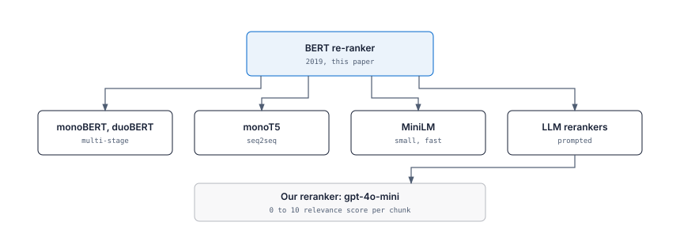
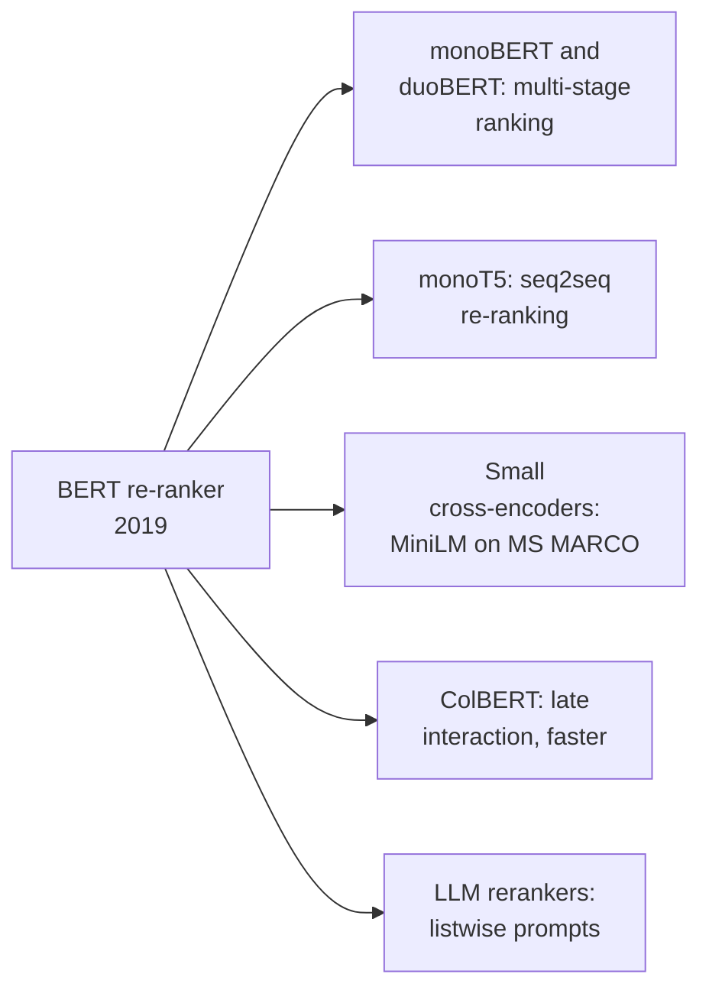

# 06. Conclusion (Paper Section 4)

In this note:

- Section 4: what the authors conclude
- Limitations we add from reading the paper
- How later work followed: monoBERT, MiniLM cross-encoders, LLM rerankers
- What we take into our implementation

## Section 4: Conclusion

> "We have described a simple adaptation of BERT as a passage re-ranker that has become the state of the art on two different tasks, which are TREC-CAR and MS MARCO. We have made the code to reproduce our experiments publicly available."

<table width="100%">
<thead><tr><th>Claim</th><th>Evidence in the paper</th></tr></thead>
<tbody>
<tr><td>A simple adaptation is enough</td><td>[CLS] query [SEP] passage [SEP], one layer on top, binary cross-entropy (note 03)</td></tr>
<tr><td>State of the art on MS MARCO</td><td>MRR@10 35.8 on eval against 28.1 for the previous best, 27 percent relative (note 05)</td></tr>
<tr><td>State of the art on TREC-CAR</td><td>MAP 33.5 against 15.3 for tuned BM25 and 14.8 for the best 2017 entry (note 05)</td></tr>
<tr><td>Reproducible</td><td>Code released at github.com/nyu-dl/dl4marco-bert</td></tr>
</tbody>
</table>

The paper states no limitations of its own; it is a four-page report of a leaderboard result.

## Limitations We Add

<table width="100%">
<thead><tr><th>Observation</th><th>Why it matters</th></tr></thead>
<tbody>
<tr><td>No latency or cost numbers</td><td>BERT-Large over 1000 passages per query needs 1000 forward passes of a 340M-parameter model; production systems re-rank far fewer candidates with smaller models</td></tr>
<tr><td>Bounded by first-stage recall</td><td>The re-ranker only reorders BM25 candidates; when the relevant passage is missing (note 04), nothing can recover it</td></tr>
<tr><td>512-token input limit</td><td>Long passages are truncated; documents must be chunked first</td></tr>
<tr><td>Pointwise scoring</td><td>Each passage is scored alone, so duplicates or near-duplicates can fill the top ranks</td></tr>
<tr><td>Domain transfer untested</td><td>Results on web questions and Wikipedia do not show performance on private documents such as ours</td></tr>
<tr><td>No end-to-end evaluation</td><td>Better ranking is measured, not better final answers</td></tr>
<tr><td>Scores are not calibrated across queries</td><td>A probability of 0.6 does not mean the same thing for every query, so fixed thresholds need tuning on our own data (basic concepts note 09)</td></tr>
</tbody>
</table>

## How Later Work Followed

<table width="100%">
<thead><tr><th>Direction</th><th>Idea</th><th>Trade-off</th></tr></thead>
<tbody>
<tr><td>monoBERT / duoBERT</td><td>This paper's model (monoBERT) followed by a pairwise model comparing two passages at a time</td><td>Better top ranks, more compute</td></tr>
<tr><td>monoT5</td><td>A sequence-to-sequence model generates "true" or "false" for relevance</td><td>Strong zero-shot transfer, larger models</td></tr>
<tr><td>Small cross-encoders</td><td>Distilled models such as ms-marco-MiniLM-L-6-v2 trained on the same MS MARCO data</td><td>Much faster, small quality loss</td></tr>
<tr><td>ColBERT</td><td>Encode query and passage separately but compare every token pair (late interaction)</td><td>Passage vectors can be precomputed, needs more storage</td></tr>
<tr><td>LLM rerankers</td><td>Prompt an LLM to order a list of passages (listwise)</td><td>No training, but slow and costly per query</td></tr>
</tbody>
</table>

The retrieve-then-rerank pattern this paper set up is now standard in RAG frameworks and hosted search services (for example semantic ranking options in managed search products).

## What We Take Into Our Implementation

<table width="100%">
<thead><tr><th>From the paper</th><th>In our Advanced RAG</th></tr></thead>
<tbody>
<tr><td>Cheap retrieval of many candidates, then an expensive re-ranker</td><td>FAISS returns N = 20 candidates, a cross-encoder re-ranks them (basic concepts notes 06, 08)</td></tr>
<tr><td>Query and passage in one input (cross-encoder)</td><td>The reranker reads (question, chunk) pairs</td></tr>
<tr><td>Relevance probability per passage</td><td>Reranker score per chunk, used to sort and to apply a threshold with dynamic k (note 09)</td></tr>
<tr><td>512-token limit</td><td>Our 1000-character chunks (about 250 tokens) fit without truncation</td></tr>
<tr><td>BERT-Base close to BERT-Large</td><td>A small MS MARCO cross-encoder is the default candidate; the final choice (local model or hosted service) is decided before the API step</td></tr>
<tr><td>MRR as the ranking metric</td><td>MRR before and after reranking in our evaluation (note 12)</td></tr>
<tr><td>Recall ceiling</td><td>Hit rate at N reported separately from hit rate after reranking</td></tr>
</tbody>
</table>

## Key Points

- The paper shows a simply fine-tuned BERT cross-encoder is a state-of-the-art passage re-ranker on MS MARCO and TREC-CAR.
- It reports no latency, cost or end-to-end answer quality, and its gains are bounded by first-stage recall.
- Later work made re-rankers smaller and faster (MiniLM, ColBERT) or more general (monoT5, LLM rerankers).
- For our project: retrieve 20 with FAISS, re-rank with a small cross-encoder, keep the best 1 to 5 by score, and measure MRR and hit rate before and after.

## Navigation

Previous: [05. Results](05.%20Results.md) | [Paper index](README.md) | Next paper: [RECOMP Compression and Selective Augmentation](../03.%20RECOMP%20Compression%20and%20Selective%20Augmentation/)
