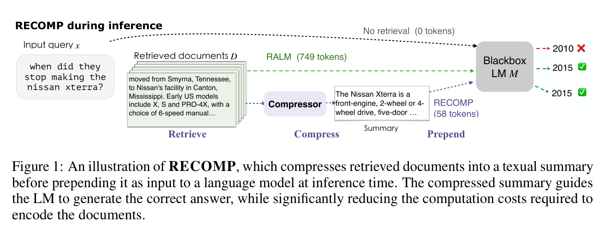
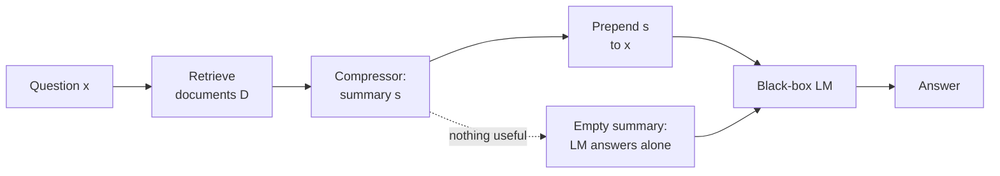

# 01. Abstract (Paper Section: Abstract)

In this note:

- The abstract split into its sentences
- Each sentence explained in simple words
- Words you need to know before reading further
- The paper in one picture (Figure 1)

## The Abstract, Sentence by Sentence

### Sentence 1: the setting

> "Retrieving documents and prepending them in-context at inference time improves performance of language model (LMs) on a wide range of tasks."

**Simple meaning:** This is RAG as we built it in Naive RAG: find documents, put them in the prompt before the question, and the model answers better.

### Sentence 2: the problem

> "However, these documents, often spanning hundreds of words, make inference substantially more expensive."

**Simple meaning:** Every retrieved document adds tokens to the prompt. More tokens mean more cost and more time per question.

### Sentence 3: the idea

> "We propose compressing the retrieved documents into textual summaries prior to in-context integration."

**Simple meaning:** Before putting the documents in the prompt, turn them into a short summary, and put only the summary in the prompt.

### Sentence 4: two benefits

> "This not only reduces the computational costs but also relieves the burden of LMs to identify relevant information in long retrieved documents."

**Simple meaning:** A short summary is cheaper, and it also helps quality: the model no longer has to find the useful sentence inside long, noisy text.

### Sentence 5: the two compressors

> "We present two compressors - an extractive compressor which selects useful sentences from retrieved documents and an abstractive compressor which generates summaries by synthesizing information from multiple documents."

<table width="100%">
<thead><tr><th>Compressor</th><th>What it does</th><th>Output</th></tr></thead>
<tbody>
<tr><td>Extractive</td><td>Picks the most useful sentences from the documents, word for word</td><td>A few original sentences</td></tr>
<tr><td>Abstractive</td><td>Writes a new summary that combines facts from several documents</td><td>New text</td></tr>
</tbody>
</table>

### Sentence 6: how they are trained

> "Both compressors are trained to improve LMs' performance on end tasks when the generated summaries are prepended to the LMs' input, while keeping the summary concise."

**Simple meaning:** A good summary here is not one a human would like; it is one that makes the **language model answer correctly**. Training uses that signal, and also rewards short summaries.

### Sentence 7: selective augmentation

> "If the retrieved documents are irrelevant to the input or offer no additional information to LM, our compressor can return an empty string, implementing selective augmentation."

**Simple meaning:** When the documents do not help, the compressor outputs nothing, so the model answers from its own knowledge instead of being misled. "Selective augmentation" means adding retrieved text only when it helps.

### Sentence 8: results

> "We evaluate our approach on language modeling task and open domain question answering task. We achieve a compression rate of as low as 6% with minimal loss in performance for both tasks, significantly outperforming the off-the-shelf summarization models."

**Simple meaning:** The summaries can be as small as 6 percent of the original documents' tokens with little loss in quality, and they work better than a general summarizer that was not trained for this goal.

### Sentence 9: transfer and faithfulness

> "We show that our compressors trained for one LM can transfer to other LMs on the language modeling task and provide summaries largely faithful to the retrieved documents."

**Simple meaning:** Because the summary is plain text, a compressor trained with one model can be used with another; and the summaries mostly stay true to the documents.

## Words You Need to Know

<table width="100%">
<thead><tr><th>Word</th><th>Meaning</th></tr></thead>
<tbody>
<tr><td>RALM</td><td>Retrieval-augmented language model: a language model that receives retrieved documents in its input</td></tr>
<tr><td>Prepend</td><td>Put text before the input; here, retrieved documents (or their summary) before the question</td></tr>
<tr><td>Compression rate</td><td>Summary tokens divided by original document tokens; 6 percent means the summary is 6 percent of the original length (lower is more compressed)</td></tr>
<tr><td>Extractive summary</td><td>A summary made of sentences copied from the source</td></tr>
<tr><td>Abstractive summary</td><td>A summary written in new words</td></tr>
<tr><td>Selective augmentation</td><td>Adding retrieved information only when it helps; otherwise adding nothing</td></tr>
<tr><td>Black-box LM</td><td>A model used only through its inputs and outputs, without changing its weights (like gpt-4o-mini through an API)</td></tr>
<tr><td>Faithful</td><td>Supported by the source documents, with no invented facts</td></tr>
</tbody>
</table>

## The Paper in One Picture (Figure 1)

The example question is "when did they stop making the nissan xterra?". Three ways to answer:

<table width="100%">
<thead><tr><th>Setting</th><th>Tokens in the prompt</th><th>Answer</th></tr></thead>
<tbody>
<tr><td>No retrieval</td><td>0</td><td>2010 (wrong)</td></tr>
<tr><td>RALM: prepend all retrieved documents</td><td>749</td><td>2015 (correct)</td></tr>
<tr><td>RECOMP: prepend the compressed summary</td><td>58</td><td>2015 (correct)</td></tr>
</tbody>
</table>

RECOMP keeps the correct answer with about 8 percent of the tokens (58 / 749).

## Key Points

- RECOMP adds one step to RAG: Retrieve, **Compress**, Prepend.
- Two compressors: extractive (select sentences) and abstractive (write a summary).
- Both are trained so the summary helps the language model answer, and kept short; both can return an empty string.
- Summaries reach 6 percent of the original tokens with small quality loss and transfer across language models.
- In our Advanced RAG, this is the optional compression stage (basic concepts note 10).

## Navigation

[Paper index](README.md) | Next: [02. Introduction](02.%20Introduction.md)
