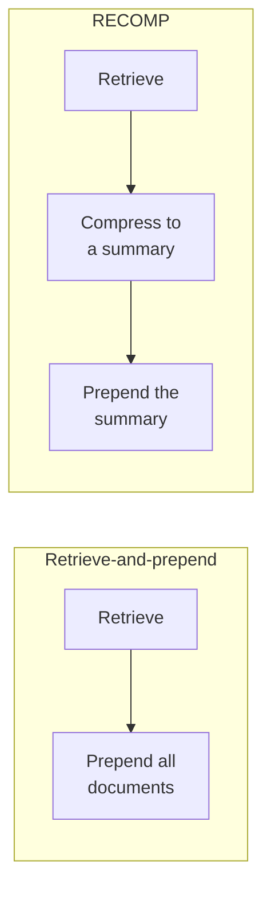

# 02. Introduction (Paper Section 1)

In this note:

- Why simply prepending documents is popular
- The three limitations of prepending documents
- RECOMP: Retrieve, Compress, Prepend
- The three properties a good summary needs
- How the compressors are trained, in short
- The headline results

## Why Prepending Is Popular

> "Simply prepending retrieved documents to the input without updating the language models (LMs) ... allows retrieval augmentation even for black-box LMs, but such approach comes with limitations."

Prepending needs no training of the language model, so it works with any model behind an API. This is exactly our Naive RAG.

## Three Limitations of Prepending

<table width="100%">
<thead><tr><th>#</th><th>Limitation (paper)</th><th>Simple meaning</th><th>In our Naive RAG</th></tr></thead>
<tbody>
<tr><td>1</td><td>"It increases computational costs as LMs now encode substantially more tokens."</td><td>More context tokens, more cost and latency</td><td>Most of our prompt tokens are the 4 chunks, not the question</td></tr>
<tr><td>2</td><td>Models "struggle to use all information in the context, frequently missing information placed in the middle" (Liu et al., 2023)</td><td>Long contexts are used unevenly: the "lost in the middle" effect</td><td>A useful chunk at position 2 or 3 can be under-used</td></tr>
<tr><td>3</td><td>"Prepending a large number of documents in-context can further confuse LMs with irrelevant information, degrading model performances."</td><td>Irrelevant text distracts the model</td><td>Context precision 0.41: more than half of the chunks were not useful</td></tr>
</tbody>
</table>

## RECOMP: Retrieve, Compress, Prepend

> "We propose RECOMP (Retrieve, Compress, Prepend), an intermediate step for RALMs which compresses retrieved documents into a textual summary prior to in-context augmentation."

### What a good summary must be

> "The generated summary should be concise to maximize efficiency, be faithful to the retrieved evidence documents, and guide RALM to generate desired outputs when prepended to the input."

<table width="100%">
<thead><tr><th>Property</th><th>Meaning</th></tr></thead>
<tbody>
<tr><td>Concise</td><td>As short as possible; empty when retrieval does not help</td></tr>
<tr><td>Faithful</td><td>Supported by the retrieved documents</td></tr>
<tr><td>Effective</td><td>Makes the language model produce the correct output</td></tr>
</tbody>
</table>

> "Our compressor strategically performs selective augmentation by generating an empty summary when the retrieved documents are irrelevant or unhelpful for target task."

## The Two Compressors, in Short

> "Both compressors implement multi-document query-focused summarization (Xu and Lapata, 2020), where we summarize retrieved evidence document set with respect to the input query."

"Query-focused" means the summary keeps only what relates to the question, not a general summary of the documents.

<table width="100%">
<thead><tr><th>Compressor</th><th>Training idea</th></tr></thead>
<tbody>
<tr><td>Extractive</td><td>"Trained with a contrastive learning objective to identify sentences that lead to target outputs"</td></tr>
<tr><td>Abstractive</td><td>"Distilled (West et al., 2022) from an extreme-scale LM (e.g. GPT-3)": a large model writes summaries, a small model learns to copy that skill</td></tr>
</tbody>
</table>

Notes 03 and 04 explain both in detail.

## The Headline Results

The paper tests one language modeling dataset (WikiText-103) and three question answering datasets (Natural Questions, TriviaQA, HotpotQA).

<table width="100%">
<thead><tr><th>Result</th><th>Number</th></tr></thead>
<tbody>
<tr><td>Oracle compressors (upper bound)</td><td>Compression rate as low as 6 percent, and better than prepending full documents</td></tr>
<tr><td>Trained compressors, language modeling</td><td>Compression ratio of 25 percent with minimal performance drop</td></tr>
<tr><td>Trained compressors, question answering</td><td>Documents compressed to 5 to 10 percent of the original tokens, with less than 10 percent relative performance drop</td></tr>
</tbody>
</table>

An **oracle** here is a compressor that cheats by trying every option and keeping the one that works best for each example; it shows what compression could achieve at best (note 05).

## Why It Matters for RAG

- Compression attacks cost and noise together: fewer tokens and less distraction.
- An empty summary is a simple way to say "retrieval did not help", the same idea later developed in Self-RAG and Adaptive RAG.
- It works with black-box models, so it fits an API model like gpt-4o-mini.

## Key Points

- Prepending documents works with any LM, but costs tokens, suffers from lost-in-the-middle, and lets irrelevant text distract the model.
- RECOMP inserts a compression step that outputs a concise, faithful, effective summary, or nothing.
- Extractive compressor: contrastive training on which sentences help; abstractive compressor: distilled from GPT-3.5.
- Trained compressors keep 5 to 10 percent of the tokens on QA with under 10 percent relative loss.

## Navigation

Previous: [01. Abstract](01.%20Abstract.md) | [Paper index](README.md) | Next: [03. Problem Formulation](03.%20Problem%20Formulation.md)
