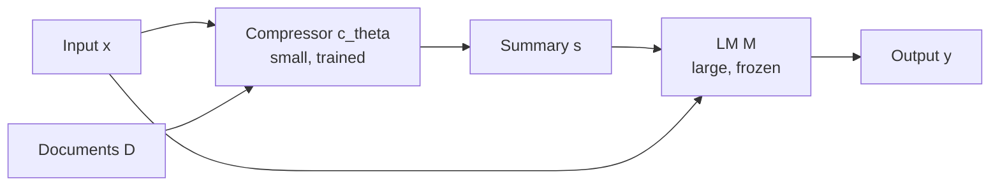
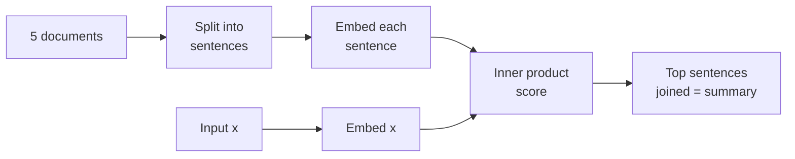

# 03. Problem Formulation (Paper Section 2)

In this note:

- The inputs and outputs, symbol by symbol
- The two modules: compressor and language model
- The three requirements: concise, effective, faithful
- The extractive compressor: a dual encoder that ranks sentences
- The abstractive compressor: a small encoder-decoder distilled from a large model
- A worked example of both

## Inputs and Outputs

> "Given an input sequence x, a target output sequence y and a set of N retrieved documents D ([d1, d2, ...dN]), RECOMP compresses retrieved documents D with respect to x into a summary s which captures core information in D relevant to x with significantly fewer tokens than D."

<table width="100%">
<thead><tr><th>Symbol (plain text)</th><th>Meaning</th><th>Example</th></tr></thead>
<tbody>
<tr><td>x</td><td>The input: a question, or the text so far in language modeling</td><td>"when did they stop making the nissan xterra?"</td></tr>
<tr><td>y</td><td>The target output</td><td>"2015"</td></tr>
<tr><td>D = [d1, ..., dN]</td><td>The N retrieved documents (N = 5 in the experiments)</td><td>Five 100-word Wikipedia passages</td></tr>
<tr><td>s</td><td>The summary the compressor produces; may be empty</td><td>A 58-token summary</td></tr>
<tr><td>c_theta</td><td>The compressor, with trainable weights theta</td><td>A 110M or 775M parameter model</td></tr>
<tr><td>M</td><td>The language model that reads s and x; frozen (black box)</td><td>Flan-UL2 (20B) or GPT-2</td></tr>
</tbody>
</table>

The retriever is fixed: "Improving retriever is not the focus of this work, so we assume a set of retrieved documents are provided."

## Two Modules

> "Our architecture consists of two modules: compressor c_theta and LM M. In this work, we assume a blackbox LM and train the compressor."

> "We design our compressor to be substantially smaller than LM M, as we aim to reduce computational costs of encoding a set of retrieved documents."

The compressor still reads all the documents, so it must be much cheaper than the language model; otherwise compression saves nothing.

## The Three Requirements

<table width="100%">
<thead><tr><th>Requirement</th><th>Paper wording</th><th>Trained for?</th></tr></thead>
<tbody>
<tr><td>Concise</td><td>"The summary should be as short as possible to optimize efficiency. If the retrieved documents do not contain relevant information or retrieval augmentation is not necessary, s can be an empty sequence."</td><td>Yes</td></tr>
<tr><td>Effective</td><td>"When s is prepended to input sequence x and provided to LM M as a prompt, LM should generate the target output sequence y."</td><td>Yes</td></tr>
<tr><td>Faithful</td><td>"s should be a faithful and interpretable summary of the input document set (i.e., s must be entailed by the input document set)."</td><td>No: checked by hand in note 07</td></tr>
</tbody>
</table>

> "We focus on training compressors for conciseness and effectiveness."

## The Extractive Compressor

> "Given n sentences [s1, s2...sn] in the input document set, we train a dual encoder model enc_theta which embeds sentence si and the input sequence x into fixed-dimensional embeddings respectively. Their inner product represents how helpful it would be for the LM M to prepend si to the input x to generate y."

Steps:

1. Split the N documents into n sentences.
2. Embed the input x and every sentence separately with the same encoder.
3. Score each sentence by the inner product (dot product) of its embedding with the input embedding.
4. Keep the top sentences and join them: that is the summary.

This is a **bi-encoder** (basic concepts note 07), like our embedding retriever, but at sentence level and trained on a different question: not "is this sentence similar to x?" but "does this sentence help the LM produce y?".

> "As this approach is extractive, we assume the faithfulness criteria is mostly satisfied."

Copied sentences cannot invent facts, although the paper notes (citing Zhang et al., 2022) that extraction can occasionally change meaning when sentences are taken out of context.

## The Abstractive Compressor

> "We train an encoder-decoder model encdec_theta to serve as an abstractive compressor, which takes the input sequence x and a concatenation of retrieved document set D [d1; d2; ...dN] and output a summary s."

There are no human-written summaries for training. The authors observe that very large models write good query-focused summaries when prompted, but using one as the compressor would defeat the purpose:

> "Using an extreme-scale model as the compressor is not desirable as we want the compressor to be substantially smaller than the LMs. Thus, we perform distillation (Hinton et al., 2015) of extreme-scale LMs to build a lightweight abstractive compressor encdec_theta."

**Distillation:** a large "teacher" model generates examples, and a small "student" model is trained to reproduce them. Here GPT-3.5 is the teacher and T5-large (775M) the student (note 04).

> "We do not train specifically for faithfulness, but later manually evaluate the faithfulness in Section 6."

## Extractive and Abstractive Side by Side

<table width="100%">
<thead><tr><th></th><th>Extractive</th><th>Abstractive</th></tr></thead>
<tbody>
<tr><td>Model type</td><td>Dual encoder (110M, from Contriever)</td><td>Encoder-decoder (775M, from T5-large)</td></tr>
<tr><td>Output</td><td>Top sentences copied from the documents</td><td>New text generated from all documents</td></tr>
<tr><td>Faithfulness</td><td>Mostly safe (copied text)</td><td>Can hallucinate</td></tr>
<tr><td>Combining documents</td><td>No: each sentence is scored alone</td><td>Yes: can merge facts from several documents</td></tr>
<tr><td>Empty output</td><td>Not used in the experiments (fixed number of sentences)</td><td>Yes, learned from training data</td></tr>
<tr><td>Training signal</td><td>Which sentence makes the LM's target most likely</td><td>Which teacher summary helps the LM most, or none</td></tr>
</tbody>
</table>

## Worked Example

Question x: "who got the first nobel prize in physics" (from the paper's appendix, Table 6). The 5 retrieved documents contain about 600 words about Nobel prizes, universities and laureates.

<table width="100%">
<thead><tr><th>Compressor</th><th>Summary (from the paper)</th></tr></thead>
<tbody>
<tr><td>T5 abstractive</td><td>"Wilhelm Rontgen received the first Nobel Prize in Physics in recognition of his extraordinary services. It is one of the five Nobel Prizes established by Alfred Nobel in 1895 and awarded since 1901."</td></tr>
<tr><td>GPT-3.5</td><td>"The first Nobel Prize in Physics was awarded to physicist Wilhelm Rontgen in 1901 for his discovery of the remarkable rays (or x-rays). Since then, 209 individuals have been awarded the prize, with only three women (1.4% of laureates) having won it."</td></tr>
</tbody>
</table>

Both keep the answer in two sentences out of hundreds of words.

## Key Points

- Input x, target y, N retrieved documents D; the compressor outputs a summary s, possibly empty; the LM M is frozen.
- The compressor must be much smaller than M, because it reads all the documents.
- Requirements: concise and effective are trained; faithful is checked by hand.
- Extractive: a dual encoder ranks sentences by inner product with x and keeps the top ones.
- Abstractive: a T5 model distilled from GPT-3.5 writes a query-focused summary of all documents.

## Navigation

Previous: [02. Introduction](02.%20Introduction.md) | [Paper index](README.md) | Next: [04. Learning the Compressors](04.%20Learning%20the%20Compressors.md)
