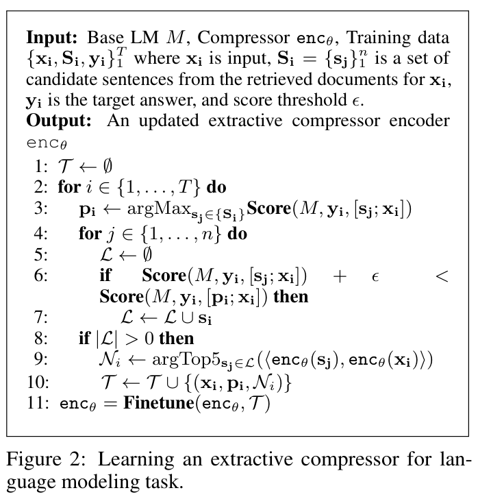
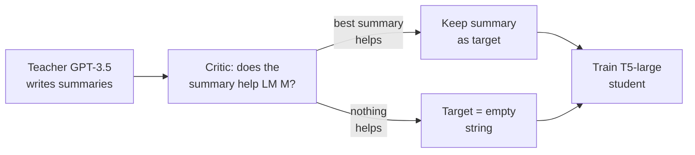
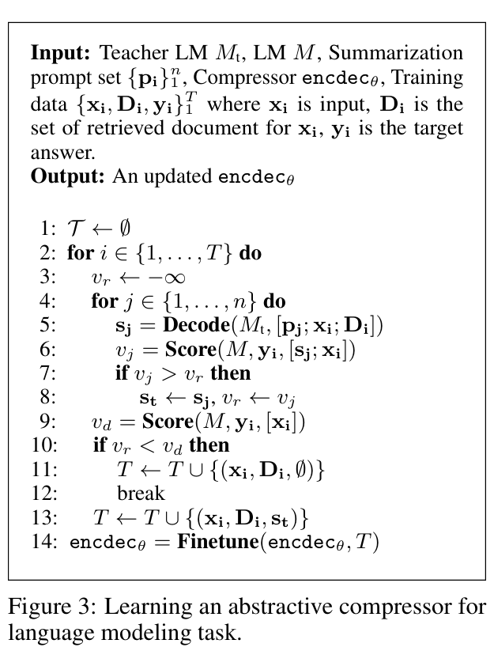
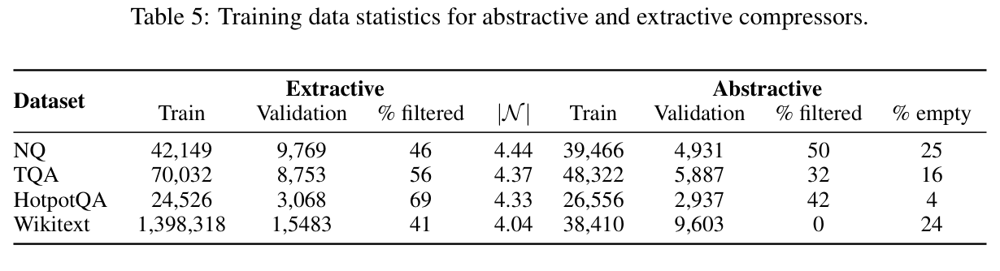

# 04. Learning the Compressors (Paper Section 3)

In this note:

- How compressors differ from ordinary summarizers
- 3.1 Extractive compression: model, Score function, Figure 2 line by line, contrastive loss, data
- 3.2 Abstractive compression: teacher generation, filtering with a critic, Figure 3 line by line, model and data
- Training statistics (Table 5) and hyperparameters (Appendix A)
- Worked examples of both training procedures

## Compressors Are Not Ordinary Summarizers

> "Instead of capturing salient information for humans readers, compressors aim to produce a concise text that are useful for a LM on an end task."

A human summary keeps the main points. A RECOMP summary keeps **whatever makes the language model produce the right output**, which may be one small fact, or nothing at all. Both compressors are therefore trained from end-task signals.

## The Score Function

Both compressors use the same measurement:

> "Score(M, yi, [sj; xi]) = log p_M(y | [sj; xi]), log likelihood assigned to target output according to LM M when candidate sentence is prepended to the input."

<table width="100%">
<thead><tr><th>Part</th><th>Meaning</th></tr></thead>
<tbody>
<tr><td>[sj; xi]</td><td>Candidate text sj placed before the input xi</td></tr>
<tr><td>p_M(y | ...)</td><td>The probability the frozen LM M gives to the correct output y</td></tr>
<tr><td>log</td><td>Log of that probability: closer to 0 is better</td></tr>
</tbody>
</table>

For QA, Score is instead whether the LM's decoded answer **exactly matches** a gold answer (Appendix Figures 6 and 7).

In words: try the candidate text in front of the input and see how much it helps the LM produce the right answer.

## 3.1 Extractive Compression

> "As we formulate extractive compression as a ranking problem, training extractive compressor resembles training a reranker for the retrieved documents with two differences. First, our compressor considers a different granularity of input (sentence) compared to the initial retrieval unit (paragraph). Second, the sentence is evaluated based on whether it is useful as input for the LM M on the downstream task."

This ties RECOMP to the BERT paper: it is a re-ranker, but for **sentences**, judged by **usefulness to the LM** rather than by human relevance labels.

### Model

- A dual encoder: x and each sentence are encoded separately; the [CLS] vector is the embedding; similarity is the inner product.
- Initialised from **Contriever** (Izacard et al., 2021), 110M parameters. For QA, the Contriever checkpoint fine-tuned on MS MARCO.

Why a dual encoder and not a cross-encoder? The paper's footnote: a cross-encoder reranker "is a similar set-up to our sentence selector, but less compute efficient." The compressor must stay cheap.

### Figure 2: the training algorithm



<table width="100%">
<thead><tr><th>Line</th><th>What it does</th></tr></thead>
<tbody>
<tr><td>1</td><td>Start with an empty training set T</td></tr>
<tr><td>2</td><td>For every training example i (input xi, candidate sentences Si, target yi)</td></tr>
<tr><td>3</td><td>Positive pi = the sentence with the highest Score: the one that most helps the LM produce yi</td></tr>
<tr><td>4-7</td><td>Collect into L every sentence whose Score plus a margin epsilon is still below the positive's Score: clearly less helpful sentences</td></tr>
<tr><td>8-9</td><td>If L is not empty, take as negatives Ni the 5 sentences in L that the current encoder rates most similar to xi: hard negatives</td></tr>
<tr><td>10</td><td>Add the triple (xi, pi, Ni) to T</td></tr>
<tr><td>11</td><td>Fine-tune the encoder on T</td></tr>
</tbody>
</table>

(Line 5 resets L inside the inner loop in the printed pseudocode; the intent, from the text, is to collect all sentences that are worse than the positive.)

The hard-negative idea is the same as in the BERT paper: negatives that **look** relevant to the encoder but do not help the LM are the most useful to learn from.

### Contrastive loss

> "We train our encoder with a contrastive loss (Karpukhin et al., 2020a), maximizing the similarity between positive pairs (xi, pi) and minimize negative pairs (xi, Ni)."

$$L = -\log \frac{e^{sim(x_i, p_i)}}{e^{sim(x_i, p_i)} + \sum_{n_j \in N_i} e^{sim(x_i, n_j)}}$$

<table width="100%">
<thead><tr><th>Symbol (plain text)</th><th>Meaning</th></tr></thead>
<tbody>
<tr><td>sim(xi, pi)</td><td>Inner product of the input and positive sentence embeddings</td></tr>
<tr><td>sim(xi, nj)</td><td>Inner product with each of the up to 5 negatives</td></tr>
<tr><td>The fraction</td><td>A softmax: the probability of picking the positive among the positive and the negatives</td></tr>
<tr><td>-log</td><td>Small when the positive wins clearly, large when a negative scores as high</td></tr>
</tbody>
</table>

**Worked example:** sim(x, p) = 3, two negatives with sim 1 and 0. Fraction = e^3 / (e^3 + e^1 + e^0) = 20.09 / (20.09 + 2.72 + 1.00) = 0.844. Loss = -log(0.844) = 0.17. If a negative also scored 3, the fraction would drop to about 0.46 and the loss rise to about 0.78.

### Data

<table width="100%">
<thead><tr><th>Task</th><th>Candidates per input</th></tr></thead>
<tbody>
<tr><td>Language modeling (WikiText-103 training split)</td><td>Top 20 sentences from the top 5 BM25 documents</td></tr>
<tr><td>QA (each dataset's training split)</td><td>Top 20 sentences from the top 5 documents retrieved by contriever-msmarco</td></tr>
</tbody>
</table>

> "For each sentence from the retrieved documents, we prepend the Wikipedia page title to it to for decontextualization."

A sentence like "He won it in 1901" means little alone; prefixing the page title ("Wilhelm Rontgen: He won it in 1901") restores context. This is a practical trick we can reuse: keep the document title with each chunk or sentence.

## 3.2 Abstractive Compression

> "To train an abstractive compressor, we distill the query-focused summarization ability of extreme-scale LM by generating training dataset from it, filter the generated data, and train an encoder-decoder model from the filtered dataset (West et al., 2022)."

Three steps: **generate** with a teacher, **filter** with a critic, **train** a student.



### Generation from the teacher

For language modeling, the authors wrote **four prompts** (Appendix Table 8), for example "Summarize the information from the provided documents" and "Generate the next two sentences of the given query using the information from the provided documents". gpt-3.5-turbo writes one summary per prompt (temperature 0.7, top p 1).

For QA, one prompt per dataset; for NQ and TriviaQA:

```text
Compress the information in the retrieved documents into a 2-sentence summary
that could be used to answer the question: Question: {query}
Retrieved documents: {docs} Compressed documents:
```

For HotpotQA: "Source documents: {docs} Question: {query} Generate a reasoning chain to answer the question:".

### Filtering with a critic

> "If the end task performance gets worse (e.g., increase in perplexity) when prepending the summary, we set the target summary to an empty string, otherwise we add the target summary to the training set. This allows for selective augmentation and mitigates the risk of prepending irrelevant documents."

Earlier work filtered summaries by summary-quality metrics; RECOMP filters by **whether the summary helps the LM**, the end-task signal.

### Figure 3: the training algorithm



<table width="100%">
<thead><tr><th>Line</th><th>What it does</th></tr></thead>
<tbody>
<tr><td>1-3</td><td>Empty training set; for each example, best score so far v_r = minus infinity</td></tr>
<tr><td>4-5</td><td>For each prompt pj, the teacher Mt writes a summary sj from the prompt, input and documents</td></tr>
<tr><td>6-8</td><td>Score each summary with the LM M; remember the best summary st and its score v_r</td></tr>
<tr><td>9</td><td>v_d = Score with no summary at all (input only)</td></tr>
<tr><td>10-12</td><td>If the best summary scores worse than no summary, add (xi, Di, empty) to T</td></tr>
<tr><td>13</td><td>Otherwise add (xi, Di, st)</td></tr>
<tr><td>14</td><td>Fine-tune the encoder-decoder on T</td></tr>
</tbody>
</table>

For QA (Appendix Figure 7) there is a single prompt, so lines 4-8 reduce to one summary.

### Worked example

<table width="100%">
<thead><tr><th>Candidate</th><th>Score(M, y, [s; x]) (log likelihood)</th></tr></thead>
<tbody>
<tr><td>Summary from prompt 1</td><td>-4.2</td></tr>
<tr><td>Summary from prompt 2</td><td>-3.1 (best, st)</td></tr>
<tr><td>Summary from prompt 3</td><td>-5.0</td></tr>
<tr><td>No summary (v_d)</td><td>-3.6</td></tr>
</tbody>
</table>

-3.1 is higher than -3.6, so summary 2 helps and becomes the target. If no summary beat -3.6, the target would be the empty string. (Numbers are illustrative.)

### Model and data

- Student: **T5-large**, 775M parameters, already trained on summarization data.
- Top 5 retrieved documents are summarized for every task.
- Language modeling: training examples from a random 2 percent of WikiText-103 training data (48,013 examples, four summaries each).
- NQ and TriviaQA: the entire training sets.
- HotpotQA: only training examples where the gold answer is in the retrieved documents (56 percent), "to reduce API costs".

## Training Statistics (Table 5)



<table width="100%">
<thead><tr><th>Dataset</th><th>Extractive train</th><th>Abstractive train</th><th>Abstractive % filtered</th><th>Abstractive % empty</th></tr></thead>
<tbody>
<tr><td>NQ</td><td>42,149</td><td>39,466</td><td>50</td><td>25</td></tr>
<tr><td>TriviaQA</td><td>70,032</td><td>48,322</td><td>32</td><td>16</td></tr>
<tr><td>HotpotQA</td><td>24,526</td><td>26,556</td><td>42</td><td>4</td></tr>
<tr><td>WikiText</td><td>1,398,318</td><td>38,410</td><td>0</td><td>24</td></tr>
</tbody>
</table>

The "% empty" column is the share of training targets that are the empty string: on NQ, for a quarter of the training questions, no GPT-3.5 summary helped the LM. The extractive side filters 41 to 69 percent of examples (those without any valid negative are removed), and kept examples have on average 4.0 to 4.4 negatives (column |N|).

## Hyperparameters (Appendix A.2)

<table width="100%">
<thead><tr><th>Setting</th><th>Extractive</th><th>Abstractive</th></tr></thead>
<tbody>
<tr><td>Initial checkpoint</td><td>Contriever (LM) or contriever-msmarco (QA)</td><td>T5-large</td></tr>
<tr><td>Optimiser</td><td>Adam</td><td>Adam</td></tr>
<tr><td>Batch size</td><td>64</td><td>16</td></tr>
<tr><td>Learning rate</td><td>2 x 10^-5</td><td>1 x 10^-5</td></tr>
<tr><td>Warm-up</td><td>1000 steps</td><td>1000 steps</td></tr>
<tr><td>Epochs</td><td>3</td><td>3</td></tr>
<tr><td>Sentence splitting</td><td>NLTK</td><td>-</td></tr>
</tbody>
</table>

## What This Means for Our Project

- We will not train compressors; gpt-4o-mini can act as a prompted compressor, like the GPT-3.5 teacher, with the NQ prompt as a template.
- The critic idea transfers to evaluation: compare answers with and without compression on our test set, as the filter compares with and without a summary.
- The extractive approach maps to sentence-level filtering of our reranked chunks, the optional compression stage in basic concepts note 10; prefixing sentences with document title and section is cheap and helps.

## Key Points

- Both compressors learn from one signal: how much a text helps the frozen LM produce the correct output.
- Extractive: Contriever dual encoder, positive = most helpful sentence, hard negatives = similar-looking but less helpful sentences, contrastive loss.
- Abstractive: GPT-3.5 writes summaries, a critic keeps the best one or an empty string, T5-large is trained on the result.
- 4 to 25 percent of abstractive training targets are empty, which teaches selective augmentation.

## Navigation

Previous: [03. Problem Formulation](03.%20Problem%20Formulation.md) | [Paper index](README.md) | Next: [05. Experimental Settings](05.%20Experimental%20Settings.md)
