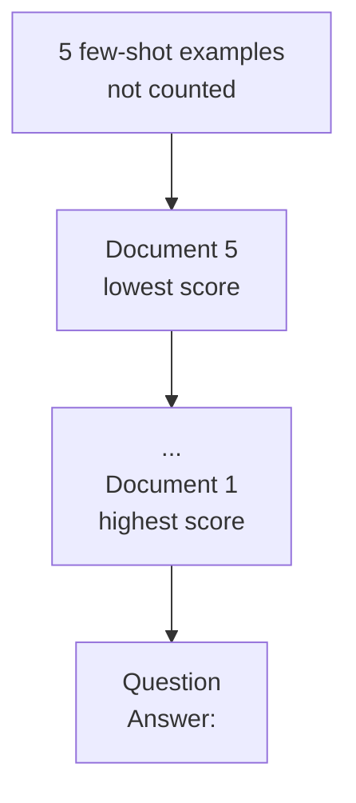
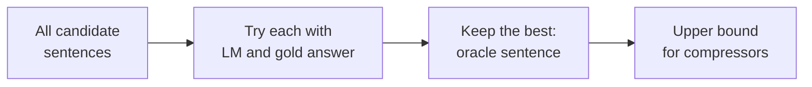

# 05. Experimental Settings (Paper Section 4)

In this note:

- What is measured: effectiveness and efficiency
- 4.1 Language modeling: WikiText-103, perplexity, three GPT models
- 4.2 Open-domain QA: NQ, TriviaQA, HotpotQA with Flan-UL2
- The prompt format and document order
- 4.3 Baselines: heuristic, extractive and abstractive
- The two oracles and why they matter

## What Is Measured

> "For both tasks, we report the task performance as a measure of effectiveness and the number of tokens provided in context as a measure of efficiency."

Every result in note 06 has two numbers: **quality** (perplexity, or EM and F1) and **# tokens** of evidence in the prompt. A good compressor keeps quality while cutting tokens.

## 4.1 Language Modeling

<table width="100%">
<thead><tr><th>Setting</th><th>Value</th></tr></thead>
<tbody>
<tr><td>Dataset</td><td>WikiText-103 (Merity et al., 2016)</td></tr>
<tr><td>Metric</td><td>Perplexity (lower is better)</td></tr>
<tr><td>Language models</td><td>GPT-2 (117M), GPT-2 XL (1.5B), GPT-J (6B)</td></tr>
<tr><td>Compressor trained with</td><td>GPT-2 only; GPT-2 XL and GPT-J test transfer</td></tr>
<tr><td>Retriever</td><td>BM25 over Wikipedia (Dec. 20, 2018), split into 100-word documents</td></tr>
<tr><td>Leakage control</td><td>Articles containing the input are removed from the corpus</td></tr>
<tr><td>Retrieval frequency</td><td>Every 32 tokens (following Ram et al., 2023)</td></tr>
</tbody>
</table>

**Perplexity** measures how surprised a model is by the true next words: it is e raised to the average negative log likelihood per token. A perplexity of 20 roughly means the model is as uncertain as choosing among 20 equally likely words. Better context lowers it.

Language modeling here means: given a piece of Wikipedia text, predict the next tokens, with retrieved documents (or their summary) in front.

## 4.2 Open-Domain QA

<table width="100%">
<thead><tr><th>Dataset</th><th>Kind of question</th><th>Evaluation split</th></tr></thead>
<tbody>
<tr><td>Natural Questions (NQ)</td><td>Real Google search questions</td><td>Development set</td></tr>
<tr><td>TriviaQA (TQA)</td><td>Trivia questions</td><td>Test set</td></tr>
<tr><td>HotpotQA</td><td>Multi-hop: needs facts from two documents</td><td>500 random development questions</td></tr>
</tbody>
</table>

<table width="100%">
<thead><tr><th>Setting</th><th>Value</th></tr></thead>
<tbody>
<tr><td>Language model M</td><td>Flan-UL2 (20B), instruction-tuned</td></tr>
<tr><td>Retriever</td><td>Contriever fine-tuned on MS MARCO, over Wikipedia (Dec. 20, 2018) in 100-word documents</td></tr>
<tr><td>Metrics</td><td>Exact Match (EM) and token-level F1 of the answer string</td></tr>
</tbody>
</table>

**EM** is 1 if the predicted answer equals a gold answer after normalisation, else 0. **F1** gives partial credit for overlapping words: "Wilhelm Rontgen" against gold "Wilhelm Conrad Rontgen" gets EM 0 but F1 = 2 x (1.0 x 0.67) / (1.0 + 0.67) = 0.8.

### Prompt format

> "We include few-shot in-context examples in the prompt, followed by the retrieved documents and the question."

```text
who won a million on deal or no deal Answer: Tomorrow Rodriguez
... (5 random training examples)
{retrieved documents or summary}
{question} Answer:
```

- The 5 examples take 110, 147 and 149 tokens on average for NQ, TQA and HotpotQA; they are **not** counted in "# tokens".
- Documents are placed **in ascending order of retrieval score**, so the best document is closest to the question (Si et al., 2022).



This ordering is a cheap trick against lost-in-the-middle: the most relevant text sits next to the question, where the model attends most.

## 4.3 Baselines

<table width="100%">
<thead><tr><th>Group</th><th>Baseline</th><th>How it works</th></tr></thead>
<tbody>
<tr><td>No compression</td><td>Top 1 / Top 5 documents</td><td>Prepend raw documents</td></tr>
<tr><td>Heuristic</td><td>BoW</td><td>Convert the documents to an ordered list of single words (unigrams) and join them</td></tr>
<tr><td>Heuristic</td><td>NE</td><td>Keep only the named entities, in order (extracted with spaCy)</td></tr>
<tr><td>Extractive</td><td>Random</td><td>A random sentence from the documents</td></tr>
<tr><td>Extractive</td><td>BM25, Contriever</td><td>Rank sentences by similarity to x and take the top</td></tr>
<tr><td>Extractive (QA only)</td><td>DPR</td><td>Dense retriever fine-tuned on NQ, used to rank sentences</td></tr>
<tr><td>Abstractive</td><td>T5 (770M)</td><td>Off-the-shelf summarizer, no RECOMP training</td></tr>
<tr><td>Abstractive</td><td>GPT-3.5</td><td>The teacher model, prompted (best single prompt for language modeling)</td></tr>
</tbody>
</table>

The comparison that matters most: **Contriever against Ours (extractive)** and **T5 against Ours (abstractive)**. Each pair starts from the same model, so the difference is RECOMP's training.

## The Oracles

> "We explore the performance upper bound of compression by considering two oracle approaches."

<table width="100%">
<thead><tr><th>Oracle</th><th>How it is built</th></tr></thead>
<tbody>
<tr><td>Extractive oracle</td><td>For each example, try every sentence in the documents and keep the one giving the best result (lowest perplexity or correct answer)</td></tr>
<tr><td>Abstractive oracle</td><td>For each example, choose among the GPT-3.5 summaries and the empty summary, whichever gives the best result</td></tr>
<tr><td>Oracle (w/ gpt2)</td><td>Oracle sentences chosen with GPT-2 but used with other LMs: tests whether "best sentence" transfers across models</td></tr>
</tbody>
</table>

An oracle uses the gold answer to choose, so it is not a real system; it tells us **how good compression could be** if the compressor were perfect.



## What This Means for Our Project

- We already report quality and tokens per answer; RECOMP-style evaluation adds **tokens of context** as an explicit efficiency metric next to cost.
- Putting the strongest chunk next to the question is free to adopt in our prompt builder.
- Our test set is small (11 questions), so we can compute an oracle-like check by hand: for failed answers, was there a single sentence in the candidates that would have been enough?

## Key Points

- Effectiveness (perplexity, EM, F1) and efficiency (evidence tokens) are reported together.
- Language modeling: WikiText-103, BM25, compressors trained with GPT-2 and tested on GPT-2 XL and GPT-J.
- QA: NQ, TriviaQA, HotpotQA with Flan-UL2 (20B), Contriever retrieval, 5 few-shot examples, best document closest to the question.
- Baselines cover heuristic, extractive and abstractive compression; oracles give the upper bound.

## Navigation

Previous: [04. Learning the Compressors](04.%20Learning%20the%20Compressors.md) | [Paper index](README.md) | Next: [06. Results](06.%20Results.md)
