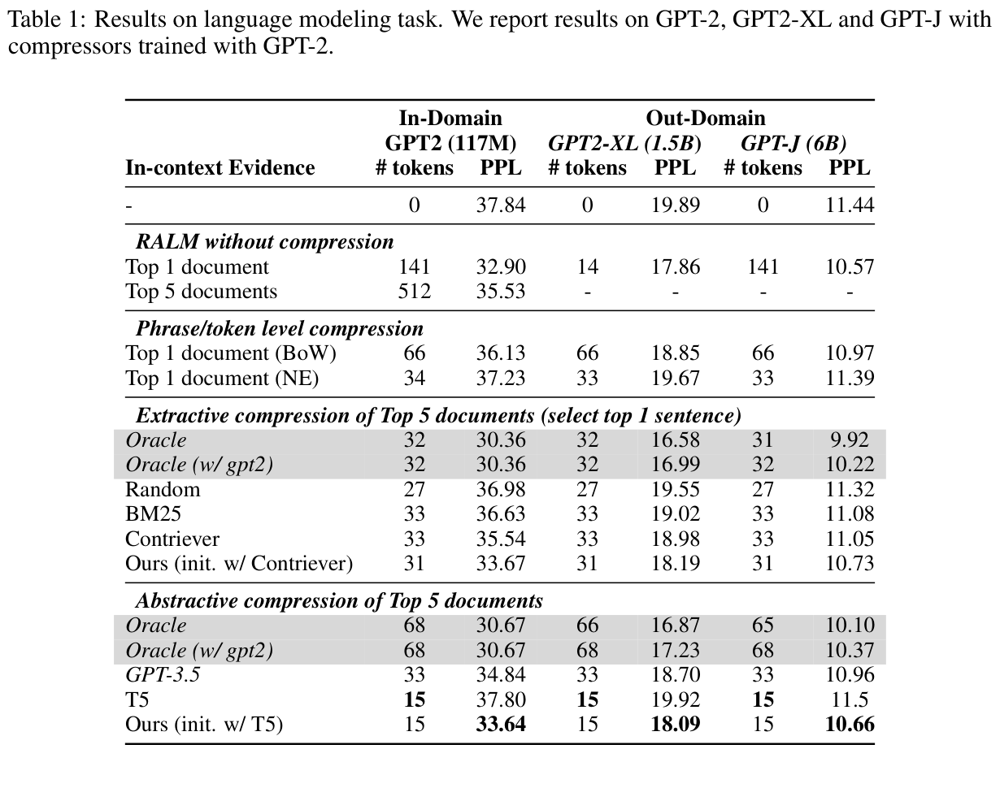
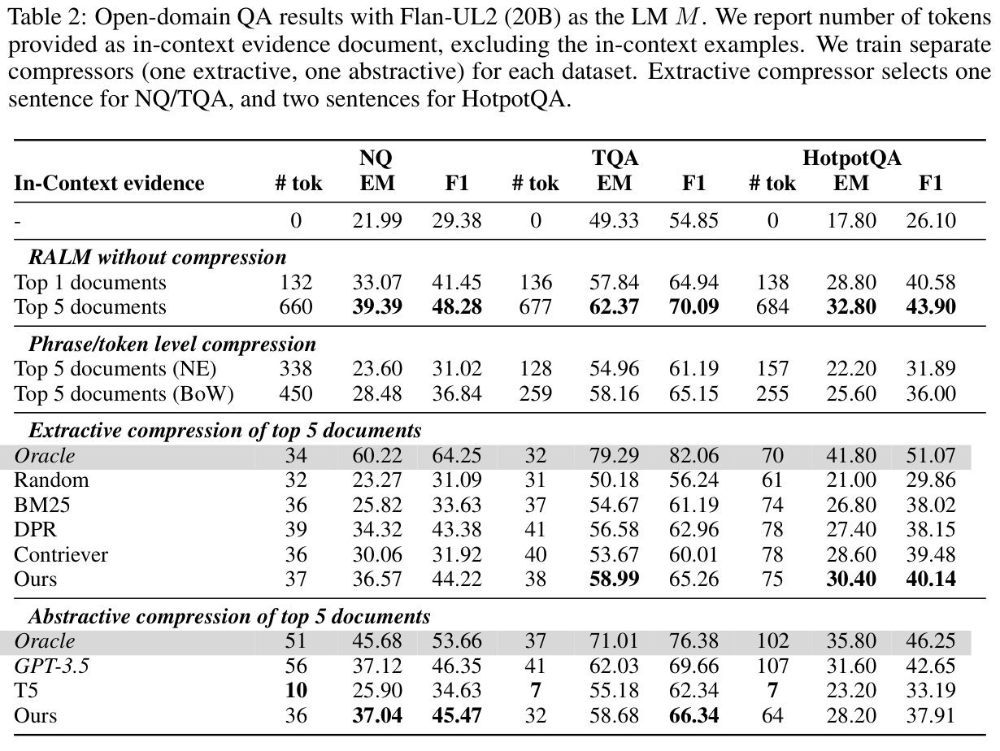
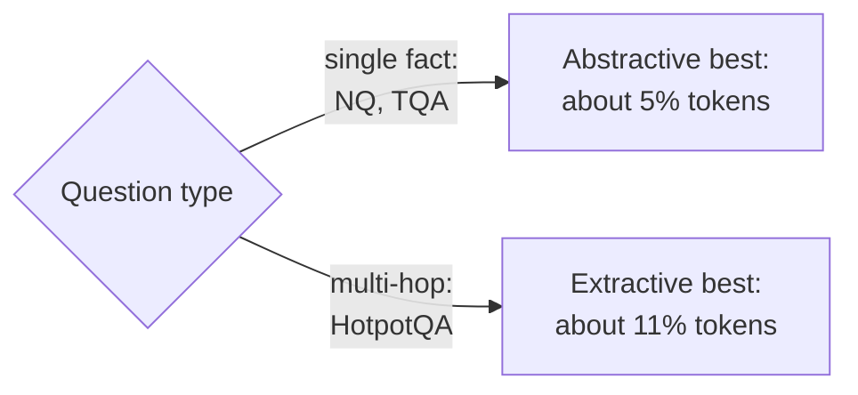

# 06. Results (Paper Section 5, Tables 1 and 2)

In this note:

- Table 1: language modeling, row by row
- Finding 1: more tokens are not always better
- Finding 2: heuristic compression hurts
- Finding 3: trained compressors beat their starting models
- Table 2: open-domain QA, row by row
- The compression ratios the paper reports, checked against the table
- Extractive against abstractive: which wins where

## Language Modeling (Table 1)

Perplexity: lower is better. Compressors were trained with GPT-2; GPT-2 XL and GPT-J are "out-domain" (transfer).

<table width="100%">
<thead><tr><th>Evidence</th><th># tokens</th><th>GPT-2 PPL</th><th>GPT-2 XL PPL</th><th>GPT-J PPL</th></tr></thead>
<tbody>
<tr><td>None</td><td>0</td><td>37.84</td><td>19.89</td><td>11.44</td></tr>
<tr><td>Top 1 document</td><td>141</td><td>32.90</td><td>17.86</td><td>10.57</td></tr>
<tr><td>Top 5 documents</td><td>512</td><td>35.53</td><td>-</td><td>-</td></tr>
<tr><td>BoW (top 1)</td><td>66</td><td>36.13</td><td>18.85</td><td>10.97</td></tr>
<tr><td>NE (top 1)</td><td>34</td><td>37.23</td><td>19.67</td><td>11.39</td></tr>
<tr><td>Extractive oracle</td><td>32</td><td>30.36</td><td>16.58</td><td>9.92</td></tr>
<tr><td>Contriever (top sentence)</td><td>33</td><td>35.54</td><td>18.98</td><td>11.05</td></tr>
<tr><td>Ours, extractive</td><td>31</td><td>33.67</td><td>18.19</td><td>10.73</td></tr>
<tr><td>Abstractive oracle</td><td>68</td><td>30.67</td><td>16.87</td><td>10.10</td></tr>
<tr><td>GPT-3.5 summary</td><td>33</td><td>34.84</td><td>18.70</td><td>10.96</td></tr>
<tr><td>T5 summary (off the shelf)</td><td>15</td><td>37.80</td><td>19.92</td><td>11.5</td></tr>
<tr><td>Ours, abstractive</td><td>15</td><td>33.64</td><td>18.09</td><td>10.66</td></tr>
</tbody>
</table>

(Token counts shown for GPT-2; the other columns are about the same. The table prints 14 tokens for "Top 1 document" under GPT-2 XL, most likely a typo for 141.)

### Finding 1: more tokens are not always better

> "More tokens are not always better: prepending top 1 document outperforms prepending top 5 documents."

Top 1 (141 tokens) gives 32.90, top 5 (512 tokens) only 35.53. Extra documents add noise. The oracles reach about 30.4 with only 32 to 68 tokens, that is 6 to 13 percent of the top 5 tokens (32 / 512 and 68 / 512).

> "This confirms that the naive retrieve-and-prepend approach has a significant room for improvement, as prepending irrelevant documents can hurt performances."

### Finding 2: heuristic compression hurts

BoW (36.13) and NE (37.23) are worse than the uncompressed top document (32.90): "potentially due to the disfluency of the prepended text". Word lists save tokens but destroy the sentences the model needs.

### Finding 3: trained compressors beat their starting models

<table width="100%">
<thead><tr><th>Pair (same starting model)</th><th>Before RECOMP training</th><th>After</th></tr></thead>
<tbody>
<tr><td>Extractive: Contriever to Ours</td><td>35.54</td><td>33.67</td></tr>
<tr><td>Abstractive: T5 to Ours</td><td>37.80 (no better than no retrieval)</td><td>33.64</td></tr>
</tbody>
</table>

The abstractive compressor reaches the best non-oracle perplexity with only 15 tokens on average, because:

> "Our abstractive compressor achieves high compression rate through selective augmentation, prepending summaries to only 33% of examples."

Against the top 1 document, the extractive compressor uses 31 / 141 = 22 percent of the tokens for a 0.8 perplexity point loss; the paper rounds this to "a compression ratio of 25% at minimum performance drop".

**Transfer:** the GPT-2-trained compressors also beat Contriever and GPT-3.5 summaries on GPT-2 XL (18.19 and 18.09) and GPT-J (10.73 and 10.66).

## Open-Domain QA (Table 2)

EM and F1: higher is better. The extractive compressor keeps 1 sentence for NQ and TQA, 2 for HotpotQA.

<table width="100%">
<thead><tr><th>Evidence</th><th>NQ tok</th><th>NQ EM</th><th>TQA tok</th><th>TQA EM</th><th>HotpotQA tok</th><th>HotpotQA EM</th></tr></thead>
<tbody>
<tr><td>None</td><td>0</td><td>21.99</td><td>0</td><td>49.33</td><td>0</td><td>17.80</td></tr>
<tr><td>Top 1 document</td><td>132</td><td>33.07</td><td>136</td><td>57.84</td><td>138</td><td>28.80</td></tr>
<tr><td>Top 5 documents</td><td>660</td><td>39.39</td><td>677</td><td>62.37</td><td>684</td><td>32.80</td></tr>
<tr><td>NE (top 5)</td><td>338</td><td>23.60</td><td>128</td><td>54.96</td><td>157</td><td>22.20</td></tr>
<tr><td>BoW (top 5)</td><td>450</td><td>28.48</td><td>259</td><td>58.16</td><td>255</td><td>25.60</td></tr>
<tr><td>Extractive oracle</td><td>34</td><td>60.22</td><td>32</td><td>79.29</td><td>70</td><td>41.80</td></tr>
<tr><td>Random sentence</td><td>32</td><td>23.27</td><td>31</td><td>50.18</td><td>61</td><td>21.00</td></tr>
<tr><td>BM25</td><td>36</td><td>25.82</td><td>37</td><td>54.67</td><td>74</td><td>26.80</td></tr>
<tr><td>DPR</td><td>39</td><td>34.32</td><td>41</td><td>56.58</td><td>78</td><td>27.40</td></tr>
<tr><td>Contriever</td><td>36</td><td>30.06</td><td>40</td><td>53.67</td><td>78</td><td>28.60</td></tr>
<tr><td>Ours, extractive</td><td>37</td><td>36.57</td><td>38</td><td>58.99</td><td>75</td><td>30.40</td></tr>
<tr><td>Abstractive oracle</td><td>51</td><td>45.68</td><td>37</td><td>71.01</td><td>102</td><td>35.80</td></tr>
<tr><td>GPT-3.5 summary</td><td>56</td><td>37.12</td><td>41</td><td>62.03</td><td>107</td><td>31.60</td></tr>
<tr><td>T5 summary</td><td>10</td><td>25.90</td><td>7</td><td>55.18</td><td>7</td><td>23.20</td></tr>
<tr><td>Ours, abstractive</td><td>36</td><td>37.04</td><td>32</td><td>58.68</td><td>64</td><td>28.20</td></tr>
</tbody>
</table>

### What the QA table shows

- **Unlike language modeling, five documents beat one** (NQ 39.39 against 33.07): questions benefit from more evidence, which motivates compressing five documents rather than retrieving one.
- **The extractive oracle is far above everything** (NQ 60.22 EM with 34 tokens against 39.39 with 660): a single well-chosen sentence beats all five documents. Removing noise helps more than adding text.
- **The extractive oracle beats the abstractive oracle** because it chooses among many sentences, while the abstractive oracle chooses only between one GPT-3.5 summary and nothing.
- **DPR is the best untrained extractive baseline on NQ** (34.32 with 39 tokens beats the top 1 document at 33.07 with 132), because it was fine-tuned on NQ; it is weaker out of domain.
- **Off-the-shelf T5** adds only 7 to 10 tokens yet gains about 4 to 6 EM over no retrieval.

### The headline numbers, checked

<table width="100%">
<thead><tr><th>Dataset</th><th>Best trained compressor</th><th>Tokens kept</th><th>EM lost against top 5</th><th>Relative EM drop</th></tr></thead>
<tbody>
<tr><td>NQ</td><td>Abstractive</td><td>36 / 660 = 5.5%</td><td>39.39 - 37.04 = 2.35</td><td>6.0%</td></tr>
<tr><td>TriviaQA</td><td>Abstractive</td><td>32 / 677 = 4.7%</td><td>62.37 - 58.68 = 3.69</td><td>5.9%</td></tr>
<tr><td>HotpotQA</td><td>Extractive</td><td>75 / 684 = 11.0%</td><td>32.80 - 30.40 = 2.40</td><td>7.3%</td></tr>
</tbody>
</table>

These match the paper's "5 to 10 percent of the original tokens with less than 10 percent relative performance drop" (HotpotQA is slightly above 10 percent of tokens).

On HotpotQA, extractive wins:

> "We find that learning an abstractive compressor for more complex tasks, such as HotpotQA, demands further study. While extreme-scale LLM boasts competitive summarization performance under single document setting, they are not good at synthesizing information from multiple documents ... and hallucinate more often."

## Results Summary

<table width="100%">
<thead><tr><th>Question</th><th>Answer from the tables</th></tr></thead>
<tbody>
<tr><td>Does compression keep quality?</td><td>Mostly: 6 to 7 percent relative EM loss on QA for a 9x to 21x token reduction</td></tr>
<tr><td>Can compression beat full documents?</td><td>Oracles do, by a lot; trained compressors do not yet on QA, but do on language modeling against top 5 (though not against top 1)</td></tr>
<tr><td>Does training matter?</td><td>Yes: trained compressors clearly beat Contriever and T5, their starting points</td></tr>
<tr><td>Are word lists a good shortcut?</td><td>No: BoW and NE are worse than raw text</td></tr>
<tr><td>Extractive or abstractive?</td><td>Abstractive for single-fact questions, extractive for multi-hop</td></tr>
</tbody>
</table>

## What This Means for Our Project

- Our Naive RAG sends about 4 chunks (around 1000 tokens of context); the paper suggests most of those tokens could go with small loss, and the right single sentence would do better than all of them.
- The big oracle gap says **selection** is the lever: our reranker and threshold (basic concepts notes 08 and 09) are the selection step; compression is a further, optional step.
- Compression must be measured on correctness, not only tokens: trained compressors still lost 2 to 4 EM points against full documents.

## Key Points

- Language modeling: top 1 beats top 5; oracle compression reaches the best perplexity with 6 to 13 percent of tokens; the abstractive compressor gets near-best perplexity with 15 tokens by prepending to only 33 percent of examples.
- QA: oracle sentence 60.22 EM on NQ against 39.39 for five documents.
- Trained compressors keep 5 to 11 percent of tokens with 6 to 7 percent relative EM loss.
- Heuristic compression (BoW, NE) hurts; abstractive wins on NQ and TQA, extractive on HotpotQA.

## Navigation

Previous: [05. Experimental Settings](05.%20Experimental%20Settings.md) | [Paper index](README.md) | Next: [07. Analysis and Discussions](07.%20Analysis%20and%20Discussions.md)
