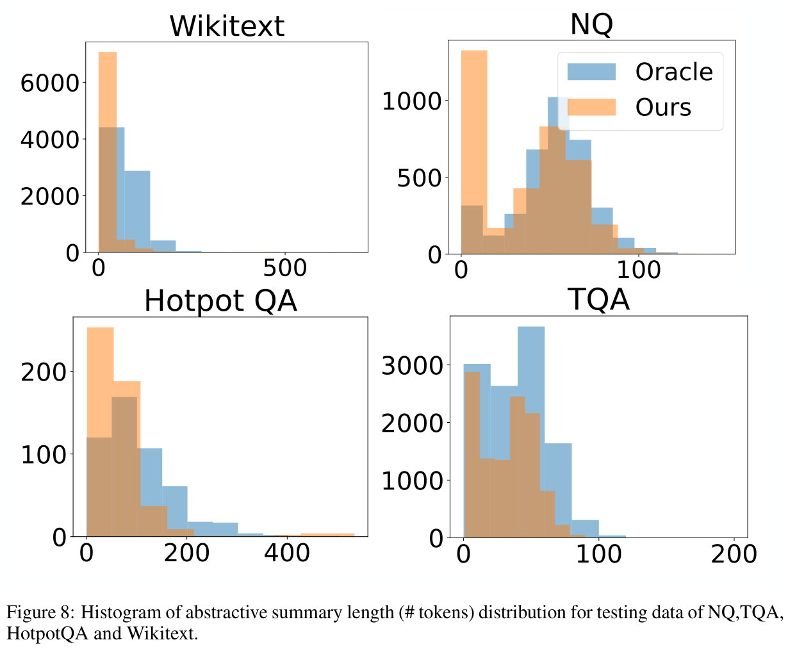
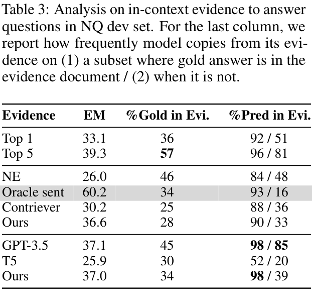
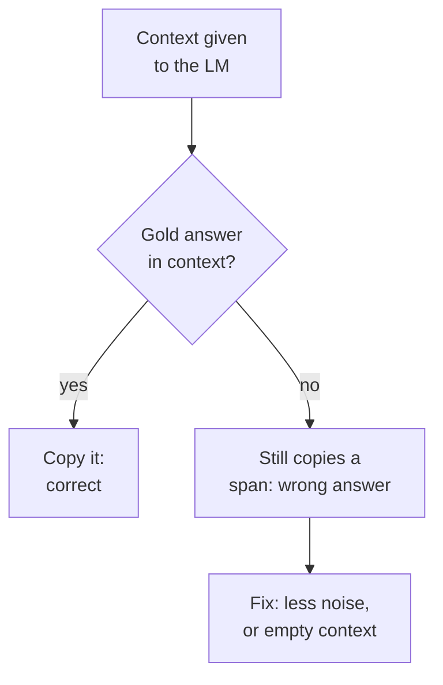
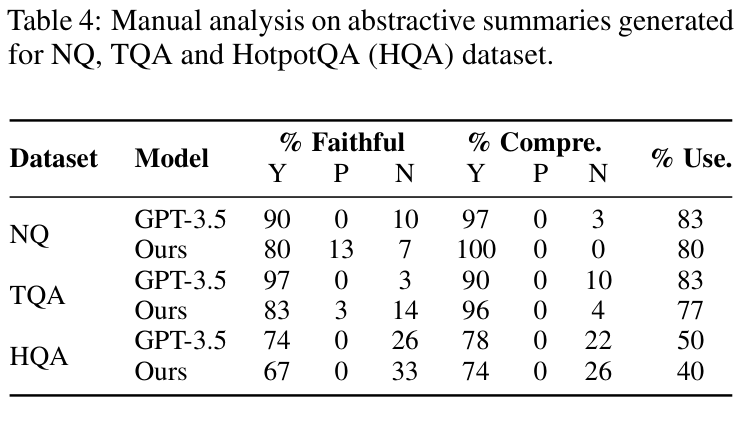

# 07. Analysis and Discussions (Paper Section 6)

In this note:

- Transfer across language models: why text summaries can move between models
- Summary length: does the compressor really skip unhelpful retrieval? (Figure 4 and Figure 8)
- How the model uses its context: copying right and copying wrong (Table 3)
- Are the summaries faithful and comprehensive? (Table 4)
- A case where compression fixes the answer (Appendix Table 9)

## Transferring Across Language Models

> "One benefit of textual summary is that they can transfer to other LMs, unlike approaches such as soft prompts."

A **soft prompt** compresses context into vectors that only one model understands. A **text** summary can be read by any model.

<table width="100%">
<thead><tr><th>Task</th><th>Trained with</th><th>Tested on</th><th>Result</th></tr></thead>
<tbody>
<tr><td>Language modeling</td><td>GPT-2 (117M)</td><td>GPT-2 XL (1.5B), GPT-J (6B)</td><td>Transfers well: still beats the baselines (note 06, Table 1)</td></tr>
<tr><td>Open-domain QA</td><td>Flan-UL2 (20B)</td><td>LLaMA-13B (Appendix Table 10)</td><td>Weaker than on Flan-UL2, sometimes no clear gain over plain Contriever on TQA and HotpotQA</td></tr>
</tbody>
</table>

> "Yet, on NQ/TQA, our compressor obtains 5% compression ratio with less than 5 EM drop compared to full document setting, showing the robustness of our retrieve-compress-prepend paradigm."

So transfer works, but a compressor is best with the model it was trained for: what helps one model is not always what helps another.

## How Long Are the Summaries?

> "Can the learned compressor reliably determine when LMs require retrieved documents or not? As retrieved documents were hurting the model performances for some input queries, 4-24% of training examples for abstractive compressors contain empty summary."

Figure 8 (the full version of Figure 4 in the main text) shows summary lengths in tokens for the oracle (blue) and the trained compressor (orange):

- **WikiText and NQ:** a tall orange bar at 0 to about 20 tokens: the compressor often outputs an empty or very short summary.
- **TQA and HotpotQA:** fewer empty outputs; lengths spread out more.
- The input documents are all about the same length, so the spread in output length shows the compressor **decides** how much to keep per question.

> "We have not experimented selective compression with extractive compressor, fixing the number of prepended sentences for the entire dataset ... Allowing adaptive augmentation with extractive summarizer can be a promising direction for future work."

The extractive compressor always keeps 1 or 2 sentences. Choosing how many sentences per question is left open, which is what a score threshold with dynamic k does in our design (basic concepts note 09).

## How Does the Model Use Its Context? (Table 3)

Two columns need explaining:

- **% Gold in Evi.:** how often the gold answer string appears in the evidence.
- **% Pred in Evi.:** how often the model's predicted answer appears in the evidence, split as (gold in evidence) / (gold not in evidence). The second number is **wrong copying**: the model copied something from text that did not contain the right answer.

<table width="100%">
<thead><tr><th>Evidence</th><th>EM</th><th>% Gold in evidence</th><th>% Pred in evidence (gold in / gold not in)</th></tr></thead>
<tbody>
<tr><td>Top 1 document</td><td>33.1</td><td>36</td><td>92 / 51</td></tr>
<tr><td>Top 5 documents</td><td>39.3</td><td>57</td><td>96 / 81</td></tr>
<tr><td>NE</td><td>26.0</td><td>46</td><td>84 / 48</td></tr>
<tr><td>Oracle sentence</td><td>60.2</td><td>34</td><td>93 / 16</td></tr>
<tr><td>Contriever</td><td>30.2</td><td>25</td><td>88 / 36</td></tr>
<tr><td>Ours, extractive</td><td>36.6</td><td>28</td><td>90 / 33</td></tr>
<tr><td>GPT-3.5</td><td>37.1</td><td>45</td><td>98 / 85</td></tr>
<tr><td>T5</td><td>25.9</td><td>30</td><td>52 / 20</td></tr>
<tr><td>Ours, abstractive</td><td>37.0</td><td>34</td><td>98 / 39</td></tr>
</tbody>
</table>

### Three lessons

1. **Having the answer is not enough.** NE contains the gold answer 46 percent of the time but reaches only 26.0 EM: the model finds the answer in it only 84 percent of the time. Our abstractive summaries with the answer are used 98 percent of the time.
2. **Irrelevant context causes wrong copying.**

   > "Prepending top 5 documents has a higher frequency (81%) of copying incorrectly compared to top 1 document (51%), and GPT-3 compression leads to an even higher incorrect copying frequency (85%), potentially as query-focused summarization generates sentences that seemingly contains the answer. Our compressor successfully reduce such erroneous behavior to 39%."

   When the right answer is absent, the model still copies **something** from the context 81 percent of the time with five documents. This is exactly how RAG hallucinates "from the documents".
3. **The oracle sentence rarely misleads (16 percent).** Good selection both gives the answer and avoids traps.

## Are the Summaries Faithful and Comprehensive? (Table 4)

The authors annotated 30 random non-empty summaries per dataset themselves.

<table width="100%">
<thead><tr><th>Axis</th><th>Question asked</th></tr></thead>
<tbody>
<tr><td>Faithfulness</td><td>Is the summary entailed by (supported by) the retrieved documents?</td></tr>
<tr><td>Comprehensiveness</td><td>Does the summary contain enough information to answer the question, wherever that information came from?</td></tr>
<tr><td>Useful</td><td>Both faithful and comprehensive</td></tr>
</tbody>
</table>

<table width="100%">
<thead><tr><th>Dataset</th><th>Model</th><th>% Faithful (Yes)</th><th>% Comprehensive (Yes)</th><th>% Useful</th></tr></thead>
<tbody>
<tr><td>NQ</td><td>GPT-3.5</td><td>90</td><td>97</td><td>83</td></tr>
<tr><td>NQ</td><td>Ours</td><td>80</td><td>100</td><td>80</td></tr>
<tr><td>TQA</td><td>GPT-3.5</td><td>97</td><td>90</td><td>83</td></tr>
<tr><td>TQA</td><td>Ours</td><td>83</td><td>96</td><td>77</td></tr>
<tr><td>HotpotQA</td><td>GPT-3.5</td><td>74</td><td>78</td><td>50</td></tr>
<tr><td>HotpotQA</td><td>Ours</td><td>67</td><td>74</td><td>40</td></tr>
</tbody>
</table>

> "Overall, our abstractive compressors were less faithful compared to the original GPT-3.5, while improving comprehensiveness."

Reading the numbers:

- The small compressor is **less faithful** than its teacher (80 against 90 on NQ): about 1 in 5 summaries contain something the documents do not support.
- Both models are weakest on **HotpotQA** (only 40 to 50 percent useful), which explains the small gains there: multi-document reasoning is hard to summarize.
- A summary can be comprehensive but unfaithful: the appendix example on NQ invents a release date ("December 2017 on Netflix") that answers the question but is not what the documents say about episode 12.

This is the key risk of abstractive compression: **the compressor can hallucinate before the generator even starts**.

## A Case Where Compression Helps (Appendix Table 9)

Question: "host of the late show who was once a correspondent for the daily show". Gold: Stephen Colbert.

<table width="100%">
<thead><tr><th>Context</th><th>Predicted answer</th></tr></thead>
<tbody>
<tr><td>None</td><td>Chelsea Handler (wrong)</td></tr>
<tr><td>Top 5 documents (long, many hosts mentioned)</td><td>Samantha Bee (wrong: copied a distractor)</td></tr>
<tr><td>GPT-3.5 summary (mentions Colbert, Helms, Oliver)</td><td>Left blank in the paper</td></tr>
<tr><td>Our T5 summary ("Stephen Colbert was a former correspondent for The Daily Show and later became host of CBS's Late Show in 2015 ...")</td><td>Stephen Colbert (correct)</td></tr>
</tbody>
</table>

The full documents contained the answer, but also several other correspondents and hosts; the model copied the wrong one. The focused summary removed the distractors.

## What This Means for Our Project

- Wrong copying from irrelevant chunks is likely behind some of our Naive RAG errors; reranking plus a threshold reduces it, and returning no context when nothing passes is the selective augmentation idea.
- If we add abstractive compression, our faithfulness judge must check the **compressed text against the original chunks**, not only the answer against the compressed text; otherwise compressor hallucinations go unnoticed.
- Extractive compression (keeping original sentences) is the safer first choice for our documents.

## Key Points

- Text summaries transfer across LMs; transfer works best between similar models and weakens on QA with LLaMA-13B.
- Summary lengths vary per question and 4 to 24 percent of training targets are empty: the compressor learns when to skip retrieval.
- With five documents, the LM copies a wrong span 81 percent of the time when the answer is absent; RECOMP's summaries cut this to 39 percent.
- The small abstractive compressor is about 80 percent faithful on NQ and TQA and only 67 percent on HotpotQA; abstractive compression can introduce hallucinations.

## Navigation

Previous: [06. Results](06.%20Results.md) | [Paper index](README.md) | Next: [08. Related Work](08.%20Related%20Work.md)
