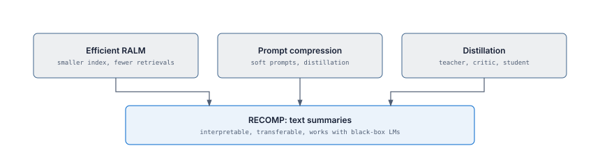
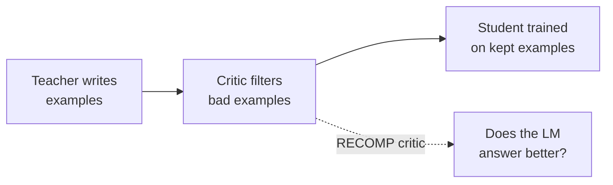

# 08. Related Work (Paper Section 7)

In this note:

- Efficient RALMs: other ways to make retrieval cheaper
- Prompt compression: soft prompts and context distillation
- Distillation and goal-oriented summarization
- Where RECOMP sits among these, in one table

## Efficient RALM

> "He et al. (2021) improves efficiency of RALMs by improving retrieval components, such as data store compression, dimensionality reduction for neural retriever. A line of work also introduces reducing retrieval frequency through selective retrieval (He et al., 2021; Mallen et al., 2022) or using a larger stride (Martins et al., 2022)."

<table width="100%">
<thead><tr><th>Approach</th><th>What it makes cheaper</th></tr></thead>
<tbody>
<tr><td>Data store compression, smaller vectors</td><td>The retrieval index (storage and search)</td></tr>
<tr><td>Selective retrieval</td><td>Skip retrieval for questions that do not need it</td></tr>
<tr><td>Larger stride</td><td>Retrieve less often during long generation</td></tr>
<tr><td>RECOMP</td><td>The tokens the LM reads: compress what was retrieved, or replace it with an empty string</td></tr>
</tbody>
</table>

> "In this work, we improve efficiency of RALM by compressing retrieved documents into a concise summary or an empty sequence, facilitating selective retrieval augmentation."

RECOMP's empty summary is a form of selective retrieval, but decided **after** seeing the documents rather than before.

## Prompt Compression

> "Recent work (Wingate et al., 2022; Chevalier et al., 2023; Mu et al., 2023) proposes compressing long contexts into summary vectors (soft prompts) that can be used by LMs, rather than shorter textual summaries."

<table width="100%">
<thead><tr><th>Method</th><th>Compressed form</th><th>Needs model weights?</th><th>Transfers to other LMs?</th><th>Readable by humans?</th></tr></thead>
<tbody>
<tr><td>Soft prompts / gist tokens</td><td>Learned vectors</td><td>Yes (gradient updates)</td><td>No</td><td>No</td></tr>
<tr><td>Context distillation</td><td>Context baked into the LM's parameters</td><td>Yes</td><td>No</td><td>No</td></tr>
<tr><td>RECOMP</td><td>Plain text summary</td><td>No (black-box LM)</td><td>Yes</td><td>Yes</td></tr>
</tbody>
</table>

> "Compared to above approaches, our approach yields more interpretable textual summary that can transfer across different LMs, and can be applied to black box LMs without requiring gradient updates."

For an API model like gpt-4o-mini, only text-based compression is possible: we cannot add soft prompts or change its weights.

Textual compression has also been studied for political fact checking (Chen et al., 2023) and instruction learning (Yin et al., 2023).

## Distillation and Goal-Oriented Summarization

> "Recent work introduces symbolic knowledge distillation (West et al., 2022), which transfers knowledge from a teacher model by generating a training dataset with the teacher model and train a student model on it. For better performance, they introduce critic criteria, which filter undesirable examples from generated training dataset."

RECOMP's abstractive compressor follows this recipe (note 04), with one change: the critic is **the end task** (does the summary help the LM answer?), not a summary-quality score.

> "One work that is similar to our setting is Hsu and Tan (2021) which trains an extractive summarization model to optimize for prediction accuracy of a sentiment prediction model based on the summary."

That is the same idea, a summary judged by a downstream model, applied to sentiment classification instead of retrieval-augmented generation.

## Where RECOMP Sits

<table width="100%">
<thead><tr><th>Family</th><th>Examples</th><th>RECOMP's difference</th></tr></thead>
<tbody>
<tr><td>Efficient retrieval</td><td>Index compression, selective retrieval</td><td>Compresses the retrieved text, not the index</td></tr>
<tr><td>Prompt compression</td><td>Soft prompts, gist tokens, context distillation</td><td>Text output: interpretable, transferable, works with black-box LMs</td></tr>
<tr><td>Summarization by distillation</td><td>Symbolic knowledge distillation, Impossible Distillation</td><td>Filters by end-task usefulness, allows empty summaries</td></tr>
<tr><td>Rerankers</td><td>BERT re-ranker (our paper 2)</td><td>Ranks sentences, not passages, by usefulness to the LM</td></tr>
</tbody>
</table>

Later work in the same direction includes token-level prompt compressors (the LLMLingua family) and the "strip irrelevant text" step in Corrective RAG, which we study in 09. Corrective RAG.

## Key Points

- Other efficiency work shrinks the index or retrieves less often; RECOMP shrinks what the LM reads.
- Soft prompts and context distillation need model weights and do not transfer; RECOMP's text summaries do both.
- The abstractive compressor uses symbolic knowledge distillation with an end-task critic.
- RECOMP is close to reranking, at sentence level and judged by the LM.

## Navigation

Previous: [07. Analysis and Discussions](07.%20Analysis%20and%20Discussions.md) | [Paper index](README.md) | Next: [09. Conclusion and Appendix](09.%20Conclusion%20and%20Appendix.md)
