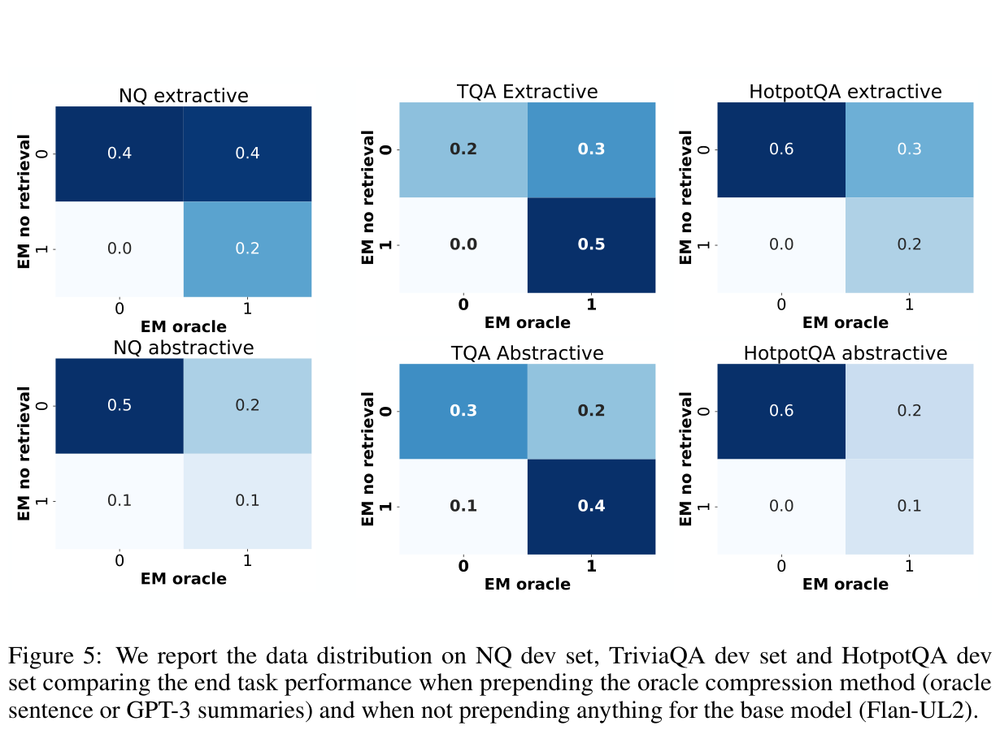
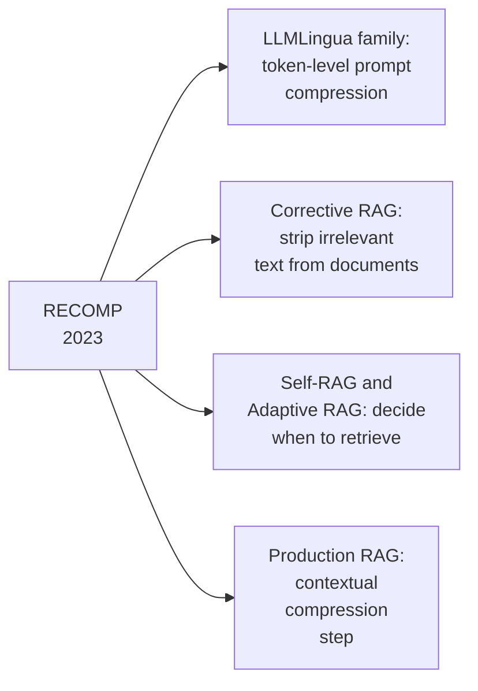

# 09. Conclusion and Appendix (Paper Section 8, Ethics, Appendix A)

In this note:

- Section 8: what the authors conclude
- Ethics and reproducibility statements
- Appendix highlights: Figure 5 (when oracle compression helps), prompts, transfer to LLaMA, annotation examples
- Limitations we add from reading the paper
- How later work followed
- What we take into our implementation

## Section 8: Conclusion

> "We introduce RECOMP, a method which compresses retrieved documents into textual summaries before prepending them to improve in-context retrieval augmented language models. We present two compression models - an extractive compressor and an abstractive compressor. We design a training scheme which leverages end task signals from a blackbox LM to generate useful summaries and allowing the compression models to perform selective augmentation. Our experiments show that our compressors can improve the efficiency of retrieval augmented LMs significantly with minimal drop in performances."

<table width="100%">
<thead><tr><th>Claim</th><th>Evidence in the paper</th></tr></thead>
<tbody>
<tr><td>Compression into text summaries works for in-context RALMs</td><td>5 to 11 percent of the tokens with 6 to 7 percent relative EM loss on QA (note 06)</td></tr>
<tr><td>Two compressors: extractive and abstractive</td><td>Contriever dual encoder and distilled T5-large (notes 03, 04)</td></tr>
<tr><td>Trained from end-task signals of a black-box LM</td><td>Score = log likelihood or exact match of the LM's output (note 04)</td></tr>
<tr><td>Selective augmentation</td><td>4 to 25 percent empty training targets; summaries prepended to only 33 percent of language modeling examples (notes 04, 06, 07)</td></tr>
</tbody>
</table>

## Ethics and Reproducibility

> "We use commercial language model to generate training data for our compressors, which might include factual error. We conduct careful human evaluation on the data generated and present our analysis in the paper."

> "We release our codes, prompt, and data generated with API access publicly."

Training data written by GPT-3.5 can contain errors, and the student compressor can learn them; this is one source of the lower faithfulness in Table 4 (note 07).

## Appendix Highlights

### Figure 5: when does oracle compression help?

Each 2 x 2 grid splits the development questions by two outcomes for Flan-UL2: correct (1) or wrong (0) **with no retrieval** (rows), and correct or wrong **with the oracle compression** (columns). Cells show the share of questions (values are rounded in the figure).

<table width="100%">
<thead><tr><th>Cell</th><th>Meaning</th><th>NQ extractive (approx.)</th></tr></thead>
<tbody>
<tr><td>No retrieval wrong, oracle wrong</td><td>Neither helps: the retrieved documents do not contain a usable answer</td><td>0.4</td></tr>
<tr><td>No retrieval wrong, oracle right</td><td>Compression fixes the answer</td><td>0.4</td></tr>
<tr><td>No retrieval right, oracle wrong</td><td>Retrieval hurts</td><td>0.0</td></tr>
<tr><td>No retrieval right, oracle right</td><td>The LM already knew; retrieval not needed</td><td>0.2</td></tr>
</tbody>
</table>

Two takeaways: a large share of questions (about 0.4 on NQ, 0.6 on HotpotQA) fail even with the best compression, so **retrieval quality caps everything**; and a visible share is answered correctly with no retrieval at all, which is where an empty summary saves tokens for free.

### Prompts (Appendix Table 8)

The exact GPT-3.5 prompts are listed in note 04. The NQ and TriviaQA prompt, "Compress the information in the retrieved documents into a 2-sentence summary that could be used to answer the question", is a ready template for a prompted compressor.

### Transfer to LLaMA-13B (Appendix Table 10)

Compressors trained with Flan-UL2 were tested with LLaMA-13B. They still compress NQ and TQA to about 5 percent of tokens with less than 5 EM loss against full documents, but the gap to LLaMA's own oracle is large, and on TQA and HotpotQA they show no clear gain over plain Contriever (note 07).

### Annotation examples (Appendix Tables 11 and 12)

<table width="100%">
<thead><tr><th>Example</th><th>Label</th><th>Why</th></tr></thead>
<tbody>
<tr><td>NQ: "when will miraculous ladybug season 2 episode 12 come out"; summary says December 2017 on Netflix</td><td>Not faithful, comprehensive</td><td>It answers the question, but the documents do not say this about episode 12</td></tr>
<tr><td>TQA: novel where Flora Poste lives with the Starkadders; summary describes the farm</td><td>Faithful, not comprehensive</td><td>Everything is true, but the novel's name (Cold Comfort Farm) is missing</td></tr>
</tbody>
</table>

These two cases are the two failure modes of abstractive compression: **inventing** an answer, or **dropping** the answer.

## Limitations We Add

The paper has no limitations section. From reading it with our project in mind:

<table width="100%">
<thead><tr><th>Observation</th><th>Why it matters</th></tr></thead>
<tbody>
<tr><td>Trained compressors still lose 2 to 4 EM points against full documents on QA</td><td>Compression mainly saves cost; it does not yet improve answers, unlike the oracle</td></tr>
<tr><td>Abstractive compressor about 80 percent faithful (67 percent on HotpotQA)</td><td>It can hallucinate before the generator runs; faithfulness must be checked against the original chunks</td></tr>
<tr><td>Extractive compressor keeps a fixed 1 or 2 sentences</td><td>No adaptive selection; the paper leaves this to future work</td></tr>
<tr><td>Compressors are trained per dataset and per LM</td><td>Training data generation needs many GPT-3.5 calls and gold answers; transfer to new LMs weakens on QA</td></tr>
<tr><td>Compressor latency and cost are not reported</td><td>The compressor reads all documents; the token savings must be compared with its own runtime</td></tr>
<tr><td>Short Wikipedia documents only</td><td>100-word passages and factoid questions; long technical or policy documents are untested</td></tr>
<tr><td>Faithfulness checked on only 30 summaries per dataset, by the authors</td><td>Small samples, not independent annotators</td></tr>
</tbody>
</table>

## How Later Work Followed

Context compression became a standard optional stage in RAG frameworks (often as an LLM or embedding filter after retrieval); the "empty summary" idea is developed further in 08. Self RAG, 09. Corrective RAG and 10. Adaptive RAG.

## What We Take Into Our Implementation

<table width="100%">
<thead><tr><th>From the paper</th><th>In our Advanced RAG</th></tr></thead>
<tbody>
<tr><td>Compress after retrieval, before generation</td><td>Optional compression stage after reranking (basic concepts notes 10, 11)</td></tr>
<tr><td>Extractive is safer than abstractive</td><td>If enabled, extractive sentence selection from the kept chunks, so the generator sees only original text</td></tr>
<tr><td>Prefix sentences with the page title</td><td>Keep document title and section with every chunk and sentence</td></tr>
<tr><td>Empty summary when documents do not help</td><td>When no chunk passes the reranker threshold, fall back instead of passing weak context (note 09)</td></tr>
<tr><td>Best evidence closest to the question</td><td>Order chunks in the prompt so the highest-scoring one is nearest to the question</td></tr>
<tr><td>Report evidence tokens with quality</td><td>Trace logs context tokens per answer next to cost and evaluation scores (note 12)</td></tr>
<tr><td>Wrong copying from irrelevant context</td><td>Measured indirectly by faithfulness and context precision in our evaluation</td></tr>
</tbody>
</table>

Because reranking with a threshold already removes most noise and our context is about 1 to 5 chunks, compression is **off by default** and evaluated as a separate ablation run.

## Key Points

- RECOMP compresses retrieved documents into text summaries, trained from a black-box LM's end-task signal, and can return nothing.
- Appendix Figure 5: many questions fail even with oracle compression (retrieval caps quality), and some need no retrieval at all.
- Main weaknesses: lossy on QA compared with full documents, abstractive hallucination, fixed-size extractive output, per-LM training, unreported compressor cost.
- For our project: optional extractive compression, titles with chunks, best chunk next to the question, fallback when nothing passes, and context tokens in the trace.

## Navigation

Previous: [08. Related Work](08.%20Related%20Work.md) | [Paper index](README.md) | Back to: [Research Paper Explained](../README.md)
