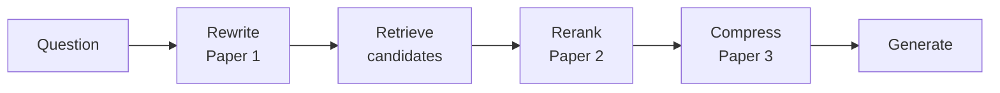

# Research Paper Explained: Advanced RAG

Advanced RAG is built on three papers: one for the stage before retrieval and two for the stage after it. Each paper gets its own folder with one note per paper section: every figure and table is shown as it appears in the paper and explained in simple words, and every equation is explained symbol by symbol.

<table width="100%">
<thead><tr><th>#</th><th>Paper</th><th>Stage</th><th>What it contributes</th><th>Status</th></tr></thead>
<tbody>
<tr><td>1</td><td><a href="01.%20Query%20Rewriting%20for%20Retrieval-Augmented%20LLMs/">Query Rewriting for Retrieval-Augmented Large Language Models</a> (Ma et al., EMNLP 2023)</td><td>Pre-retrieval</td><td>Rewrite-Retrieve-Read: rewrite the question before retrieval, with a frozen LLM or a small trained rewriter improved by reinforcement learning</td><td>Done</td></tr>
<tr><td>2</td><td><a href="02.%20Passage%20Re-ranking%20with%20BERT/">Passage Re-ranking with BERT</a> (Nogueira and Cho, 2019)</td><td>Post-retrieval</td><td>A BERT cross-encoder that re-scores each (query, passage) pair; state of the art on MS MARCO and TREC-CAR</td><td>Planned</td></tr>
<tr><td>3</td><td><a href="03.%20RECOMP%20Compression%20and%20Selective%20Augmentation/">RECOMP: Improving Retrieval-Augmented LMs with Compression and Selective Augmentation</a> (Xu, Shi and Choi, ICLR 2024)</td><td>Post-retrieval</td><td>Compress retrieved documents into short summaries before generation (extractive and abstractive compressors), and return an empty summary when the documents do not help</td><td>Planned</td></tr>
</tbody>
</table>

## Where each paper fits

## Navigation

Previous: [01. Basic Concepts](../01.%20Basic%20Concepts/) | [Notes](../README.md) | Next: [03. Interview Preparation](../03.%20Interview%20Preparation/)
