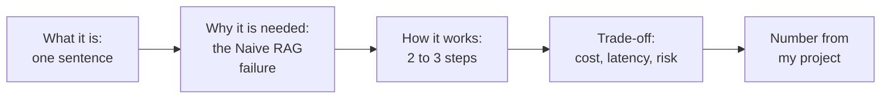
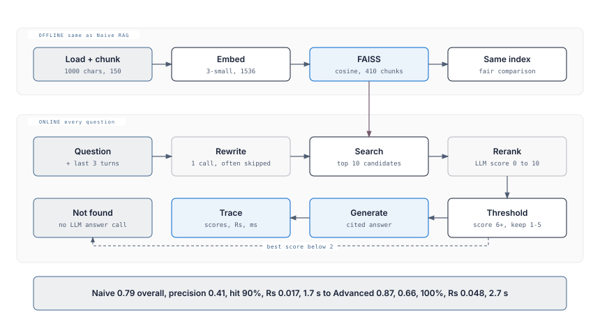
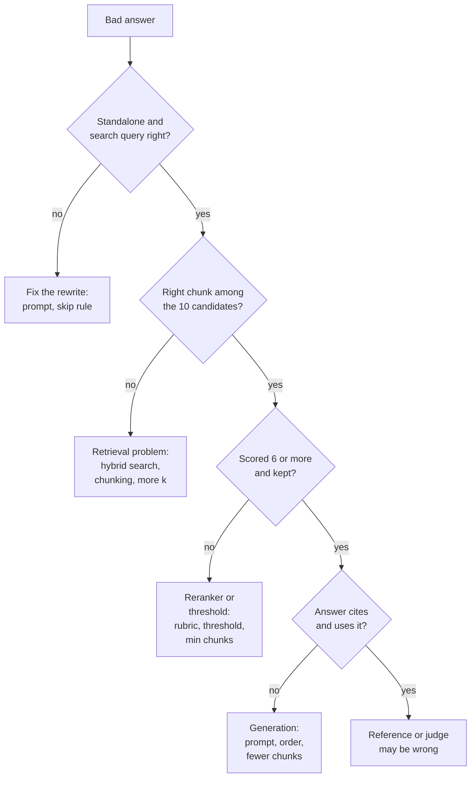

# 01. Advanced RAG Interview Preparation

In this doc:

- How to use this doc, and how to structure any answer
- The 30-second and 2-minute explanations
- The diagram to draw
- Questions and answers by topic, with this project's measured numbers
- Worked numbers for the whiteboard
- System design: from this project to production
- Your project story, before and after
- Debugging a bad answer live
- Rapid-fire round and mistakes that cost points

Everything here is backed by the notes, the three papers and the implementation in this folder. Numbers come from the evaluation in [API doc 11](../../03.%20API/docs/11.%20Evaluation%20Results%20and%20Comparison%20with%20Naive%20RAG.md) (11 test questions, gpt-4o-mini, text-embedding-3-small, FAISS). Start with the [Naive RAG Interview Preparation](../../../01.%20Naive%20RAG/01.%20Notes/03.%20Interview%20Preparation/01.%20Naive%20RAG%20Interview%20Preparation.md): interviewers almost always ask Naive RAG first and then "how would you improve it?", which is this doc.

## How to Use This Doc

- Read the two explanations until you can say them without notes.
- Practise drawing the diagram in under two minutes.
- For each topic, answer the question yourself first, then compare.
- Learn the worked numbers: real numbers from your own system are what make an answer stand out.

### How to structure any answer

Example: "Reranking re-scores retrieved chunks with a model that reads the question and chunk together. It is needed because embedding similarity barely separates good and bad chunks: in my project ranks 1 to 4 for one question were 0.537, 0.536, 0.535, 0.534. A cross-encoder or LLM gives each chunk a relevance score; I sort by it and keep chunks above a threshold. It costs one extra call, about Rs 0.03 and 1 s. It took the right file to rank 1 for 9 of 10 questions instead of 8, and MRR from 0.86 to 0.95."

## The 30-Second Explanation

"Advanced RAG keeps the Naive RAG pipeline (index chunks with embeddings, retrieve, generate) but improves the steps around retrieval. Before retrieval it rewrites the question, so follow-ups and vague questions search well. Retrieval brings back more candidates than needed, and a reranker that reads the question with each candidate scores real relevance. Only chunks above a score threshold go to the generator. In my project this raised context precision from 0.41 to 0.66 and the overall score from 0.79 to 0.87, at about three times the cost per question."

## The 2-Minute Explanation

"Naive RAG has one number, top k, that must do two jobs: find the right chunk (recall) and send nothing else (precision). With top 4, my Naive RAG found the right file for 9 of 10 questions but 59 percent of the context it sent was irrelevant, and follow-up questions like 'and how is it trained?' failed because 'it' was searched literally.

Advanced RAG splits the jobs. First, one LLM call condenses the question with the chat history and rewrites it in search wording, the Rewrite-Retrieve-Read idea from Ma et al. 2023. Clear first questions skip this call. Second, retrieval returns 10 candidates instead of 4: on my test set that finds the expected file for 10 of 10 questions. Third, a reranker scores each candidate. The classic choice is a cross-encoder like the BERT re-ranker of Nogueira and Cho 2019; I used gpt-4o-mini as a relevance judge to stay on Azure only, scoring all 10 in one call on a 0 to 10 rubric. Fourth, a threshold keeps chunks scoring 6 or more, between 1 and 5 of them, and if even the best scores below 2 no context is sent and the API says the answer is not in the documents. RECOMP-style compression is available but off, because it cost more than it saved.

I measured it with an ablation: five presets adding one stage at a time on the same test set and judge. The threshold gave the largest gain: context precision 0.43 to 0.66. Correctness stayed at 0.84, so the remaining errors are retrieval and chunking problems, the motivation for hybrid search next. Cost went from Rs 0.017 to Rs 0.048 per question, two thirds of it the LLM reranker, and time from 1.7 to 2.7 seconds."

## The Diagram to Draw

Draw it in this order: the Naive index on top ("unchanged"), then the online row left to right, then the threshold with the not-found branch, then the before-and-after numbers. Point at each box when you say the 2-minute explanation.

## Questions and Answers by Topic

### 1. Fundamentals

<table width="100%">
<thead><tr><th>Question</th><th>Answer</th></tr></thead>
<tbody>
<tr><td>What is Advanced RAG?</td><td>RAG with stages added around retrieval: pre-retrieval (query rewriting, expansion), post-retrieval (reranking, filtering, compression). The pipeline is still one linear pass: retrieve once, generate once (Gao et al. survey terminology: Naive, Advanced, Modular)</td></tr>
<tr><td>Which Naive RAG problems does it solve?</td><td>Vague and follow-up questions (rewriting), right chunk ranked too low (wider retrieval plus reranking), irrelevant chunks in the prompt (threshold), long noisy context (compression)</td></tr>
<tr><td>Which problems does it not solve?</td><td>Information missing from the index or split across chunks, exact names and codes that dense search misses, multi-hop questions needing several retrievals, deciding whether to retrieve at all (partly)</td></tr>
<tr><td>Why not just increase top k?</td><td>Recall goes up but precision goes down: more irrelevant text, more tokens, lost-in-the-middle. Advanced RAG retrieves wide and then filters, so recall and precision are handled by different stages</td></tr>
<tr><td>What stays the same as Naive RAG?</td><td>Loading, chunking (1000 characters, 150 overlap), embeddings, FAISS index, the grounded prompt with citations. Keeping the index identical made the comparison fair</td></tr>
<tr><td>Pre-retrieval vs post-retrieval?</td><td>Pre-retrieval changes the query (rewrite, expand, decompose); post-retrieval changes what is done with results (rerank, filter, compress, reorder)</td></tr>
</tbody>
</table>

### 2. Query rewriting

<table width="100%">
<thead><tr><th>Question</th><th>Answer</th></tr></thead>
<tbody>
<tr><td>What is Rewrite-Retrieve-Read?</td><td>Ma et al., EMNLP 2023: add a rewriting step before retrieval. A frozen LLM or a small T5 rewriter trained first on filtered LLM rewrites, then with PPO reinforcement learning using the reader's answer quality as reward. Gains of about 2 to 4 EM on open-domain QA</td></tr>
<tr><td>What did you implement?</td><td>One gpt-4o-mini call in JSON mode returning standalone_question (used to rerank and answer) and search_query (used to search). Temperature 0, max 150 tokens</td></tr>
<tr><td>Why return two questions?</td><td>Search wording ("daily meal allowance international per diem") helps the embedding but is a poor question to answer. The generator answers the standalone question, which keeps the user's meaning</td></tr>
<tr><td>When do you skip the rewrite?</td><td>Rewriting switched off, or a question of 8 or more words without history, or with history but no pronoun or follow-up opening. Saves about 1 s and Rs 0.004 on clear questions</td></tr>
<tr><td>What can go wrong?</td><td>Query drift: the rewrite adds facts. I saw the model copy "DPR" from an earlier answer into a question about CRAG; a prompt rule now forbids copying from earlier answers. Rewrites are logged in the trace so drift is visible</td></tr>
<tr><td>What if the rewrite call fails?</td><td>Fall back to the original question; the reason is recorded ("rewrite call failed: TimeoutError"). A rewrite is an improvement, never a requirement</td></tr>
<tr><td>Multi-query, HyDE, step-back?</td><td>Multi-query searches several rewrites and fuses results with reciprocal rank fusion (RAG Fusion); HyDE searches with a hypothetical answer; step-back asks a more general question first. They raise recall at the cost of more calls; covered in later architectures</td></tr>
</tbody>
</table>

### 3. Candidate retrieval and recall

<table width="100%">
<thead><tr><th>Question</th><th>Answer</th></tr></thead>
<tbody>
<tr><td>Why retrieve more candidates than you send?</td><td>The reranker can only reorder what retrieval returns: recall at N is a ceiling. Retrieve wide (10), then let the reranker choose few (1 to 5)</td></tr>
<tr><td>How did you choose 10?</td><td>Measured hit rate (expected file present): top 1: 7/10, top 4: 9/10, top 10: 10/10, top 20: 10/10. With an LLM reranker, 20 candidates would double reranking cost (Rs 0.067 against Rs 0.035) with no recall gain</td></tr>
<tr><td>What do similarity scores tell you?</td><td>Little in absolute terms: for one paper question ranks 1 and 10 were 0.54 and 0.51. For the HR question rank 10 was 0.12. That is why a learned relevance score is needed to filter</td></tr>
<tr><td>Hit rate vs recall?</td><td>Hit rate: share of questions with at least one relevant chunk retrieved. Recall at k: share of all relevant chunks retrieved. My hit rate is file-level, an upper bound</td></tr>
</tbody>
</table>

### 4. Bi-encoders, cross-encoders and reranking

<table width="100%">
<thead><tr><th>Question</th><th>Answer</th></tr></thead>
<tbody>
<tr><td>Bi-encoder vs cross-encoder?</td><td>Bi-encoder: question and chunk embedded separately, compared with a dot product; chunk vectors precomputed, fast, search millions. Cross-encoder: question and chunk in one input, full attention between them; more accurate, but one model pass per pair, so only for a few candidates</td></tr>
<tr><td>What did the BERT re-ranker paper show?</td><td>Nogueira and Cho 2019: BERT-Large as a binary classifier on [CLS] query [SEP] passage [SEP]. MS MARCO MRR@10 35.8 against 28.1 for the previous best (27 percent relative); TREC-CAR MAP 33.5 against 15.3 for BM25. 100k training pairs already beat the previous best</td></tr>
<tr><td>Why hard negatives?</td><td>Training negatives were BM25's top results that are not relevant: they look relevant, which is exactly what the re-ranker must learn to reject</td></tr>
<tr><td>What is MRR?</td><td>Mean of 1 / rank of the first relevant result. Rank 1 gives 1, rank 3 gives 0.33, none gives 0. My file-level MRR went from 0.858 to 0.950 with reranking</td></tr>
<tr><td>ColBERT?</td><td>Late interaction: token-level embeddings for query and passage, compared with max-sim. Passage side precomputed, so faster than a cross-encoder and more precise than one vector per chunk; more storage</td></tr>
<tr><td>Listwise vs pointwise reranking?</td><td>Pointwise scores each passage alone (BERT, my rubric). Listwise orders the whole list at once (LLM prompts like RankGPT); captures comparisons but is sensitive to order and context length</td></tr>
</tbody>
</table>

### 5. Using an LLM as the reranker

<table width="100%">
<thead><tr><th>Question</th><th>Answer</th></tr></thead>
<tbody>
<tr><td>Why gpt-4o-mini instead of a cross-encoder?</td><td>Stack constraint: Azure OpenAI only, no PyTorch or local models. The LLM plays the cross-encoder's role: it reads question and chunk together. Trade-off: about Rs 0.032 and 1 s per question, where a local MiniLM would be free in money</td></tr>
<tr><td>How does it work?</td><td>One call for all 10 candidates, numbered with their source. A written rubric: 10 answers directly, 7 to 9 most of the answer, 4 to 6 partly useful, 1 to 3 same topic but not helpful, 0 unrelated. Reply is JSON: one integer per candidate. Temperature 0</td></tr>
<tr><td>Why a rubric?</td><td>LLM scores drift without anchors. The rubric makes a score of 6 mean the same on every question, so one threshold works</td></tr>
<tr><td>A latency trick you used?</td><td>Asking for a plain list [8, 0, 5] instead of objects with ids cut output from 125 to 33 tokens and the call from 1.68 s to 0.93 s. Output tokens dominate a short call. A length check guards against misaligned lists</td></tr>
<tr><td>Risks of an LLM reranker?</td><td>Uses its own knowledge ("judge only what the passage says"), scores influenced by neighbouring passages, run-to-run variation of 1 to 2 points, cost growing with candidates. Fallback to retrieval order on any failure</td></tr>
<tr><td>Show an example.</td><td>"Which retriever and generator does RAG combine?": a CRAG chunk mentioning "retriever R and generator G" was rank 1 by similarity (0.537) and scored 3; the RAG paper methods chunk was rank 3 (0.535) and scored 7, moving to rank 1</td></tr>
</tbody>
</table>

### 6. Thresholds and dynamic k

<table width="100%">
<thead><tr><th>Question</th><th>Answer</th></tr></thead>
<tbody>
<tr><td>What is dynamic k?</td><td>The number of chunks sent varies per question: keep those scoring at or above a threshold, with a minimum and maximum. My setting: threshold 6, keep 1 to 5</td></tr>
<tr><td>How did you choose the threshold?</td><td>Saved reranker scores for the test set and swept thresholds without new calls. 3 to 7 kept the expected file for all 10 questions; 8 lost one. I chose 6, not 7, because scores vary 1 to 2 points between runs and one relevant chunk scored exactly 7</td></tr>
<tr><td>What happens to an out-of-scope question?</td><td>All candidates score 0. If the best is below the floor of 2, no context is sent and the fixed "I could not find this" answer is returned without calling the generator</td></tr>
<tr><td>Effect on chunk count?</td><td>Naive always sent 4. With the threshold: 0 for out-of-scope, 1 for HR questions, up to 5 for broad paper questions; average 3.6</td></tr>
<tr><td>Why a minimum of 1?</td><td>When the best chunk is related but weak (score 2 to 5), sending it lets the generator answer or say it is not enough; sending nothing would refuse questions that are partly answerable</td></tr>
</tbody>
</table>

### 7. Context compression (RECOMP)

<table width="100%">
<thead><tr><th>Question</th><th>Answer</th></tr></thead>
<tbody>
<tr><td>What is RECOMP?</td><td>Xu, Shi and Choi (ICLR 2024): compress retrieved documents into a summary before generation. Extractive compressor (Contriever dual encoder selecting sentences) or abstractive (T5-large distilled from GPT-3.5). Both can output nothing (selective augmentation). About 5 to 11 percent of tokens with 6 to 7 percent relative EM loss on QA</td></tr>
<tr><td>Extractive vs abstractive?</td><td>Extractive keeps original sentences: faithful by construction. Abstractive writes new text: can merge facts but hallucinates (RECOMP found about 80 percent faithful on NQ)</td></tr>
<tr><td>What did you implement?</td><td>Extractive: sentences numbered locally, the model returns only numbers, the code keeps the original sentences. No new text can appear</td></tr>
<tr><td>Why is it off?</td><td>Measured: context minus 46 percent, but cost plus 30 percent and time plus 0.6 s, because compressor and generator are the same cheap model. RECOMP assumes a small compressor and a large reader. One answer was lost</td></tr>
<tr><td>A bug you found?</td><td>The sentence splitter cut at "et al.", producing fragments; fixed by not splitting after common abbreviations, with a test</td></tr>
</tbody>
</table>

### 8. Conversations and follow-ups

<table width="100%">
<thead><tr><th>Question</th><th>Answer</th></tr></thead>
<tbody>
<tr><td>How do you handle follow-up questions?</td><td>The client sends earlier turns as history; the rewriter turns "and within India?" into "What is the daily meal allowance for employees working within India?" using the last 3 turns, answers cut to 300 characters</td></tr>
<tr><td>Where is the conversation stored?</td><td>In the client. The API is stateless: easier to scale and no server-side session data. The UI sends the last 6 answered turns</td></tr>
<tr><td>How does the user know it understood?</td><td>The UI shows "Understood as: ..." under the question when it was rewritten</td></tr>
<tr><td>Topic changes?</td><td>A new long question without pronouns skips the rewrite; the prompt says to use history only to resolve references</td></tr>
</tbody>
</table>

### 9. Evaluation and ablation

<table width="100%">
<thead><tr><th>Question</th><th>Answer</th></tr></thead>
<tbody>
<tr><td>How did you evaluate?</td><td>Same 11-question test set and gpt-4o-mini judge as Naive RAG: faithfulness, answer relevance, context precision, correctness against a reference, plus hit rate and candidate hit rate, latency and cost</td></tr>
<tr><td>What is an ablation?</td><td>Adding one stage at a time to measure each one. My presets: A Naive, B + rewrite, C + rerank keeping 4, D + threshold, E + compression. A preset applies to the run's own thread only, so live chat is unaffected</td></tr>
<tr><td>Results?</td><td>Overall 0.79, 0.82, 0.81, 0.87, 0.89. Context precision 0.41, 0.46, 0.43, 0.66, 0.78. Correctness 0.84, 0.86, 0.89, 0.84, 0.82. Hit rate 90, 100, 100, 100, 90 percent</td></tr>
<tr><td>Which stage mattered most?</td><td>The threshold: precision 0.43 to 0.66. Reranking while still sending 4 chunks (C) mostly added cost. Rewriting fixed the vague question and lifted hit rate to 100 percent</td></tr>
<tr><td>Why is E (best overall) not the default?</td><td>Its gains are in context metrics; correctness and hit rate dropped, and it costs 25 percent more and 1.5 s longer</td></tr>
<tr><td>How do you know the baseline is fair?</td><td>Preset A in the new code reproduced Naive RAG: 0.79 against 0.80 overall, 0.409 against 0.41 precision, same hit rate and time</td></tr>
<tr><td>Limits of the evaluation?</td><td>11 questions (one question moves an average by about 0.02), one run per preset, file-level hit rate, single-turn questions, judge from the same model family</td></tr>
<tr><td>Why candidate hit rate?</td><td>Separates recall (expected file among the 10 candidates) from selection (expected file sent). The gap shows how often reranking and the threshold drop the right file</td></tr>
</tbody>
</table>

### 10. Cost and latency

<table width="100%">
<thead><tr><th>Question</th><th>Answer</th></tr></thead>
<tbody>
<tr><td>What does a question cost?</td><td>Default pipeline: about Rs 0.048 and 2.7 s on average; Naive was Rs 0.017 and 1.7 s</td></tr>
<tr><td>Where does it go?</td><td>Per-stage tracking: rerank about 70 percent of cost (Rs 0.031), generate about 26 percent; time: generate 38 percent, rerank 27 percent, retrieve 23 percent, rewrite 12 percent</td></tr>
<tr><td>How did you measure per stage?</td><td>A snapshot of the usage meter before and after each stage (track_stage), so no component had to change; shown in the trace, logs and analytics</td></tr>
<tr><td>How would you cut cost?</td><td>Local cross-encoder (removes most of Rs 0.032), fewer or shorter candidates for scoring, cache rewrites and answers, skip reranking when one candidate is far ahead</td></tr>
<tr><td>How would you cut latency?</td><td>Stream the answer, run rewrite only when needed (done), smaller reranker, parallel scoring, prompt caching</td></tr>
<tr><td>Did you meet the targets?</td><td>4 of 6: precision 0.65+, overall 0.85+, hit rate 95 to 100 percent, time under 3 s. Not met: correctness 0.90 (0.84) and cost under Rs 0.04 (Rs 0.048)</td></tr>
</tbody>
</table>

### 11. Failure modes and debugging

<table width="100%">
<thead><tr><th>Question</th><th>Answer</th></tr></thead>
<tbody>
<tr><td>Where can each stage fail?</td><td>Rewrite: drift or wrong reference. Retrieval: answer not in candidates. Rerank: relevant chunk scored low. Threshold: too strict drops evidence, too loose keeps noise. Generate: ignores context or cites wrong chunk</td></tr>
<tr><td>How do you find which stage failed?</td><td>The trace: compare standalone and search query; check candidate_hit (was the right chunk retrieved?); read the scores and kept flags; then the answer and citations</td></tr>
<tr><td>A real failure?</td><td>rag-corpus ("What collection does RAG retrieve from?"): no chunk states the Wikipedia dump clearly, so the best case is a vague answer. A retrieval and chunking gap, not a reranking problem</td></tr>
<tr><td>Another?</td><td>rag-variants: the chunk defining RAG-Sequence vs RAG-Token scored below 6 and was dropped; correctness 0.5. Selection can remove partly useful chunks</td></tr>
<tr><td>Design principle for failures?</td><td>Every model stage falls back to Naive behaviour on error and records why; the answer still arrives</td></tr>
</tbody>
</table>

### 12. Engineering

<table width="100%">
<thead><tr><th>Question</th><th>Answer</th></tr></thead>
<tbody>
<tr><td>How is the code organised?</td><td>FastAPI with three layers: routes and schemas, services (RAG service runs the pipeline), components (rewriting, retrieval, reranking, compression, generation). Each stage is a package with its own tests</td></tr>
<tr><td>How are stages configured?</td><td>pydantic-settings from .env: switches and limits per stage, shown in GET /health and the startup log. All switches off reproduces Naive RAG exactly</td></tr>
<tr><td>How did you run presets without affecting live traffic?</td><td>A context variable holds a settings copy; get_settings() returns it inside the evaluation thread only</td></tr>
<tr><td>How do you test LLM code?</td><td>Fake clients returning fixed replies: test parsing, fallbacks (bad JSON, wrong score count, timeouts), skip rules and limits. Live checks are separate and documented. 103 API tests, 37 UI tests</td></tr>
<tr><td>What does the API return?</td><td>Answer, sources with similarity and rerank score, usage, and a trace: questions at each step, all candidates with ranks, scores and kept flags, tokens, cost and time per stage</td></tr>
</tbody>
</table>

### 13. Limitations and next architectures

<table width="100%">
<thead><tr><th>Question</th><th>Answer</th></tr></thead>
<tbody>
<tr><td>Main limitations of your Advanced RAG?</td><td>Correctness unchanged (retrieval and chunking gaps), cost three times Naive, dense search only (exact terms), single retrieval (no multi-hop), small test set</td></tr>
<tr><td>What next and why?</td><td>Hybrid search (BM25 plus dense) for exact terms and recall; contextual chunking for chunks that lose context; Self-RAG, Corrective RAG and Adaptive RAG to decide when and how to retrieve; iterative retrieval for multi-hop</td></tr>
<tr><td>When is Advanced RAG enough?</td><td>Single-fact questions over a clean corpus, moderate traffic, where precision and follow-ups matter more than the last points of correctness</td></tr>
<tr><td>When is it overkill?</td><td>Tiny corpora where top 3 is always right, very latency-sensitive paths, or when cost per question must stay near Naive levels</td></tr>
</tbody>
</table>

## Worked Numbers for the Whiteboard

<table width="100%">
<thead><tr><th>Item</th><th>Number</th><th>How to derive it</th></tr></thead>
<tbody>
<tr><td>Rerank cost, 10 candidates</td><td>Rs 0.032</td><td>2,407 input x 0.15 + 33 output x 0.60 per million USD = 0.00038 USD x 84</td></tr>
<tr><td>Rewrite cost</td><td>Rs 0.0044</td><td>230 x 0.15 + 30 x 0.60 per million = 0.0000525 USD x 84</td></tr>
<tr><td>Generate, 1 chunk vs 4</td><td>Rs 0.003 vs about Rs 0.017</td><td>About 200 vs about 1,000 prompt tokens</td></tr>
<tr><td>Relative MRR@10 gain in the BERT paper</td><td>27 percent</td><td>(35.8 - 28.1) / 28.1</td></tr>
<tr><td>Precision gain from the threshold</td><td>+0.23</td><td>0.432 (C) to 0.658 (D)</td></tr>
<tr><td>Cost multiple vs Naive</td><td>2.8x</td><td>Rs 0.048 / Rs 0.017</td></tr>
<tr><td>Plain-list speed-up</td><td>45 percent faster</td><td>1.68 s to 0.93 s</td></tr>
</tbody>
</table>

## System Design: From This Project to Production

<table width="100%">
<thead><tr><th>Concern</th><th>This project</th><th>Production</th></tr></thead>
<tbody>
<tr><td>Reranker</td><td>gpt-4o-mini, one call for 10</td><td>Hosted or local cross-encoder (bge-reranker, Cohere, Azure AI Search semantic ranker), batched, GPU if volume is high</td></tr>
<tr><td>Retrieval</td><td>FAISS in memory, dense only</td><td>Managed vector store with hybrid search and metadata filters, top 50 to 100 candidates for a cheap reranker</td></tr>
<tr><td>Conversation</td><td>Client sends history</td><td>Same, plus a session store for analytics and summarised long histories</td></tr>
<tr><td>Latency</td><td>2.7 s, no streaming</td><td>Stream tokens, run rewrite and first retrieval in parallel when possible, cache</td></tr>
<tr><td>Cost control</td><td>Per-stage tracking</td><td>Budgets and alerts per stage, routing (skip rerank when the top candidate is clearly best)</td></tr>
<tr><td>Quality</td><td>11-question test set, presets</td><td>Hundreds of questions incl. multi-turn, online feedback, regression gate on every change</td></tr>
<tr><td>Safety</td><td>Grounded prompt, not-found floor</td><td>Prompt injection filters on retrieved text, access control per document, PII redaction</td></tr>
</tbody>
</table>

## Your Project Story

Use situation, action, result:

- **Situation:** "My Naive RAG scored 0.80 overall but context precision was 0.41: most chunks it sent were irrelevant, and follow-up questions failed."
- **Task:** "Raise precision to 0.65 and overall to 0.85 without breaking the budget of 3 seconds, keeping the index fixed for a fair comparison."
- **Action:** "I added a one-call rewriter, retrieved 10 candidates, reranked them with gpt-4o-mini on a 0 to 10 rubric, and kept chunks scoring 6 or more. I measured each stage with an ablation of five presets, tuned the threshold on saved scores, and tracked cost per stage."
- **Result:** "Precision 0.41 to 0.66, overall 0.79 to 0.87, hit rate 90 to 100 percent, 2.7 seconds. Correctness stayed at 0.84 and cost tripled, mostly the reranker, which points to hybrid search and a local cross-encoder as the next steps."

## Debugging a Bad Answer, Live

Say it while pointing at the trace: "First I check what was searched, then whether the right chunk was a candidate, then its score and whether it was kept, then the answer." This order follows the pipeline and finds the earliest stage that failed.

## Rapid-Fire Round

<table width="100%">
<thead><tr><th>Question</th><th>Answer</th></tr></thead>
<tbody>
<tr><td>Rewrite-Retrieve-Read is from?</td><td>Ma et al., EMNLP 2023</td></tr>
<tr><td>BERT re-ranker input format?</td><td>[CLS] query [SEP] passage [SEP], query up to 64 tokens, total 512</td></tr>
<tr><td>BERT re-ranker loss?</td><td>Binary cross-entropy over relevant and hard negative passages</td></tr>
<tr><td>RECOMP's two compressors?</td><td>Extractive (dual encoder, contrastive loss) and abstractive (T5 distilled from GPT-3.5)</td></tr>
<tr><td>Selective augmentation?</td><td>Sending no retrieved text when it does not help</td></tr>
<tr><td>Your candidate count?</td><td>10</td></tr>
<tr><td>Your threshold and limits?</td><td>Score 6, keep 1 to 5, not-found floor 2</td></tr>
<tr><td>Precision before and after?</td><td>0.41 to 0.66</td></tr>
<tr><td>Cost before and after?</td><td>Rs 0.017 to Rs 0.048</td></tr>
<tr><td>Most expensive stage?</td><td>Reranking</td></tr>
<tr><td>Biggest single gain?</td><td>The threshold</td></tr>
<tr><td>What does the trace contain?</td><td>Questions at each step, all candidates with scores, kept flags, cost and time per stage</td></tr>
<tr><td>Lost in the middle?</td><td>LLMs use the start and end of long contexts better than the middle (Liu et al. 2023)</td></tr>
<tr><td>RRF formula?</td><td>score = sum over lists of 1 / (60 + rank)</td></tr>
</tbody>
</table>

## Mistakes That Cost Points

- Saying "reranking always improves RAG" without the cost: in this project it tripled cost per question.
- Confusing bi-encoders and cross-encoders, or claiming a cross-encoder can search a whole corpus.
- Quoting the reranker's effect without the threshold: reordering alone (preset C) barely moved precision.
- Forgetting recall: no reranker recovers a chunk that retrieval did not return.
- Claiming compression always saves money: it did not when compressor and generator were the same model.
- Giving results without the evaluation's limits (11 questions, one run per preset).
- Rewriting the question and then answering the rewrite instead of the user's meaning.

## Navigation

Previous: [02. Research Paper Explained](../02.%20Research%20Paper%20Explained/) | [Interview Preparation](README.md) | [Notes](../README.md)
