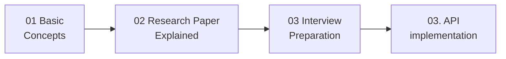

# 01. Notes

Everything needed to understand Advanced RAG before building it: the concepts in simple terms, the three research papers explained section by section, and interview preparation.

## Reading order

<table width="100%">
<thead><tr><th>#</th><th>Folder</th><th>What it covers</th><th>Status</th></tr></thead>
<tbody>
<tr><td>1</td><td><a href="01.%20Basic%20Concepts/">Basic Concepts</a></td><td>From Naive to Advanced RAG: query rewriting, expansion, conversational rewriting, candidate retrieval, bi-encoders vs cross-encoders, reranking, thresholds, compression, evaluation, cost</td><td>Done</td></tr>
<tr><td>2</td><td><a href="02.%20Research%20Paper%20Explained/">Research Paper Explained</a></td><td>Query Rewriting (Rewrite-Retrieve-Read, EMNLP 2023), Passage Re-ranking with BERT (2019) and RECOMP context compression (ICLR 2024), one note per paper section, with every figure, table and equation explained</td><td>Done</td></tr>
<tr><td>3</td><td><a href="03.%20Interview%20Preparation/">Interview Preparation</a></td><td>Advanced RAG from an interview point of view, with the results of this implementation</td><td>Planned</td></tr>
</tbody>
</table>

Prerequisite: the [Naive RAG notes](../../01.%20Naive%20RAG/01.%20Notes/), especially chunking, embeddings, retrieval and evaluation.

## Navigation

[Advanced RAG](../README.md) | Next: [01. Basic Concepts](01.%20Basic%20Concepts/)
