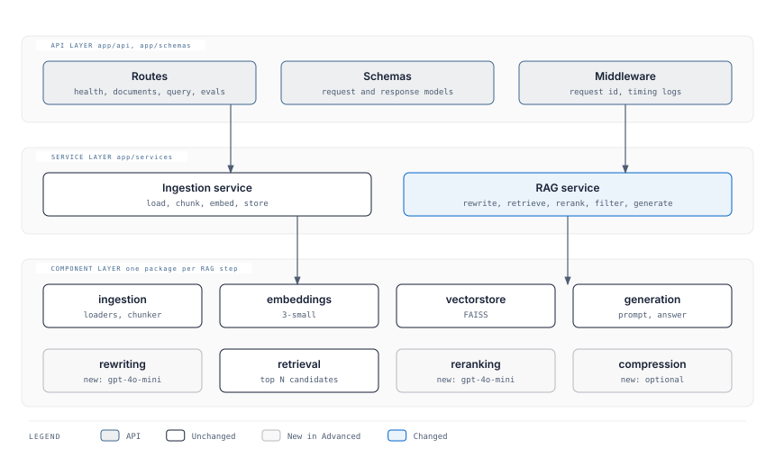
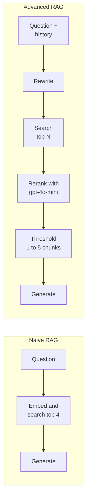
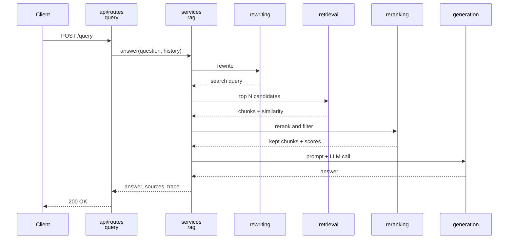

# 01. Project Base and Folder Structure

In this doc:

- Why the Advanced RAG API starts from a copy of the Naive RAG API
- What was copied, what was renamed, and what is new
- The folder tree, with the three new packages
- How the query pipeline will change, stage by stage
- Running Naive and Advanced side by side
- The build order for the rest of the API

## Why Start From the Naive RAG API

Advanced RAG keeps the whole indexing side of Naive RAG and changes only the query side (notes: [11. Advanced RAG Architecture End to End](../../01.%20Notes/01.%20Basic%20Concepts/11.%20Advanced%20RAG%20Architecture%20End%20to%20End.md)). Starting from a copy gives three benefits:

<table width="100%">
<thead><tr><th>Benefit</th><th>What it means in practice</th></tr></thead>
<tbody>
<tr><td>Fair comparison</td><td>Same loaders, chunker (1000 characters, 150 overlap), embeddings and FAISS index, so any change in the evaluation comes from the new query stages only</td></tr>
<tr><td>Tested base</td><td>All 63 Naive RAG tests pass on the copy before any new code is added</td></tr>
<tr><td>Independent folders</td><td>Naive RAG stays frozen as the baseline; Advanced RAG can change freely</td></tr>
</tbody>
</table>

Copying instead of importing from the Naive folder keeps each architecture self-contained: a reader can open one folder and see the full system.

## What Was Copied, Renamed and Added

<table width="100%">
<thead><tr><th>Item</th><th>Action</th><th>Detail</th></tr></thead>
<tbody>
<tr><td>app/ (all packages), tests/, requirements.txt, .env.example, .gitignore</td><td>Copied</td><td>From 01. Naive RAG/03. API, without caches, virtual environment, data or docs</td></tr>
<tr><td>App name, descriptions, docstrings</td><td>Renamed</td><td>"Naive RAG API" becomes "Advanced RAG API"; pipeline descriptions no longer say Naive</td></tr>
<tr><td>Data folders</td><td>New, empty in git</td><td>data/uploads, data/index (with .gitkeep), data/usage and data/evals created at run time</td></tr>
<tr><td>Server port</td><td>Changed</td><td>8001, so Naive RAG can keep running on 8000</td></tr>
<tr><td>PDF loader test</td><td>Path fixed</td><td>Reads the RAG paper from 01. Naive RAG/02. Papers</td></tr>
<tr><td>app/rewriting, app/reranking, app/compression</td><td>New packages</td><td>Only an __init__.py docstring for now; code is added step by step</td></tr>
</tbody>
</table>

Secrets are unchanged: the app reads the repository root `.env`, and only `.env.example` with variable names is committed.

## Three Layers, Three New Packages



The layer rules from Naive RAG stay: the API layer only handles HTTP, the service layer runs pipelines, and each component package does one RAG step.

<table width="100%">
<thead><tr><th>New package</th><th>Stage</th><th>Model</th><th>Paper</th></tr></thead>
<tbody>
<tr><td>app/rewriting</td><td>Before retrieval: condense follow-ups and rewrite the question into a search query</td><td>gpt-4o-mini</td><td>Query Rewriting (Ma et al., 2023)</td></tr>
<tr><td>app/reranking</td><td>After retrieval: score each candidate chunk for relevance, then keep the best few with a threshold</td><td>gpt-4o-mini as reranker</td><td>Passage Re-ranking with BERT (Nogueira and Cho, 2019)</td></tr>
<tr><td>app/compression</td><td>Before generation, optional: keep only the useful sentences</td><td>gpt-4o-mini or none</td><td>RECOMP (Xu et al., 2024)</td></tr>
</tbody>
</table>

### Reranker choice

The notes describe a cross-encoder reranker. For this implementation the reranker is **gpt-4o-mini**, used as a pointwise relevance scorer: it reads the question and each candidate chunk and returns a relevance score, which plays the role of the BERT paper's relevance probability. This keeps the stack to Azure OpenAI only (no PyTorch or local model). The cost and latency impact, and how the candidate count is chosen to control it, are explained in the reranker doc when that step is built.

## Folder Tree

```text
02. Advanced RAG/03. API/
    app/
        main.py                 FastAPI app, port 8001
        api/
            routes/             health, documents, query, evals, analytics
            middleware.py       request id and timing logs
        core/                   settings from .env, logging, Azure client
        schemas/                Pydantic request and response models
        ingestion/              loaders and chunker (unchanged)
        embeddings/             text-embedding-3-small client (unchanged)
        vectorstore/            FAISS index (unchanged)
        retrieval/              question to top N candidate chunks
        rewriting/              NEW: condense and rewrite the question
        reranking/              NEW: gpt-4o-mini reranker, threshold, dynamic k
        compression/            NEW: optional extractive compression
        generation/             prompt builder and answer generator
        services/               ingestion service, RAG service, usage, vector store
        evals/                  LLM judge, test set, evaluation runner
    data/
        uploads/                uploaded files (not committed)
        index/                  FAISS index and chunk metadata (not committed)
        usage/                  usage records (not committed)
        evals/                  evaluation reports (not committed)
    docs/                       numbered design docs like this one
        images/                 design diagrams
    tests/                      tests per package
    requirements.txt
    .env.example
```

## How the Query Pipeline Will Change





Each new stage can be switched off in settings, which turns the pipeline back into Naive RAG for that stage. This is what makes the ablation runs in the evaluation possible (notes: [12. Evaluating Advanced RAG](../../01.%20Notes/01.%20Basic%20Concepts/12.%20Evaluating%20Advanced%20RAG.md)).

## Running Naive and Advanced Side by Side

<table width="100%">
<thead><tr><th>App</th><th>Folder</th><th>Command (from the folder)</th><th>Docs URL</th></tr></thead>
<tbody>
<tr><td>Naive RAG</td><td>01. Naive RAG/03. API</td><td>.venv/bin/uvicorn app.main:app --reload</td><td>http://127.0.0.1:8000/docs</td></tr>
<tr><td>Advanced RAG</td><td>02. Advanced RAG/03. API</td><td>.venv/bin/uvicorn app.main:app --reload --port 8001</td><td>http://127.0.0.1:8001/docs</td></tr>
</tbody>
</table>

Each folder has its own virtual environment:

```bash
cd "02. Advanced RAG/03. API"
python3 -m venv .venv
.venv/bin/pip install -r requirements.txt
.venv/bin/python -m pytest -q
```

The data folders are separate. To compare on the same documents, upload the same files to both apps (or copy the Naive data/uploads and data/index folders locally; they are not committed).

## Build Order

Each step is built, documented and pushed on its own.

<table width="100%">
<thead><tr><th>Step</th><th>Feature</th><th>Doc</th></tr></thead>
<tbody>
<tr><td>1</td><td>Project base and folder structure</td><td>01 (this doc)</td></tr>
<tr><td>2</td><td>Advanced pipeline settings</td><td>02</td></tr>
<tr><td>3</td><td>Query rewriter (condense and rewrite in one call)</td><td>03</td></tr>
<tr><td>4</td><td>Candidate retrieval (top N)</td><td>04</td></tr>
<tr><td>5</td><td>gpt-4o-mini reranker</td><td>05</td></tr>
<tr><td>6</td><td>Threshold and dynamic k</td><td>06</td></tr>
<tr><td>7</td><td>RAG service and query API with trace</td><td>07</td></tr>
<tr><td>8</td><td>Optional context compression</td><td>08</td></tr>
<tr><td>9</td><td>Logs, usage and cost per stage</td><td>09</td></tr>
<tr><td>10</td><td>Evaluation, ablation runs and comparison with Naive RAG</td><td>10 and later</td></tr>
</tbody>
</table>

## Key Points

- The Advanced RAG API is a copy of the tested Naive RAG API with its own data, port 8001 and three new packages.
- Indexing is unchanged, so evaluation differences come only from the new query stages.
- The reranker is gpt-4o-mini used as a relevance scorer, keeping the stack to Azure OpenAI.
- Every new stage is switchable, so the pipeline can fall back to Naive behaviour and be evaluated stage by stage.
