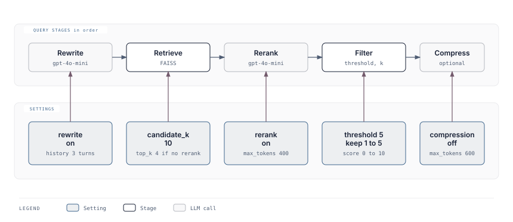
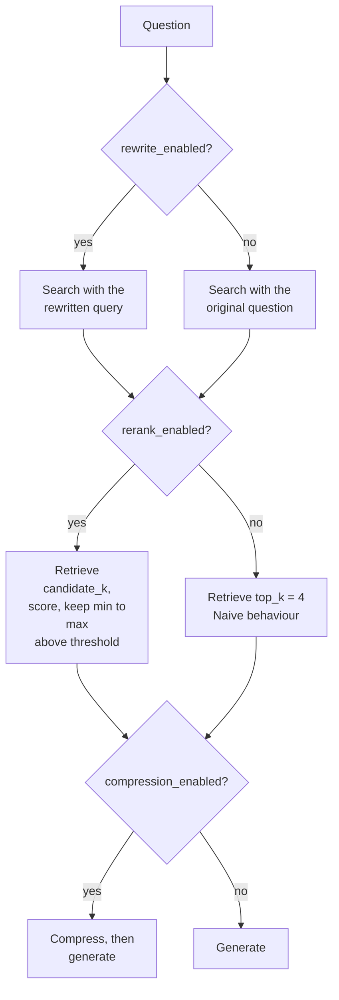

# 02. Advanced Pipeline Settings

In this doc:

- Why every new stage gets its own settings
- The new settings, their defaults and who uses them
- Why the defaults were chosen (candidate count, threshold, chunk limits)
- How a stage falls back to Naive RAG when it is switched off
- Where the settings are visible: startup log and GET /health
- How the settings are tested

Files: [app/core/config.py](../app/core/config.py), [app/schemas/health.py](../app/schemas/health.py), [app/api/routes/health.py](../app/api/routes/health.py), [app/main.py](../app/main.py), [tests/test_config.py](../tests/test_config.py)

## Why Each Stage Gets Settings

Advanced RAG adds stages that cost tokens and time. To measure whether each one is worth it, the evaluation runs the pipeline with stages switched on one at a time (the ablation runs A to E in notes: [12. Evaluating Advanced RAG](../../01.%20Notes/01.%20Basic%20Concepts/12.%20Evaluating%20Advanced%20RAG.md)). This is only possible if every stage can be switched on and off and tuned **without changing code**.

The settings mechanism is the same as Naive RAG (pydantic-settings reading the repository root `.env`, see the Naive RAG doc [02. Configuration and Settings](../../../01.%20Naive%20RAG/03.%20API/docs/02.%20Configuration%20and%20Settings.md)). Only new fields are added.



## The New Settings

<table width="100%">
<thead><tr><th>Setting (.env name)</th><th>Default</th><th>Used by</th><th>Meaning</th></tr></thead>
<tbody>
<tr><td>REWRITE_ENABLED</td><td>true</td><td>Query rewriter</td><td>Condense and rewrite the question before searching</td></tr>
<tr><td>REWRITE_HISTORY_TURNS</td><td>3</td><td>Query rewriter</td><td>How many earlier question and answer turns the rewriter sees</td></tr>
<tr><td>REWRITE_MAX_TOKENS</td><td>150</td><td>Query rewriter</td><td>Longest rewrite the model may return</td></tr>
<tr><td>CANDIDATE_K</td><td>10</td><td>Retriever</td><td>How many chunks are retrieved for the reranker</td></tr>
<tr><td>RERANK_ENABLED</td><td>true</td><td>Reranker</td><td>Score candidates with gpt-4o-mini</td></tr>
<tr><td>RERANK_MAX_TOKENS</td><td>400</td><td>Reranker</td><td>Longest reply (one score per candidate)</td></tr>
<tr><td>RERANK_THRESHOLD</td><td>5.0</td><td>Filter</td><td>Minimum relevance score (0 to 10) for a chunk to be kept</td></tr>
<tr><td>MIN_CHUNKS</td><td>1</td><td>Filter</td><td>Keep at least this many chunks, even if fewer pass the threshold</td></tr>
<tr><td>MAX_CHUNKS</td><td>5</td><td>Filter</td><td>Never send more than this many chunks to the generator</td></tr>
<tr><td>COMPRESSION_ENABLED</td><td>false</td><td>Compressor</td><td>Keep only the useful sentences of each kept chunk</td></tr>
<tr><td>COMPRESSION_MAX_TOKENS</td><td>600</td><td>Compressor</td><td>Longest compressed context the model may return</td></tr>
</tbody>
</table>

The existing TOP_K (4) stays: it is the number of chunks used when reranking is off, which is exactly Naive RAG. All new names are listed in `.env.example`; none of them are secret.

## Why These Defaults

### CANDIDATE_K = 10

The reranker reads every candidate. With gpt-4o-mini as the reranker, each candidate costs input tokens on every question:

<table width="100%">
<thead><tr><th>Candidates</th><th>Reranker input (approx.)</th><th>Reranker cost per question</th></tr></thead>
<tbody>
<tr><td>10</td><td>10 x 250 + 300 = 2,800 tokens</td><td>2,800 x 0.15 / 1,000,000 USD = 0.00042 USD = about Rs 0.035</td></tr>
<tr><td>20</td><td>20 x 250 + 300 = 5,300 tokens</td><td>About Rs 0.067</td></tr>
</tbody>
</table>

(A 1000-character chunk is about 250 tokens; 300 tokens cover the instructions and the question; gpt-4o-mini input is 0.15 USD per million tokens; 1 USD = Rs 84.)

The notes suggested 20 candidates for a local cross-encoder, where extra candidates are almost free. With an LLM reranker, 10 candidates halve the reranking cost while still giving 2.5 times the 4 chunks Naive RAG looked at, which is where most of its misses were (the right chunk at rank 5 to 8). The evaluation will report hit rate at 10 to check that recall is enough; CANDIDATE_K=20 can be tested with one `.env` change.

### RERANK_THRESHOLD = 5.0 on a 0 to 10 scale

The reranker returns an integer score per chunk: 0 means unrelated, 10 means the chunk directly answers the question. 5 is the middle: "partly relevant". Chunks below it are more likely to distract than help. The threshold will be tuned on the test set in the threshold step.

### MIN_CHUNKS = 1, MAX_CHUNKS = 5

From notes [09. Score Thresholds and Dynamic k](../../01.%20Notes/01.%20Basic%20Concepts/09.%20Score%20Thresholds%20and%20Dynamic%20k.md): at least one chunk so the generator always has something to cite (it can still say the documents do not contain the answer), and at most five to cap prompt size and keep the best chunks out of the "lost in the middle" zone.

### COMPRESSION_ENABLED = false

RECOMP showed that compression saves tokens but can lose answers or add unsupported text (paper note [09](../../01.%20Notes/02.%20Research%20Paper%20Explained/03.%20RECOMP%20Compression%20and%20Selective%20Augmentation/09.%20Conclusion%20and%20Appendix.md)). With reranking and at most five chunks, the context is already small, so compression starts off and is evaluated as a separate run.

## Falling Back to Naive RAG



With all three switches off, the pipeline is exactly Naive RAG: same query, same top 4 chunks, same prompt. This gives the evaluation a built-in baseline (run A).

## Where the Settings Are Visible

**Startup log**, so every run records the configuration it used:

```text
Advanced RAG API v0.1.0 starting
  chat model    gpt-4o-mini
  embeddings    text-embedding-3-small  dims=1536
  chunking      size=1000  overlap=150  top_k=4
  rewrite       enabled=True  history_turns=3
  rerank        enabled=True  candidates=10  threshold=5.0  keep=1-5
  compression   enabled=False
  index         files=6  chunks=...
```

**GET /health**, so the UI can show which stages are active:

```json
"pipeline": {
  "chat_model": "...",
  "top_k": 4,
  "rewrite_enabled": true,
  "candidate_k": 10,
  "rerank_enabled": true,
  "rerank_threshold": 5.0,
  "min_chunks": 1,
  "max_chunks": 5,
  "compression_enabled": false
}
```

Secret values (endpoint, key) are still never returned; only True/False flags and non-secret names.

## Tests

<table width="100%">
<thead><tr><th>Test</th><th>Checks</th></tr></thead>
<tbody>
<tr><td>test_stage_defaults</td><td>Rewriting and reranking on, compression off, 10 candidates, threshold within 0 to 10, 1 &lt;= min &lt;= max &lt;= candidates</td></tr>
<tr><td>test_stage_settings_read_from_environment</td><td>RERANK_ENABLED=false, CANDIDATE_K=20 and RERANK_THRESHOLD=6.5 from the environment become a bool, an int and a float</td></tr>
<tr><td>test_health_reports_status_and_pipeline_settings</td><td>GET /health returns the new stage settings and never the API key</td></tr>
</tbody>
</table>

Both settings tests build `Settings(_env_file=None)` so they use only defaults and test variables, never the real `.env`.

## Key Points

- Every new stage has a switch and its limits in settings, read from the root `.env` with defaults in config.py.
- CANDIDATE_K is 10, not 20, because the gpt-4o-mini reranker pays for every candidate (about Rs 0.035 for 10).
- Threshold 5 on a 0 to 10 scale, keep 1 to 5 chunks, compression off by default.
- All switches off gives exactly Naive RAG, the baseline for the ablation runs.
