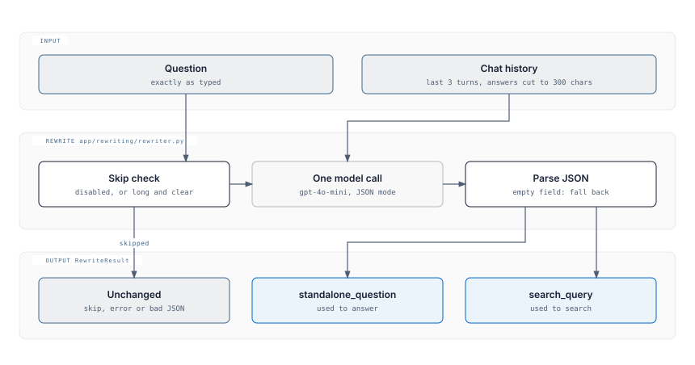
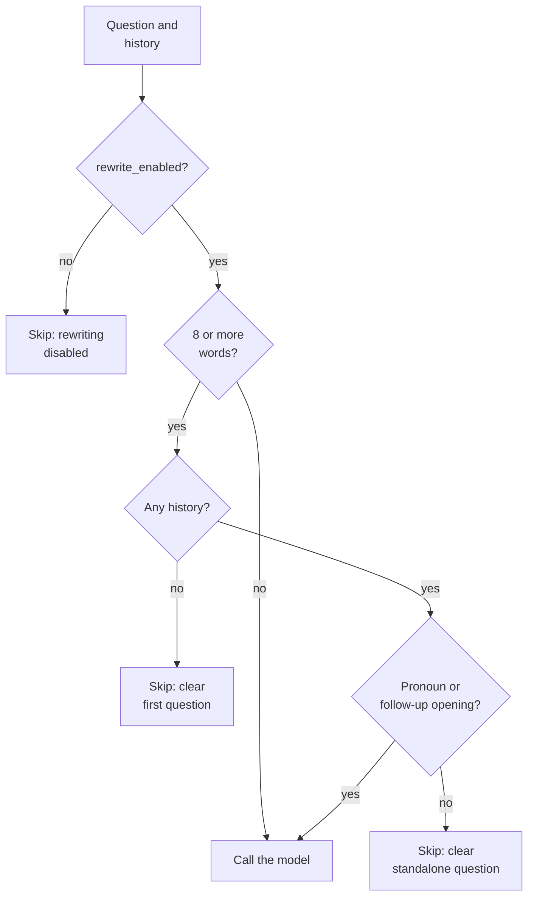
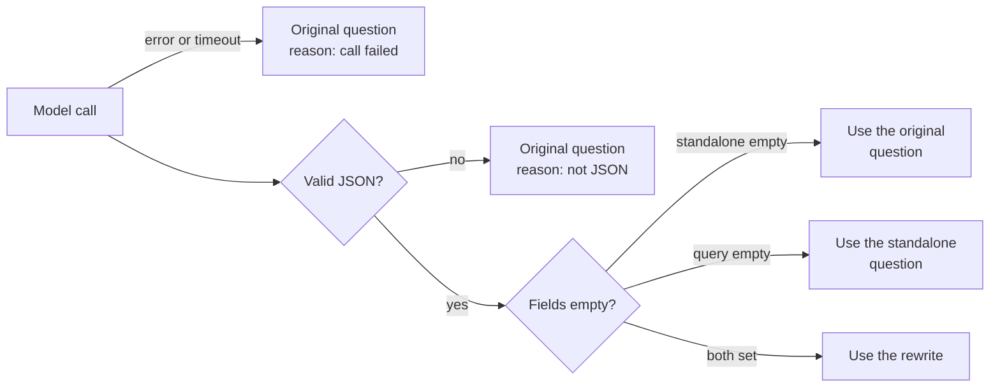

# 03. Query Rewriter

In this doc:

- What the rewriter does and which paper it comes from
- Why condensing and rewriting are one call
- When the call is skipped, and why
- The prompt, line by line
- The code, step by step
- Fallbacks: the rewriter never stops an answer
- Live examples from our documents, with tokens, cost and latency
- Known risks and how they are watched
- Tests

Files: [app/rewriting/rewriter.py](../app/rewriting/rewriter.py), [app/rewriting/prompts.py](../app/rewriting/prompts.py), [tests/test_rewriter.py](../tests/test_rewriter.py)

## What It Does

Naive RAG searches with the question exactly as typed. Two kinds of questions fail that way (notes: [03. Query Rewriting](../../01.%20Notes/01.%20Basic%20Concepts/03.%20Query%20Rewriting.md) and [05. Conversational Query Rewriting](../../01.%20Notes/01.%20Basic%20Concepts/05.%20Conversational%20Query%20Rewriting.md)):

<table width="100%">
<thead><tr><th>Problem</th><th>Example</th><th>Why search fails</th></tr></thead>
<tbody>
<tr><td>Follow-up question</td><td>"and how many reflection tokens does it use?"</td><td>"it" means Self-RAG, but the embedding of the question does not know that</td></tr>
<tr><td>Short or vague question</td><td>"sick leave?"</td><td>Two words give a weak embedding; documents use longer phrasing</td></tr>
</tbody>
</table>

The rewriter returns two strings:

- **standalone_question:** the question made understandable without the chat. It is what the generator answers, so follow-ups are answered correctly.
- **search_query:** the question in search wording (key terms, full forms, likely document words). It is used only for retrieval.

This is the Rewrite-Retrieve-Read idea with a frozen LLM rewriter (paper notes: [Query Rewriting for Retrieval-Augmented LLMs](../../01.%20Notes/02.%20Research%20Paper%20Explained/01.%20Query%20Rewriting%20for%20Retrieval-Augmented%20LLMs/)). The paper keeps the reader on the original question; we answer the standalone question, which is the original question with references resolved, so its meaning is the same.



## Why One Call

Condensing (resolve "it") and rewriting (search wording) could be two calls. One call that returns both:

<table width="100%">
<thead><tr><th>Option</th><th>Calls</th><th>Latency</th><th>Decision</th></tr></thead>
<tbody>
<tr><td>Condense call, then rewrite call</td><td>2</td><td>About 1.5 to 2 s</td><td>Rejected: doubles the delay before search starts</td></tr>
<tr><td>One call returning JSON with both fields</td><td>1</td><td>About 0.9 s measured</td><td>Chosen</td></tr>
</tbody>
</table>

JSON mode (`response_format={"type": "json_object"}`) makes the model return valid JSON, so the two fields can be read safely.

## When the Call Is Skipped

Every call adds about 0.9 s and Rs 0.004. Notes [13. Cost and Latency Trade-offs](../../01.%20Notes/01.%20Basic%20Concepts/13.%20Cost%20and%20Latency%20Trade-offs.md) recommend skipping it when it cannot help:



<table width="100%">
<thead><tr><th>Rule</th><th>Reason</th></tr></thead>
<tbody>
<tr><td>Fewer than 8 words: always rewrite</td><td>Short questions are the ones that search badly</td></tr>
<tr><td>8 or more words and no history: skip</td><td>A long first question has nothing to resolve and is usually specific enough</td></tr>
<tr><td>8 or more words with history: skip unless it has a pronoun (it, they, this, these, those, he, she, ...) or starts like a follow-up (and, also, what about, how about, ...)</td><td>A long question without references is already standalone</td></tr>
</tbody>
</table>

The rule errs towards calling the model: a wasted call costs Rs 0.004, a missed follow-up costs a wrong answer. "that" and "there" are not treated as pronouns because they appear in most normal questions ("Is there a policy that ...").

## The Prompt

```text
You rewrite questions for a document search system. You never answer them.

Given the chat history and the latest question, return two things:
1. standalone_question: ... Replace words like "it", "they", "that", "this one"
   and follow-ups like "what about X?" with what they refer to. Keep the meaning
   and the language. If the question is already standalone, copy it unchanged.
2. search_query: ... a short search query (at most 30 words) with its key terms,
   the full form of abbreviations and the words a document about it would likely use.

Use the chat history only to work out what the latest question refers to. Do not
copy answers, names or terms from earlier answers into either field unless the
latest question asks about them.
Never add facts, names or numbers that the question and history do not contain.
Reply with JSON only, in this form: {"standalone_question": "...", "search_query": "..."}
```

<table width="100%">
<thead><tr><th>Line</th><th>Why it is there</th></tr></thead>
<tbody>
<tr><td>"You never answer them"</td><td>Without it, the model sometimes answers the question inside the rewrite</td></tr>
<tr><td>Copy unchanged if already standalone</td><td>Avoids changing questions that are fine</td></tr>
<tr><td>At most 30 words</td><td>Very long queries dilute the embedding</td></tr>
<tr><td>Use history only to resolve references</td><td>Added after testing: the model copied "DPR" from an earlier answer about the RAG paper into a query about CRAG (see below)</td></tr>
<tr><td>Never add facts</td><td>A rewrite with invented details searches for the wrong thing (query drift)</td></tr>
</tbody>
</table>

The user message holds the last 3 turns as "Q: ... / A: ..." lines, with each earlier answer cut to 300 characters, then "LATEST QUESTION: ...". Answers are cut because only the topic matters for resolving references, and full answers would multiply the prompt tokens.

## The Code, Step by Step

```python
# 1. Keep only the last rewrite_history_turns turns
turns = settings.rewrite_history_turns
history = (history or [])[-turns:] if turns > 0 else []

# 2. Skip when not needed
reason = skip_reason(question, history)
if reason:
    return unchanged(question, reason)

# 3. One chat completion that must return JSON (temperature 0 for stable rewrites)
response = client.chat.completions.create(..., response_format={"type": "json_object"})

# 4. Count tokens in the running query's usage meter
add_chat_tokens(response.usage.prompt_tokens, response.usage.completion_tokens)

# 5. Read both fields; fall back for any empty field
standalone = standalone or question
search_query = search_query or standalone
```

The result is a `RewriteResult`:

<table width="100%">
<thead><tr><th>Field</th><th>Meaning</th></tr></thead>
<tbody>
<tr><td>original_question</td><td>The question as typed</td></tr>
<tr><td>standalone_question</td><td>Used by the generator</td></tr>
<tr><td>search_query</td><td>Used by the retriever</td></tr>
<tr><td>rewritten</td><td>True only when the model's reply was used</td></tr>
<tr><td>reason</td><td>"rewritten", "rewriting disabled", "clear first question", "clear standalone question", "rewrite call failed: ...", "reply was not valid JSON"</td></tr>
</tbody>
</table>

All fields go into the query trace (built in step 7), so every answer shows what was searched.

## Fallbacks



A rewrite is an improvement, never a requirement: if anything goes wrong, the pipeline continues exactly like Naive RAG.

## Live Examples

Measured against our Azure gpt-4o-mini deployment:

<table width="100%">
<thead><tr><th>Question</th><th>History</th><th>Result</th><th>Tokens in / out</th><th>Time</th></tr></thead>
<tbody>
<tr><td>sick leave?</td><td>None</td><td>Standalone "What is sick leave?"; search "definition and explanation of sick leave"</td><td>200 / 23</td><td>1.8 s (first call, includes connection setup)</td></tr>
<tr><td>How does Self-RAG decide when to retrieve passages during generation?</td><td>None</td><td>Skipped: clear first question</td><td>0 / 0</td><td>0 s</td></tr>
<tr><td>and how many reflection tokens does it use?</td><td>Self-RAG question</td><td>"How many reflection tokens does Self-RAG use?"; search "number of reflection tokens used by Self-RAG ..."</td><td>230 / 29</td><td>0.9 s</td></tr>
<tr><td>what about CRAG?</td><td>RAG paper retriever question</td><td>"What retriever does the CRAG paper use?"</td><td>227 / 33</td><td>0.9 s</td></tr>
<tr><td>which one is cheaper?</td><td>CRAG vs Self-RAG comparison</td><td>"Which one is cheaper, CRAG or Self-RAG?"; search "cost comparison of CRAG and Self-RAG retrieval methods"</td><td>about 230 / 30</td><td>about 0.9 s</td></tr>
</tbody>
</table>

**Cost of one call:** 230 x 0.15 + 30 x 0.60 = 52.5 USD per million calls, so 0.0000525 USD = about **Rs 0.0044** per rewritten question. The notes estimated about 500 input tokens; the real prompt is smaller because answers are cut to 300 characters.

## Known Risks

<table width="100%">
<thead><tr><th>Risk</th><th>Seen?</th><th>Mitigation</th></tr></thead>
<tbody>
<tr><td>Terms copied from earlier answers</td><td>Yes: "dense passage retriever DPR" appeared in the CRAG query because the previous answer was about DPR</td><td>Prompt rule added; "DPR" no longer appears, "dense passage retriever" still can as a search term. Watched in the trace and in the evaluation's rewrite faithfulness check</td></tr>
<tr><td>Rewrite answers the question</td><td>No</td><td>"You never answer them"</td></tr>
<tr><td>Clear question made worse</td><td>Possible</td><td>Skip rule for long questions; evaluation compares runs with and without rewriting</td></tr>
<tr><td>Extra latency</td><td>About 0.9 s per call</td><td>One combined call, skipped for clear questions</td></tr>
</tbody>
</table>

## Tests

<table width="100%">
<thead><tr><th>Test</th><th>Checks</th></tr></thead>
<tbody>
<tr><td>test_follow_up_detection</td><td>"it" and "what about" are follow-ups; a plain question is not</td></tr>
<tr><td>test_skips_when_disabled</td><td>No model call when rewriting is off</td></tr>
<tr><td>test_skips_clear_first_question</td><td>A long first question is not sent to the model</td></tr>
<tr><td>test_rewrites_follow_up_with_history</td><td>JSON reply is used; JSON mode, token limit and history are in the request</td></tr>
<tr><td>test_only_last_turns_are_sent</td><td>Only the last 3 of 5 turns reach the prompt</td></tr>
<tr><td>test_long_answers_are_shortened_in_prompt</td><td>Earlier answers are cut to 300 characters</td></tr>
<tr><td>test_bad_json_falls_back_to_original</td><td>Plain text reply keeps the original question</td></tr>
<tr><td>test_failed_call_falls_back_to_original</td><td>An API error keeps the original question</td></tr>
<tr><td>test_empty_fields_fall_back</td><td>Missing search_query falls back to the standalone question</td></tr>
</tbody>
</table>

All tests use a fake client; no Azure call is made.

## Key Points

- One gpt-4o-mini call in JSON mode returns a standalone question (to answer) and a search query (to search).
- The call is skipped when rewriting is off or the question is long and clear; short and follow-up questions are always rewritten.
- Every failure falls back to the original question, so the pipeline behaves like Naive RAG.
- Measured: about 230 input and 30 output tokens, Rs 0.0044 and 0.9 s per rewritten question.
