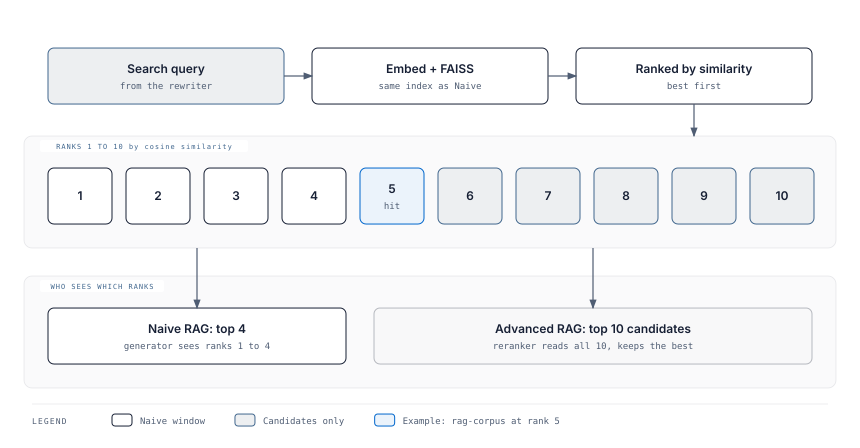
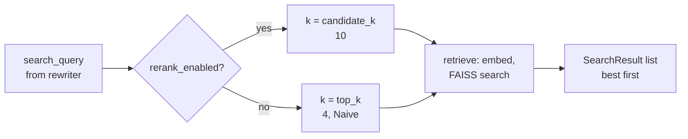

# 04. Candidate Retrieval

In this doc:

- Why the reranker needs more chunks than the generator
- How many candidates: measured on our test set
- The code: candidate_count() and retrieve_candidates()
- What the similarity scores tell us about the candidates
- Tests

Files: [app/retrieval/retriever.py](../app/retrieval/retriever.py), [tests/test_retriever.py](../tests/test_retriever.py)

## Why More Chunks

Naive RAG retrieves 4 chunks and sends all of them to the generator. That one number has two jobs: **recall** (find the right chunk) and **precision** (send nothing else). One number cannot do both well (notes: [06. Candidate Retrieval and Recall](../../01.%20Notes/01.%20Basic%20Concepts/06.%20Candidate%20Retrieval%20and%20Recall.md)).

Advanced RAG splits the jobs:

<table width="100%">
<thead><tr><th>Stage</th><th>Job</th><th>Number</th></tr></thead>
<tbody>
<tr><td>Candidate retrieval (this step)</td><td>Recall: make sure the right chunk is somewhere in the list</td><td>candidate_k = 10</td></tr>
<tr><td>Reranker and threshold (next steps)</td><td>Precision: keep only the chunks that really help</td><td>1 to 5</td></tr>
</tbody>
</table>

The reranker can only reorder what retrieval returns: a chunk that is not among the candidates is lost for good. This is the recall ceiling from the BERT reranker paper (paper note [04. Experiments](../../01.%20Notes/02.%20Research%20Paper%20Explained/02.%20Passage%20Re-ranking%20with%20BERT/04.%20Experiments.md)).



## How Many Candidates: Measured

For each of the 10 test questions with an expected source file, we searched the index with the question and recorded the rank of the first chunk from that file (same index and embeddings as Naive RAG):

<table width="100%">
<thead><tr><th>Question id</th><th>Expected file</th><th>First rank of that file</th><th>Chunks from that file in top 10</th></tr></thead>
<tbody>
<tr><td>rag-variants</td><td>2005.11401_RAG-Lewis.pdf</td><td>1</td><td>3</td></tr>
<tr><td>rag-components</td><td>2005.11401_RAG-Lewis.pdf</td><td>3</td><td>6</td></tr>
<tr><td>rag-corpus</td><td>2005.11401_RAG-Lewis.pdf</td><td>5</td><td>4</td></tr>
<tr><td>selfrag-reflection</td><td>2310.11511_Self-RAG.pdf</td><td>1</td><td>10</td></tr>
<tr><td>selfrag-when</td><td>2310.11511_Self-RAG.pdf</td><td>2</td><td>8</td></tr>
<tr><td>crag-evaluator</td><td>2401.15884_Corrective-RAG.pdf</td><td>1</td><td>7</td></tr>
<tr><td>crag-incorrect</td><td>2401.15884_Corrective-RAG.pdf</td><td>1</td><td>10</td></tr>
<tr><td>adaptive-routing</td><td>2403.14403_Adaptive-RAG.pdf</td><td>1</td><td>10</td></tr>
<tr><td>hr-sick-days</td><td>hr_policy.md</td><td>1</td><td>1</td></tr>
<tr><td>hr-new-joiner-leave</td><td>hr_policy.md</td><td>1</td><td>1</td></tr>
</tbody>
</table>

<table width="100%">
<thead><tr><th>Cut-off</th><th>Hit rate (expected file present)</th></tr></thead>
<tbody>
<tr><td>Top 1</td><td>7 / 10</td></tr>
<tr><td>Top 4 (Naive RAG)</td><td>9 / 10</td></tr>
<tr><td>Top 10 (candidate_k)</td><td>10 / 10</td></tr>
<tr><td>Top 20</td><td>10 / 10</td></tr>
</tbody>
</table>

- **Top 4 misses rag-corpus**: the first RAG paper chunk is at rank 5, behind chunks from other papers.
- **Top 10 finds every expected file**, and top 20 adds nothing on this test set.
- With the gpt-4o-mini reranker, 20 candidates would double the reranking cost (about Rs 0.067 instead of Rs 0.035) for no recall gain here. This confirms the default **candidate_k = 10** from doc 02.

A hit here is file-level (any chunk of the expected file), the same measure as the Naive RAG evaluation. It is an upper bound: the right file can be present without the exact answer chunk. The evaluation step will also look at whether the kept chunks contain the answer.

### What the similarity scores show

<table width="100%">
<thead><tr><th>Question</th><th>Rank 1 similarity</th><th>Rank 10 similarity</th></tr></thead>
<tbody>
<tr><td>selfrag-reflection</td><td>0.778</td><td>0.619</td></tr>
<tr><td>rag-components</td><td>0.537</td><td>0.509</td></tr>
<tr><td>hr-sick-days</td><td>0.569</td><td>0.124</td></tr>
<tr><td>out-of-scope</td><td>0.231</td><td>0.160</td></tr>
</tbody>
</table>

- For paper questions, rank 10 is almost as similar as rank 1 (0.51 against 0.54 for rag-components): cosine similarity cannot separate the useful chunk from the rest. This is why a reranker is needed.
- For the HR questions, the policy file has only one matching chunk and ranks 2 to 10 are unrelated papers (0.124): the reranker and threshold must drop them, or they become noise in the prompt.
- The out-of-scope question has low similarity everywhere; all candidates should be dropped by the reranker, leaving the generator to say the answer is not in the documents.

## The Code

```python
def candidate_count() -> int:
    """Number of chunks to retrieve: candidate_k for the reranker, or top_k without it."""
    settings = get_settings()
    return settings.candidate_k if settings.rerank_enabled else settings.top_k


def retrieve_candidates(search_query: str, store: FaissStore | None = None) -> list[SearchResult]:
    """Return the candidate chunks for the search query, best first by similarity."""
    return retrieve(search_query, top_k=candidate_count(), store=store)
```



- The search itself is unchanged from Naive RAG: embed with text-embedding-3-small, cosine search in FAISS.
- The input is the **search_query** from the rewriter, not the raw question.
- The position in this list is the **retrieval rank**. The reranker keeps it next to its own score, so the trace and the evaluation can show how ranks changed (MRR before and after reranking).

## Tests

<table width="100%">
<thead><tr><th>Test</th><th>Checks</th></tr></thead>
<tbody>
<tr><td>test_retrieve_returns_best_chunks_first</td><td>(Naive) most similar chunks first, top_k respected</td></tr>
<tr><td>test_retrieve_on_empty_store_skips_embedding</td><td>(Naive) no embedding call on an empty index</td></tr>
<tr><td>test_candidate_count_follows_rerank_switch</td><td>10 with reranking on, 4 with it off</td></tr>
<tr><td>test_retrieve_candidates_uses_candidate_count</td><td>retrieve_candidates returns candidate_k chunks, best first</td></tr>
</tbody>
</table>

## Key Points

- Retrieval now has one job, recall; the reranker and threshold handle precision.
- On our test set, top 4 finds the expected file for 9 of 10 questions, top 10 for all 10, top 20 adds nothing.
- candidate_k = 10 gives full file-level recall at half the reranking cost of 20.
- Similarity scores barely separate candidates for paper questions and include clearly unrelated chunks for HR questions: both are the reranker's job.
