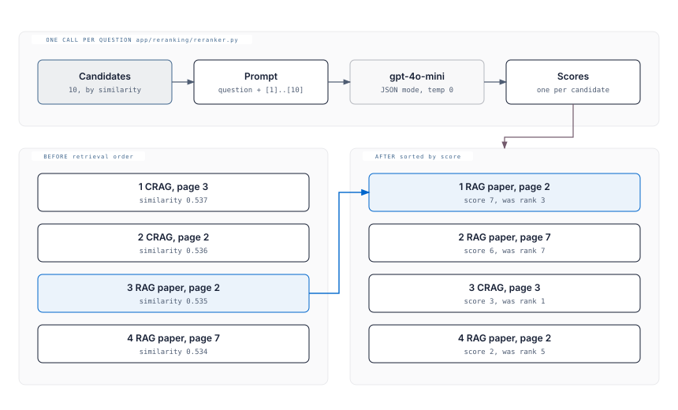
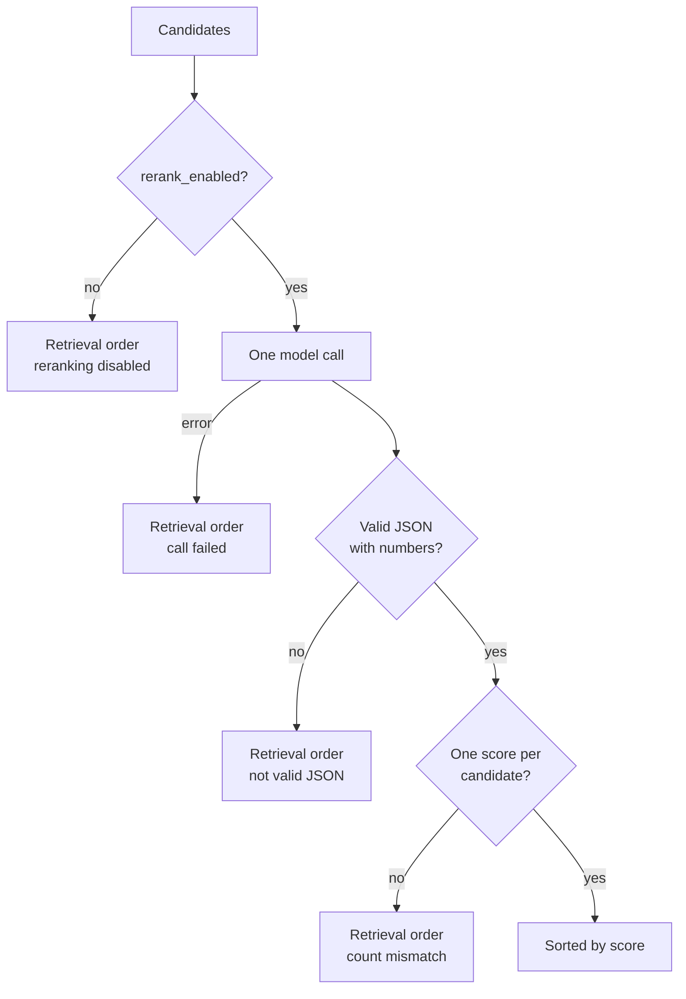

# 05. LLM Reranker

In this doc:

- Why gpt-4o-mini is the reranker, and how it relates to the BERT cross-encoder
- Pointwise scoring in one batched call
- The prompt and the 0 to 10 rubric
- Why the reply is a plain list (half the latency)
- The code, step by step, and the fallbacks
- Live results on our test set: ranks, MRR, latency, tokens, cost
- A worked example: rag-components
- Known risks
- Tests

Files: [app/reranking/reranker.py](../app/reranking/reranker.py), [app/reranking/prompts.py](../app/reranking/prompts.py), [tests/test_reranker.py](../tests/test_reranker.py)

## Why gpt-4o-mini as the Reranker

A reranker reads the question **together with** each candidate and judges relevance. That is what makes it better than embedding similarity, where question and chunk are encoded separately (notes: [07. Bi-Encoders vs Cross-Encoders](../../01.%20Notes/01.%20Basic%20Concepts/07.%20Bi-Encoders%20vs%20Cross-Encoders.md) and [08. Reranking](../../01.%20Notes/01.%20Basic%20Concepts/08.%20Reranking.md)).

<table width="100%">
<thead><tr><th>Option</th><th>Reads question and chunk together</th><th>Extra dependency</th><th>Cost per question (10 candidates)</th><th>Decision</th></tr></thead>
<tbody>
<tr><td>Local cross-encoder (ms-marco-MiniLM)</td><td>Yes</td><td>sentence-transformers and PyTorch</td><td>Free, local CPU time</td><td>Not chosen: outside the stack rules</td></tr>
<tr><td>Hosted reranker (Azure AI Search semantic ranker, Cohere)</td><td>Yes</td><td>New paid service and key</td><td>Per-call pricing</td><td>Not chosen</td></tr>
<tr><td>gpt-4o-mini as relevance judge</td><td>Yes</td><td>None: same Azure deployment</td><td>About Rs 0.032 (measured)</td><td>Chosen</td></tr>
</tbody>
</table>

The role is the same as in the BERT paper (paper notes: [Passage Re-ranking with BERT](../../01.%20Notes/02.%20Research%20Paper%20Explained/02.%20Passage%20Re-ranking%20with%20BERT/)): a model reads (question, passage) and outputs a relevance score; candidates are sorted by it. The differences:

<table width="100%">
<thead><tr><th></th><th>BERT re-ranker (paper)</th><th>Our gpt-4o-mini reranker</th></tr></thead>
<tbody>
<tr><td>Training</td><td>Fine-tuned on MS MARCO relevance labels</td><td>None: instructions and a rubric in the prompt</td></tr>
<tr><td>Score</td><td>Probability from the [CLS] vector</td><td>Integer 0 to 10 written by the model</td></tr>
<tr><td>Passages per pass</td><td>One (pointwise)</td><td>All 10 in one call, but each scored on its own</td></tr>
<tr><td>Candidates</td><td>1000 from BM25</td><td>10 from FAISS</td></tr>
</tbody>
</table>

## One Batched Call

Scoring each candidate in its own call would mean 10 calls per question. Instead, all candidates are numbered in one prompt and the model returns 10 scores. The instruction "score each passage on its own" keeps it pointwise: the score should depend on the passage and the question, not on the other passages.



## The Prompt

```text
You are a relevance judge for a document search system.

You get a question and numbered passages. Score each passage on its own: how useful
is it for answering the question?
Use this scale:
10 = directly answers the question
7 to 9 = contains most of the answer
4 to 6 = related and partly useful
1 to 3 = same general topic, but does not help answer
0 = unrelated

Judge only what the passage says, not what you know. Do not answer the question.
Reply with JSON only, in this form: {"scores": [8, 0, 5]}
The list must hold exactly one integer score per passage, in passage order.
```

The user message is `QUESTION: ...` followed by `PASSAGES:` and the candidates as `[n] (source, page)` blocks, the same format the generator sees.

<table width="100%">
<thead><tr><th>Choice</th><th>Why</th></tr></thead>
<tbody>
<tr><td>A written rubric for every score band</td><td>Without anchors, LLM scores drift; the rubric makes 5 mean "partly useful" on every question, so one threshold works (doc 06)</td></tr>
<tr><td>"Same general topic, but does not help" = 1 to 3</td><td>Exactly our Naive RAG failure: chunks about the same paper that do not answer the question</td></tr>
<tr><td>"Judge only what the passage says"</td><td>The model knows a lot about RAG papers; it must not give a high score because it knows the answer itself</td></tr>
<tr><td>Question = standalone question from the rewriter</td><td>Relevance is judged against what the user asked (with references resolved), not against the search wording</td></tr>
<tr><td>Temperature 0, JSON mode</td><td>Stable scores, parseable reply</td></tr>
</tbody>
</table>

## Why a Plain List: Half the Latency

The first version asked for `{"scores": [{"id": 1, "score": 8}, ...]}`. Measured on all 11 test questions with the same candidates:

<table width="100%">
<thead><tr><th>Reply format</th><th>Output tokens</th><th>Average call time</th></tr></thead>
<tbody>
<tr><td>List of id and score objects</td><td>125</td><td>1.68 s</td></tr>
<tr><td>Plain list of integers</td><td>33</td><td>0.93 s</td></tr>
</tbody>
</table>

Output tokens are generated one by one, so they dominate the time of a short-output call. The plain list returned exactly 10 scores for every question. Because a list has no ids, the code checks the length: a list with the wrong number of scores cannot be matched safely and is treated as a failed rerank.

## The Code, Step by Step

```python
# 1. Nothing to do, or switched off: keep the retrieval order
if not candidates: return RerankOutcome(reason="no candidates")
if not settings.rerank_enabled: return in_retrieval_order(candidates, "reranking disabled")

# 2. One call, JSON mode, temperature 0
response = client.chat.completions.create(..., response_format={"type": "json_object"})
add_chat_tokens(response.usage.prompt_tokens, response.usage.completion_tokens)

# 3. One score per candidate, clamped to 0 to 10; wrong length -> None
scores = read_scores(reply_text, len(candidates))

# 4. Pair each candidate with its score and retrieval rank, sort
chunks = [RankedChunk(result, rank, score) for rank, (result, score) in enumerate(zip(candidates, scores), start=1)]
chunks.sort(key=lambda chunk: (-chunk.rerank_score, chunk.retrieval_rank))
```

Each `RankedChunk` keeps:

<table width="100%">
<thead><tr><th>Field</th><th>Meaning</th></tr></thead>
<tbody>
<tr><td>result</td><td>The chunk and its cosine similarity</td></tr>
<tr><td>retrieval_rank</td><td>Position before reranking (1 = most similar)</td></tr>
<tr><td>rerank_score</td><td>0 to 10, or None when not reranked</td></tr>
</tbody>
</table>

Equal scores keep the retrieval order, so similarity still breaks ties.

### Fallbacks



In every fallback the scores are None, so the threshold step (doc 06) knows the reranker did not run and falls back to the Naive top_k.

## Live Results on the Test Set

Rewrite, retrieve 10 candidates, rerank, for the 11 test questions. "Rank" is the position of the first chunk from the expected file.

<table width="100%">
<thead><tr><th>Question id</th><th>Rank before</th><th>Rank after</th><th>Scores, sorted</th></tr></thead>
<tbody>
<tr><td>rag-variants</td><td>1</td><td>1</td><td>9, 8, 6, 2, 2, 2, 1, 1, 1, 1</td></tr>
<tr><td>rag-components</td><td>3</td><td>1</td><td>7, 6, 3, 2, 2, 2, 1, 1, 1, 1</td></tr>
<tr><td>rag-corpus</td><td>4</td><td>2</td><td>8, 7, 6, 6, 5, 4, 4, 4, 3, 2</td></tr>
<tr><td>selfrag-reflection</td><td>1</td><td>1</td><td>10, 10, 9, 9, 8, 8, 7, 7, 6, 6</td></tr>
<tr><td>selfrag-when</td><td>1</td><td>1</td><td>8, 8, 7, 7, 6, 3, 3, 3, 3, 2</td></tr>
<tr><td>crag-evaluator</td><td>1</td><td>1</td><td>10, 10, 9, 7, 7, 4, 3, 0, 0, 0</td></tr>
<tr><td>crag-incorrect</td><td>1</td><td>1</td><td>10, 10, 9, 7, 7, 5, 4, 4, 3, 3</td></tr>
<tr><td>adaptive-routing</td><td>1</td><td>1</td><td>10, 9, 7, 6, 6, 6, 5, 4, 3, 1</td></tr>
<tr><td>hr-sick-days</td><td>1</td><td>1</td><td>10, 0, 0, 0, 0, 0, 0, 0, 0, 0</td></tr>
<tr><td>hr-new-joiner-leave</td><td>1</td><td>1</td><td>10, 0, 0, 0, 0, 0, 0, 0, 0, 0</td></tr>
<tr><td>out-of-scope</td><td>-</td><td>-</td><td>0, 0, 0, 0, 0, 0, 0, 0, 0, 0</td></tr>
</tbody>
</table>

<table width="100%">
<thead><tr><th>Metric (10 questions with an expected file)</th><th>Before reranking</th><th>After reranking</th></tr></thead>
<tbody>
<tr><td>Hit at 1</td><td>8 / 10</td><td>9 / 10</td></tr>
<tr><td>MRR (file level)</td><td>0.858</td><td>0.950</td></tr>
</tbody>
</table>

(Before reranking already includes the rewriter: rag-corpus starts at rank 4 with the rewritten query, against rank 5 with the raw question in doc 04.)

What the scores show:

- **Clear separation where similarity had none:** for rag-components, similarities were 0.537, 0.536, 0.535, 0.534 for ranks 1 to 4; scores are 7, 6, 3, 2.
- **Off-topic chunks drop to 0:** for both HR questions, one chunk scores 10 and the other nine score 0. Similarity ranked unrelated paper chunks at 0.12; now they can be cut safely by a threshold.
- **Out-of-scope question:** every candidate scores 0, so the threshold step can send no context and the generator says the answer is not in the documents.
- **Topic-rich questions keep many high scores** (selfrag-reflection: nothing below 6): several chunks really discuss reflection tokens. Dynamic k (doc 06) will keep up to 5 here.

### Worked example: rag-components

Question: "Which retriever and generator does the original RAG model combine?"

<table width="100%">
<thead><tr><th>Retrieval rank</th><th>Chunk</th><th>Similarity</th><th>Score</th><th>New rank</th></tr></thead>
<tbody>
<tr><td>1</td><td>CRAG, page 3: "a generator G. The retriever R aims to retrieve the top-K documents ..."</td><td>0.537</td><td>3</td><td>3</td></tr>
<tr><td>2</td><td>CRAG, page 2</td><td>0.536</td><td>1</td><td>7</td></tr>
<tr><td>3</td><td>RAG paper, page 2: "Methods: We explore RAG models ..."</td><td>0.535</td><td>7</td><td>1</td></tr>
<tr><td>7</td><td>RAG paper, page 7</td><td>0.516</td><td>6</td><td>2</td></tr>
</tbody>
</table>

The CRAG chunk talks about "a retriever" and "a generator" in general, so it is close in embedding space, but it does not describe the original RAG model. The reranker reads both and puts the RAG paper's methods section first. This is the "same topic, not the answer" failure from Naive RAG, fixed.

### Latency, tokens and cost

<table width="100%">
<thead><tr><th>Measure (11 questions)</th><th>Value</th></tr></thead>
<tbody>
<tr><td>Average rerank call</td><td>0.98 s (max 1.23 s)</td></tr>
<tr><td>Input tokens</td><td>2,407 on average (10 chunks + rubric + question)</td></tr>
<tr><td>Output tokens</td><td>33</td></tr>
<tr><td>Cost per question</td><td>2,407 x 0.15 + 33 x 0.60 = 381 USD per million questions = 0.00038 USD = about Rs 0.032</td></tr>
</tbody>
</table>

This matches the doc 02 estimate (Rs 0.035). Together with the rewriter (Rs 0.0044) and generation, the full question will be around Rs 0.05; the exact figure comes from the evaluation.

## Known Risks

<table width="100%">
<thead><tr><th>Risk</th><th>Mitigation</th></tr></thead>
<tbody>
<tr><td>Scores influenced by the other passages in the same call</td><td>"Score each passage on its own" and a fixed rubric; the evaluation checks the kept chunks</td></tr>
<tr><td>Model uses its own knowledge</td><td>"Judge only what the passage says"; most visible on paper questions the model knows</td></tr>
<tr><td>Integer scores have ties</td><td>Retrieval rank breaks ties</td></tr>
<tr><td>Wrong number of scores</td><td>Length check, fallback to retrieval order</td></tr>
<tr><td>Cost grows with candidates</td><td>candidate_k = 10 (doc 04: no recall gain from 20 on our test set)</td></tr>
<tr><td>About 1 s added per question</td><td>Plain list reply; reported per stage in the trace</td></tr>
</tbody>
</table>

## Tests

<table width="100%">
<thead><tr><th>Test</th><th>Checks</th></tr></thead>
<tbody>
<tr><td>test_scores_reorder_candidates</td><td>Highest score first, retrieval ranks kept, JSON mode and token limit in the request</td></tr>
<tr><td>test_ties_keep_retrieval_order</td><td>Equal scores keep the original order</td></tr>
<tr><td>test_scores_are_clamped</td><td>14 becomes 10, -2 becomes 0</td></tr>
<tr><td>test_wrong_score_count_keeps_retrieval_order</td><td>Two scores for three candidates falls back</td></tr>
<tr><td>test_disabled_keeps_retrieval_order</td><td>No call when reranking is off, scores None</td></tr>
<tr><td>test_failed_call_keeps_retrieval_order</td><td>API error falls back</td></tr>
<tr><td>test_bad_or_empty_reply_keeps_retrieval_order</td><td>Plain text or non-numeric scores fall back</td></tr>
<tr><td>test_no_candidates</td><td>Empty input, no call</td></tr>
<tr><td>test_prompt_numbers_passages_with_sources</td><td>Question first, passages numbered with source labels</td></tr>
</tbody>
</table>

## Key Points

- gpt-4o-mini scores all 10 candidates in one call with a 0 to 10 rubric; candidates are sorted by score, ties by retrieval rank.
- A plain list reply cut the call from 1.68 s to 0.93 s.
- On the test set: hit at 1 from 8 to 9 of 10, MRR from 0.858 to 0.950; off-topic chunks score 0, out-of-scope questions score 0 everywhere.
- About 1 s and Rs 0.032 per question; every failure falls back to the retrieval order.
