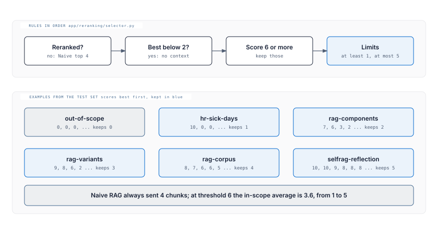
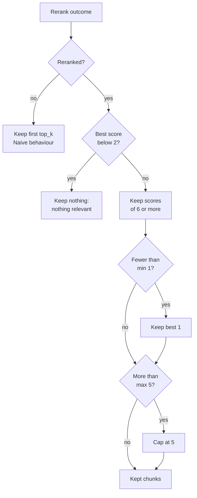

# 06. Threshold and Dynamic k

In this doc:

- Why a fixed number of chunks is the wrong rule
- The four rules of the selector, in order
- The not-found floor: sending no context for out-of-scope questions
- Tuning the threshold on the test set, and why 6 was chosen
- How many chunks each test question keeps
- The code and the Selection result
- Tests

Files: [app/reranking/selector.py](../app/reranking/selector.py), [app/core/config.py](../app/core/config.py), [tests/test_selector.py](../tests/test_selector.py)

## Why Not a Fixed Number

Naive RAG always sends 4 chunks. For "How many sick days do employees get?" only one chunk in the whole index is relevant, so 3 of the 4 are noise; for "What are reflection tokens in Self-RAG?" more than 4 chunks are relevant. This is why Naive RAG's context precision was 0.41 (notes: [09. Score Thresholds and Dynamic k](../../01.%20Notes/01.%20Basic%20Concepts/09.%20Score%20Thresholds%20and%20Dynamic%20k.md)).

With reranker scores on a fixed 0 to 10 rubric (doc 05), the number of chunks can follow the question: keep what is relevant, drop the rest.



## The Rules, in Order



<table width="100%">
<thead><tr><th>#</th><th>Rule</th><th>Setting</th><th>Why</th></tr></thead>
<tbody>
<tr><td>1</td><td>No reranker scores: keep the first top_k in retrieval order</td><td>TOP_K = 4</td><td>Reranking off or failed: behave exactly like Naive RAG</td></tr>
<tr><td>2</td><td>Best score below the floor: keep nothing</td><td>RERANK_MIN_BEST_SCORE = 2</td><td>Every candidate is unrelated (rubric 0 or 1); sending them invites wrong copying (RECOMP paper note 07)</td></tr>
<tr><td>3</td><td>Keep chunks scoring at or above the threshold</td><td>RERANK_THRESHOLD = 6</td><td>"Related and partly useful" or better</td></tr>
<tr><td>4</td><td>At least min, at most max chunks</td><td>MIN_CHUNKS = 1, MAX_CHUNKS = 5</td><td>Always something to cite when the best chunk is weak but related; bound prompt size</td></tr>
</tbody>
</table>

Because the reranked chunks are sorted best first, the kept chunks are always a prefix of the list and the dropped chunks are the rest.

## The Not-Found Floor

The notes describe this as an optional "tau_min" rule. It is added here because the reranker scores make it safe:

<table width="100%">
<thead><tr><th>Question</th><th>Best score</th><th>Rule 2 result</th></tr></thead>
<tbody>
<tr><td>out-of-scope ("Who won the FIFA World Cup in 2018?")</td><td>0</td><td>No context</td></tr>
<tr><td>Weakest in-scope question (rag-components)</td><td>7</td><td>Not triggered</td></tr>
</tbody>
</table>

The gap between 0 and 7 is wide, so a floor of 2 has a large margin on both sides. With no context, the RAG service will return the fixed answer "I could not find this in the provided documents." without calling the generator (step 7), which also saves the generation cost.

## Tuning the Threshold

Following the procedure in notes 09: run rewrite, retrieval and reranking once per test question, save all scores, then try every threshold without new model calls. Floor 2, min 1, max 5 in every row.

<table width="100%">
<thead><tr><th>Threshold</th><th>Hit (expected file kept)</th><th>Average chunks kept</th><th>File precision of kept chunks</th><th>Out-of-scope chunks kept</th></tr></thead>
<tbody>
<tr><td>3</td><td>10 / 10</td><td>3.8</td><td>0.85</td><td>0</td></tr>
<tr><td>4</td><td>10 / 10</td><td>3.7</td><td>0.88</td><td>0</td></tr>
<tr><td>5</td><td>10 / 10</td><td>3.7</td><td>0.88</td><td>0</td></tr>
<tr><td>6</td><td>10 / 10</td><td>3.6</td><td>0.89</td><td>0</td></tr>
<tr><td>7</td><td>10 / 10</td><td>3.1</td><td>0.91</td><td>0</td></tr>
<tr><td>8</td><td>9 / 10</td><td>2.3</td><td>0.85</td><td>0</td></tr>
</tbody>
</table>

"File precision" is the share of kept chunks that come from the expected file, a cheap stand-in for context precision (the judge measures the real one in the evaluation).

### Why 6 and not 7

The notes rule is "the highest threshold that keeps the hit rate". On one run that is 7. But the reranker's scores move by 1 to 2 points between runs on the same question (for example selfrag-when's top scores were 8, 8, 7 in one run and 10, 8, 8 in another), and rag-components' best chunk scored exactly 7. At threshold 7, a one-point drop would lose that question's second relevant chunk; at 8, rag-corpus already loses its expected file. Threshold 6 keeps one point of margin under the weakest relevant chunks for a small cost: 0.5 more chunks on average and 0.02 lower file precision. The evaluation will compare 6 and 7 directly.

## Chunks Kept per Question (Threshold 6)

<table width="100%">
<thead><tr><th>Question id</th><th>Scores, best first</th><th>Kept</th><th>Kept from expected file</th><th>Rule</th></tr></thead>
<tbody>
<tr><td>rag-variants</td><td>9, 8, 6, 2, 2, ...</td><td>3</td><td>3</td><td>Above threshold</td></tr>
<tr><td>rag-components</td><td>7, 6, 3, 2, ...</td><td>2</td><td>2</td><td>Above threshold</td></tr>
<tr><td>rag-corpus</td><td>8, 7, 6, 6, 5, ...</td><td>4</td><td>1</td><td>Above threshold</td></tr>
<tr><td>selfrag-reflection</td><td>10, 10, 9, 8, 8, 8, ...</td><td>5</td><td>5</td><td>Capped at 5</td></tr>
<tr><td>selfrag-when</td><td>10, 8, 8, 8, 7, 4, ...</td><td>5</td><td>3</td><td>Above threshold</td></tr>
<tr><td>crag-evaluator</td><td>10, 10, 9, 7, 7, 4, ...</td><td>5</td><td>5</td><td>Above threshold</td></tr>
<tr><td>crag-incorrect</td><td>10, 10, 9, 7, 7, 5, ...</td><td>5</td><td>5</td><td>Above threshold</td></tr>
<tr><td>adaptive-routing</td><td>10, 9, 7, 7, 6, 6, ...</td><td>5</td><td>5</td><td>Capped at 5</td></tr>
<tr><td>hr-sick-days</td><td>10, 0, 0, ...</td><td>1</td><td>1</td><td>Above threshold</td></tr>
<tr><td>hr-new-joiner-leave</td><td>10, 0, 0, ...</td><td>1</td><td>1</td><td>Above threshold</td></tr>
<tr><td>out-of-scope</td><td>0, 0, 0, ...</td><td>0</td><td>-</td><td>Nothing relevant</td></tr>
</tbody>
</table>

- The HR questions go from 4 chunks (1 useful) in Naive RAG to exactly the 1 useful chunk.
- Broad paper questions keep 5, all from the right paper.
- rag-corpus keeps 4 chunks, only 1 from the RAG paper: other papers also describe what corpus RAG uses (Wikipedia), so the reranker rates them as useful. That is reasonable for answering, but it shows file-level precision understates real usefulness.

## The Code

```python
# No scores: keep the Naive top_k in retrieval order
if not outcome.reranked:
    return Selection(chunks[:settings.top_k], chunks[settings.top_k:], "not reranked, kept top_k")

# Even the best chunk is unrelated: send no context
if chunks[0].rerank_score < settings.rerank_min_best_score:
    return Selection([], chunks, "nothing relevant")

# Chunks at or above the threshold, then the min and max limits
kept = [chunk for chunk in chunks if chunk.rerank_score >= settings.rerank_threshold]
if len(kept) < settings.min_chunks:
    kept = chunks[:settings.min_chunks]
if len(kept) > settings.max_chunks:
    kept = kept[:settings.max_chunks]
```

The `Selection` result:

<table width="100%">
<thead><tr><th>Field</th><th>Meaning</th></tr></thead>
<tbody>
<tr><td>kept</td><td>Chunks for the prompt, best first, each with retrieval rank and score</td></tr>
<tr><td>dropped</td><td>Candidates not sent, kept for the trace so the UI can show why</td></tr>
<tr><td>reason</td><td>"above threshold", "above threshold, capped at max_chunks", "below threshold, kept min_chunks", "nothing relevant", "not reranked, kept top_k", "no candidates"</td></tr>
</tbody>
</table>

## Settings Changes

<table width="100%">
<thead><tr><th>Setting</th><th>Before</th><th>Now</th><th>Reason</th></tr></thead>
<tbody>
<tr><td>RERANK_THRESHOLD</td><td>5.0 (first guess)</td><td>6.0</td><td>Tuned above</td></tr>
<tr><td>RERANK_MIN_BEST_SCORE</td><td>-</td><td>2.0 (new)</td><td>Not-found floor</td></tr>
</tbody>
</table>

Both are in `.env.example`, the startup log and GET /health; doc 02 is updated.

## Tests

<table width="100%">
<thead><tr><th>Test</th><th>Checks</th></tr></thead>
<tbody>
<tr><td>test_keeps_chunks_at_or_above_threshold</td><td>9 and 6 kept, 5 and 1 dropped</td></tr>
<tr><td>test_caps_at_max_chunks</td><td>Five passing chunks cut to max</td></tr>
<tr><td>test_keeps_min_chunks_when_none_pass</td><td>Best score 4: the best chunk is kept anyway</td></tr>
<tr><td>test_nothing_relevant_keeps_no_chunks</td><td>Best score 1: nothing kept</td></tr>
<tr><td>test_not_reranked_keeps_naive_top_k</td><td>No scores: first 4 in retrieval order</td></tr>
<tr><td>test_no_candidates</td><td>Empty input, empty selection</td></tr>
</tbody>
</table>

## Key Points

- The selector keeps chunks scoring 6 or more, at least 1 and at most 5; if the best chunk scores below 2, it keeps none.
- Tuned on saved scores: thresholds 3 to 7 keep every expected file; 6 was chosen for a one-point margin against run-to-run score changes.
- At threshold 6 the number of chunks follows the question: 0 for out-of-scope, 1 for the HR questions, up to 5 for broad paper questions (3.6 on average instead of a fixed 4).
- Without reranker scores, the selector falls back to the Naive top 4.
