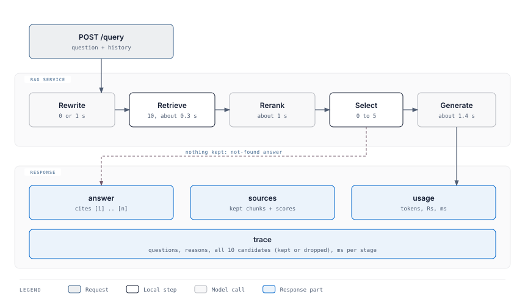
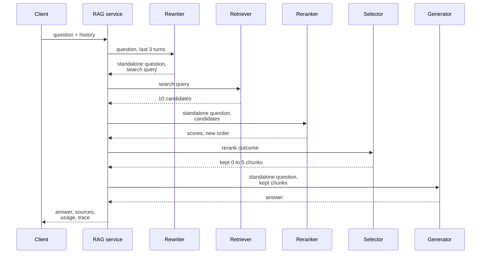

# 07. RAG Service and Query API

In this doc:

- The full query pipeline: five stages and which question each stage uses
- The request: question and chat history (top_k removed, and why)
- The response: answer, sources with reranker scores, usage and trace
- The not-found path that skips the generation call
- The logs of one question
- Live runs: a first question, a follow-up and an out-of-scope question
- Changes to the evaluation runner
- Tests

Files: [app/services/rag_service.py](../app/services/rag_service.py), [app/schemas/query.py](../app/schemas/query.py), [app/api/routes/query.py](../app/api/routes/query.py), [app/evals/runner.py](../app/evals/runner.py), [tests/test_rag_service.py](../tests/test_rag_service.py), [tests/test_query_api.py](../tests/test_query_api.py)

## The Pipeline

Docs 03 to 06 built the stages; this step connects them in `answer_question()`.





Each text has one job:

<table width="100%">
<thead><tr><th>Text</th><th>Used by</th><th>Why</th></tr></thead>
<tbody>
<tr><td>Original question</td><td>Rewriter, trace</td><td>What the user typed</td></tr>
<tr><td>Standalone question</td><td>Reranker and generator</td><td>Relevance and the answer must follow what the user meant, with "it" resolved</td></tr>
<tr><td>Search query</td><td>Retriever only</td><td>Search wording helps the embedding; it is not a good question to answer</td></tr>
</tbody>
</table>

When the rewriter skips the call, all three are the same text.

## The Request

```json
{
  "question": "and how is it trained?",
  "history": [
    {"question": "Which retriever and generator does the original RAG model combine?",
     "answer": "The original RAG model combines ... [1]"}
  ]
}
```

<table width="100%">
<thead><tr><th>Field</th><th>Rules</th><th>Notes</th></tr></thead>
<tbody>
<tr><td>question</td><td>1 to 2000 characters</td><td>Same as Naive RAG</td></tr>
<tr><td>history</td><td>Up to 20 turns, oldest first; each question up to 2000 and answer up to 8000 characters</td><td>New. The API stays stateless: the client (the UI) sends the earlier turns. The rewriter uses only the last 3</td></tr>
<tr><td>top_k</td><td>Removed</td><td>In Naive RAG it fixed the number of chunks. In Advanced RAG the selector decides the number per question (doc 06), so a request top_k would bypass the main improvement. TOP_K remains in settings for the reranking-off fallback</td></tr>
</tbody>
</table>

Invalid input (empty question, too long text, more than 20 turns) gets a 422 response from the schema.

## The Response

<table width="100%">
<thead><tr><th>Part</th><th>Content</th></tr></thead>
<tbody>
<tr><td>answer</td><td>Generated answer with [n] citations, or the fixed not-found answer</td></tr>
<tr><td>sources</td><td>Only the kept chunks, numbered like the prompt; each with similarity (score), rerank_score and retrieval_rank</td></tr>
<tr><td>usage</td><td>Embedding and chat tokens of all calls (rewrite, rerank, answer), cost in USD and Rs, total milliseconds</td></tr>
<tr><td>trace</td><td>See below</td></tr>
</tbody>
</table>

### The trace

```json
"trace": {
  "original_question": "and how is it trained?",
  "standalone_question": "How is the original Retrieval-Augmented Generation (RAG) model trained?",
  "search_query": "training method of original Retrieval-Augmented Generation RAG model retriever generator",
  "rewritten": true,  "rewrite_reason": "rewritten",
  "reranked": true,   "rerank_reason": "reranked",
  "selection_reason": "above threshold",
  "candidates": [
    {"retrieval_rank": 7, "final_rank": 1, "label": "2005.11401_RAG-Lewis.pdf, page 1",
     "similarity": 0.680, "rerank_score": 8.0, "kept": true, "citation": 1},
    ...
    {"retrieval_rank": 2, "final_rank": 8, "label": "2401.15884_Corrective-RAG.pdf, page 1",
     "similarity": 0.697, "rerank_score": 1.0, "kept": false, "citation": null}
  ],
  "timings_ms": {"rewrite": 1019, "retrieve": 277, "rerank": 1042, "generate": 1485}
}
```

The trace answers "why did I get this answer?" without reading server logs: what was searched, what was found, how it was scored, what was sent and how long each stage took. The UI will show it, and every evaluation result stores it.

## The Not-Found Path

If the selector keeps nothing (empty index, or every candidate below the floor), the service returns "I could not find this in the provided documents." **without calling the generator**. The trace still shows all candidates and their scores, and `timings_ms.generate` is 0.

## The Logs of One Question

Every stage is one line with its time; every candidate is one line with its old and new rank, similarity, score and keep or drop:

```text
question      "and how is it trained?"  kind=query  history=1
rewrite       reason=rewritten  1.02 s
    standalone "How is the original Retrieval-Augmented Generation (RAG) model trained?"
    search     "training method of original Retrieval-Augmented Generation RAG model retriever generator"
retrieve      candidates=10  top_similarity=0.725  275 ms
rerank        reason=reranked  1.04 s
    select     kept=4 of 10  above threshold
    #1         keep  was #7  sim=0.680  score=8  2005.11401_RAG-Lewis.pdf  p.1
    #2         keep  was #1  sim=0.725  score=7  2005.11401_RAG-Lewis.pdf  p.9
    #3         keep  was #10  sim=0.672  score=7  2005.11401_RAG-Lewis.pdf  p.2
    #4         keep  was #5  sim=0.683  score=6  2005.11401_RAG-Lewis.pdf  p.2
    #5         drop  was #8  sim=0.679  score=5  2401.15884_Corrective-RAG.pdf  p.3
    ...
generate      model=gpt-4o-mini  context_chars=4058  1.48 s
    answer     "The original Retrieval-Augmented Generation (RAG) model is trained by jointly learning ..."
    cited      [1, 3]  of 4 kept
usage         tokens=3944  cost=$0.000668  inr=Rs 0.0561  stages={'rewrite': 1019, 'retrieve': 277, 'rerank': 1042, 'generate': 1485}
```

Note "#3 keep was #10": the chunk at the bottom of the similarity list is one of the most useful. With Naive RAG's top 4 it would never have been seen.

## Live Runs

Three questions through `POST /query` against our Azure deployment and the same index as Naive RAG:

<table width="100%">
<thead><tr><th>Question</th><th>Rewrite</th><th>Kept</th><th>Answer</th><th>Time</th><th>Cost</th></tr></thead>
<tbody>
<tr><td>Which retriever and generator does the original RAG model combine?</td><td>Skipped (clear first question)</td><td>2 of 10, both RAG paper (pages 2 and 7)</td><td>Retriever and generator described from the RAG paper, cites [1]</td><td>3.44 s</td><td>Rs 0.043</td></tr>
<tr><td>and how is it trained? (follow-up)</td><td>"How is the original RAG model trained?"</td><td>4 of 10, all RAG paper</td><td>Jointly trained retriever and generator, cites [1] and [3]</td><td>3.84 s</td><td>Rs 0.056</td></tr>
<tr><td>Who won the FIFA World Cup in 2018?</td><td>Skipped</td><td>0 of 10, all scored 0</td><td>Not-found answer, no generation call</td><td>1.23 s</td><td>Rs 0.041</td></tr>
</tbody>
</table>

Time per stage, from the traces:

<table width="100%">
<thead><tr><th>Stage</th><th>First question</th><th>Follow-up</th><th>Out of scope</th></tr></thead>
<tbody>
<tr><td>Rewrite</td><td>0 ms (skipped)</td><td>1,019 ms</td><td>1 ms (skipped)</td></tr>
<tr><td>Retrieve</td><td>1,299 ms (first call, connection setup)</td><td>277 ms</td><td>299 ms</td></tr>
<tr><td>Rerank</td><td>811 ms</td><td>1,042 ms</td><td>916 ms</td></tr>
<tr><td>Generate</td><td>1,307 ms</td><td>1,485 ms</td><td>0 ms (not called)</td></tr>
</tbody>
</table>

Against the Naive RAG baseline (Rs 0.02 and 1.7 s per question), Advanced RAG costs about twice as much and takes about twice as long. The reranker is the largest added cost (about Rs 0.032), the rewrite the largest added delay on follow-ups. Whether the quality gain is worth it is decided by the evaluation (step 10); step 9 adds per-stage tokens and cost to the trace.

## Changes to the Evaluation Runner

The runner calls the same `answer_question()`, so it needed small changes:

<table width="100%">
<thead><tr><th>Change</th><th>Reason</th></tr></thead>
<tbody>
<tr><td>No top_k in POST /evals/runs or in the runner</td><td>The number of chunks is decided by the selector</td></tr>
<tr><td>Report records "pipeline": every stage switch and limit</td><td>Runs with different stages on can be compared (ablation)</td></tr>
<tr><td>Each result stores the full trace</td><td>Every score can be explained from what was retrieved and kept</td></tr>
<tr><td>New candidate_hit and candidate_hit_rate</td><td>Separates recall (expected file among the 10 candidates) from what was kept (retrieval_hit), as planned in notes 12</td></tr>
<tr><td>Sources in results include rerank_score</td><td>Judge results can be read next to reranker scores</td></tr>
</tbody>
</table>

## Tests

<table width="100%">
<thead><tr><th>Test</th><th>Checks</th></tr></thead>
<tbody>
<tr><td>test_stages_run_in_order_and_only_kept_chunks_are_sources</td><td>Search uses the search query; rerank and answer use the standalone question; only the chunk scoring 9 becomes source [1]</td></tr>
<tr><td>test_trace_records_every_candidate</td><td>Questions, reasons, all candidates with ranks, scores, kept flags, citations, and a time per stage</td></tr>
<tr><td>test_nothing_relevant_skips_llm</td><td>All scores 0: not-found answer, no chat call, every candidate dropped</td></tr>
<tr><td>test_empty_index_skips_llm</td><td>No candidates: not-found answer, no chat call</td></tr>
<tr><td>test_query_returns_answer_sources_and_trace</td><td>History reaches the service; response holds rerank scores, the trace and usage</td></tr>
<tr><td>test_query_rejects_empty_question</td><td>422</td></tr>
<tr><td>test_query_rejects_too_many_turns</td><td>21 turns gives 422</td></tr>
<tr><td>Evaluation runner tests</td><td>candidate_hit, trace in results, candidate_hit_rate and pipeline in the report</td></tr>
</tbody>
</table>

93 tests pass, all offline.

## Key Points

- `answer_question(question, history)` runs rewrite, retrieve, rerank, select and generate; the search query is used only to search, the standalone question to rerank and answer.
- POST /query takes the question and the chat history; top_k is gone because the selector chooses the number of chunks.
- Every response carries a trace: questions, reasons, all candidates with scores and keep or drop, and time per stage.
- Out-of-scope questions return the not-found answer without a generation call.
- Live: about 3.4 to 3.8 s and Rs 0.04 to 0.06 per answered question, roughly twice Naive RAG; the evaluation will show whether the quality gain justifies it.
