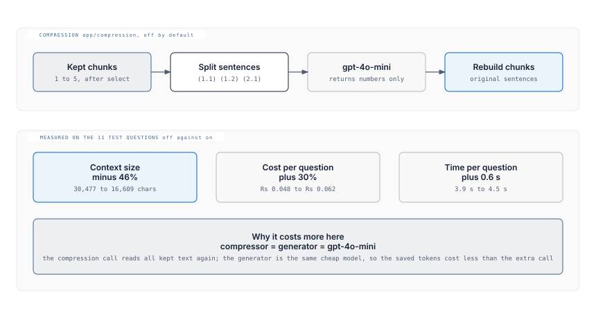
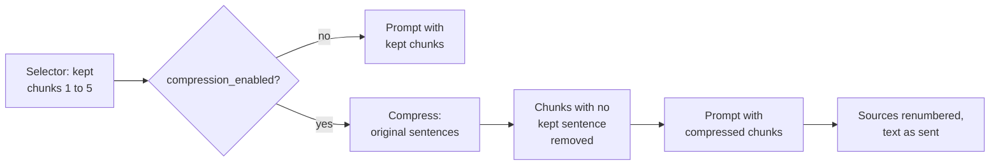

# 08. Context Compression

In this doc:

- What the optional compression stage does and which paper it comes from
- Why it is extractive, and why the model returns only sentence numbers
- Sentence splitting, and the "et al." bug found while testing
- The code, the fallbacks and how sources and citations change
- Measured on the test set: context size, cost, time and answers
- Why it stays off by default
- Tests

Files: [app/compression/compressor.py](../app/compression/compressor.py), [app/compression/prompts.py](../app/compression/prompts.py), [app/services/rag_service.py](../app/services/rag_service.py), [tests/test_compressor.py](../tests/test_compressor.py)

## What It Does

After the selector keeps 1 to 5 chunks, compression keeps only the **sentences** of those chunks that help answer the question. It is the RECOMP idea (paper notes: [RECOMP Compression and Selective Augmentation](../../01.%20Notes/02.%20Research%20Paper%20Explained/03.%20RECOMP%20Compression%20and%20Selective%20Augmentation/)) and the optional step in notes [10. Context Compression and Filtering](../../01.%20Notes/01.%20Basic%20Concepts/10.%20Context%20Compression%20and%20Filtering.md).



## Extractive, Numbers Only

RECOMP found that abstractive summaries can add unsupported facts (about 80 percent faithful on NQ, paper note 07). So this stage is **extractive**: the context sent to the generator is always made of original sentences.

To make that guaranteed, not just requested, the model never writes text:

1. The code splits every kept chunk into sentences and numbers them `(chunk.sentence)`.
2. gpt-4o-mini returns `{"keep": {"1": [1, 2], "2": []}}`: only numbers.
3. The code rebuilds each chunk from the original sentences with those numbers, in their original order.

A hallucinated sentence is impossible: the model can only choose, not write. A short reply (numbers) also keeps the call fast, the same lesson as the reranker's plain score list (doc 05).

### The prompt

```text
You select sentences for a question answering system.

You get a question and numbered passages split into numbered sentences, like (2.3) for
passage 2, sentence 3.
Keep every sentence that helps answer the question, and any sentence needed to understand a
kept sentence (for example the sentence that says what "it" refers to).
Drop sentences that do not help. When unsure, keep the sentence. A passage may keep no sentences.
Do not answer the question and do not rewrite anything.
Reply with JSON only, in this form: {"keep": {"1": [1, 2], "2": []}}
```

"When unsure, keep the sentence" leans towards recall: dropping a needed sentence loses the answer, keeping an extra one only costs a few tokens.

## Sentence Splitting and the "et al." Bug

Sentences end at `.`, `!` or `?` followed by a space, or at a line break. The first test run produced fragments such as "2023; Luo et al., 2023; Asai et al., 2024) that are": the splitter cut after "al.". The selected fragment made no sense alone, the rag-corpus question lost its context and the answer became "not found".

The fix ignores sentence ends right after abbreviations common in papers:

```python
SENTENCE_END = re.compile(r"(?<!\bal\.)(?<!e\.g\.)(?<!i\.e\.)(?<!\bFig\.)(?<!\bEq\.)(?<=[.!?])\s+|\n+")
```

A test now checks "As shown by Asai et al. in Fig. 2, it works, e.g. on QA." stays one sentence.

## The Code

```python
# Switched off or nothing to do: unchanged
if not settings.compression_enabled: return unchanged(chunks, "compression disabled")

# One call in JSON mode, temperature 0
response = client.chat.completions.create(..., response_format={"type": "json_object"})

# Rebuild each chunk from its kept sentences; drop chunks with none
for position, chunk in enumerate(chunks):
    sentences = split_sentences(chunk.text)
    wanted = selection.get(position + 1, set())
    kept = [sentence for index, sentence in enumerate(sentences, start=1) if index in wanted]
    if kept:
        compressed.append(Document(text=" ".join(kept), metadata=chunk.metadata))
        kept_indexes.append(position)
```

### Fallbacks

<table width="100%">
<thead><tr><th>Case</th><th>Result</th><th>Reason in the trace</th></tr></thead>
<tbody>
<tr><td>COMPRESSION_ENABLED=false (default)</td><td>Chunks unchanged, no call</td><td>compression disabled</td></tr>
<tr><td>API error</td><td>Chunks unchanged</td><td>compression call failed: ...</td></tr>
<tr><td>Reply not valid JSON</td><td>Chunks unchanged</td><td>reply was not valid JSON</td></tr>
<tr><td>No sentence selected anywhere</td><td>Chunks unchanged</td><td>no sentence selected, kept original chunks</td></tr>
</tbody>
</table>

The last rule matters: an empty context would turn a question the selector judged answerable into a not-found answer.

### Sources, citations and the trace



- Sources hold the text **as sent** to the generator, so citations point to what the model actually read.
- A chunk removed by compression is marked `kept: false` in the trace candidates and gets no citation number.
- The trace adds `compressed`, `compression_reason`, `context_chars_before`, `context_chars_after` and a `compress` time.

## Measured on the Test Set

All 11 test questions, compression off and on (same pipeline otherwise):

<table width="100%">
<thead><tr><th>Question id</th><th>Context chars (off to on)</th><th>Chunks sent</th><th>Answer with compression</th></tr></thead>
<tbody>
<tr><td>rag-variants</td><td>2,541 to 596 (23%)</td><td>3 to 2</td><td>Same facts, shorter: "RAG-Sequence and RAG-Token [2]"</td></tr>
<tr><td>rag-components</td><td>732 to 408 (56%)</td><td>1 to 1</td><td>Same</td></tr>
<tr><td>rag-corpus</td><td>3,791 to 51 (1%)</td><td>4 to 1</td><td>Not found (see below)</td></tr>
<tr><td>selfrag-reflection</td><td>4,263 to 4,152 (97%)</td><td>5 to 5</td><td>Same</td></tr>
<tr><td>selfrag-when</td><td>4,715 to 1,606 (34%)</td><td>5 to 4</td><td>Same idea, worded differently</td></tr>
<tr><td>crag-evaluator</td><td>4,280 to 2,864 (67%)</td><td>5 to 5</td><td>Same</td></tr>
<tr><td>crag-incorrect</td><td>4,829 to 2,988 (62%)</td><td>5 to 5</td><td>Same, more focused on the web search action</td></tr>
<tr><td>adaptive-routing</td><td>4,842 to 3,721 (77%)</td><td>5 to 5</td><td>Same</td></tr>
<tr><td>hr-sick-days</td><td>242 to 137 (57%)</td><td>1 to 1</td><td>Same: 8 sick days [1]</td></tr>
<tr><td>hr-new-joiner-leave</td><td>242 to 86 (36%)</td><td>1 to 1</td><td>Same: 12 days [1]</td></tr>
<tr><td>out-of-scope</td><td>0</td><td>0</td><td>Not found (no call)</td></tr>
</tbody>
</table>

<table width="100%">
<thead><tr><th>Average per question</th><th>Off</th><th>On</th><th>Change</th></tr></thead>
<tbody>
<tr><td>Context characters (total over 11)</td><td>30,477</td><td>16,609</td><td>minus 46%</td></tr>
<tr><td>Cost</td><td>Rs 0.048</td><td>Rs 0.062</td><td>plus 30%</td></tr>
<tr><td>Time</td><td>3.9 s</td><td>4.5 s</td><td>plus 0.6 s (compression call 1.6 s on average, partly offset by shorter generation)</td></tr>
</tbody>
</table>

(This run was made before the "et al." fix. After the fix, rag-variants and selfrag-when compress to a similar size, and rag-corpus still compresses to about 100 characters and answers "not found".)

### What the numbers mean

- **Context halves, but cost and time go up.** The compression call reads all kept text again, and the generator is the same cheap gpt-4o-mini. Saving 14,000 characters (about 3,500 tokens) of generator input over 11 questions is worth less than 11 extra calls. RECOMP's setting is the opposite: a small compressor in front of a large, expensive reader (Flan-UL2 20B). Compression pays off when the generator costs much more than the compressor.
- **Most answers are unchanged.** The reranker and threshold already removed most noise, so the remaining chunks are mostly useful.
- **rag-corpus exposes a retrieval gap, not only a compression risk.** Its kept chunks do not state what corpus RAG uses (the reference answer is the Wikipedia dense index). Without compression the generator wrote a vague answer ("an accessible corpus containing a large amount of knowledge"); with compression almost nothing was relevant and it answered "not found". The evaluation will show this case; the fix belongs in retrieval (for example hybrid search in 03. Hybrid Search RAG), not here.

## Why It Stays Off

<table width="100%">
<thead><tr><th>Consideration</th><th>Finding</th></tr></thead>
<tbody>
<tr><td>Cost</td><td>Higher (plus 30%) with gpt-4o-mini as both compressor and generator</td></tr>
<tr><td>Latency</td><td>Higher (plus 0.6 s)</td></tr>
<tr><td>Quality</td><td>Unchanged on most questions; risk of dropping weak evidence</td></tr>
<tr><td>When to switch it on</td><td>A larger, more expensive generator; long chunks; context limits</td></tr>
</tbody>
</table>

COMPRESSION_ENABLED stays false. The stage remains in the pipeline and will be measured as one ablation run in the evaluation.

## Tests

<table width="100%">
<thead><tr><th>Test</th><th>Checks</th></tr></thead>
<tbody>
<tr><td>test_split_sentences</td><td>Splits at punctuation and line breaks; "et al.", "Fig." and "e.g." do not end a sentence</td></tr>
<tr><td>test_prompt_numbers_sentences</td><td>Sentences shown as (chunk.sentence) under the chunk label</td></tr>
<tr><td>test_keeps_selected_sentences_and_removes_empty_chunks</td><td>Original sentences in original order, metadata kept, empty chunk removed, JSON mode and token limit</td></tr>
<tr><td>test_disabled_keeps_chunks</td><td>No call when off</td></tr>
<tr><td>test_failures_keep_chunks</td><td>API error, bad JSON and empty selection keep the chunks</td></tr>
<tr><td>test_compression_shortens_sources_and_renumbers (RAG service)</td><td>Sources hold the compressed text; a chunk removed by compression is not cited</td></tr>
<tr><td>test_trace_records_every_candidate (RAG service)</td><td>Compression off by default: reason "compression disabled", context size unchanged</td></tr>
</tbody>
</table>

99 tests pass.

## Key Points

- Optional extractive compression: the model returns sentence numbers, the code keeps the original sentences, so no new text can appear.
- Testing found and fixed a sentence-splitting bug on "et al.".
- On the test set it halves the context but costs 30 percent more and adds 0.6 s, because compressor and generator are the same cheap model.
- It stays off by default and is kept for the ablation run; rag-corpus shows a retrieval gap that compression cannot fix.
