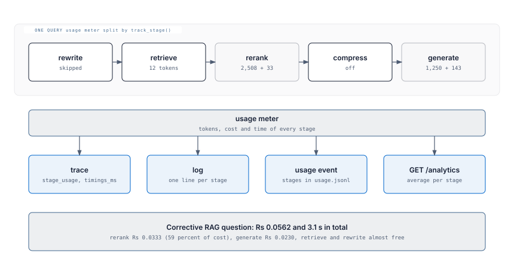
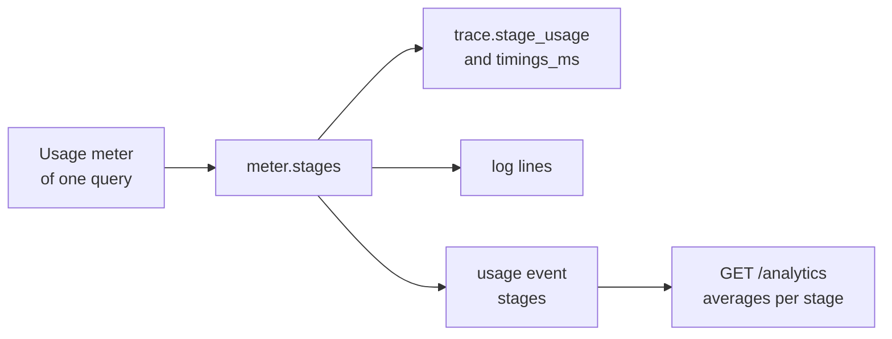

# 09. Usage, Cost and Logs per Stage

In this doc:

- Why total cost is no longer enough
- track_stage(): splitting one query's usage by stage
- Where the split appears: trace, logs, usage events and GET /analytics
- A full log of one question, read line by line
- Measured: which stage costs what
- Tests

Files: [app/services/usage.py](../app/services/usage.py), [app/services/rag_service.py](../app/services/rag_service.py), [app/schemas/query.py](../app/schemas/query.py), [app/schemas/analytics.py](../app/schemas/analytics.py), [tests/test_usage.py](../tests/test_usage.py)

## Why Per-Stage Usage

Naive RAG made one embedding call and one chat call per question, so its total cost was easy to read. Advanced RAG makes up to four chat calls (rewrite, rerank, compress, generate). A total of Rs 0.056 does not say which stage to optimise. The notes plan exactly this (notes: [13. Cost and Latency Trade-offs](../../01.%20Notes/01.%20Basic%20Concepts/13.%20Cost%20and%20Latency%20Trade-offs.md)): measure every stage, then decide.



## track_stage()

The usage meter (Naive RAG doc 22) already collects every token of a query. `track_stage()` takes a snapshot before a stage and records the difference after it:

```python
@contextmanager
def track_stage(meter: UsageMeter, name: str):
    before = (meter.embedding_tokens, meter.prompt_tokens, meter.completion_tokens)
    cost_before = meter.cost(settings)
    start = time.perf_counter()
    yield
    meter.stages[name] = {
        "embedding_tokens": meter.embedding_tokens - before[0],
        "prompt_tokens": meter.prompt_tokens - before[1],
        "completion_tokens": meter.completion_tokens - before[2],
        "cost_usd": round(meter.cost(settings) - cost_before, 8),
        "latency_ms": round((time.perf_counter() - start) * 1000),
    }
```

In the RAG service every stage is wrapped:

```python
with track_stage(meter, "rerank"), log_step(log, "rerank") as step:
    outcome = rerank(rewrite.standalone_question, candidates)
```

Why a snapshot and not a stage name passed into every model call:

<table width="100%">
<thead><tr><th>Option</th><th>Change needed</th><th>Decision</th></tr></thead>
<tbody>
<tr><td>Pass a stage name to the rewriter, reranker, compressor, generator and embedder</td><td>Every component changes, and each must know about usage</td><td>Rejected</td></tr>
<tr><td>Snapshot the meter around each stage</td><td>Only the RAG service changes; components keep calling add_chat_tokens() as before</td><td>Chosen</td></tr>
</tbody>
</table>

The stages run one after another, so the difference between two snapshots belongs to exactly one stage. The same timer now feeds `trace.timings_ms`, replacing the separate stage timers of doc 07.

## Where the Split Appears

<table width="100%">
<thead><tr><th>Place</th><th>Content</th><th>Use</th></tr></thead>
<tbody>
<tr><td>Response trace: stage_usage</td><td>Per stage: embedding, prompt and completion tokens, cost in USD and Rs, milliseconds. All five stages always present (zero if a stage did not run)</td><td>UI per-answer breakdown</td></tr>
<tr><td>Response trace: timings_ms</td><td>Milliseconds per stage, from the same measurement</td><td>Quick view of where time went</td></tr>
<tr><td>Log</td><td>One aligned line per stage after the answer</td><td>Reading the server console</td></tr>
<tr><td>Usage event (data/usage/usage.jsonl)</td><td>"stages" object on every query event</td><td>History, analytics</td></tr>
<tr><td>GET /analytics: stages</td><td>For each stage: runs, average cost in USD, average tokens, average milliseconds over all questions, in pipeline order</td><td>Which stage to optimise</td></tr>
</tbody>
</table>



## One Question, Read Line by Line

```text
question      "What does the retrieval evaluator in Corrective RAG do?"  kind=query  history=0
rewrite       reason=clear first question  0 ms
retrieve      candidates=10  top_similarity=0.638  370 ms
rerank        reason=reranked  1.02 s
    select     kept=5 of 10  above threshold
    #1         keep  was #2  sim=0.637  score=10  2401.15884_Corrective-RAG.pdf  p.2
    #2         keep  was #9  sim=0.576  score=10  2401.15884_Corrective-RAG.pdf  p.5
    #3         keep  was #1  sim=0.638  score=9  2401.15884_Corrective-RAG.pdf  p.10
    #4         keep  was #3  sim=0.619  score=7  2401.15884_Corrective-RAG.pdf  p.4
    #5         keep  was #4  sim=0.588  score=7  2401.15884_Corrective-RAG.pdf  p.4
    #6         drop  was #5  sim=0.581  score=4  2401.15884_Corrective-RAG.pdf  p.2
    ...
    #10        drop  was #10  sim=0.572  score=0  2310.11511_Self-RAG.pdf  p.1
generate      model=gpt-4o-mini  context_chars=...  1.70 s
    answer     "The retrieval evaluator in Corrective RAG is a lightweight component ..."
    cited      [1, 2, 4, 5]  of 5 sent
    rewrite    in=    0  out=   0  Rs 0.0000  1 ms
    retrieve   in=   12  out=   0  Rs 0.0000  372 ms
    rerank     in= 2508  out=  33  Rs 0.0333  1021 ms
    compress   in=    0  out=   0  Rs 0.0000  0 ms
    generate   in= 1250  out= 143  Rs 0.0230  1696 ms
usage         tokens=3946  cost=$0.000670  inr=Rs 0.0562
POST /query  200  3.11 s
```

<table width="100%">
<thead><tr><th>Lines</th><th>What to read</th></tr></thead>
<tbody>
<tr><td>question</td><td>The question, the run kind and how many history turns came with it</td></tr>
<tr><td>rewrite, retrieve, rerank, generate</td><td>One line per stage with its result and time</td></tr>
<tr><td>select and #1 to #10</td><td>Every candidate: new rank, old rank, similarity, reranker score, keep or drop, file and page. "was #9" with score 10 is a chunk similarity search had nearly missed</td></tr>
<tr><td>answer, cited</td><td>The answer start and which of the sent chunks it cites</td></tr>
<tr><td>The five stage lines</td><td>Input and output tokens, rupees and milliseconds per stage, aligned so they can be compared at a glance</td></tr>
<tr><td>usage</td><td>Total tokens and cost</td></tr>
</tbody>
</table>

## Measured: Which Stage Costs What

Two live questions:

<table width="100%">
<thead><tr><th>Stage</th><th>"how many sick days?" (rewritten)</th><th>Corrective RAG question (rewrite skipped)</th></tr></thead>
<tbody>
<tr><td>rewrite</td><td>268 tokens, Rs 0.0045, 1,821 ms</td><td>0, Rs 0, 1 ms</td></tr>
<tr><td>retrieve</td><td>8 tokens, Rs 0.0000, 651 ms</td><td>12 tokens, Rs 0.0000, 372 ms</td></tr>
<tr><td>rerank</td><td>2,185 tokens, Rs 0.0288, 1,045 ms</td><td>2,541 tokens, Rs 0.0333, 1,021 ms</td></tr>
<tr><td>compress</td><td>off</td><td>off</td></tr>
<tr><td>generate</td><td>207 tokens (1 chunk kept), Rs 0.0031, 638 ms</td><td>1,393 tokens (5 chunks), Rs 0.0230, 1,696 ms</td></tr>
<tr><td>Total</td><td>Rs 0.0363, 4.2 s</td><td>Rs 0.0562, 3.1 s</td></tr>
</tbody>
</table>

What this shows:

- **The reranker is the most expensive stage**: 59 to 79 percent of the cost, because it reads all 10 candidates. That is the number to watch if cost must fall (fewer candidates, shorter chunk text for scoring, or a local cross-encoder).
- **Generation got cheaper for focused questions**: one kept chunk makes the HR answer cost Rs 0.0031 instead of reading 4 chunks as Naive RAG did.
- **Rewrite costs little money but real time** (about 1 to 1.8 s when it runs), which is why it is skipped for clear first questions.
- **Retrieve** is almost free in money; its time is the embedding call (the first call after start-up is slower).

These figures will be averaged over the whole test set by the evaluation (doc 10), and over all real questions by GET /analytics.

## Tests

<table width="100%">
<thead><tr><th>Test</th><th>Checks</th></tr></thead>
<tbody>
<tr><td>test_track_stage_splits_usage_by_stage</td><td>Each stage records only its own tokens; the saved event keeps the split; summarize() averages per stage</td></tr>
<tr><td>test_trace_records_every_candidate</td><td>stage_usage has all five stages in order, each with tokens, cost in USD and Rs, and time</td></tr>
<tr><td>test_nothing_relevant_skips_llm</td><td>The generate stage counts as zero when it does not run</td></tr>
</tbody>
</table>

Tests write usage to a temporary file, never to data/usage. 100 tests pass.

## Key Points

- track_stage() snapshots the usage meter around each stage, so no component had to change.
- Every answer carries tokens, cost (USD and Rs) and time per stage; logs show one aligned line per stage; GET /analytics averages them.
- Measured: the reranker is the largest cost (Rs 0.029 to 0.033 per question), the rewrite the largest delay when it runs, generation is cheaper when fewer chunks are kept.
