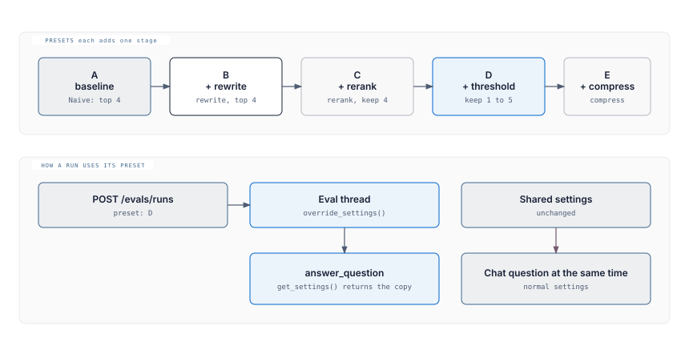
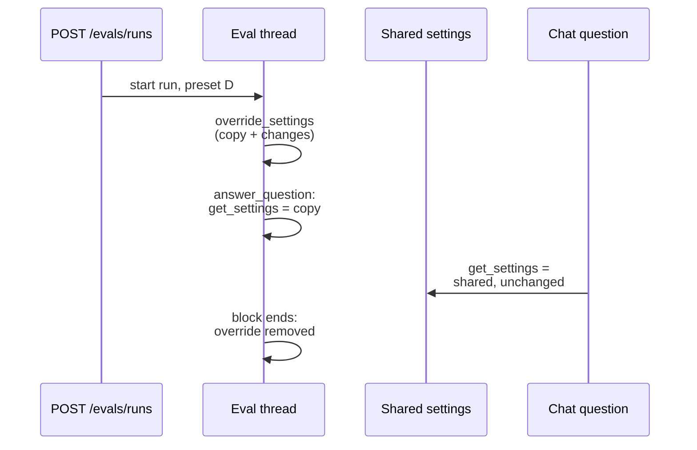

# 10. Evaluation Presets and Ablation Runs

In this doc:

- Why one evaluation of the full pipeline is not enough
- The five presets A to E and what each isolates
- override_settings(): changing settings for one run's thread only
- The API: GET /evals/presets and POST /evals/runs with a preset
- What a report now records
- Tests

Files: [app/evals/runner.py](../app/evals/runner.py), [app/core/config.py](../app/core/config.py), [app/api/routes/evals.py](../app/api/routes/evals.py), [app/schemas/evals.py](../app/schemas/evals.py), [tests/test_eval_runner.py](../tests/test_eval_runner.py), [tests/test_config.py](../tests/test_config.py)

## Why Ablation

If the full pipeline scores better than Naive RAG, which stage caused it? Rewriting, reranking, the threshold, or compression? Each stage adds cost and time (doc 09), so each must earn its place. An **ablation** runs the same test set with stages added one at a time and compares every metric, cost and latency (notes: [12. Evaluating Advanced RAG](../../01.%20Notes/01.%20Basic%20Concepts/12.%20Evaluating%20Advanced%20RAG.md)).



## The Presets

<table width="100%">
<thead><tr><th>Preset</th><th>Name</th><th>Settings changed</th><th>Isolates</th></tr></thead>
<tbody>
<tr><td>A</td><td>Naive RAG baseline</td><td>rewrite off, rerank off, compression off</td><td>Baseline inside this API: same code path, top 4 chunks</td></tr>
<tr><td>B</td><td>A + rewrite</td><td>rewrite on</td><td>Effect of condensing and rewriting the query</td></tr>
<tr><td>C</td><td>B + rerank, keep 4</td><td>rerank on, threshold 0, floor 0, min 4, max 4</td><td>Effect of better ordering only: still 4 chunks, like Naive</td></tr>
<tr><td>D</td><td>C + threshold and dynamic k</td><td>rerank on with the default threshold 6, floor 2, keep 1 to 5</td><td>Effect of sending fewer, better chunks (the default pipeline)</td></tr>
<tr><td>E</td><td>D + compression</td><td>compression on</td><td>Effect of extractive compression</td></tr>
</tbody>
</table>

Preset C keeps exactly 4 chunks on purpose: it separates the gain from **reordering** (C against B) from the gain from **sending fewer chunks** (D against C), as the notes recommend. Our candidate count is 10 (doc 04), not the 20 in the notes.

Running A inside the Advanced API, rather than reusing the old Naive report, makes the baseline use today's index, judge and test set, so differences come only from the stages.

## override_settings()

Every component reads its switches through `get_settings()`. To run a preset without changing the code of any component, `get_settings()` now checks a context variable first:

```python
# Settings that replace the shared ones inside one thread, used by evaluation presets
settings_override: ContextVar[Settings | None] = ContextVar("settings_override", default=None)

def get_settings() -> Settings:
    return settings_override.get() or load_settings()

@contextmanager
def override_settings(**changes):
    token = settings_override.set(load_settings().model_copy(update=changes))
    try:
        yield
    finally:
        settings_override.reset(token)
```



<table width="100%">
<thead><tr><th>Option</th><th>Problem</th><th>Decision</th></tr></thead>
<tbody>
<tr><td>Change the shared settings during a run</td><td>A chat question asked during the run would silently use the preset</td><td>Rejected</td></tr>
<tr><td>Pass the preset through every function</td><td>Every component signature changes</td><td>Rejected</td></tr>
<tr><td>Context variable holding a settings copy</td><td>None: the copy is visible only in the run's own thread</td><td>Chosen</td></tr>
</tbody>
</table>

A context variable set inside a thread is only seen by that thread. The run's thread sets the override at its start, so the shared `Settings` object is never modified.

## The API

```text
GET  /evals/presets        A to E with name, description and changed settings
POST /evals/runs           {"preset": "D", "case_ids": [...]}   preset optional
```

- Without a preset, a run uses the current settings, as before.
- An unknown preset (for example "Z") gets a 422 response from the schema.
- Only one run at a time, as in Naive RAG; the five presets are run one after another.

## What a Report Records

<table width="100%">
<thead><tr><th>Field</th><th>Content</th></tr></thead>
<tbody>
<tr><td>preset, preset_name</td><td>"D", "C + threshold and dynamic k" (or none, "Current settings")</td></tr>
<tr><td>pipeline</td><td>The stage settings as the run's thread saw them</td></tr>
<tr><td>summary</td><td>Faithfulness, answer relevance, context precision, correctness, overall, retrieval_hit_rate (expected file among the chunks sent), candidate_hit_rate (among the 10 candidates), passed, latency, cost</td></tr>
<tr><td>results[].trace</td><td>Full trace per question, including stage_usage, so cost per stage can be averaged per preset</td></tr>
</tbody>
</table>

## Tests

<table width="100%">
<thead><tr><th>Test</th><th>Checks</th></tr></thead>
<tbody>
<tr><td>test_override_settings_applies_inside_block_only</td><td>Inside the block get_settings() returns a changed copy; after it, the shared object is back and unchanged</td></tr>
<tr><td>test_preset_changes_settings_for_the_run_only</td><td>Preset A: the question runs with reranking off; the report records preset and pipeline; shared settings unchanged</td></tr>
<tr><td>test_presets_endpoint_and_unknown_preset</td><td>A to E listed, C keeps exactly 4 chunks, preset "Z" gives 422</td></tr>
</tbody>
</table>

103 tests pass. The results of running A to E on the test set are in doc 11.

## Key Points

- Five presets add one stage at a time: A Naive, B rewrite, C rerank keeping 4, D threshold and dynamic k, E compression.
- override_settings() applies a preset to a settings copy inside the run's thread; chat questions during a run are not affected.
- POST /evals/runs takes an optional preset; every report records the preset and the exact stage settings.
