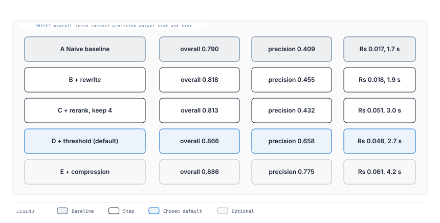
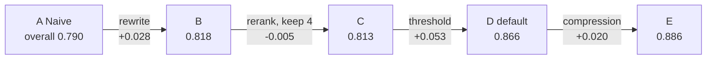

# 11. Evaluation Results and Comparison with Naive RAG

In this doc:

- How the runs were made
- The results of presets A to E, metric by metric
- What each stage added, and what it cost
- Question by question: where Advanced RAG helped and where it did not
- The targets set before building, met or not
- The decision: which preset is the default
- Limits of this evaluation

Reports: `data/evals/<run id>.json` (local, not committed). Run ids: A `f2666f3befce`, B `cc5b3f8bd2a9`, C `f56e088e105b`, D `025071d7c57a`, E `cdb9b82689f8`.

## How the Runs Were Made

- Same 11 test questions, same LLM judge (gpt-4o-mini) and same index (6 files) as the Naive RAG evaluation.
- Presets A to E from doc 10, run one after another with `POST /evals/runs {"preset": ...}`.
- Answer cost below is the cost of answering only (rewrite, retrieve, rerank, compress, generate); the judge's cost is excluded so the pipelines are compared fairly.

## Results

<table width="100%">
<thead><tr><th>Metric</th><th>A Naive</th><th>B + rewrite</th><th>C + rerank, keep 4</th><th>D + threshold (default)</th><th>E + compression</th></tr></thead>
<tbody>
<tr><td>Faithfulness</td><td>0.955</td><td>0.955</td><td>0.932</td><td>0.932</td><td>1.000</td></tr>
<tr><td>Answer relevance</td><td>0.955</td><td>1.000</td><td>1.000</td><td>1.000</td><td>0.932</td></tr>
<tr><td>Context precision</td><td>0.409</td><td>0.455</td><td>0.432</td><td>0.658</td><td>0.775</td></tr>
<tr><td>Correctness</td><td>0.841</td><td>0.864</td><td>0.886</td><td>0.841</td><td>0.818</td></tr>
<tr><td>Overall</td><td>0.790</td><td>0.818</td><td>0.813</td><td>0.866</td><td>0.886</td></tr>
<tr><td>Hit rate (expected file sent)</td><td>90%</td><td>100%</td><td>100%</td><td>100%</td><td>90%</td></tr>
<tr><td>Candidate hit rate (in the 10 candidates)</td><td>90% (4 retrieved)</td><td>100%</td><td>100%</td><td>100%</td><td>100%</td></tr>
<tr><td>Passed (overall 0.75 or more)</td><td>9 / 11</td><td>9 / 11</td><td>8 / 11</td><td>8 / 11</td><td>10 / 11</td></tr>
<tr><td>Chunks sent (average)</td><td>4.0</td><td>4.0</td><td>4.0</td><td>3.2</td><td>2.7</td></tr>
<tr><td>Answer cost per question</td><td>Rs 0.017</td><td>Rs 0.018</td><td>Rs 0.051</td><td>Rs 0.048</td><td>Rs 0.061</td></tr>
<tr><td>Time per question</td><td>1.7 s</td><td>1.9 s</td><td>3.0 s</td><td>2.7 s</td><td>4.2 s</td></tr>
</tbody>
</table>

**Preset A reproduces Naive RAG:** overall 0.79 against 0.80, context precision 0.409 against 0.41, hit rate 90 percent, 1.7 s. The baseline inside the new code matches the old system, so the other columns can be trusted as stage effects.

### Cost per stage (average per question)

<table width="100%">
<thead><tr><th>Stage</th><th>A</th><th>B</th><th>C</th><th>D</th><th>E</th></tr></thead>
<tbody>
<tr><td>rewrite</td><td>-</td><td>Rs 0.0014</td><td>Rs 0.0014</td><td>Rs 0.0014</td><td>Rs 0.0014</td></tr>
<tr><td>rerank</td><td>-</td><td>-</td><td>Rs 0.0321</td><td>Rs 0.0321</td><td>Rs 0.0321</td></tr>
<tr><td>compress</td><td>-</td><td>-</td><td>-</td><td>-</td><td>Rs 0.0182</td></tr>
<tr><td>generate</td><td>Rs 0.0166</td><td>Rs 0.0169</td><td>Rs 0.0173</td><td>Rs 0.0145</td><td>Rs 0.0090</td></tr>
</tbody>
</table>

The rewrite is cheap on average because most test questions are long first questions and it is skipped (doc 03). The reranker is two thirds of D's cost.

## What Each Stage Added

<table width="100%">
<thead><tr><th>Step</th><th>Effect</th><th>Why</th></tr></thead>
<tbody>
<tr><td>A to B: rewrite</td><td>Hit rate 90 to 100 percent; overall plus 0.028</td><td>"What document collection does RAG retrieve from?" was rewritten into search words that reach the RAG paper (rag-corpus: correctness 0 to 0.25, precision 0.25 to 0.75)</td></tr>
<tr><td>B to C: rerank, still 4 chunks</td><td>Correctness up (0.864 to 0.886), precision about the same, cost three times higher</td><td>Better ordering puts the right chunk first, but still sending 4 chunks keeps the noise: reordering alone does not fix precision</td></tr>
<tr><td>C to D: threshold and dynamic k</td><td>Context precision 0.432 to 0.658; overall 0.813 to 0.866; fewer chunks, cheaper generation</td><td>Sending only chunks scoring 6 or more removes noise: HR questions send 1 chunk instead of 4 (precision 0.25 to 1.0); the out-of-scope question sends nothing and scores 1.0</td></tr>
<tr><td>D to E: compression</td><td>Precision 0.775, faithfulness 1.0, overall 0.886; but correctness down, hit rate 90 percent, plus Rs 0.013 and 1.6 s</td><td>Shorter context is more precise, but rag-corpus loses its evidence (doc 08)</td></tr>
</tbody>
</table>

The biggest single gain comes from the **threshold**, not from reordering. This matches the Naive RAG diagnosis (Naive doc 28): the problem was too many unrelated chunks, and the reranker scores are what make cutting them safe.

## Question by Question (A against D)

<table width="100%">
<thead><tr><th>Question id</th><th>A overall / chunks</th><th>D overall / chunks</th><th>What changed</th></tr></thead>
<tbody>
<tr><td>rag-variants</td><td>0.75 / 4</td><td>0.65 / 3</td><td>Worse: the kept chunks name both variants but not how they differ; the judge marked correctness 0.5</td></tr>
<tr><td>rag-components</td><td>0.63 / 4</td><td>0.69 / 2</td><td>Precision 0.25 to 0.5; correctness unchanged (0.5)</td></tr>
<tr><td>rag-corpus</td><td>0.38 / 4</td><td>0.63 / 4</td><td>Better: the rewrite reached RAG paper chunks; still no Wikipedia detail in the index text found</td></tr>
<tr><td>selfrag-reflection</td><td>1.00 / 4</td><td>1.00 / 5</td><td>Already perfect</td></tr>
<tr><td>selfrag-when</td><td>0.81 / 4</td><td>0.88 / 4</td><td>Precision 0.25 to 0.5</td></tr>
<tr><td>crag-evaluator</td><td>1.00 / 4</td><td>0.95 / 5</td><td>One extra less relevant chunk (precision 0.8)</td></tr>
<tr><td>crag-incorrect</td><td>0.88 / 4</td><td>0.90 / 5</td><td>Precision 0.5 to 0.6</td></tr>
<tr><td>adaptive-routing</td><td>0.88 / 4</td><td>0.90 / 5</td><td>Precision 0.5 to 0.6</td></tr>
<tr><td>hr-sick-days</td><td>0.81 / 4</td><td>1.00 / 1</td><td>Precision 0.25 to 1.0: only the policy chunk sent</td></tr>
<tr><td>hr-new-joiner-leave</td><td>0.81 / 4</td><td>0.94 / 1</td><td>Precision 0.25 to 1.0; the answer left out "approved by the line manager" (same single chunk in both runs, so a generation difference)</td></tr>
<tr><td>out-of-scope</td><td>0.75 / 4</td><td>1.00 / 0</td><td>No context sent, not-found answer, no generation call</td></tr>
</tbody>
</table>

Seven questions improved, one stayed perfect, one is about even, two dropped slightly. The two drops are worth reading:

- **rag-variants:** the reference expects the difference between RAG-Sequence (one document for the whole answer) and RAG-Token (a document per token). The chunk that defines this scored below 6 and was dropped; Naive's 4 chunks happened to include text the judge accepted as closer. Selection can remove a partly useful chunk.
- **hr-new-joiner-leave:** both runs sent the same HR chunk; the D answer was shorter. With 11 questions and an LLM judge, a 0.25 correctness step on one question moves the average by 0.023, so small differences are within noise.

## Targets

Targets set before building (Advanced RAG README and notes 12):

<table width="100%">
<thead><tr><th>Target</th><th>Naive RAG</th><th>D (default)</th><th>Met?</th></tr></thead>
<tbody>
<tr><td>Context precision 0.65 or more</td><td>0.41</td><td>0.658</td><td>Yes</td></tr>
<tr><td>Overall 0.85 or more</td><td>0.80</td><td>0.866</td><td>Yes</td></tr>
<tr><td>Hit rate 95 to 100 percent</td><td>90%</td><td>100%</td><td>Yes</td></tr>
<tr><td>Time under 3 s</td><td>1.7 s</td><td>2.7 s average</td><td>Yes (average; follow-ups with a rewrite take about 3.5 to 4 s)</td></tr>
<tr><td>Correctness 0.90 or more</td><td>0.85</td><td>0.841</td><td>No</td></tr>
<tr><td>Cost under Rs 0.04</td><td>Rs 0.02</td><td>Rs 0.048</td><td>No: the gpt-4o-mini reranker alone is Rs 0.032</td></tr>
</tbody>
</table>

Four of six targets are met. The two misses have clear causes:

- **Correctness** is limited by what the index and chunks contain (rag-corpus has no chunk stating the Wikipedia dump; rag-variants' definition sentence sits in a chunk that scores below the threshold), not by ordering. That is a retrieval and chunking problem, addressed by 03. Hybrid Search RAG and 06. Contextual Chunking RAG.
- **Cost** follows from choosing gpt-4o-mini as the reranker (doc 05). A local cross-encoder would remove most of the Rs 0.032.

## The Decision

**Preset D stays the default** (rewrite, 10 candidates, gpt-4o-mini rerank, threshold 6, keep 1 to 5, no compression):

<table width="100%">
<thead><tr><th>Preset</th><th>Why not the default</th></tr></thead>
<tbody>
<tr><td>A, B</td><td>Precision stays at 0.41 to 0.46; out-of-scope questions still get 4 unrelated chunks</td></tr>
<tr><td>C</td><td>Pays the full reranking cost without the precision gain</td></tr>
<tr><td>E</td><td>Highest overall (0.886) and precision (0.775), but lower correctness and hit rate, 25 percent more cost and 1.5 s more time; the gains are in context metrics, not in correct answers</td></tr>
<tr><td>D</td><td>Best balance: all context targets met, correctness equal to Naive, 2.7 s, Rs 0.048</td></tr>
</tbody>
</table>

## Limits of This Evaluation

- **11 questions.** One question changing by 0.25 moves an average by about 0.02; differences below about 0.03 are not meaningful.
- **One run per preset.** The judge and the reranker vary between runs (doc 06 saw reranker scores move by 1 to 2 points).
- **File-level hit rate.** "Expected file sent" does not prove the answer sentence was sent (rag-variants).
- **Single-turn test set.** The follow-up handling of the rewriter (doc 03 and doc 07 live runs) is not measured by these questions; a multi-turn test set is a next step.
- **Judge is gpt-4o-mini,** the same model family as the pipeline.

## Key Points

- Preset A reproduces Naive RAG (overall 0.79, precision 0.41), so stage effects are measured on a matching baseline.
- The default pipeline D raises context precision from 0.41 to 0.66, overall from 0.79 to 0.87 and hit rate from 90 to 100 percent, with correctness unchanged.
- The threshold gives the largest gain; reranking alone (C) mostly costs money; rewriting helps the vague question.
- D costs Rs 0.048 and 2.7 s per question, about three times Naive's cost and 1.6 times its time; correctness and cost targets are not met, and both point to retrieval and the reranker choice as the next levers.
