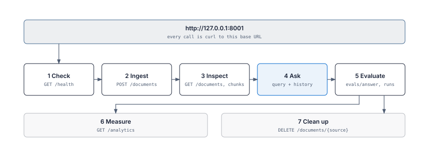
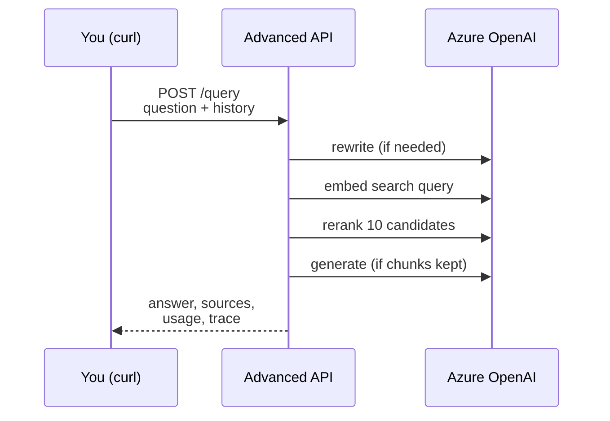

# 12. End to End curl Guide

In this doc:

- What is the same as the Naive RAG API, and what is new
- Every Advanced RAG call with curl, what it does and a real response
- Reading the trace: candidates, scores and cost per stage
- Follow-up questions with history
- Evaluation presets from the command line
- Errors and a one-script flow

All responses are real, from the running Advanced RAG API on port 8001 with the six project documents plus a demo travel policy file (uploaded, then deleted). Long fields are shortened with `jq`. Endpoints that work exactly as in Naive RAG (document list, chunks, file download, test set, run list) are explained in the Naive RAG doc [29. End to End curl Guide](../../../01.%20Naive%20RAG/03.%20API/docs/29.%20End%20to%20End%20curl%20Guide.md); here they are only listed.



```bash
BASE=http://127.0.0.1:8001
```

Start the API from 02. Advanced RAG/03. API with `.venv/bin/uvicorn app.main:app --reload --port 8001`.

## Same and New

<table width="100%">
<thead><tr><th>Endpoint</th><th>Naive RAG</th><th>Advanced RAG</th></tr></thead>
<tbody>
<tr><td>GET /health</td><td>Models, chunking, top_k</td><td>Plus every stage switch and limit</td></tr>
<tr><td>POST /documents, GET /documents, chunks, file, DELETE</td><td>As documented</td><td>Same</td></tr>
<tr><td>POST /query</td><td>{question, top_k}; answer, sources, usage</td><td>{question, history}; plus reranker scores on sources and a full trace</td></tr>
<tr><td>POST /evals/answer, GET /evals/testset, GET /evals/runs, GET /evals/runs/{id}</td><td>As documented</td><td>Same; reports add pipeline, preset, candidate hit rate and the trace per case</td></tr>
<tr><td>GET /evals/presets</td><td>-</td><td>New: presets A to E</td></tr>
<tr><td>POST /evals/runs</td><td>{case_ids, top_k}</td><td>{case_ids, preset}</td></tr>
<tr><td>GET /analytics</td><td>Totals, daily, recent</td><td>Plus stages: average cost and time per stage</td></tr>
</tbody>
</table>



## 1. Check the API and Its Stages: GET /health

```bash
curl -s $BASE/health | jq .pipeline
```

```json
{
  "chat_model": "gpt-4o-mini",
  "embedding_model": "text-embedding-3-small",
  "embedding_dimensions": 1536,
  "chunk_size": 1000,
  "chunk_overlap": 150,
  "top_k": 4,
  "rewrite_enabled": true,
  "candidate_k": 10,
  "rerank_enabled": true,
  "rerank_threshold": 6.0,
  "rerank_min_best_score": 2.0,
  "min_chunks": 1,
  "max_chunks": 5,
  "compression_enabled": false
}
```

These are the settings every question will use (doc 02). `top_k` only applies when reranking is off.

## 2. Upload and Inspect

```bash
curl -s -X POST $BASE/documents -F "file=@travel_policy.md" | jq '{source, chunks, total_chunks, embedding_tokens}'
```

```json
{ "source": "travel_policy.md", "chunks": 1, "total_chunks": 411, "embedding_tokens": 110 }
```

`GET /documents`, `GET /documents/{source}/chunks` and `GET /documents/{source}/file` work as in the Naive guide.

## 3. Ask: POST /query

```bash
curl -s -X POST $BASE/query \
  -H "Content-Type: application/json" \
  -d '{"question": "What is the daily meal allowance abroad?"}' > q1.json

jq '{answer, sources: [.sources[] | {number, label, score, rerank_score, retrieval_rank}], usage}' q1.json
```

```json
{
  "answer": "The daily meal allowance for employees working abroad is USD 60 [1].",
  "sources": [
    { "number": 1, "label": "travel_policy.md", "score": 0.4281, "rerank_score": 10.0, "retrieval_rank": 1 }
  ],
  "usage": {
    "embedding_tokens": 13,
    "prompt_tokens": 2334,
    "completion_tokens": 83,
    "cost_usd": 0.0004,
    "cost_inr": 0.0336,
    "latency_ms": 3700
  }
}
```

Compare with Naive RAG (doc 29 of the Naive API): the same question sent 4 chunks, three of them unrelated. Here only the travel policy chunk is sent, with reranker score 10.

### The trace: what each stage did

```bash
jq '.trace | {original_question, standalone_question, search_query, rewritten,
              rewrite_reason, reranked, rerank_reason, selection_reason, timings_ms}' q1.json
```

```json
{
  "original_question": "What is the daily meal allowance abroad?",
  "standalone_question": "What is the daily meal allowance for employees working abroad?",
  "search_query": "daily meal allowance for employees working abroad international per diem meal expenses",
  "rewritten": true,
  "rewrite_reason": "rewritten",
  "reranked": true,
  "rerank_reason": "reranked",
  "selection_reason": "above threshold",
  "timings_ms": { "rewrite": 1192, "retrieve": 358, "rerank": 1378, "compress": 0, "generate": 749 }
}
```

The question has fewer than 8 words, so the rewriter ran (doc 03) and added search words such as "per diem".

### Every candidate

```bash
jq -c '.trace.candidates[] | {final_rank, retrieval_rank, label, similarity, rerank_score, kept, citation}' q1.json
```

```text
{"final_rank":1,"retrieval_rank":1,"label":"travel_policy.md","similarity":0.4281,"rerank_score":10.0,"kept":true,"citation":1}
{"final_rank":2,"retrieval_rank":2,"label":"hr_policy.md","similarity":0.225,"rerank_score":0.0,"kept":false,"citation":null}
{"final_rank":3,"retrieval_rank":3,"label":"2310.11511_Self-RAG.pdf, page 22","similarity":0.1919,"rerank_score":0.0,"kept":false,"citation":null}
...
{"final_rank":10,"retrieval_rank":10,"label":"2310.11511_Self-RAG.pdf, page 21","similarity":0.1497,"rerank_score":0.0,"kept":false,"citation":null}
```

`retrieval_rank` is the position by similarity, `final_rank` after reranking, `kept` whether it was sent to the generator and `citation` its [n] in the answer (doc 07).

### Cost and time per stage

```bash
jq -c '.trace.stage_usage | to_entries[] | {stage: .key, prompt_tokens: .value.prompt_tokens,
        completion_tokens: .value.completion_tokens, cost_inr: .value.cost_inr, latency_ms: .value.latency_ms}' q1.json
```

```text
{"stage":"rewrite","prompt_tokens":242,"completion_tokens":35,"cost_inr":0.0048,"latency_ms":1192}
{"stage":"retrieve","prompt_tokens":0,"completion_tokens":0,"cost_inr":0.0,"latency_ms":358}
{"stage":"rerank","prompt_tokens":1853,"completion_tokens":33,"cost_inr":0.025,"latency_ms":1378}
{"stage":"compress","prompt_tokens":0,"completion_tokens":0,"cost_inr":0.0,"latency_ms":0}
{"stage":"generate","prompt_tokens":239,"completion_tokens":15,"cost_inr":0.0038,"latency_ms":749}
```

The reranker is three quarters of this question's cost; generation is cheap because only one short chunk was sent (doc 09).

## 4. Follow-up Questions: history

Send the earlier turns, oldest first, in `history`. The API is stateless, so the client keeps the conversation. Here the request is built from the first answer with `jq`:

```bash
jq -n --slurpfile q q1.json '{question: "and within India?",
  history: [{question: "What is the daily meal allowance abroad?", answer: $q[0].answer}]}' > q2_request.json

curl -s -X POST $BASE/query -H "Content-Type: application/json" -d @q2_request.json \
  | jq '{answer, trace: (.trace | {standalone_question, search_query, rewrite_reason, selection_reason}),
         cost_inr: .usage.cost_inr, latency_ms: .usage.latency_ms}'
```

```json
{
  "answer": "The daily meal allowance for employees working within India is Rs 1,500 [1].",
  "trace": {
    "standalone_question": "What is the daily meal allowance for employees working within India?",
    "search_query": "daily meal allowance for employees working within India",
    "rewrite_reason": "rewritten",
    "selection_reason": "above threshold"
  },
  "cost_inr": 0.0378,
  "latency_ms": 2691
}
```

"and within India?" alone could not be searched; with the history it became a complete question. Without `history`, the same request would search for "and within India?".

Limits: up to 20 turns; each question up to 2000 and each answer up to 8000 characters. The rewriter uses the last 3.

## 5. A Question the Documents Cannot Answer

```bash
curl -s -X POST $BASE/query -H "Content-Type: application/json" \
  -d '{"question": "Who won the FIFA World Cup in 2018?"}' \
  | jq '{answer, sources: (.sources | length), selection_reason: .trace.selection_reason,
         top_score: .trace.candidates[0].rerank_score, cost_inr: .usage.cost_inr}'
```

```json
{
  "answer": "I could not find this in the provided documents.",
  "sources": 0,
  "selection_reason": "nothing relevant",
  "top_score": 0.0,
  "cost_inr": 0.0408
}
```

Every candidate scored 0, below the not-found floor of 2, so no context was sent and no answer was generated (doc 06).

## 6. Evaluate

### One answer: POST /evals/answer

Grade against the standalone question (it is what was answered):

```bash
jq '{question: .trace.standalone_question, answer: .answer, contexts: [.sources[].text],
     reference: "USD 60 per day abroad."}' q1.json > eval.json

curl -s -X POST $BASE/evals/answer -H "Content-Type: application/json" -d @eval.json \
  | jq '{overall, faithfulness: .faithfulness.score, context_precision: .context_precision.score,
         correctness: .correctness.score, relevant_chunks}'
```

```json
{ "overall": 1.0, "faithfulness": 1.0, "context_precision": 1.0, "correctness": 1.0, "relevant_chunks": [1] }
```

Context precision 1.0 here, against 0.25 for the same question in Naive RAG.

### Presets: GET /evals/presets

```bash
curl -s $BASE/evals/presets | jq -c '.presets | to_entries[] | {preset: .key, name: .value.name, changes: .value.changes}'
```

```text
{"preset":"A","name":"Naive RAG baseline","changes":{"rewrite_enabled":false,"rerank_enabled":false,"compression_enabled":false}}
{"preset":"B","name":"A + rewrite","changes":{"rewrite_enabled":true,"rerank_enabled":false,"compression_enabled":false}}
{"preset":"C","name":"B + rerank, keep 4","changes":{"rewrite_enabled":true,"rerank_enabled":true,"compression_enabled":false,"rerank_threshold":0.0,"rerank_min_best_score":0.0,"min_chunks":4,"max_chunks":4}}
{"preset":"D","name":"C + threshold and dynamic k","changes":{"rewrite_enabled":true,"rerank_enabled":true,"compression_enabled":false}}
{"preset":"E","name":"D + compression","changes":{"rewrite_enabled":true,"rerank_enabled":true,"compression_enabled":true}}
```

### Run a preset: POST /evals/runs

```bash
RUN_ID=$(curl -s -X POST $BASE/evals/runs -H "Content-Type: application/json" \
  -d '{"preset": "D", "case_ids": ["hr-sick-days"]}' | jq -r .id)

while [ "$(curl -s $BASE/evals/runs/$RUN_ID | jq -r .status)" = "running" ]; do sleep 2; done

curl -s $BASE/evals/runs/$RUN_ID | jq '{id, status, preset, summary: {overall: .summary.overall,
  context_precision: .summary.context_precision, retrieval_hit_rate: .summary.retrieval_hit_rate,
  candidate_hit_rate: .summary.candidate_hit_rate},
  kept: [.results[0].trace.candidates[] | select(.kept) | .label]}'
```

```json
{
  "id": "371b163f360e",
  "status": "done",
  "preset": "D",
  "summary": { "overall": 1.0, "context_precision": 1.0, "retrieval_hit_rate": 1.0, "candidate_hit_rate": 1.0 },
  "kept": ["hr_policy.md"]
}
```

The POST response also shows `pipeline`, the exact stage settings the run uses. Leave out `case_ids` to run all 11 questions (about Rs 0.8 for preset D including the judge); leave out `preset` to use the current settings. The full A to E comparison is in doc 11.

## 7. Measure: GET /analytics

```bash
curl -s $BASE/analytics | jq '.stages'
```

```json
{
  "rewrite":  { "runs": 11, "avg_cost_usd": 0.00002221, "avg_tokens": 111,  "avg_latency_ms": 451 },
  "retrieve": { "runs": 11, "avg_cost_usd": 2.3e-7,     "avg_tokens": 12,   "avg_latency_ms": 703 },
  "rerank":   { "runs": 11, "avg_cost_usd": 0.00037309, "avg_tokens": 2388, "avg_latency_ms": 967 },
  "compress": { "runs": 11, "avg_cost_usd": 0.0,        "avg_tokens": 0,    "avg_latency_ms": 0 },
  "generate": { "runs": 10, "avg_cost_usd": 0.0001324,  "avg_tokens": 657,  "avg_latency_ms": 1235 }
}
```

Averages over chat questions (`kind = query`) that recorded stages. Generate has one run fewer: the out-of-scope question never called it. `totals`, `daily` and `recent` are as in Naive RAG.

## 8. Clean Up

```bash
curl -s -X DELETE $BASE/documents/travel_policy.md | jq .
```

```json
{ "source": "travel_policy.md", "removed_chunks": 1 }
```

## Errors

Same statuses as the Naive API (400 unsupported file, 404 unknown file or run, 409 duplicate upload or run already active, 422 invalid input). New 422 cases:

<table width="100%">
<thead><tr><th>Request</th><th>Why 422</th></tr></thead>
<tbody>
<tr><td>{"preset": "Z"} to POST /evals/runs</td><td>"Input should be 'A', 'B', 'C', 'D' or 'E'"</td></tr>
<tr><td>More than 20 history turns, or a turn too long</td><td>History limits</td></tr>
</tbody>
</table>

```bash
curl -s -w "\nstatus=%{http_code}\n" -X POST $BASE/evals/runs -H "Content-Type: application/json" -d '{"preset": "Z"}'
```

```text
{"detail":[{"type":"literal_error","loc":["body","preset"],"msg":"Input should be 'A', 'B', 'C', 'D' or 'E'","input":"Z","ctx":{"expected":"'A', 'B', 'C', 'D' or 'E'"}}]}
status=422
```

`top_k` sent to POST /query is ignored (it is not part of the request any more); the number of chunks comes from the threshold.

Model call failures do not return errors: a failed rewrite or rerank falls back to the original question or the retrieval order, and the trace reason says so ("rewrite call failed: TimeoutError").

## The Whole Flow in One Script

```bash
#!/bin/bash
BASE=http://127.0.0.1:8001
set -e

curl -s $BASE/health | jq '.pipeline | {rewrite_enabled, rerank_enabled, rerank_threshold}'
curl -s -X POST $BASE/documents -F "file=@travel_policy.md" | jq '{source, chunks}'

# First question, saved for the follow-up
curl -s -X POST $BASE/query -H "Content-Type: application/json" \
  -d '{"question": "What is the daily meal allowance abroad?"}' | tee q1.json \
  | jq '{answer, kept: [.trace.candidates[] | select(.kept) | .label], cost_inr: .usage.cost_inr}'

# Follow-up with history
jq -n --slurpfile q q1.json '{question: "and within India?",
  history: [{question: "What is the daily meal allowance abroad?", answer: $q[0].answer}]}' \
  | curl -s -X POST $BASE/query -H "Content-Type: application/json" -d @- \
  | jq '{understood_as: .trace.standalone_question, answer}'

curl -s $BASE/analytics | jq '.stages | map_values(.avg_latency_ms)'
curl -s -X DELETE $BASE/documents/travel_policy.md | jq .
```

## Key Points

- POST /query takes `history` for follow-ups and returns the trace: questions at each step, all candidates with scores, and cost and time per stage.
- Questions outside the documents return the not-found answer without a generation call.
- GET /evals/presets and `preset` in POST /evals/runs run the ablation presets from the command line.
- Everything else works as in the Naive RAG API; the demo file was uploaded and deleted, leaving the index as it was.
