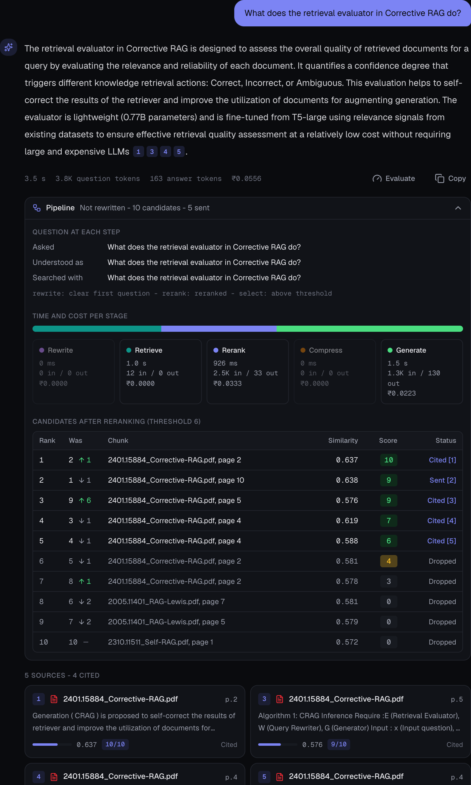
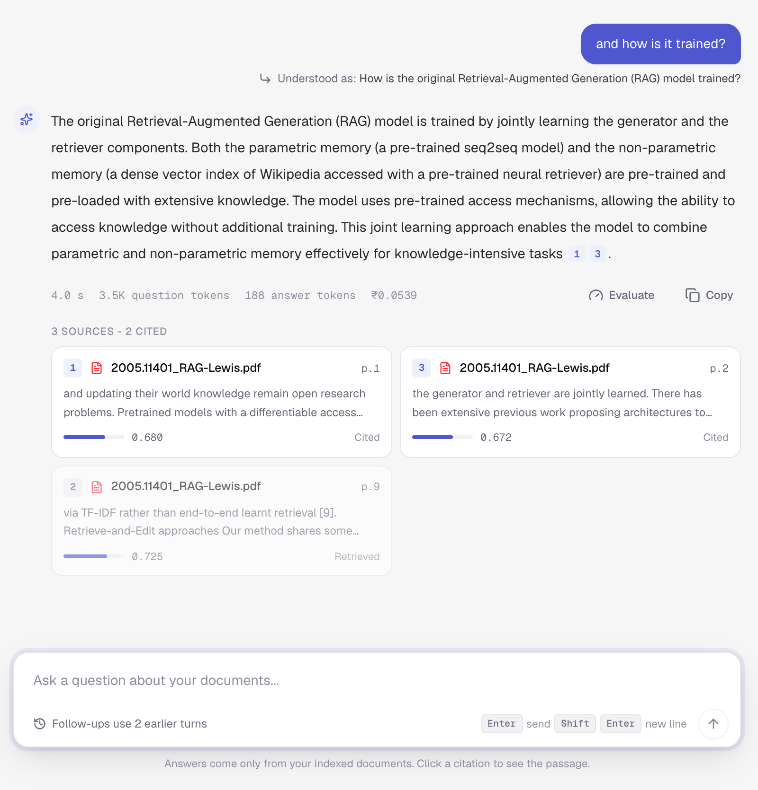
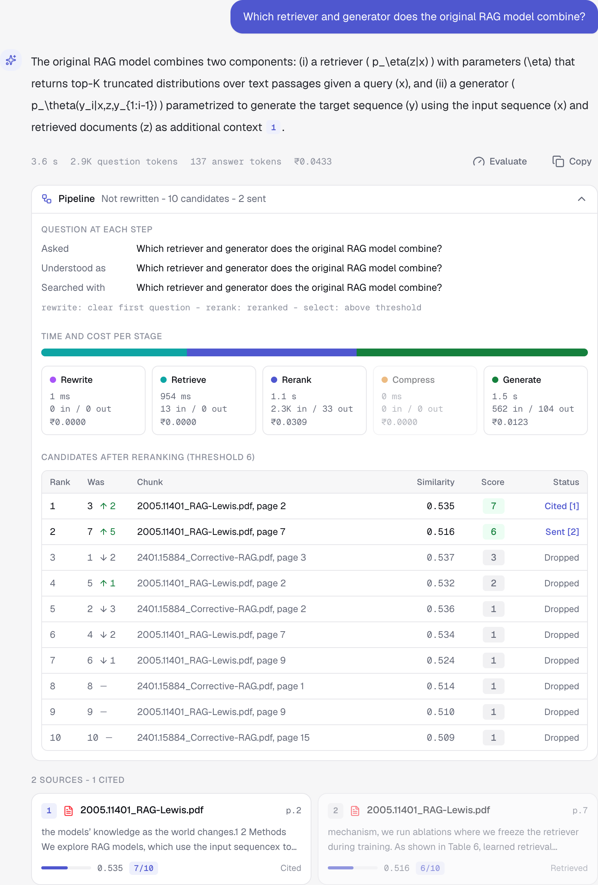
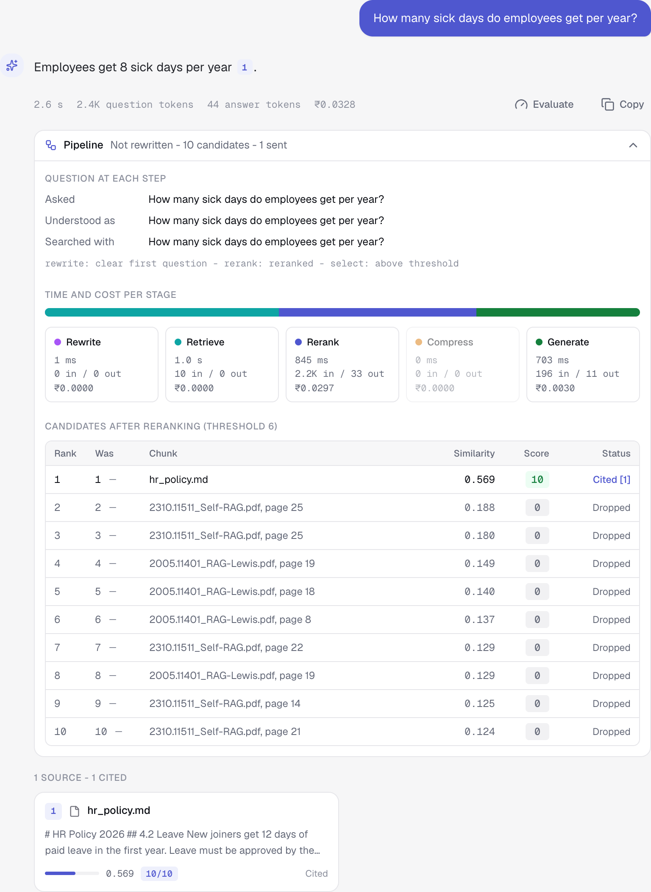
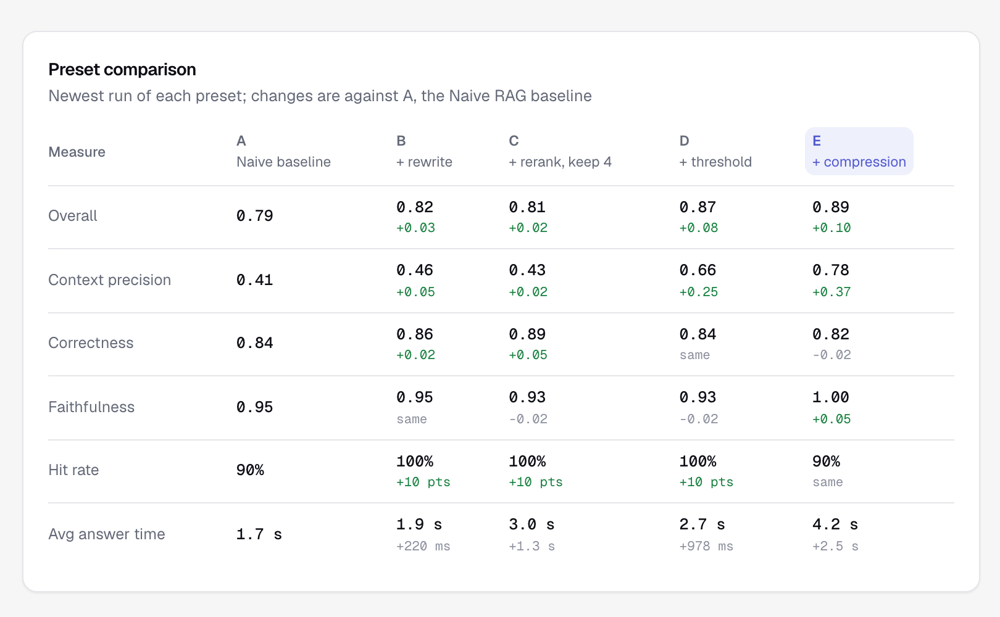
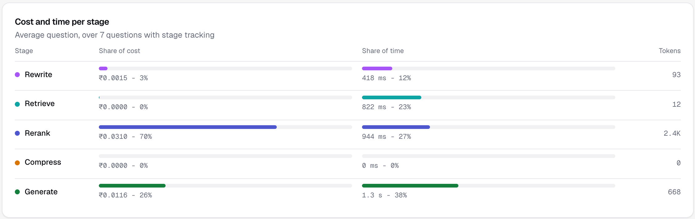

# Advanced RAG UI

**Status:** Done.

A React app for the Advanced RAG API. It starts from the [Naive RAG UI](../../01.%20Naive%20RAG/04.%20UI/) (chat with PDF citations, Documents, Analytics, Evals) and makes the new stages visible: follow-up questions, the rewritten question, every candidate before and after reranking, cost and time per stage, and evaluation presets compared against the Naive baseline.



## Showcase

All screenshots are from the running app with real answers (gpt-4o-mini, text-embedding-3-small, FAISS).

### 1. Follow-up questions



"and how is it trained?" is sent with the earlier turns; the API rewrites it and the chat shows "Understood as: How is the original Retrieval-Augmented Generation (RAG) model trained?".

### 2. The pipeline behind every answer

<table width="100%">
<thead><tr><th>Reranking fixes the order</th><th>Only the useful chunk is sent</th></tr></thead>
<tbody>
<tr><td></td><td></td></tr>
</tbody>
</table>

The pipeline panel shows the question at each step, the time and cost of each stage, and all 10 candidates with their rank before and after reranking, similarity, reranker score and whether they were sent and cited.

### 3. Evaluation presets compared with Naive RAG



Presets A (Naive baseline) to E (with compression) run from the Evals page; the comparison card shows the newest run of each with its change against A.

### 4. Cost and time per stage



## Run

1. Start the API (from `02. Advanced RAG/03. API`, see its README):

   ```bash
   .venv/bin/uvicorn app.main:app --reload --port 8001
   ```

2. Start the UI (from `02. Advanced RAG/04. UI`):

   ```bash
   npm install
   npm run dev
   ```

3. Open http://localhost:5174. The Naive RAG UI can run at the same time on 5173.

<table width="100%">
<thead><tr><th>Command</th><th>What it does</th></tr></thead>
<tbody>
<tr><td>npm run dev</td><td>Dev server with hot reload on port 5174; /api is proxied to FastAPI on port 8001</td></tr>
<tr><td>npm run build</td><td>Production build in dist/</td></tr>
<tr><td>npm test</td><td>Unit tests (Vitest)</td></tr>
<tr><td>npm run lint</td><td>Lint (oxlint)</td></tr>
</tbody>
</table>

## Build Steps

<table width="100%">
<thead><tr><th>Step</th><th>Feature</th><th>What it adds</th><th>Status</th></tr></thead>
<tbody>
<tr><td>1</td><td>Project base</td><td>Copy of the Naive RAG UI pointing at the Advanced API (port 8001), served on port 5174</td><td>Done</td></tr>
<tr><td>2</td><td>Follow-up chat</td><td>Earlier turns sent with each question so follow-ups are rewritten into standalone questions</td><td>Done</td></tr>
<tr><td>3</td><td>Pipeline view</td><td>Rewritten question, candidates before and after reranking, kept and dropped chunks, cost and time per stage</td><td>Done</td></tr>
<tr><td>4</td><td>Evaluation presets and comparison</td><td>Run presets A to E and compare runs metric by metric against the Naive baseline</td><td>Done</td></tr>
<tr><td>5</td><td>Stage analytics</td><td>Average cost and time per stage across questions</td><td>Done</td></tr>
<tr><td>6</td><td>Settings display and showcase</td><td>Stage settings in the sidebar and Documents page, screenshots of every view</td><td>Done</td></tr>
</tbody>
</table>

## Docs

<table width="100%">
<thead><tr><th>#</th><th>Doc</th><th>Topic</th></tr></thead>
<tbody>
<tr><td>01</td><td><a href="docs/01.%20UI%20Project%20Base.md">UI Project Base</a></td><td>Why the UI starts from the Naive UI, what changed, ports for side by side running</td></tr>
<tr><td>02</td><td><a href="docs/02.%20Follow-up%20Chat.md">Follow-up Chat</a></td><td>Earlier turns sent with each question, Understood as line, top k menu removed</td></tr>
<tr><td>03</td><td><a href="docs/03.%20Pipeline%20Panel.md">Pipeline Panel</a></td><td>Questions at each step, time and cost per stage, all candidates before and after reranking, scores on source cards</td></tr>
<tr><td>04</td><td><a href="docs/04.%20Evaluation%20Presets%20and%20Comparison.md">Evaluation Presets and Comparison</a></td><td>Preset menu, comparison card against the Naive baseline, preset and stages in run summary and history</td></tr>
<tr><td>05</td><td><a href="docs/05.%20Stage%20Analytics.md">Stage Analytics</a></td><td>Cost and time per stage card on the Analytics page, stageAverages()</td></tr>
<tr><td>06</td><td><a href="docs/06.%20Stage%20Settings%20Display%20and%20UI%20Overview.md">Stage Settings Display and UI Overview</a></td><td>Settings in the sidebar and Documents page, the UI on one map, final checks</td></tr>
</tbody>
</table>

## Navigation

Previous: [03. API](../03.%20API/) | [Advanced RAG](../README.md)
