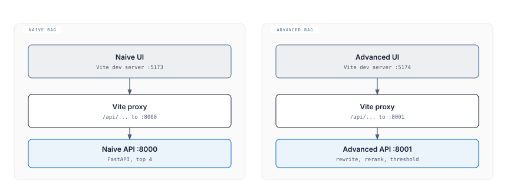
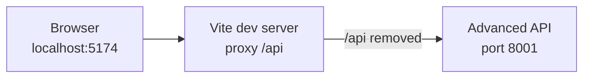

# 01. UI Project Base

In this doc:

- Why the Advanced RAG UI starts from a copy of the Naive RAG UI
- What was copied, what was renamed and what changed
- Ports: running both UIs and both APIs side by side
- Which parts will change in the next steps

## Why a Copy

The Naive RAG UI already has everything Advanced RAG needs except the new stages: chat with citations and the PDF viewer, documents and ingestion, analytics in rupees, answer evaluation and evaluation runs (Naive UI docs 01 to 11). The API kept the same endpoints and added fields (Advanced API doc 07), so the copy works against the Advanced API at once.

As with the API, copying instead of sharing code keeps each architecture complete in its own folder and leaves the Naive UI untouched as the baseline.

## What Was Copied and Changed

<table width="100%">
<thead><tr><th>Item</th><th>Action</th></tr></thead>
<tbody>
<tr><td>src/, public/, index.html, package.json, package-lock.json, vite.config.js, .oxlintrc.json, .gitignore</td><td>Copied from 01. Naive RAG/04. UI (without node_modules, dist and docs)</td></tr>
<tr><td>Package name</td><td>naive-rag-ui to advanced-rag-ui</td></tr>
<tr><td>Page title and sidebar name</td><td>"Naive RAG" to "Advanced RAG"</td></tr>
<tr><td>API proxy target</td><td>http://127.0.0.1:8000 to http://127.0.0.1:8001</td></tr>
<tr><td>Dev server port</td><td>5173 (Vite default) to 5174</td></tr>
<tr><td>"API not reachable" message</td><td>Mentions port 8001</td></tr>
<tr><td>Theme storage key</td><td>naive-rag-theme to advanced-rag-theme, so the two apps keep separate light and dark choices</td></tr>
</tbody>
</table>

Checks after the copy: `npm install`, `npm test` (22 tests pass), `npm run build` and `npm run lint` (no warnings).

## Side by Side

<table width="100%">
<thead><tr><th>App</th><th>Start (from the folder)</th><th>Open</th></tr></thead>
<tbody>
<tr><td>Advanced API</td><td>.venv/bin/uvicorn app.main:app --reload --port 8001 (in 02. Advanced RAG/03. API)</td><td>http://127.0.0.1:8001/docs</td></tr>
<tr><td>Advanced UI</td><td>npm install, then npm run dev (in 02. Advanced RAG/04. UI)</td><td>http://localhost:5174</td></tr>
<tr><td>Naive API and UI</td><td>As in the Naive READMEs</td><td>http://localhost:5173</td></tr>
</tbody>
</table>

## What Changes Next

<table width="100%">
<thead><tr><th>Step</th><th>Change</th><th>API feature used</th></tr></thead>
<tbody>
<tr><td>2</td><td>Chat sends earlier turns for follow-up questions; the top k selector is removed</td><td>history in POST /query (API doc 07)</td></tr>
<tr><td>3</td><td>Pipeline panel under each answer: rewritten question, candidates before and after reranking, kept and dropped chunks, cost and time per stage</td><td>trace in the query response (API docs 07, 09)</td></tr>
<tr><td>4</td><td>Evals page: run presets A to E and compare runs side by side</td><td>GET /evals/presets, preset in POST /evals/runs (API doc 10)</td></tr>
<tr><td>5</td><td>Analytics: average cost and time per stage</td><td>stages in GET /analytics (API doc 09)</td></tr>
<tr><td>6</td><td>Settings shown in the sidebar and documents page; screenshots</td><td>pipeline in GET /health (API doc 02)</td></tr>
</tbody>
</table>

## Key Points

- The Advanced UI is a copy of the Naive UI, renamed, pointing at the Advanced API on port 8001 and served on port 5174.
- Both architectures can run at the same time for side by side comparison.
- The next steps add follow-up chat, the pipeline trace view, evaluation presets and per-stage analytics.
