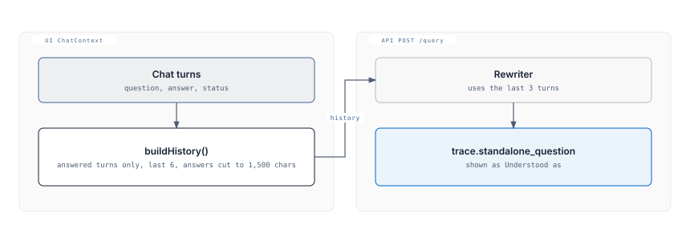
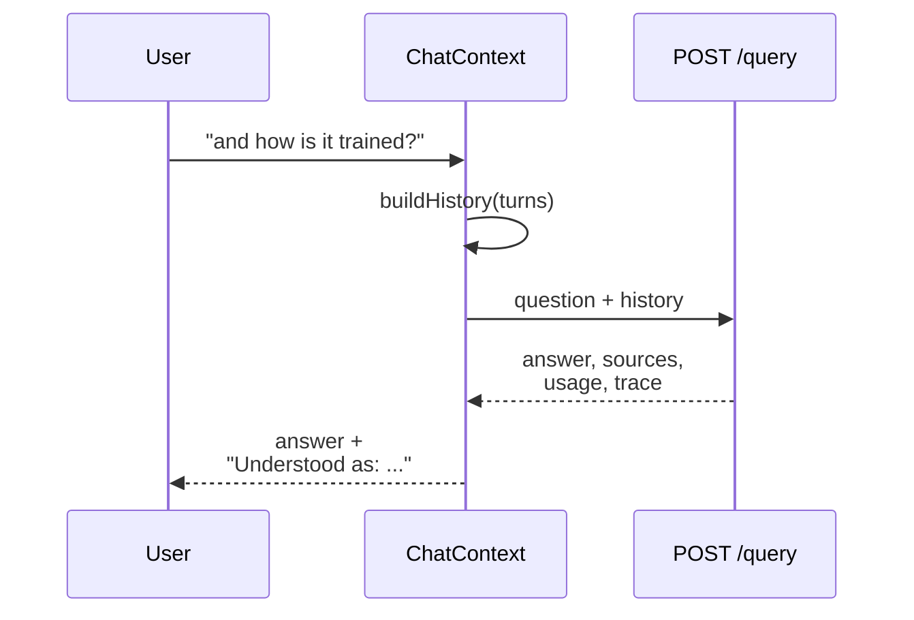
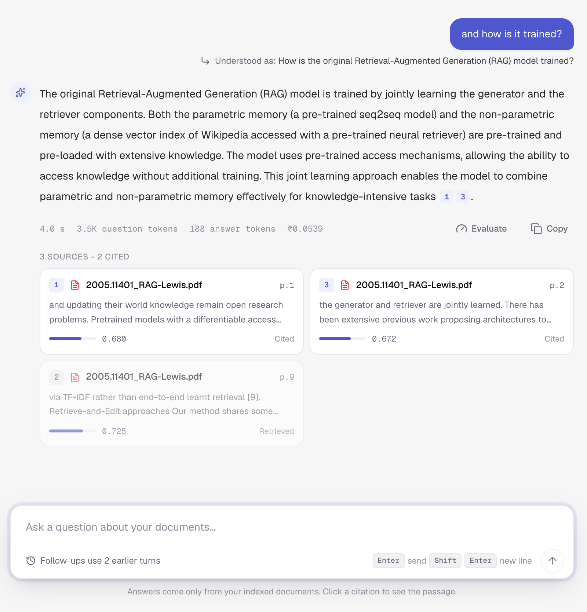

# 02. Follow-up Chat

In this doc:

- Why the chat must send earlier turns
- buildHistory(): which turns are sent, and how much of them
- What the user sees: the "Understood as" line and the follow-up label
- Why the top k menu was removed
- Changes file by file
- Tests and a live check

Files: [src/features/chat/history.js](../src/features/chat/history.js), [src/features/chat/ChatContext.jsx](../src/features/chat/ChatContext.jsx), [src/features/chat/ChatTurn.jsx](../src/features/chat/ChatTurn.jsx), [src/features/chat/Composer.jsx](../src/features/chat/Composer.jsx), [src/api/client.js](../src/api/client.js)

## Why Send Earlier Turns

The API is stateless: it does not remember the conversation. A follow-up such as "and how is it trained?" only makes sense with the question before it. The Advanced API accepts a `history` list in POST /query and its rewriter turns the follow-up into a standalone question (API docs 03 and 07). The UI already holds every turn, so it sends them.





## buildHistory()

```js
export function buildHistory(turns, limit = HISTORY_TURNS) {
  const answered = turns.filter((turn) => turn.status === 'done' && turn.answer)
  return answered.slice(-limit).map((turn) => ({
    question: turn.question,
    answer: turn.answer.slice(0, HISTORY_ANSWER_CHARS),
  }))
}
```

<table width="100%">
<thead><tr><th>Rule</th><th>Value</th><th>Why</th></tr></thead>
<tbody>
<tr><td>Only answered turns</td><td>status "done"</td><td>A failed or still running turn has no answer to give context</td></tr>
<tr><td>Most recent turns</td><td>6</td><td>The API rewriter uses the last 3; 6 leaves room if that setting is raised, and stays far below the API limit of 20</td></tr>
<tr><td>Answer length</td><td>1,500 characters</td><td>The rewriter needs the topic, not the whole answer (it cuts to 300 itself); keeps the request small</td></tr>
<tr><td>Taken before the new turn is added</td><td>-</td><td>The question being asked is not part of its own history</td></tr>
</tbody>
</table>

A retry asks the same question again with the history at that moment.

## What the User Sees



- **Understood as:** under the question, when the API rewrote it (`trace.rewritten` and the standalone question differs from what was typed). The user can check that "it" was read as "the original RAG model". If the rewrite were wrong, this is where it shows.
- **Follow-up label in the composer:** "New conversation" or "Follow-ups use 2 earlier turns", with a tooltip explaining why turns are sent. "New chat" clears the turns, so the next question starts without history.
- **Thinking steps** now name the Advanced stages: "Rewriting the question", "Searching and reranking", "Writing the answer".
- **Evaluate** grades the answer against the standalone question, so a follow-up such as "and how is it trained?" is judged on its real meaning.

## Why the Top k Menu Was Removed

The Naive composer let the user choose how many chunks to retrieve. In Advanced RAG the API decides per question (1 to 5 chunks by reranker score, API doc 06) and POST /query no longer accepts top_k. Keeping the menu would suggest a control that does nothing. The space shows the follow-up label instead.

## Changes File by File

<table width="100%">
<thead><tr><th>File</th><th>Change</th></tr></thead>
<tbody>
<tr><td>src/features/chat/history.js (new)</td><td>buildHistory() and its limits</td></tr>
<tr><td>src/api/client.js</td><td>askQuestion(question, history) sends {question, history}</td></tr>
<tr><td>src/api/queries.js</td><td>useAsk passes history</td></tr>
<tr><td>src/features/chat/ChatContext.jsx</td><td>ask() builds the history, stores the trace on the turn, exposes historyTurns; evaluate() uses the standalone question</td></tr>
<tr><td>src/features/chat/ChatTurn.jsx</td><td>"Understood as" line; new thinking steps</td></tr>
<tr><td>src/features/chat/Composer.jsx</td><td>Top k menu replaced by the follow-up label</td></tr>
<tr><td>src/features/chat/ChatPage.jsx</td><td>Passes historyTurns; retry without top k</td></tr>
</tbody>
</table>

## Tests and Live Check

<table width="100%">
<thead><tr><th>Test</th><th>Checks</th></tr></thead>
<tbody>
<tr><td>keeps only answered turns, oldest first</td><td>Failed and running turns are not sent</td></tr>
<tr><td>sends only the most recent turns</td><td>8 turns with limit 3 sends the last 3</td></tr>
<tr><td>cuts long answers</td><td>A 5,000-character answer is cut to 1,500</td></tr>
<tr><td>askQuestion sends the question and the chat history as JSON</td><td>Request body {question, history}; empty list without history</td></tr>
</tbody>
</table>

25 tests pass; lint and build are clean.

Live check against the running API: "Which retriever and generator does the original RAG model combine?" then "and how is it trained?". The second answer shows "Understood as: How is the original Retrieval-Augmented Generation (RAG) model trained?" and cites RAG paper pages 1 and 2, in 4.0 s for Rs 0.054.

## Key Points

- The chat sends the last 6 answered turns with every question; the API rewriter resolves follow-ups.
- The rewritten question is shown as "Understood as" so the user can check it.
- The top k menu is gone because the API now chooses the number of chunks per question.
