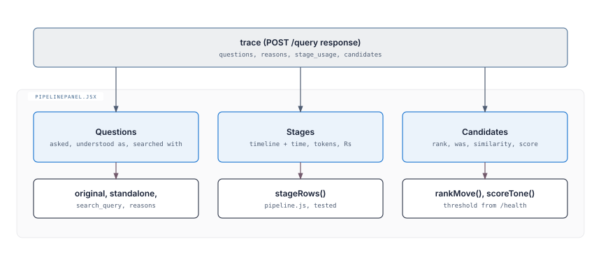
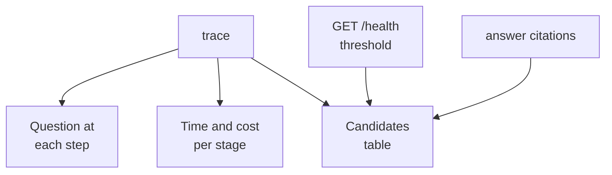
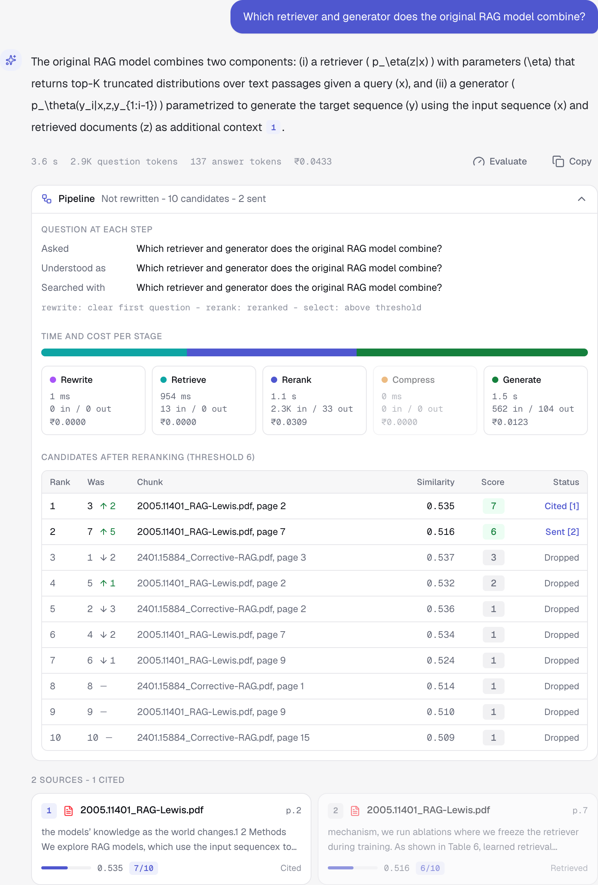
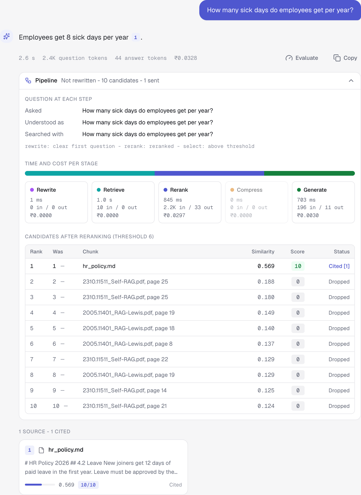

# 03. Pipeline Panel

In this doc:

- Why every answer shows what the pipeline did
- The three parts of the panel and the trace fields behind them
- Reading two real examples: a reranked paper question and an HR question
- Reranker scores on the source cards
- The helpers in pipeline.js and their tests
- Design choices

Files: [src/features/chat/PipelinePanel.jsx](../src/features/chat/PipelinePanel.jsx), [src/features/chat/pipeline.js](../src/features/chat/pipeline.js), [src/features/chat/pipeline.test.js](../src/features/chat/pipeline.test.js), [src/features/chat/SourceCards.jsx](../src/features/chat/SourceCards.jsx), [src/features/chat/ChatTurn.jsx](../src/features/chat/ChatTurn.jsx)

## Why Show the Pipeline

In Naive RAG an answer had one hidden step between question and answer: the top 4 search results. Advanced RAG has five stages that can each change the answer: a rewrite can misread the question, the reranker can drop the right chunk, the threshold can keep too few. The API already returns a trace of every stage (API docs 07 and 09). This panel puts it under each answer, so a user or developer can see **why** this answer came out, without reading server logs.

## The Three Parts

The panel is closed by default; a summary row ("Not rewritten - 10 candidates - 2 sent") opens it.

<table width="100%">
<thead><tr><th>Part</th><th>Shows</th><th>Trace fields</th></tr></thead>
<tbody>
<tr><td>Question at each step</td><td>Asked, understood as, searched with, and the reason line (rewrite, rerank, select)</td><td>original_question, standalone_question, search_query, rewrite_reason, rerank_reason, selection_reason</td></tr>
<tr><td>Time and cost per stage</td><td>A timeline bar sized by time, and for each stage its time, tokens in and out, and rupees; stages that did not run are faded</td><td>stage_usage</td></tr>
<tr><td>Candidates after reranking</td><td>All 10 candidates: new rank, old rank with an up or down arrow, file and page, similarity, reranker score (coloured against the threshold), and Cited [n], Sent [n] or Dropped</td><td>candidates, plus rerank_threshold from GET /health</td></tr>
</tbody>
</table>

## Example 1: Reranking Fixes the Order

"Which retriever and generator does the original RAG model combine?"

- **Question:** not rewritten (clear first question), so all three lines are the same.
- **Stages:** retrieve about 1 s, rerank 1.1 s and Rs 0.031, generate 1.5 s and Rs 0.012. The reranker costs more than the answer.
- **Candidates:** RAG paper page 2 was rank 3 by similarity (0.535) and becomes rank 1 with score 7, then is cited [1]. RAG paper page 7 jumps from rank 7 to rank 2 (score 6, sent but not cited). The Corrective RAG chunk that similarity ranked first (0.537) scores 3 and is dropped. Every similarity is between 0.509 and 0.537, which shows why similarity alone could not choose.

## Example 2: One Useful Chunk

"How many sick days do employees get per year?"

- **Candidates:** hr_policy.md scores 10 and is cited; the nine paper chunks score 0 and are dropped. Naive RAG would have sent four chunks here, three of them unrelated.
- **Stages:** generation reads only 196 tokens and costs Rs 0.003, against about Rs 0.017 with four chunks.

## Reranker Score on Source Cards

Each source card now shows the reranker score next to the similarity bar, for example "0.535  7/10". A reader sees at a glance both how similar the chunk is and how relevant the reranker judged it.

## The Helpers

All logic that turns the trace into numbers is in `pipeline.js`, separate from the component, so it is tested without rendering:

<table width="100%">
<thead><tr><th>Function</th><th>Does</th></tr></thead>
<tbody>
<tr><td>stageRows(stageUsage)</td><td>Five rows in pipeline order (zero for stages that did not run) with time, tokens, rupees and share of the total time</td></tr>
<tr><td>rankMove(candidate)</td><td>Places moved: retrieval rank minus final rank (positive means up)</td></tr>
<tr><td>scoreTone(score, threshold)</td><td>success at or above the threshold, warning up to 2 below, muted lower, neutral without a score</td></tr>
<tr><td>traceSummary(trace)</td><td>"Rewritten - 10 candidates - 4 sent", plus "compressed" when compression ran</td></tr>
</tbody>
</table>

Five new tests cover these (30 UI tests pass; lint and build are clean).

## Design Choices

<table width="100%">
<thead><tr><th>Choice</th><th>Why</th></tr></thead>
<tbody>
<tr><td>Closed by default</td><td>The answer stays the focus; the panel is for checking and debugging</td></tr>
<tr><td>Threshold from GET /health, not hard-coded</td><td>If RERANK_THRESHOLD changes in .env, the colours follow</td></tr>
<tr><td>Same colours per stage everywhere (chart tokens)</td><td>The timeline, the stage cards and later the analytics page use one colour per stage</td></tr>
<tr><td>Fixed column widths, chunk label gets the rest</td><td>File names and pages stay readable; numbers line up</td></tr>
<tr><td>Sent and Cited shown separately</td><td>A chunk can be sent but not cited (example 1, page 7): useful when reading context precision</td></tr>
</tbody>
</table>

## Key Points

- Every answer has a pipeline panel built from the API trace: questions at each step, time and cost per stage, and all candidates with ranks, scores and status.
- The examples show the two main effects of Advanced RAG: better order (rank 3 to 1) and fewer, relevant chunks (1 instead of 4).
- Source cards show the reranker score next to the similarity.
