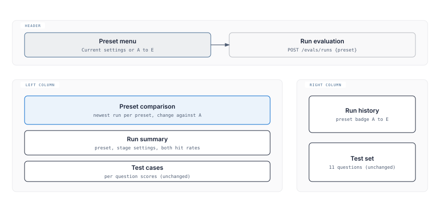
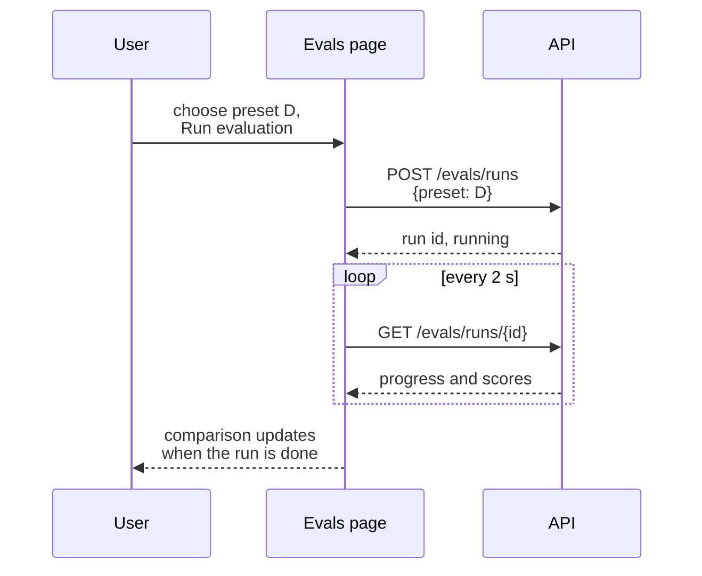
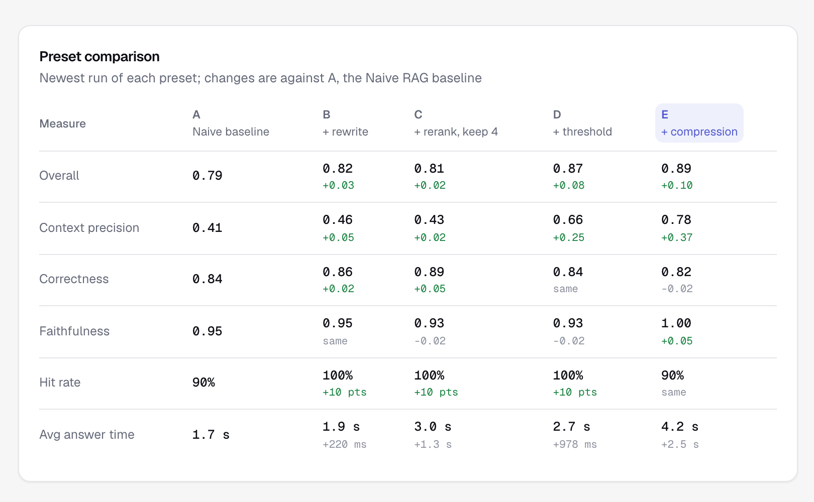
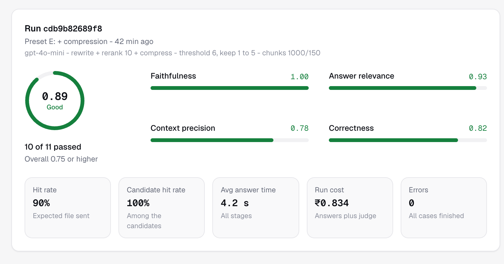
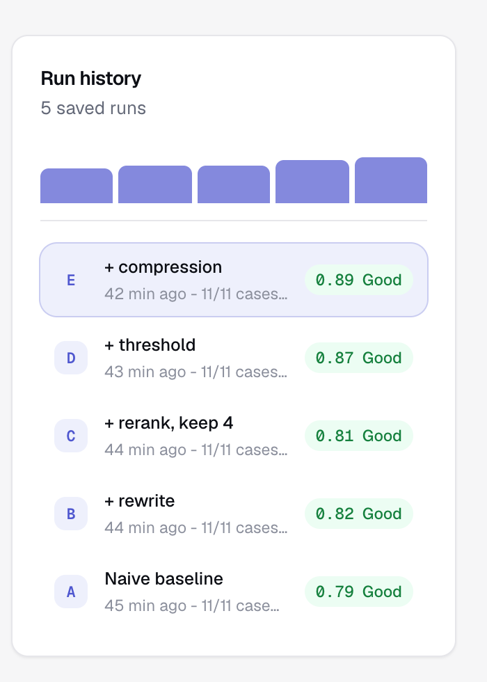

# 04. Evaluation Presets and Comparison

In this doc:

- What changed on the Evals page
- Running a preset from the UI
- The preset comparison card, and how to read it
- Run summary and history: preset and stage settings
- The helpers in compare.js and their tests

Files: [src/features/evals/EvalsPage.jsx](../src/features/evals/EvalsPage.jsx), [src/features/evals/PresetComparison.jsx](../src/features/evals/PresetComparison.jsx), [src/features/evals/compare.js](../src/features/evals/compare.js), [src/features/evals/compare.test.js](../src/features/evals/compare.test.js), [src/features/evals/RunSummary.jsx](../src/features/evals/RunSummary.jsx), [src/features/evals/RunHistory.jsx](../src/features/evals/RunHistory.jsx), [src/api/client.js](../src/api/client.js), [src/api/queries.js](../src/api/queries.js)

## What Changed

The Naive Evals page (Naive UI doc 11) ran the test set with a chosen top k. The Advanced API replaced top k with ablation presets A to E (API doc 10), so the page now runs presets and compares them.

<table width="100%">
<thead><tr><th>Part</th><th>Naive UI</th><th>Advanced UI</th></tr></thead>
<tbody>
<tr><td>Header menu</td><td>Top k: default, 2, 4, 6, 8</td><td>Preset: current settings, or A to E with a short description</td></tr>
<tr><td>Above the run</td><td>-</td><td>Preset comparison card</td></tr>
<tr><td>Run summary</td><td>Model, top k, chunk size</td><td>Preset, stages on (rewrite, rerank 10, compress), threshold and chunk limits; hit rate and candidate hit rate</td></tr>
<tr><td>Run history</td><td>Time, top k, cost</td><td>Preset badge (A to E) and label, time, cost</td></tr>
</tbody>
</table>

## Running a Preset

1. Choose a preset in the header menu (for example "D  + threshold: Rewrite, rerank, keep 1 to 5 chunks scoring 6 or more").
2. Click "Run evaluation". The request is `POST /evals/runs {"preset": "D"}`.
3. The run appears in the history with its badge and fills in case by case (polled every 2 seconds, as in the Naive UI).

Presets come from `GET /evals/presets`, cached for the session because they only change with the API code. The preset changes the settings only for the run's own thread (API doc 10), so chat questions asked during a run are not affected.

## The Comparison Card

The card shows the **newest finished run of each preset** side by side. Under every value is its change against A, the Naive RAG baseline: green when it improved, grey when it got worse, "same" when unchanged. For time, lower is better, so a longer time is grey.

How to read the numbers above (from API doc 11):

- **Context precision** rises a little with rewrite and reranking alone (0.46, 0.43) and jumps with the threshold (D: 0.66, plus 0.25).
- **Correctness** is 0.84 in both A and D: Advanced RAG removed noise without losing answers, but did not add correct answers either.
- **Hit rate** goes from 90 to 100 percent as soon as the rewrite runs (B).
- **Time** grows with every model call: plus 0.2 s for the rewrite, about plus 1 s for reranking, plus 2.5 s with compression.

Clicking a column header opens that run below. The card appears once at least two presets have finished.

## Run Summary and History

<table width="100%">
<thead><tr><th>Run summary</th><th>Run history</th></tr></thead>
<tbody>
<tr><td></td><td></td></tr>
</tbody>
</table>

- **Summary subtitle:** "Preset E: + compression", then the stages and limits that ran: "rewrite + rerank 10 + compress - threshold 6, keep 1 to 5". Built from the `pipeline` object every report stores, so it is correct even for runs made with the current settings.
- **Two hit rates:** "Hit rate" (expected file among the chunks sent) and "Candidate hit rate" (among the 10 candidates). The gap between them shows how often the reranker and threshold dropped the right file: in E, 100 percent of candidates but 90 percent sent.
- **History:** each run has a badge with its preset letter and a short label of what that preset adds.

## The Helpers

<table width="100%">
<thead><tr><th>Function</th><th>Does</th></tr></thead>
<tbody>
<tr><td>latestByPreset(runs)</td><td>Newest finished run of each preset, in the order A to E (runs come newest first; running and unfinished runs are skipped)</td></tr>
<tr><td>deltaFrom(baseline, run, key)</td><td>Value minus baseline, null when either is missing</td></tr>
<tr><td>isBetter(delta, lowerIsBetter)</td><td>True, false, or null for no change; time is "lower is better"</td></tr>
<tr><td>presetLabel(preset)</td><td>"+ threshold" for D, "Current settings" without preset</td></tr>
</tbody>
</table>

Short labels describe what each preset **adds** ("+ rewrite"), because the API names ("A + rewrite") read badly next to the letter of the preset that has them. 35 UI tests pass; lint and build are clean.

## Key Points

- The Evals page runs presets A to E instead of a top k choice.
- A comparison card shows the newest run of each preset with its change against the Naive baseline, metric by metric.
- Run summaries show the preset, the stages and limits used, and both hit rates.
