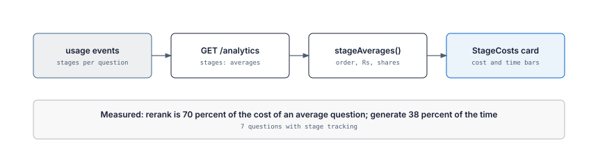
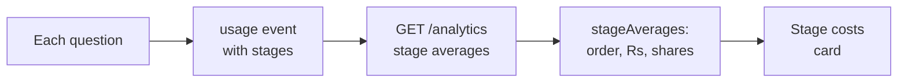
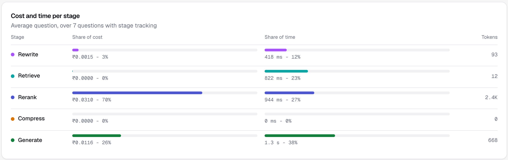

# 05. Stage Analytics

In this doc:

- Why the Analytics page needs a per-stage view
- The Stage costs card and how to read it
- stageAverages() and its tests
- Other Analytics changes

Files: [src/features/analytics/StageCosts.jsx](../src/features/analytics/StageCosts.jsx), [src/features/analytics/analytics.js](../src/features/analytics/analytics.js), [src/features/analytics/analytics.test.js](../src/features/analytics/analytics.test.js), [src/features/analytics/AnalyticsPage.jsx](../src/features/analytics/AnalyticsPage.jsx)

## Why

The pipeline panel (doc 03) shows the stages of one answer. To decide what to optimise, the averages over many questions matter: which stage costs most and which is slowest on a typical question. The API records the split of every question and GET /analytics returns per-stage averages (API doc 09). This card shows them.





## The Card



One row per stage in pipeline order, coloured as in the pipeline panel:

<table width="100%">
<thead><tr><th>Column</th><th>Meaning</th></tr></thead>
<tbody>
<tr><td>Share of cost</td><td>Bar for the stage's share of the average question's cost, with rupees and percent</td></tr>
<tr><td>Share of time</td><td>Bar for the stage's share of the average question's time, with milliseconds and percent</td></tr>
<tr><td>Tokens</td><td>Average tokens the stage uses</td></tr>
</tbody>
</table>

Reading the numbers above (7 questions with stage tracking):

- **Rerank is 70 percent of the cost** (Rs 0.031 of about Rs 0.045): the largest single lever on cost, as API doc 09 found.
- **Generate is 38 percent of the time** (1.3 s), rerank 27 percent (0.9 s), retrieve 23 percent (0.8 s, including the slower first embedding call after start-up).
- **Rewrite is cheap** (Rs 0.0015) because most questions skip it.
- **Compress is 0** because it is off by default.

Only questions asked through the chat (`kind = query`) with stage data are averaged, so evaluation runs and older events do not distort it.

## stageAverages()

```js
export function stageAverages(stages = {}, rate = 84) {
  const known = STAGES.filter((stage) => stages[stage.name])
  ...
  return known.map((stage) => ({ ...stage, runs, tokens, ms, inr, costShare, timeShare }))
}
```

- Stages come back from the API in any order; the helper uses the same `STAGES` list as the pipeline panel, so order, labels and colours match everywhere.
- Shares are of the sum over stages, so the bars of one column add up to 100 percent.

Two tests: pipeline order with rupees and shares, and an empty result when no stage data exists (37 UI tests pass).

## Other Changes

- The "Avg answer time" tile now says "All pipeline stages" instead of "Embed, search and generate".
- With no tracked question yet, the card says so and points to the chat.

## Key Points

- The Analytics page shows the cost and time of each stage for an average question.
- Measured: reranking is 70 percent of the cost and generation 38 percent of the time.
- One stage list (STAGES) drives order and colours in both the pipeline panel and the analytics card.
